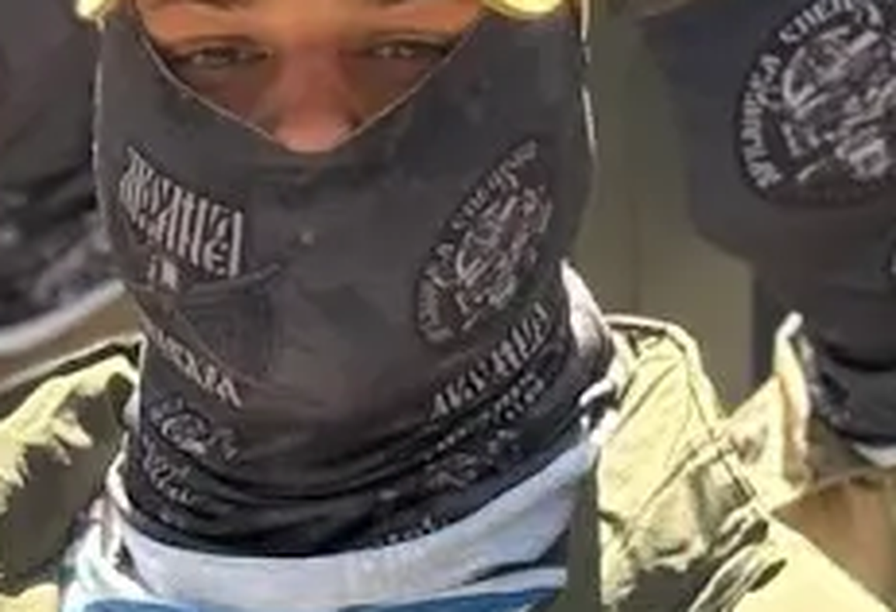

# ANO DPO Obrazovatelny Tsentr Gagaring (Gagaring Educational Center, autonomous non-profit supplementary-professional-education org) — АНО ДПО «Образовательный центр Гагаринг»

`WB: not_checked` 

ИНН 2310240630 · ОГРН 1252300026208

## At a glance

- **Legal form:** ANO (autonomous non-profit organisation)
- **Registered:** 26.05.2025
- **Director:** Безроднова Анна Сергеевна
- **ЦБСТ tie:** confirmed
- **Wildberries overlap:** not_checked

## Ownership & corporate history

### Director

| Value | As of | Note |
|---|---|---|
| Безроднова Анна Сергеевна | 2026-09-03 | per egrul.nalog.ru open-API search result [s5371] |

### Founders / ownership

| Value | As of | Note |
|---|---|---|
| ООО «Гагаринг» (ИНН 2312321660) — учредитель, per Гагаринг's own FY2025 audit report | 2025-12-31 |  [s5333] |

## Images

-  — Cropped frame from Гагаринг's own 2026-08-04 graduation video, showing graduates' face-buffs with a circular emblem reading approximately «УДАРНАЯ СПЕЦНАЗ...» and text visually resembling «АРХАНГЕЛ» (not OCR-confirmed). [s5382]

## Principals & persons of interest

_No named principals linked to this entity yet._

## Open questions

- Physical location of the training center not yet confirmed by an independent source (cadastral/NSPD, local press, or a geolocated photo). s5378 (24.02.2026 opening post) names no address; s5380 (01.03.2026) separately names "школа «Архангел» в Туапсе" visited by the same team days later — plausibly the same facility, not confirmed. s5613/s5597/s5605/s5606 (Feb 2026 posts) establish it is explicitly the training center of the 51-я Гвардейская Общевойсковая Армия, opened with «Архангел Легион» fund, «проект Архангел», КБ «Ветер» and «Рубикон» present at a 21.02.2026 coordination meeting (s5375) — none of those organizations besides Гагаринг are yet profiled in this registry. Гагаринг's own YouTube channel (s5383/s5382/s5384, uploaded 2026-08-04, same graduation ceremony as s5372) confirms Гагаринг itself produced and published video of the event, but the background is a plain corrugated-metal wall with no identifiable landmarks — user-confirmed geolocation is not feasible from this frame. Graduates' face-buffs carry a circular emblem reading approximately "УДАРНАЯ СПЕЦНАЗ..." with stacked text visually resembling "АРХАНГЕЛ" (s5382, not OCR-confirmed at available resolution) — a possible additional branding link to the Архангел network beyond the timing/personnel overlap already noted, but not a confirmed one. Full video not retrievable from this session's sandboxed network (YouTube CDN 403s without a browser session); only the thumbnail was archived. [s5378]
- Full EGRUL extract not yet pulled (only the egrul.nalog.ru open-API summary result, s5371) — a proper extract would give the registered legal address, which may itself only be a Krasnodar mailbox rather than the training site, per the established Гагаринг address pattern.

## Sources cited in this profile

| ID | Type | Locator | Captured | As of |
|---|---|---|---|---|
| s5333 | Fedresurs | Fedresurs (FEDRESURS_939B297414FA48A4A4B3497315AF3659_20260903_gagaring-audit-report-2025fy-full.pdf) | 2026-09-03 | — |
| s5371 | EGRUL extract | EGRUL extract (EGRUL_2310240630_20260903_open-api-search-result.json) | 2026-09-03 | 2026-09-03 |
| s5378 | Tgpost | Tgpost (TGPOST_projectArchangel_9613_20260224.txt) | 2026-02-24 | 2026-02-24 |
| s5382 | Youtube | Youtube (YOUTUBE_20260804_gagaring-vypusk-shkoly-fpv-mask-crop.png) | 2026-08-04 | 2026-08-04 |

---
_Generated from this investigation's registry (`data/registry/`) by `scripts/build_company_profile.py`. Not a substitute for reading the underlying primary sources listed above._