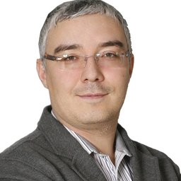

# АНО «Платформа НТИ»

`sanctioned` `plumbing` `WB: not_checked` 

ИНН 7703469180 · ОГРН 1197700000376

## At a glance

- **Legal form:** ANO (autonomous non-profit organisation)
- **Registered:** 14.01.2019
- **Address:** 123424, Москва, пер. Малый Конюшковский, д. 2, помещ. 1/6
- **Director:** (Наблюдательный совет — коллегиальный высший орган, состав 11 чел.)
- **Wildberries overlap:** not_checked

## Ownership & corporate history

### Director

| Value | As of | Note |
|---|---|---|
| Наблюдательный совет established 14.01.2019 per АСИ protocol №3 от 12.12.2018 | 2019-01-14 |  [s0443] |
| Песков Дмитрий Николаевич | 2021-03-26 | Должность: ГЕНЕРАЛЬНЫЙ ДИРЕКТОР, личный ИНН 772919018611. Full signed ЕГРЮЛ выписка pulled 2026-09-07. [s6817] |

## Financials

| Year | Revenue | Profit | Source |
|---|---|---|---|
| 2021 | — | ₽-3,057,000 | [s6550] |
| 2022 | — | ₽21,191,000 | [s6551] |
| 2023 | ₽1,250,000 | ₽-11,005,000 | [s6552] |
| 2024 | ₽8,453,000 | ₽1,480,000 | [s6553] |
| 2025 | ₽1,616,000 | ₽-3,637,000 | [s6554] |

## Trademarks

| Mark | Reg. no. | Filed | Registered | Classes |
|---|---|---|---|---|
| — | 890585 | 20210609 | 06.09.2022 | 09 (broad catch-all filing, no UAV/defense-specific items); 16 (broad catch-all filing, no UAV/defense-specific items); 38 (broad catch-all filing, no UAV/defense-specific items) |
| — | 899377 | 20210609 | 18.10.2022 | 16 (broad catch-all filing, no UAV/defense-specific items); 41 (UAV/defense terms present: дрон) |

## Sanctions & screening

**Ukraine (Presidential sanctions decree/list)** [s0765]

- 1 OpenSanctions match(es) (screened 2026-09-06).
- 5 OCCRP Aleph match(es) (screened 2026-09-05).

## Principals & persons of interest

### Дмитрий Песков

- **DOB:** 26.12.1975
- **Birthplace:** Воронеж (Voronezh)
- **ИНН:** 772919018611
- Presidential special representative for digital and technological development; CEO, АНО «Платформа НТИ»

## Corporate links

- **АНО «НПЦ «Ушкуйник»»** — учредитель [s0443]
- **АНО «НПЦ Колыбель БАС Калужской области»** — учредитель [s0443]
- **АНО «НПЦ БАС «Белгород»»** — учредитель [s0443]
- **АНО «НПЦ БАС Нижегородской области»** — учредитель [s0443]
- **АНО «НПЦ БАС Самара»** — учредитель [s0443]
- **АНО «Федеральный центр беспилотных авиационных систем» (ФЦ БАС)** — учредитель [s0443]
- **Фонд поддержки проектов Национальной технологической инициативы** — учредитель (фонд) [s0443]

## Sources cited in this profile

| ID | Type | Locator | Captured | As of |
|---|---|---|---|---|
| [s0443] | document | document (990fb105-2bfd-4bd4-b6e0-bfadc3a6a2e6.pdf) | — | 2025-12-31 |
| [s0765] | OpenSanctions screening record | OpenSanctions screening record (OPENSANCTIONS_7703469180_20260824_ano-platforma-nti.json) | 2026-08-24 | — |
| [s6550] | Bfo | Bfo (BFO_7703469180_2021_ано-платформа-нти.pdf) | — | — |
| [s6551] | Bfo | Bfo (BFO_7703469180_2022_ано-платформа-нти.pdf) | — | — |
| [s6552] | Bfo | Bfo (BFO_7703469180_2023_ано-платформа-нти.pdf) | — | — |
| [s6553] | Bfo | Bfo (BFO_7703469180_2024_ано-платформа-нти.pdf) | — | — |
| [s6554] | Bfo | Bfo (BFO_7703469180_2025_ано-платформа-нти.pdf) | — | — |
| [s6817] | EGRUL extract | EGRUL extract (EGRUL_7703469180_20260907_ano-platforma-nti.pdf) | 2026-09-07 | 2026-09-07 |

---
_Generated from this investigation's registry (`data/registry/`) by `scripts/build_company_profile.py`. Not a substitute for reading the underlying primary sources listed above._