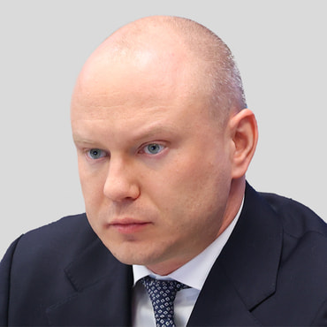

# Autonomous Non-Profit Organization "The Center for Uncrewed Vehicle Systems and Technology" (ЦБСТ's own EGRUL-registered English name) — АНО «ЦБСТ» | Centre for Unmanned Systems & Technologies

`sanctioned` `cbst-core` `WB: not_checked` 

ИНН 9702064851 · ОГРН 1247700190430

## At a glance

- **Legal form:** ANO (autonomous non-profit organisation)
- **Address:** 129110, Москва, пер. Банный, д. 3, помещ. 208
- **Director:** Яныкина Нина Олеговна
- **ОКВЭД:** 73.20.1 — Исследование конъюнктуры рынка (market research) — main code as of 02.04.2026; secondary codes cover publishing (58.11/13/14/19), software development (62.01), R&D (72.19) and conference organising (82.30). Nothing defence-coded.
- **Wildberries overlap:** not_checked

## Ownership & corporate history

### Director

| Value | As of | Note |
|---|---|---|
| Яныкина Нина Олеговна | 2025-12-16 | GRN 2257724392760 — became GD 16.12.2025, per ЦБСТ's own full signed EGRUL extract (pulled 15.08.2026). [s0228] |

### Founders / ownership

| Value | As of | Note |
|---|---|---|
| Фонд «Наша Правда» | 2024-02-27 | co-founder from inception, ИНН 9705196180. [s0228] |
| ПАО «Банк ПСБ» | 2025-04-01 | GRN 2257715371901 — joined as second founder 01.04.2025. [s0228] |

### Address

| Value | As of | Note |
|---|---|---|
| 129110, Москва, пер. Банный, д. 3, помещ. 208 | 2024-02-27 |  [s0228] |

## Financials

| Year | Revenue | Profit | Source |
|---|---|---|---|
| 2024 | — | — | [s0384] |
| 2025 | — | — | [s0387] |

## Sanctions & screening

**US (OFAC, Russia Harmful Foreign Activities Sanctions), Canada (Special Economic Measures Act), Australia (Autonomous Sanctions, Russia), Ukraine (war-sanctions.gur.gov.ua, military-industry listing), Ukraine (Presidential sanctions decree/list)** [s0574]

- 1 OpenSanctions match(es) (screened 2026-08-24).
- 3 OCCRP Aleph match(es) (screened 2026-08-26).

## Web & social presence

### Website

- <https://cbst.ru/> — Confirmed via convergent third-party business registries (Kontur.Focus, RBC Companies) all citing ИНН 9702064851/ОГРН 1247700190430/GD Яныкина Нина Олеговна against this domain; cbst.ru's own /about page doesn't self-state ИНН (checked directly), so this rests on registry-aggregator corroboration rather than the site's own text.

## Principals & persons of interest

### Андрей Анатольевич Безруков

- **DOB:** 1986-07-29
- **Address:** г. Москва, пер. Красина, д. 16, стр. 2, кв. 103; г. Санкт-Петербург, ул. Лёни Голикова, д. 29/8, кв. 162
- **ИНН:** 519031542137
- Chairman of the Board (правление), ЦБСТ
- `sanctions lead`

### Нина Олеговна Яныкина

- **ИНН:** 780158807980
- General Director, АНО «ЦБСТ» (2025-12-16–present)
- `sanctions lead`

## Corporate links

- **Center for Unmanned Systems LLC (Tula)** — OpenSanctions merges this Tula ООО (ИНН 7100032961, reg. 08.02.2023, directly OFAC/EO14024- designated) into the same deduped profile as this Moscow АНО, sharing "ЦБСТ"/"TSBS" branding and aliases. Relationship not established as of 2026-08-24 — see the Tula entity's own open_questions for what would resolve it. [s0572]

## Open questions

- screen_opensanctions.py (2026-08-24) surfaced that OpenSanctions' deduped profile for this ИНН carries an OFAC/EO14024 designation whose own explicit ID numbers actually belong to a separate, previously-untracked Tula entity (ooo-tsentr-bespilotnykh-sistem-tula, ИНН 7100032961, registered a year before this АНО). Do NOT read this as confirmation that АНО «ЦБСТ» itself carries a direct US OFAC designation under its own Moscow ИНН — that specific claim is NOT established. What IS established: a same-branded, earlier-registered Tula entity is OFAC-designated, and the exact relationship between the two needs a primary-source EGRUL/ownership check. [s0572]
- GUR's foreign-components-in-weapons catalogue lists two component sets for a weapon item titled "Delta (CBTS.611000, sample No.1)" and "...sample No.2)" — a long-range, gasoline-engine fixed-wing UAV (DLE-60 two-stroke engine, RFD900X long-range telemetry, airspeed/Pitot sensors, RTK navigation modules), pulled and read in full 2026-08-24 (23 components across both samples). CORRECTION (user-flagged, 2026-08-24): "CBTS" is NOT a plausible transliteration of ЦБСТ — the standard transliteration of Ц is "Ts", giving TsBST, not CBTS. There is no linguistic basis for reading "CBTS.611000" as a ЦБСТ reference; the resemblance is coincidental letter overlap only. GUR's own page gives no attribution whatsoever — no manufacturer, no company, no ИНН. Recorded here only because it was pulled and read; there is currently no basis to treat it as related to ЦБСТ, this registry's manufacturer roster, or any entity in it. Left as a parked, unattributed weapon-item record, not an open question implying a ЦБСТ connection. [s0970]
- Full scan of Сидякин's personal Telegram channel (@asidyakin, 2026-08-25, back to 22.02.2022 — real history starts 2025-05-19) surfaced three unresolved brand names in ЦБСТ/«Наша Правда» equipment-delivery posts (msg 6 and 145, both 19-20.05.2025, 76-я гвардейская десантно-штурмовая бригада): «Локтар» (программно-аппаратные комплексы — software-hardware complexes, no further detail), «Шорох» and «Грань» (комплексы связи для поддержки штурмовых групп — communications complexes for assault groups). No legal entity, ИНН, or manufacturer name given for any of the three — not yet resolvable to a registry entity. «Стратим» and «КингПро» drones in the same posts are already-known residents (corroborating evidence, not new). «Русак», «Голубь-Т», «Секира 13», «Воробей» in the same posts are also already-known products.
- Same channel scan (@asidyakin, msg 680, 19.01.2026) also surfaced thermal sight brands «Кречет», «Аркон» and «Рубеж» delivered to БАРС-Курск brigade alongside UAZ vehicles — these are accessories/optics, not drones, and no manufacturer/ИНН given; unclear if these come from a ЦБСТ resident or a separate third-party defense-optics supplier. Not yet resolvable.

## Sources cited in this profile

| ID | Type | Locator | Captured | As of |
|---|---|---|---|---|
| s0228 | EGRUL extract | EGRUL extract (ul-1247700190430-20260815005804.pdf) | — | 2026-08-15 |
| s0384 | БФО annual-accounts filing | БФО annual-accounts filing (РЕСУРС_БФО_9702064851_2024_20260816.zip) | 2026-08-16 | 2024-12-31 |
| s0387 | БФО annual-accounts filing | БФО annual-accounts filing (РЕСУРС_БФО_9702064851_2025_20260816.zip) | 2026-08-16 | 2025-12-31 |
| s0572 | EGRUL open-API record | EGRUL open-API record (EGRULAPI_7100032961_20260824_ooo-tsentr-bespilotnykh-sistem-tula.json) | 2026-08-24 | 2026-08-24 |
| s0574 | OpenSanctions screening record | OpenSanctions screening record (OPENSANCTIONS_9702064851_20260824_ano-tsbst-centre-for-unmanned-systems-technologies.json) | 2026-08-24 | — |
| s0970 | GUR war-sanctions record | GUR war-sanctions record (GUR_20260824_delta-cbts611000-sample1.html) | 2026-08-24 | — |

---
_Generated from this investigation's registry (`data/registry/`) by `scripts/build_company_profile.py`. Not a substitute for reading the underlying primary sources listed above._