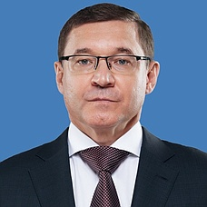
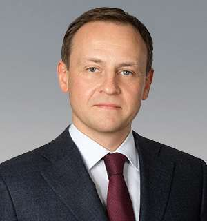
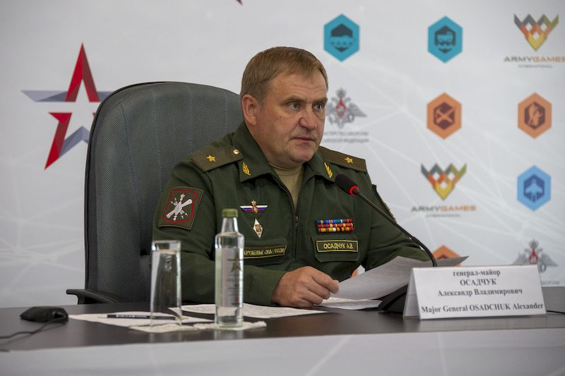
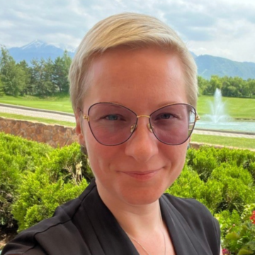

# Autonomous Non-Profit Organization "The Center for Uncrewed Vehicle Systems and Technology" (ЦБСТ's own EGRUL-registered English name) — АНО «ЦБСТ» | Centre for Unmanned Systems & Technologies

`sanctioned` `cbst-core` `WB: not_checked` 

ИНН 9702064851 · ОГРН 1247700190430

## At a glance

- **Legal form:** ANO (autonomous non-profit organisation)
- **Address:** 129110, Москва, пер. Банный, д. 3, помещ. 208
- **Director:** Яныкина Нина Олеговна
- **ОКВЭД:** 73.20.1 — Исследование конъюнктуры рынка (market research) — main code as of 02.04.2026; secondary codes cover publishing (58.11/13/14/19), software development (62.01), R&D (72.19) and conference organising (82.30). Nothing defence-coded.
- **Wildberries overlap:** not_checked

## Ownership & corporate history

### Director

| Value | As of | Note |
|---|---|---|
| Яныкина Нина Олеговна | 2025-12-16 | GRN 2257724392760 — became GD 16.12.2025, per ЦБСТ's own full signed EGRUL extract (pulled 15.08.2026). [s0228] |

### Founders / ownership

| Value | As of | Note |
|---|---|---|
| Фонд «Наша Правда» | 2024-02-27 | co-founder from inception, ИНН 9705196180. [s0228] |
| ПАО «Банк ПСБ» | 2025-04-01 | GRN 2257715371901 — joined as second founder 01.04.2025. [s0228] |

### Address

| Value | As of | Note |
|---|---|---|
| 129110, Москва, пер. Банный, д. 3, помещ. 208 | 2024-02-27 |  [s0228] |

## Financials

| Year | Revenue | Profit | Source |
|---|---|---|---|
| 2024 | — | — | [s0384] |
| 2024 | — | — | [s0382] |
| 2024 | — | — | [s0383] |
| 2025 | — | — | [s0387] |
| 2025 | — | — | [s0385] |
| 2025 | — | — | [s0386] |

## State-program participation

- as_of: 2026-07-21; name_en: «СВОё дело с Ростех» (Rostec technology-initiatives programme for demobilised SVO participants); name_ru: «СВОё дело с Ростех»; role: Named partner of Ростех's programme: signed the 10.12.2025 cooperation agreement, runs expert review and accelerator places for selected projects («Наша организация отвечает за экспертизу и поддержку развития отобранных проектов»). [s8655]

## Sanctions & screening

**Ukraine (GUR war-sanctions portal, own listing), Ukraine (NSDC State Register, own entry per OpenSanctions merged profile)** [s8251]

- 1 OpenSanctions match(es) (screened 2026-09-06).
- 3 OCCRP Aleph match(es) (screened 2026-09-19).

## Web & social presence

### Website

- <https://cbst.ru/> — Confirmed via convergent third-party business registries (Kontur.Focus, RBC Companies) all citing ИНН 9702064851/ОГРН 1247700190430/GD Яныкина Нина Олеговна against this domain; cbst.ru's own /about page doesn't self-state ИНН (checked directly), so this rests on registry-aggregator corroboration rather than the site's own text.

### Telegram

- <https://t.me/ANO_CBST>

## Images

-  — Company logo, from the organization's own official site (cbst.ru). [s7536]

## Principals & persons of interest

### Владимир Владимирович Якушев

- **DOB:** 14.06.1968
- **Birthplace:** Нефтекамск, Башкортостан (Neftekamsk, Bashkortostan)
- **ИНН:** 890304549930
- Chairman of the Supervisory Board; Secretary of United Russia's General Council; First Deputy Chairman of the Federation Council (2025-02-14–present)

### Андрей Анатольевич Безруков

- **DOB:** 29.07.1986
- **Address:** г. Москва, пер. Красина, д. 16, стр. 2, кв. 103; г. Санкт-Петербург, ул. Лёни Голикова, д. 29/8, кв. 162
- **ИНН:** 519031542137
- Chairman of the Board (правление), ЦБСТ
- `sanctions lead`

### Александр Геннадьевич Сидякин

- **DOB:** 17.11.1977
- **Birthplace:** Сегежа, Карелия (Segezha, Karelia)
- **Address:** г. Москва, Княжеская ул., д. 8А; г. Москва, ул. Фестивальная, д. 73, корп. 3, кв. 71; Респ. Татарстан, г. Казань, ул. Апастовская, д. 11А, кв. 11
- **ИНН:** 690900262387
- Secretary of the Supervisory Board; Head of United Russia’s Central Executive Committee (2025-07-18–present)
- Member of the Supervisory Board (2025-06-19–present)
- Member of the Board (правление) (2025-06-24–present)
- `sanctions lead`
- <https://t.me/asidyakin>
- <https://vk.com/a_sidyakin>

### Кирилл Лысогорский

- **DOB:** 19.04.1986
- **Birthplace:** Ванадзор, Армения (Vanadzor, Armenia)
- **ИНН:** 772705212594
- Deputy Minister of Industry and Trade
- `sanctions lead`

### Михаил Кузнецов

- Head of the Executive Committee, ОНФ (Popular Front)

### Александр Осадчук

- **DOB:** 17.11.1962
- **Birthplace:** Обнинск, Калужская область (Obninsk, Kaluga Oblast)
- **Address:** г. Москва, ул. Металлургов, д. 62, кв. 155; Московская обл., г. Химки, ул. Горшина, д. 1, кв. 724
- **ИНН:** 772027207786
- Head of the Main Directorate for Innovative Development (ГУИР), Ministry of Defence
- `sanctions lead`

### Нина Олеговна Яныкина

- **DOB:** 23.07.1985
- **ИНН:** 780158807980
- General Director, АНО «ЦБСТ» (2025-12-16–present)
- `sanctions lead`

### Дмитрий Владимирович Рубинштейн

- **DOB:** 13.04.1975
- **ИНН:** 771537069549
- General Director, АНО «ЦБСТ», appointed July 2024, until late 2025 (2024-07–present)
- `sanctions lead`

## Corporate links

- **ООО «МПТМ»** — участник (доля не указана) [s0207]

## Open questions

- screen_opensanctions.py (2026-08-24) surfaced that OpenSanctions' deduped profile for this ИНН carries an OFAC/EO14024 designation whose own explicit ID numbers actually belong to a separate, previously-untracked Tula entity (ooo-tsentr-bespilotnykh-sistem-tula, ИНН 7100032961, registered a year before this АНО). Do NOT read this as confirmation that АНО «ЦБСТ» itself carries a direct US OFAC designation under its own Moscow ИНН — that specific claim is NOT established. What IS established: a same-branded, earlier-registered Tula entity is OFAC-designated, and the exact relationship between the two needs a primary-source EGRUL/ownership check. [s0572]
- GUR's foreign-components-in-weapons catalogue lists two component sets for a weapon item titled "Delta (CBTS.611000, sample No.1)" and "...sample No.2)" — a long-range, gasoline-engine fixed-wing UAV (DLE-60 two-stroke engine, RFD900X long-range telemetry, airspeed/Pitot sensors, RTK navigation modules), pulled and read in full 2026-08-24 (23 components across both samples). CORRECTION (user-flagged, 2026-08-24): "CBTS" is NOT a plausible transliteration of ЦБСТ — the standard transliteration of Ц is "Ts", giving TsBST, not CBTS. There is no linguistic basis for reading "CBTS.611000" as a ЦБСТ reference; the resemblance is coincidental letter overlap only. GUR's own page gives no attribution whatsoever — no manufacturer, no company, no ИНН. Recorded here only because it was pulled and read; there is currently no basis to treat it as related to ЦБСТ, this registry's manufacturer roster, or any entity in it. Left as a parked, unattributed weapon-item record, not an open question implying a ЦБСТ connection. [s0970]
- Full scan of Сидякин's personal Telegram channel (@asidyakin, 2026-08-25, back to 22.02.2022 — real history starts 2025-05-19) surfaced three unresolved brand names in ЦБСТ/«Наша Правда» equipment-delivery posts (msg 6 and 145, both 19-20.05.2025, 76-я гвардейская десантно-штурмовая бригада): «Локтар» (программно-аппаратные комплексы — software-hardware complexes, no further detail), «Шорох» and «Грань» (комплексы связи для поддержки штурмовых групп — communications complexes for assault groups). No legal entity, ИНН, or manufacturer name given for any of the three — not yet resolvable to a registry entity. «Стратим» and «КингПро» drones in the same posts are already-known residents (corroborating evidence, not new). «Русак», «Голубь-Т», «Секира 13», «Воробей» in the same posts are also already-known products.
- Same channel scan (@asidyakin, msg 680, 19.01.2026) also surfaced thermal sight brands «Кречет», «Аркон» and «Рубеж» delivered to БАРС-Курск brigade alongside UAZ vehicles — these are accessories/optics, not drones, and no manufacturer/ИНН given; unclear if these come from a ЦБСТ resident or a separate third-party defense-optics supplier. Not yet resolvable.
- The «Переговорка» transcript's ₽14bn Единая Россия 'front aid' figure (since 2024) is party-wide across all humanitarian/military aid categories, not a ЦБСТ-specific or drone-only figure -- do not cite it as ЦБСТ's own budget or as UAV-specific spending without re-reading the exact wording. Worth drafting into docs/index.html as a properly scoped quote once the narrative section is next revised. [s0178]
- Post-publication edits that remove or shorten resident names, found by comparing ЦБСТ posts with forwards of them (scripts/tg_forward_diff.py, 2026-10-01; 251 of 2308 posts have a forward, so this is a floor): post 410 (01.02.2025) lost «Площадь», «Стратим» [s8664 vs s8665]; post 1270 (24.09.2025) «СуперХроно» became «СХ» [s8669 vs s8670]; post 2080 (17.04.2026) lost «Титан Северо-Запад» [s8674 vs s8675]. Three of 251 comparable posts; motive unknown. [s8664]
- Residents named by ЦБСТ but NOT resolved to a legal entity (2026-10-01 sweep): «SR Space» (post 473; the ЕГРЮЛ holds АО «СР СПЕЙС» ИНН 9724017598, in bankruptcy proceedings since 2025, name match only, not wired); «Витрес» (post 597; several ООО «ВИТРЕС», none tied); «Основательные технологии» (post 2150, president Вячеслав Нечаев per Известия; no ЕГРЮЛ match by name); «GoDrone» («Набат», post 2382); «Квадросим»; «ИнПоинт» (accelerator II finalist, post 1976); makers of «Талисман»/«Зеркальце» (post 369) and «Койот». [s8672]
- 2026-10-01 lead review of the seven open ЦБСТ post warnings: (1) НПП «ЭЛВО», St Petersburg, named in ЦБСТ post 2209 as a participant of Accelerator stream II and partner of Кольская верфь on a hydrofoil unmanned boat; CORRECTION 2026-10-02: it IS in the registry as npp-elvo-kolskaya-verf (ИНН 7810918592, t-doc tie [s7604]); the first version of this note called it unrecorded because a lookup of the bare word «ЭЛВО» missed it (scripts/registry_lookup.py fixed 2026-10-02). (2) The maker of the interceptor «Молот-ПВО» named in post 2124 is unresolved; a press item about a different interceptor called «Молот» credits the Moscow company Nova Labs, which is unverified as the same product.
- 2026-10-02 triage of the resident sweep (503,714 posts) and ЦБСТ posts 457, 1102, 1557, 2463, 2538, 2541. (a) Named by ЦБСТ as residents or accelerator members, not in the registry, legal entity unresolved: «Антелекон» (post 2538, [s8872]: «Резидент ЦБСТ проведёт в Донбассе испытания нового антенного комплекса», antenna series АН5200-5800Ш17, tested at «полигоне ЦСН «БАРС-Сармат»»; antelecon.ru redirects to антелекон.рф, which did not answer on 2026-10-02, and the Wayback availability API listed no copy; a guessed domain is not an identifier, so no entity); «Аква-Волга» (Volgograd team, accelerator stream III, co-developer with ЭЛВО and Кольская верфь of the unmanned boat «Вектор», posts 2463 [s8870] and 2541 [s8873]); «Арьергард» (post 457, [s8868]: «резиденты АНО ЦБСТ, к примеру, компания Арьергард», exhibitor at NAIS 2025). (b) ООО «Прикладная робототехника Авиа» is a party to a cooperation agreement signed with ЦБСТ at the forum of 15.08.2025 (post 1102, [s8869]); ЦБСТ does not call it a resident. The channel the post links, @appliedrobotics, is the official channel of ООО «Прикладная робототехника» and its site prints ИНН 7730697556, ОГРН 5137746149680 ([s8874]); whether «…Авиа» is that company or a related one is not established, so no record is created. (c) Posts 1246 and 1557 ([s8889]) list drone names of resident companies without naming the company: «Русак» (a product of ООО «Стратим» 5260494520 per the GUR profile on file; that company is 25% owned by АО «Стратим», which has a ЦБСТ tie) and «Сибирячок» (ООО «Гаскар Интеграция» lists a «Сибирячок» on its own site, [s8013]). Product-name matches only, not ties. (d) The sweep listed АО «НПП» as NEW; it is on file as ao-npp-real (t-open tie): the posts shorten the name. [s8872]

## Sources cited in this profile

| ID | Type | Locator | Captured | As of |
|---|---|---|---|---|
| [s0178] | transcript | transcript (TRANSCRIPT_20250421_peregovorka-cbst-er-sidyakin-bezrukov.txt) | 2025-04-21 | — |
| [s0207] | document | document (bf074f6f-b83d-402b-a413-77c124e18ab0.pdf) | — | 2025-12-31 |
| [s0228] | EGRUL extract | EGRUL extract (ul-1247700190430-20260815005804.pdf) | — | 2026-08-15 |
| [s0382] | БФО annual-accounts filing | БФО annual-accounts filing (РЕСУРС_БФО_9702064851_2024_20260815.zip) | 2026-08-15 | 2024-12-31 |
| [s0383] | БФО annual-accounts filing | БФО annual-accounts filing (РЕСУРС_БФО_9702064851_2024_20260816 (1).zip) | — | 2024-12-31 |
| [s0384] | БФО annual-accounts filing | БФО annual-accounts filing (РЕСУРС_БФО_9702064851_2024_20260816.zip) | 2026-08-16 | 2024-12-31 |
| [s0385] | БФО annual-accounts filing | БФО annual-accounts filing (РЕСУРС_БФО_9702064851_2025_20260815.zip) | 2026-08-15 | 2025-12-31 |
| [s0386] | БФО annual-accounts filing | БФО annual-accounts filing (РЕСУРС_БФО_9702064851_2025_20260816 (1).zip) | — | 2025-12-31 |
| [s0387] | БФО annual-accounts filing | БФО annual-accounts filing (РЕСУРС_БФО_9702064851_2025_20260816.zip) | 2026-08-16 | 2025-12-31 |
| [s0572] | EGRUL open-API record | EGRUL open-API record (EGRULAPI_7100032961_20260824_ooo-tsentr-bespilotnykh-sistem-tula.json) | 2026-08-24 | 2026-08-24 |
| [s0970] | GUR war-sanctions record | GUR war-sanctions record (GUR_20260824_delta-cbts611000-sample1.html) | 2026-08-24 | — |
| [s7536] | site capture | site capture (SITE_9702064851_20260916_ano-tsbst-logo.png) | 2026-09-16 | — |
| [s8251] | GUR war-sanctions record | GUR war-sanctions record (GUR_9702064851_20260930_ano-tsbst-centre-for-unmanned-systems-technologies.html) | 2026-09-30 | — |
| [s8655] | Tgpost | Tgpost (TGPOST_20260721_ano_cbst-2343-svoe-delo-s-rostekh-100-applications-cbst-expertise.txt) | 2026-07-21 | — |
| [s8664] | Tgpost | Tgpost (TGPOST_20250201_ANO_CBST-410-name-removed-ploshchad-stratim.txt) | 2025-02-01 | — |
| [s8672] | Tgpost | Tgpost (TGPOST_20251126_ANO_CBST-1572-neiry-biodrony-golubi-resident.txt) | 2025-11-26 | — |
| [s8872] | Tgpost | Tgpost (TGPOST_20260917_ano_cbst-2538-antelekon-resident-antenna-test.txt) | 2026-09-17 | — |

---
_Generated from this investigation's registry (`data/registry/`) by `scripts/build_company_profile.py`. Not a substitute for reading the underlying primary sources listed above._