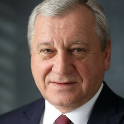

# АО «Аэромакс»

`sanctioned` `adjacent` `WB: not_checked` 

ИНН 7708407413 · ОГРН 1227700471020

## At a glance

- **Legal form:** AO (joint-stock company)
- **Registered:** 2022-08-04
- **Director:** Управляющая организация: ООО «Кронштадт-Техник»
- **Charter capital:** ₽10,000
- **Wildberries overlap:** not_checked

## Ownership & corporate history

### Director

| Value | As of | Note |
|---|---|---|
| Управляющая организация: ООО «Кронштадт-Техник» | 2026-08-24 | per egrul.nalog.ru open-API lookup, 2026-08-24 [s0949] |

### Founders / ownership

| Value | As of | Note |
|---|---|---|
| ОБЩЕСТВО С ОГРАНИЧЕННОЙ ОТВЕТСТВЕННОСТЬЮ "АЭРОМАКС" 100% (₽10 000) | 2022-08-04 | Full signed ЕГРЮЛ выписка pulled 2026-09-07 (egrul_vypiska_pull.py). [s6733] |

### Charter capital

| Value | As of | Note |
|---|---|---|
| 10000 | 2022-08-04 | Full signed ЕГРЮЛ выписка pulled 2026-09-07 (egrul_vypiska_pull.py). [s6733] |

## Products

- **БВС СТ AS-32-10** — Fixed-wing UAS with extended flight time, for aerial survey over large areas. [s1169]
- **БВС СТ AS-32-8** — Compact electric fixed-wing UAS for rapid deployment and high-precision imagery. [s1169]
- **БВС СТ Д-12К** — Electric VTOL UAS. [s1169]

## Financials

| Year | Revenue | Profit | Source |
|---|---|---|---|
| 2022 | — | ₽-60,011,000 | [s6565] |
| 2023 | ₽442,000 | ₽-170,265,000 | [s6566] |
| 2024 | — | ₽-158,859,000 | [s6567] |
| 2025 | — | ₽-32,713,000 | [s6568] |

## Licences

- Свидетельство эксплуатанта (СЭ), выполняющего авиационные работы — реестр Росавиации (favt.gov.ru, выборка из ФГИС «Реестр эксплуатантов и воздушных судов» на 01.09.2026). Статус: норма (действующее). Эксплуатируемые ВС: АС-МК-6 (1 ед.), Диам-20 (1 ед.) — оба являются беспилотными авиационными системами. [s6416]

## Sanctions & screening

**Sanctioned** [s0771]

- 3 OpenSanctions match(es) (screened 2026-09-06).

## Principals & persons of interest

### Алёшин Борис Сергеевич

- **DOB:** 03.03.1955
- **Birthplace:** Москва (Moscow)
- **ИНН:** 770802770590
- Chairman of the Board of Directors (until 2023 departure) (?–2023)
- `sanctions lead`

## Open questions

- Featured in rk.2035.university's curated БАС-industry showcase as "АО «Аэромакс»" (civil БАС helicopter/plane-type operator) -- legal form in the catalog text (АО) matches this entity specifically, distinguishing it from the registry's separate ooo-aeromaks (ООО, different ИНН) -- see the Аэромакс name-collision case in the rk_2035_university_bas_registry memory. [s1168]

## Sources cited in this profile

| ID | Type | Locator | Captured | As of |
|---|---|---|---|---|
| s0771 | OpenSanctions screening record | OpenSanctions screening record (OPENSANCTIONS_7708407413_20260824_ao-aeromaks.json) | 2026-08-24 | — |
| s0949 | EGRUL open-API record | EGRUL open-API record (EGRULAPI_7708407413_20260824_ao-aeromaks.json) | 2026-08-24 | 2026-08-24 |
| s1168 | bulk open-data extract | bulk open-data extract (DATASET_20260824_rk2035-university-bas-objects-catalog.json) | 2026-08-24 | — |
| s1169 | bulk open-data extract | bulk open-data extract (DATASET_20260824_rk2035-university-bas-product-models.json) | 2026-08-24 | — |
| s6416 | bulk open-data extract | bulk open-data extract (DATASET_20260901_favt-aviation-works-operators-registry.txt) | 2026-09-01 | — |
| s6565 | Bfo | Bfo (BFO_7708407413_2022_ао-аэромакс.pdf) | — | — |
| s6566 | Bfo | Bfo (BFO_7708407413_2023_ао-аэромакс.pdf) | — | — |
| s6567 | Bfo | Bfo (BFO_7708407413_2024_ао-аэромакс.pdf) | — | — |
| s6568 | Bfo | Bfo (BFO_7708407413_2025_ао-аэромакс.pdf) | — | — |
| s6733 | EGRUL extract | EGRUL extract (EGRUL_7708407413_20260907_ao-aeromaks.pdf) | 2026-09-07 | 2026-09-07 |

---
_Generated from this investigation's registry (`data/registry/`) by `scripts/build_company_profile.py`. Not a substitute for reading the underlying primary sources listed above._