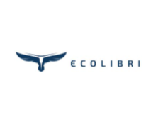
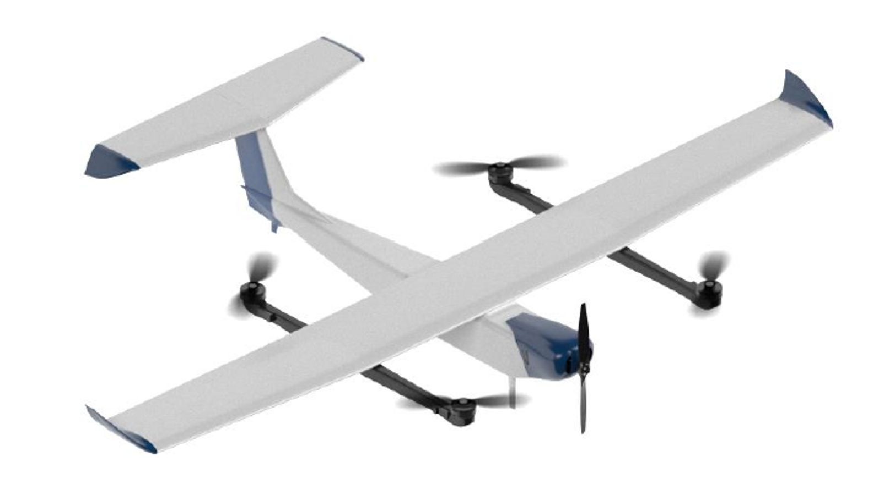
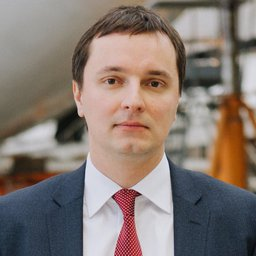

# АО «Эколибри»

`manufacturer` 

ИНН 7714473012 · ОГРН 1217700279103 · Moscow

## At a glance

- **Legal form:** AO (joint-stock company)
- **Address:** г. Москва
- **Director:** Павлова Татьяна Викторовна
- **Charter capital:** ₽76,336
- **ОКВЭД:** 72.19 — Научные исследования и разработки в области естественных и технических наук прочие
- **Wildberries overlap:** none_found

## Ownership & corporate history

### Director

| Value | As of | Note |
|---|---|---|
| Павлова Татьяна Викторовна | 2024-07-15 | Должность: ГЕНЕРАЛЬНЫЙ ДИРЕКТОР, личный ИНН 772158414345. Full signed ЕГРЮЛ выписка pulled 2026-09-07. [s6824] |
| Павлова Татьяна Викторовна | 2026-08-25 | Per АЭРОНЕКСТ member-catalog card («ФИО Руководителя» field, «Должность руководителя»: Генеральный директор), captured_date basis -- as_of is the capture date, not independently confirmed against EGRUL yet. [s1403] |

### Charter capital

| Value | As of | Note |
|---|---|---|
| 50000 | 2024-09-20 | Изменения №1 к уставу, протокол внеочередного общего собрания акционеров от 09.09.2024 (внесено в ЕГРЮЛ 20.09.2024, ГРН 2247709425247): capital set to ₽50,000 (50,000 ordinary shares × ₽1), plus authorization to place up to 100,000,000 further shares. [s6908] |
| 76336 | 2026-01-20 | Full signed ЕГРЮЛ выписка pulled 2026-09-07 (egrul_vypiska_pull.py). [s6824] |

## Products

- **ECOLIBRI eVTOL** — Electric VTOL aircraft.
- **ECOLIBRI Р-75** — eVTOL variant.
- **EM-01** — Electric motor.
- **Эколибри Р-35** — Found via GISP goods-catalog full-roster company_ogrn sweep (2026-09-03). ОКПД2: БАС в составе с беспилотным воздушным судном самолетного типа с максимальной взлетной массой свыше 30 кг, но не более 500 кг [s5391]
- **Эколибри Р-30** — Found via GISP goods-catalog full-roster company_ogrn sweep (2026-09-03). ОКПД2: БАС в составе с беспилотным воздушным судном самолетного типа с максимальной взлетной массой свыше 1 кг, но не более 30 кг [s5391]
- **Эколибри Р-5** — Found via GISP goods-catalog full-roster company_ogrn sweep (2026-09-03). ОКПД2: БАС в составе с беспилотным воздушным судном мультироторного типа с максимальной взлетной массой свыше 4 кг, но не более 30 кг [s5391]
- **Эколибри Р-75** — Found via GISP goods-catalog full-roster company_ogrn sweep (2026-09-03). ОКПД2: БАС в составе с беспилотным воздушным судном самолетного типа с вертикальным взлетом и посадкой с максимальной взлетной массой свыше 30 кг, но не более 500 кг [s5391]

## Financials

| Year | Revenue | Profit | Source |
|---|---|---|---|
| 2021 | — | — | [s0320] |
| 2022 | ₽5,692,000 | ₽89,000 | [s0321] |
| 2023 | ₽19,658,000 | ₽327,000 | [s0322] |
| 2024 | ₽10,930,000 | ₽660,000 | [s0323] |
| 2025 | ₽21,328,000 | ₽422,000 | [s0324] |

## State-program participation

- as_of: 2026-09-03; name_en: GISP (State Industrial Information System) product catalog — БАС industry listing; name_ru: Каталог продукции ГИСП — отрасль БАС; role: Manufacturer listed with an active БАС-category (беспилотные авиационные системы) product entry in gisp.gov.ru's official product catalog (industry filter 68/product-group 144), the federal government's industrial-product registry platform. ИНН-matched to this entity exactly. [s5344]
- as_of: 2026-09-06; name_en: rk.2035.university national БАС (UAV-industry) company registry; name_ru: Реестр компаний БАС — rk.2035.university; role: ID-confirmed match (exact ИНН + ОГРН, not a name collision) in the national rk.2035.university БАС-industry company directory. Sectors declared: Компания БАС. Activity types: Разработка, Производство, Эксплуатация. Personnel count 84, profile created 2026-04-10. [s1165]
- as_of: 2025-12-09; name_en: Aerospace Innovation Valley Innovation Science-Technology Center (ИНТЦ) -- residency formalized in the company's own charter; name_ru: Инновационный научно-технологический центр «Аэрокосмическая инновационная долина»; role: Изменения №4 к уставу (протокол внеочередного общего собрания акционеров от 09.12.2025) restated the company's core purpose (п.2.1 устава) as scientific-technological activity under Федеральный закон от 29.07.2017 №216-ФЗ «Об инновационных научно-технологических центрах...» and Постановление Правительства РФ от 22.04.2022 №735 «О создании инновационного научно-технологического центра «Аэрокосмическая инновационная долина»» -- a formal charter-level ИНТЦ-residency declaration, not just a catalogue listing. [s6908]

## Trademarks

| Mark | Reg. no. | Filed | Registered | Classes |
|---|---|---|---|---|
| — | 837048 | 20210630 | 15.11.2021 | 01 (broad catch-all filing, no UAV/defense-specific items); 07 (UAV/defense terms present: дрон, летательн, воздушн, взрывчат, робот); 09 (UAV/defense terms present: антенн, военн, навигацион, оружи, робот, взрывчат); 12 (UAV/defense terms present: беспилот, робот, летательн, радиоуправляем, коптер, дрон, военн, воздушн); 39 (UAV/defense terms present: летательн, дрон, навигацион) |
| — | 837293 | 20210305 | 16.11.2021 | 01 (broad catch-all filing, no UAV/defense-specific items); 07 (UAV/defense terms present: дрон, летательн, воздушн, взрывчат, робот); 09 (UAV/defense terms present: антенн, военн, навигацион, оружи, робот, взрывчат); 12 (UAV/defense terms present: беспилот, летательн, дрон, военн, воздушн); 39 (UAV/defense terms present: летательн, навигацион) |
| — | 837294 | 20210305 | 16.11.2021 | 01 (broad catch-all filing, no UAV/defense-specific items); 07 (UAV/defense terms present: дрон, летательн, воздушн, взрывчат, робот); 09 (UAV/defense terms present: антенн, военн, навигацион, оружи, робот, взрывчат); 12 (UAV/defense terms present: беспилот, летательн, дрон, военн, воздушн); 39 (UAV/defense terms present: летательн, навигацион) |
| — | 872056 | 20210630 | 01.06.2022 | 01 (broad catch-all filing, no UAV/defense-specific items); 07 (UAV/defense terms present: дрон, летательн, воздушн, взрывчат, робот); 09 (UAV/defense terms present: антенн, военн, навигацион, оружи, робот, взрывчат); 12 (UAV/defense terms present: беспилот, робот, летательн, радиоуправляем, коптер, дрон, военн, воздушн); 39 (UAV/defense terms present: летательн, дрон, навигацион) |
| — | 880543 | 20211208 | 08.07.2022 | 01 (broad catch-all filing, no UAV/defense-specific items); 07 (UAV/defense terms present: дрон, летательн, воздушн, взрывчат, робот); 09 (UAV/defense terms present: антенн, военн, навигацион, оружи, робот, взрывчат); 12 (UAV/defense terms present: беспилот, робот, летательн, радиоуправляем, коптер, дрон, военн, воздушн); 39 (UAV/defense terms present: летательн, дрон, навигацион) |

- Listed on Ukraine's GUR war-sanctions UAV-industry registry (screened 2026-09-05).
- 1 OpenSanctions match(es) (screened 2026-09-06).
- 3 OCCRP Aleph match(es) (screened 2026-09-05).

## Web & social presence

### Website

- <http://эколибри.рф> — Also ecolibri.aero. ИНН 7714473012 stated explicitly on-site; address matches (Ленинградский пр., 37, БЦ «Аэродом»).

### Marketplace listings

- <https://xn--80aaorhk2b.xn--p1ai/sellers/ekolibri> — Official partner/seller profile on Налетай.рф, the ГТЛК-backed state civilian UAV marketplace. Legal-info block confirms exact ИНН match. Direct manufacturer storefront (sells under its own name, not a reseller). 2 products listed (Р-75, Р-5 -- fixed-wing UAVs, Р-75 priced from ₽13,000,000).

## Images

-  — Company logo, as self-listed in rk.2035.university's curated БАС-industry showcase [s1168]
-  — Р-75 VTOL fixed-wing UAV -- product photo from its Налетай.рф listing. [s2625]

## Principals & persons of interest

### Рогозин Алексей Дмитриевич

- **DOB:** 21.09.1983
- **ИНН:** 770301599800
- Председатель консультативного совета / Chairman of the Advisory Council
- `sanctions lead`

## Open questions

- Featured in rk.2035.university's curated БАС-industry showcase for environmental-monitoring drones -- catalog text labels it "ООО «Эколибри»" though this registry has it as АО «Эколибри» (ИНН 7714473012); flagged as a minor legal-form discrepancy in the source text rather than assumed to be a different entity, given the identical distinctive name and matching business description. [s1168]
- 2026-08-24: leader-id.ru self-report shows Павлова Татьяна Викторовна as Генеральный директор, Москва -- exact company-name/city match, and the `director` field is otherwise empty here because the full EGRUL extract's shareholders/registrar block didn't extract cleanly (see below). A plausible lead for the missing director field, but NOT promoted directly -- leader-id self-report alone isn't sufficient sourcing for a primary identity field per this registry's standing discipline. Needs a clean EGRUL re-read or re-OCR to confirm before setting `director`.

## Sources cited in this profile

| ID | Type | Locator | Captured | As of |
|---|---|---|---|---|
| s0320 | БФО annual-accounts filing | БФО annual-accounts filing (РЕСУРС_БФО_7714473012_2021_20260817.zip) | 2026-08-17 | 2021-12-31 |
| s0321 | БФО annual-accounts filing | БФО annual-accounts filing (РЕСУРС_БФО_7714473012_2022_20260817.zip) | 2026-08-17 | 2022-12-31 |
| s0322 | БФО annual-accounts filing | БФО annual-accounts filing (РЕСУРС_БФО_7714473012_2023_20260817.zip) | 2026-08-17 | 2023-12-31 |
| s0323 | БФО annual-accounts filing | БФО annual-accounts filing (РЕСУРС_БФО_7714473012_2024_20260817.zip) | 2026-08-17 | 2024-12-31 |
| s0324 | БФО annual-accounts filing | БФО annual-accounts filing (РЕСУРС_БФО_7714473012_2025_20260817.zip) | 2026-08-17 | 2025-12-31 |
| s1165 | bulk open-data extract | bulk open-data extract (DATASET_20260824_rk2035-university-companies.zip) | 2026-08-24 | — |
| s1168 | bulk open-data extract | bulk open-data extract (DATASET_20260824_rk2035-university-bas-objects-catalog.json) | 2026-08-24 | — |
| s1403 | АЭРОНЕКСТ member record | АЭРОНЕКСТ member record (AERONEXT_7714473012_20260825_ao-ekolibri.json) | 2026-08-25 | — |
| s2625 | Naletay | Naletay (NALETAY_7714473012_20260826_catalog-listing.json) | 2026-08-26 | 2026-08-26 |
| s5344 | Gisp | Gisp (GISP_20260903_bas-manufacturer-catalog-155-companies.json) | 2026-09-03 | 2026-09-03 |
| s5391 | Gisp | Gisp (GISP_20260903_goods-catalog-full-roster-sweep-20-hits.json) | 2026-09-03 | 2026-09-03 |
| s6824 | EGRUL extract | EGRUL extract (EGRUL_7714473012_20260907_ao-ekolibri.pdf) | 2026-09-07 | 2026-09-07 |
| s6908 | Founding-Устав bundle | Founding-Устав bundle (UD_1217700279103_20260907_ekolibri.zip) | 2026-09-07 | 2024-09-09 |

---
_Generated from this investigation's registry (`data/registry/`) by `scripts/build_company_profile.py`. Not a substitute for reading the underlying primary sources listed above._