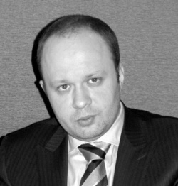

# АО ПК «Азимут»

`sanctioned` `money-layer` `WB: not_checked` 

ИНН 7701583410 · ОГРН 1057746261605

## At a glance

- **Registered:** 16.02.2005
- **Address:** 125167, Москва, ал. Нарышкинская, д. 5, стр. 2, помещ. Х ком. №15 этаж 2
- **Director:** Саидов Аскер Казбекович
- **Charter capital:** ₽2,422,000
- **ОКВЭД:** 26.20.1 — Производство компьютеров
- **Wildberries overlap:** not_checked

## Ownership & corporate history

### Director

| Value | As of | Note |
|---|---|---|
| Саидов Аскер Казбекович | 2014-12-02 | Генеральный директор, личный ИНН 054403029570, ГРН 6147748324619, 02.12.2014 [s0212] |

### Charter capital

| Value | As of | Note |
|---|---|---|
| 2422000 | 2023-05-04 | ГРН 2237703834058, 04.05.2023 [s0212] |

### Address

| Value | As of | Note |
|---|---|---|
| 125167, Москва, ал. Нарышкинская, д. 5, стр. 2, помещ. Х ком. №15 этаж 2 | 2018-02-20 | ГРН 9187746144412, 20.02.2018 [s0212] |

### Legal name

| Value | As of | Note |
|---|---|---|
| АО Производственная компания «Азимут» | 2024-12-24 | ГРН 2247713421129, 24.12.2024 — current name recorded 2024; entity dates from 2005, so an earlier name existed. Predecessor not stated in this extract. [s0212] |

## Trademarks

| Mark | Reg. no. | Filed | Registered | Classes |
|---|---|---|---|---|
| — | 152023 | 19950711 | 30.04.1997 | 07 (культиваторы;); 09 (кассовые аппараты) |
| — | 282509 | 20030603 | 18.02.2005 | 07 (регуляторы скорости (числа оборотов) для машин и двигателей; регулятор частоты вращения; регулятор холостого хода); 09 (broad catch-all filing, no UAV/defense-specific items); 11 (вентиляторы (части установок для кондиционирования воздуха); моторедуктор управления заслонками распределения воздушного потока отопителя автомобиля); 12 (крышки топливных баков; пробка топливного бака; тормоза; электромагнитный клапан); 20 (контейнеры (для хранения и транспортировки)) |
| — | 387813 | 20080602 | 26.08.2009 | 09 (broad catch-all filing, no UAV/defense-specific items); 37 (строительство; ремонт; установка оборудования; восстановление машин, полностью или частично изношенных; установка и ремонт электроприборов; установка, ремонт и техническое обслуживание машинного оборудования); 42 (broad catch-all filing, no UAV/defense-specific items) |
| — | 525668 | 20130603 | 29.10.2014 | 06 (контейнеры металлические для хранения и транспортировки, ящик кассовый металлический, ящики из обычных металлов); 07 (UAV/defense terms present: воздушн); 09 (UAV/defense terms present: антенн, военн, навигацион); 12 (системы гидравлические для транспортных средств; тележки двухколесные; узлы и детали транспортных средств функциональные, включенные в 12 класс); 42 (научные и технологические услуги и относящиеся к ним научные исследования и разработки, услуги по промышленному анализу и научным исследованиям, разработка и усовершенствование технического и программного обеспечения компьютеров) |
| — | 637651 | 20151201 | 01.12.2017 | 09 (приборы и инструменты навигационные; приборы навигационные спутниковые); 37 (строительство) |

## Sanctions & screening

**Canada (Special Economic Measures Act), Switzerland (SECO, Ukraine-related measures), US-BIS-EL, NZ-RSA2022, Ukraine (Presidential sanctions decree/list)** [s0763]

- 4 OpenSanctions match(es) (screened 2026-08-24).
- 5 OCCRP Aleph match(es) (screened 2026-08-26).

### Securing measures

- ROW_NUM: 1; ROM_KIND: 2; NP_INN: 7701583410; NP_NAME: АКЦИОНЕРНОЕ ОБЩЕСТВО ПРОИЗВОДСТВЕННАЯ КОМПАНИЯ "АЗИМУТ"; REG_DATE: 13.09.2021 00:00:00; CNCL_DATE: 01.10.2021 12:34:00; CNCL_REASON: Исполнение решения о привлечении к ответственности за совершение налогового правонарушения (решения об отказе в привлечении к ответственности за совершение налогового правонарушения); ASSET_NAME: Земельный участок 
, 05:40:000040:1070; row_cnt: 2
- ROW_NUM: 2; ROM_KIND: 2; NP_INN: 7701583410; NP_NAME: АКЦИОНЕРНОЕ ОБЩЕСТВО ПРОИЗВОДСТВЕННАЯ КОМПАНИЯ "АЗИМУТ"; REG_DATE: 13.09.2021 00:00:00; CNCL_DATE: 01.10.2021 12:34:00; CNCL_REASON: Исполнение решения о привлечении к ответственности за совершение налогового правонарушения (решения об отказе в привлечении к ответственности за совершение налогового правонарушения); ASSET_NAME: Земельный участок , 05:40:000040:1071; row_cnt: 2

## Principals & persons of interest

### Саидов Аскер Казбекович

- **DOB:** 1982-10-22
- **Birthplace:** Хасавюрт, Дагестан / Khasavyurt, Dagestan
- **ИНН:** 054403029570
- Генеральный директор — sanctions designation attaches here (radar/radionavigation production activity description matches this entity, not the holding company)
- `sanctions lead`

## Sources cited in this profile

| ID | Type | Locator | Captured | As of |
|---|---|---|---|---|
| s0212 | EGRUL extract | EGRUL extract (ul-1057746261605-20260814234906.pdf) | — | 2026-08-14 |
| s0763 | OpenSanctions screening record | OpenSanctions screening record (OPENSANCTIONS_7701583410_20260824_ao-pk-azimut.json) | 2026-08-24 | — |

---
_Generated from this investigation's registry (`data/registry/`) by `scripts/build_company_profile.py`. Not a substitute for reading the underlying primary sources listed above._