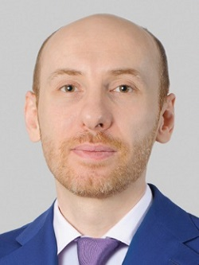

# АО УК «Азимут» | formerly «Аэронавигационные и информационные системы»

`money-layer` `WB: not_checked` 

ИНН 7714390623 · ОГРН 1167746513967

## At a glance

- **Legal form:** УК
- **Registered:** 30.05.2016
- **Address:** Г.Москва
- **Director:** Саидов Аскер Казбекович
- **Wildberries overlap:** not_checked

## Ownership & corporate history

### Director

| Value | As of | Note |
|---|---|---|
| Саидов Аскер Казбекович | 2026-08-24 | per egrul.nalog.ru open-API lookup (name+ОГРН+director quick-match, not a full signed extract). [s0106] |

## Financials

| Year | Revenue | Profit | Source |
|---|---|---|---|
| 2021 | — | ₽233,002,000 | [s0315] |
| 2022 | — | ₽323,141,000 | [s0316] |
| 2023 | — | ₽1,476,617,000 | [s0317] |
| 2024 | — | ₽1,495,590,000 | [s0318] |
| 2025 | — | ₽673,211,000 | [s0319] |

## Trademarks

| Mark | Reg. no. | Filed | Registered | Classes |
|---|---|---|---|---|
| — | 376714 | 20080130 | 13.04.2009 | 09 (broad catch-all filing, no UAV/defense-specific items); 42 (научно-исследовательские, проектно-конструкторские разработки в области дактилоскопии, совершенствование и обслуживание программного обеспечения) |
| — | 887648 | 20220427 | 17.08.2022 | 09 (программы для компьютеров, записанные; программы игровые для компьютеров, загружаемые; программы компьютерные, загружаемые; программы операционные для компьютеров, записанные; программы-заставки для компьютеров, записанные или загружаемые); 35 (сбор информации в компьютерных базах данных); 37 (установка, обслуживание и ремонт компьютеров; установка, ремонт и техническое обслуживание офисной техники и оборудования); 42 (broad catch-all filing, no UAV/defense-specific items) |

- Listed on Ukraine's GUR war-sanctions UAV-industry registry (screened 2026-09-05).
- 1 OpenSanctions match(es) (screened 2026-09-06).
- 1 OCCRP Aleph match(es) (screened 2026-09-05).

## Principals & persons of interest

### Саидов Аскер Казбекович

- **DOB:** 1982-10-22
- **Birthplace:** Хасавюрт, Дагестан / Khasavyurt, Dagestan
- **Address:** г. Москва, Петровско-Разумовский проезд, д. 16, кв. 125; г. Москва, ул. Минская, д. 1Г, корп. 2, кв. 217
- **ИНН:** 054403029570
- Генеральный директор; 44% shareholder (Ростех is a co-shareholder of this holding company)
- `sanctions lead`

### Saidov Adil Abukovich — Саидов Адиль Абукович

- **DOB:** 1973-04-18
- **Address:** г. Москва, Борисовские пруды, д. 25, корп. 2, кв. 172; Московская обл., Красногорск, ул. Верещагина, д. 13
- **ИНН:** 772428159554
- Член совета директоров (board member) — which Azimut entity not fully confirmed

## Sources cited in this profile

| ID | Type | Locator | Captured | As of |
|---|---|---|---|---|
| s0106 | EGRUL open-API record | EGRUL open-API record (EGRULAPI_7714390623_20260822_ao-uk-azimut-formerly-aeronavigatsionnye-i-informatsionnye-s.json) | 2026-08-22 | 2026-08-22 |
| s0315 | БФО annual-accounts filing | БФО annual-accounts filing (РЕСУРС_БФО_7714390623_2021_20260816.zip) | 2026-08-16 | 2021-12-31 |
| s0316 | БФО annual-accounts filing | БФО annual-accounts filing (РЕСУРС_БФО_7714390623_2022_20260816.zip) | 2026-08-16 | 2022-12-31 |
| s0317 | БФО annual-accounts filing | БФО annual-accounts filing (РЕСУРС_БФО_7714390623_2023_20260816.zip) | 2026-08-16 | 2023-12-31 |
| s0318 | БФО annual-accounts filing | БФО annual-accounts filing (РЕСУРС_БФО_7714390623_2024_20260816.zip) | 2026-08-16 | 2024-12-31 |
| s0319 | БФО annual-accounts filing | БФО annual-accounts filing (РЕСУРС_БФО_7714390623_2025_20260816.zip) | 2026-08-16 | 2025-12-31 |

---
_Generated from this investigation's registry (`data/registry/`) by `scripts/build_company_profile.py`. Not a substitute for reading the underlying primary sources listed above._