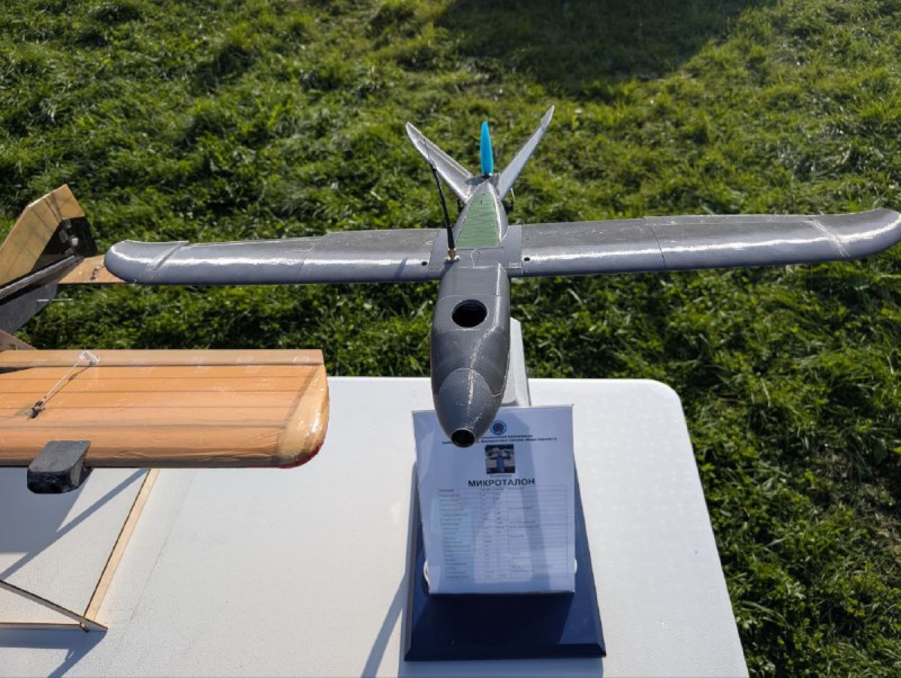
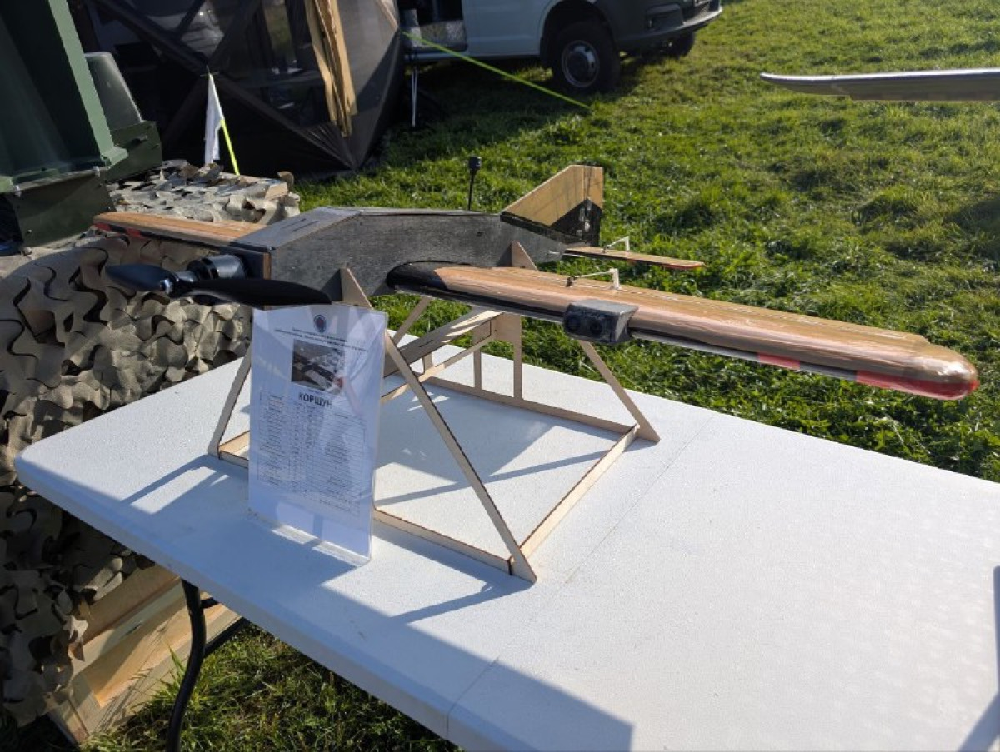

# CSN "Bars-Sarmat" (Rogozin) — Центр специального назначения (добровольческий, беспилотных систем) «Барс-Сармат»

**Brand:** Барс-Сармат
`adjacent` 

## At a glance

- **Director:** Рогозин Дмитрий Олегович
- **ЦБСТ tie:** None found.
- **Wildberries overlap:** none_found

## Ownership & corporate history

### Director

| Value | As of | Note |
|---|---|---|
| Рогозин Дмитрий Олегович (Начальник Центра) | 2026-09-19 | The unit's own site names him 'Начальник Центра'; the 2024 posts call him 'командир' of the detachment ([s7693]). No legal-entity registration for the unit is on file: a military volunteer formation, not a company. [s7687] |

## Workforce & production scale

| Headcount | As of | Note |
|---|---|---|
| более 1000 бойцов | 2026-09-19 | Self-reported on the home page under 'Результаты работы Центра за 2025 год'; claim not independently confirmed. [s7686] |

## Self-reported marketing claims

> *Первый в России Центр специального назначения, занимающийся разработкой, боевой апробацией и применением роботизированных электронных комплексов и систем*
> The first Special Purpose Centre in Russia engaged in the development, combat approbation and use of robotic electronic complexes and systems.
>
> — Self-description on the unit's own site (bars-sarmat.ru home page, captured 19.09.2026): a military unit that states 'разработка' (development) as part of its function, next to combat approbation. (2026-09-19) [s7686]

> *400 + апробированных на передовой разработок российского ОПК и “народного ВПК”*
> 400+ developments of the Russian defence industry and the "people's military-industrial complex" tested at the front.
>
> — 'Результаты работы Центра за 2025 год' block on the home page. Same «народный ВПК» framing Проект «Архангел» uses since 2023. (2026-09-19) [s7686]

> *Серийное производство сотен единиц средств радиоэлектронной борьбы и связи*
> Serial production of hundreds of electronic-warfare and communications units.
>
> — Same results block on the home page; the unit claims its own production, not only testing. No maker is named on the page. (2026-09-19) [s7686]

> *Около 350 единиц уничтоженного вооружения и военной техники, а также группы пехоты противника*
> About 350 units of destroyed enemy weapons and military equipment, plus infantry groups.
>
> — 2025 results block on the home page, alongside 'более 1000 бойцов' and 'Свыше 100 сбитых разведывательных и ударных беспилотных самолетов противника'. Unit's own claim, not independently confirmed. (2026-09-19) [s7686]

> *от 210 000 рублей*
> From 210,000 roubles a month.
>
> — Monthly pay advertised on the home page; the FAQ ([s7683]) grounds it in art. 13.2 of Federal Law 76-FZ and a one-year contract. On 27.09.2024 the channel gave the figure as 'от 205 000 рублей' plus a one-off 500 000 рублей payment after the first stage ([s7692]). (2026-09-19) [s7686]

> *Она составит 500 000 рублей.*
> It will be 500,000 roubles.
>
> — @russian_shock_volunteer_brigade msg 1618 (27.09.2024): one-off payment to those who sign the contract, paid after the first service stage. (2024-09-27) [s7692]

> *Совместно с проектом Архангел и Батальоном Сармат(Рогозина Д.О.), прорабатыватся методика и техническое оснащение совместного проекта по защите объектов критически важной инфарструктуры.*
> Together with Проект Архангел and the Sarmat battalion (Rogozin D.O.), a methodology and technical equipment for a joint project protecting critically important infrastructure are being worked out.
>
> — @russian_shock_volunteer_brigade msg 1668 (18.10.2024), announcement by the centre «ЗОВ-АА»; invites manufacturers to 'апробация изделия', one event 'при поддержке Правительства Республики Татарстан в феврале 2025г.' (2024-10-18) [s7696]

> *Близкие проекту "Архангел" волонтёрские инженерные сообщества и учебные центры БпЛА начинают тесное взаимодействие с нашим добровольческим военно-техническим отрядом "БАРС-САРМАТ".*
> Volunteer engineering communities and UAV training centres close to the Arkhangel project are starting close cooperation with our volunteer military-technical detachment BARS-SARMAT.
>
> — @russian_shock_volunteer_brigade msg 1683 (21.10.2024), first-person post ('нашим ... отрядом'); the unit's own channel names Архангел's network as an intended feeder. (2024-10-21) [s7697]

> *при поддержке "БАРС-Сармат" провели испытания изделия народного ОПК - "Горыныч 2.0".*
> with the support of BARS-Sarmat, tested the people's-defence-industry product Gorynych 2.0.
>
> — Post carrying Архангел's sign-off (26.11.2024), listing uses including 'Поражение беспилотников со связью Старлинк или с оптоволоконным кабелем путем деформации стеклопластиковых и др. элементов конструкции' and 'Плановый поджог ... объектов'; 'Серийное производство доступно уже сейчас!'; supplies routed to '@KPOT1BOT'. Maker not named in the post. (2024-11-26) [s7699]

> *Индивидуальный РЭБ " ЩИТ - И " прошел совместную апробацию с Б.А.Р.С - Сармат и Проектом Архангел.*
> The individual EW set SHCHIT-I passed joint approbation with B.A.R.S-Sarmat and Project Arkhangel.
>
> — @russian_shock_volunteer_brigade msg 1988 (15.01.2025): five-item kit covering 97 to 1020 MHz, suppression 'зафиксировано на расстоянии 310 метров', first kit to be handed to a named-later general at the front. Links to a TASS article; maker not named. (2025-01-15) [s7700]

> *Особый интерес вызвал раздел по новым технологиям «Гермеса» в управлении роботами и группами роботов через Интернет.*
> Particular interest was drawn by the section on Germes's new technologies for controlling robots and groups of robots over the Internet.
>
> — Post of 16.02.2025 (Germes-side text, carried on the Sarmat channel): Germes trained БАРС САРМАТ instructors in soldering, frequency setting and ППРЧ, and gave the unit new interference-resistant comms kits and an 8-metre mast. Hashtags #сармат #барс #Рогозин. (2025-02-16) [s7701]

## Web & social presence

### Website

- <https://bars-sarmat.ru> — official site, 9 pages archived 19.09.2026 ([s7682]-s7690); gallery, «Наши бойцы» and the encyclopedia list loaded without media

### Telegram

- <https://t.me/russian_shock_volunteer_brigade> — official channel, 2,453 posts scraped 2024-09-20 to 2026-09-19
- <https://t.me/rogozin_do> — Рогозин's own channel, also linked from the site
- <https://t.me/SARMAT_APPROBATION_BOT> — bot for product-approbation applications ('Подать заявку на апробацию изделия')
- <https://t.me/anketusvo_bot> — volunteer questionnaire bot

### Other

- <https://max.ru/russian_shock_volunteer_brigade> — same channel on Max
- <https://www.rustore.ru/catalog/app/ru.sarmat.bars> — RuStore app for volunteer applications
- tel:88002221620 — 8-800-222-16-20

## Images

-  — Дронница-2025 (6–7 сентября 2025, Новгородская область): cast green housing embossed «БАРС САРМАТ», mounted among rows of green cylindrical enclosures. Photo from the unit's own Telegram post (8 сентября 2025), which lists the equipment shown (МГЛА-Сармат, «Сармат», navigation module, quadcopter, «Авианосец», «Коршун», «МикроТалон») without saying which item this is; the photo itself does not identify the product. [s7861]
-  — Дронница-2025: winged UAV with underslung payload pods on an exhibition stand, with a specification placard whose text is not legible. From the unit's own Telegram post of 8 сентября 2025, which names among the exhibits the carrier aircraft «Авианосец»; the photo does not say which exhibit this is. [s7863]
-  — Дронница-2025: fixed-wing airframe on a stand with a placard reading «МИКРОТАЛОН». The unit's own Telegram post of 8 сентября 2025 lists the interceptor «МикроТалон» among the items it presented. [s7864]
-  — Дронница-2025: wooden-framed fixed-wing airframe on a stand with a placard reading «КОРШУН». The unit's own Telegram post of 8 сентября 2025 lists the interceptor «Коршун» among the items it presented. [s7865]

## Principals & persons of interest

### Dmitry Olegovich Rogozin — Рогозин Дмитрий Олегович

- **DOB:** 21.12.1963
- **Birthplace:** Москва (Moscow)
- Начальник Центра (commander) of ЦСН «Барс-Сармат»; the unit's own site gives him as 'Начальник Центра специального назначения отряда беспилотных систем «Барс-Сармат»' and, since September 2024, 'командир' of its first volunteer detachment. Archangel's own channel names him 'командир БАРС Сармат' (17.10.2024) (2024-09–present)

## Corporate links

- **Project "KB Arkhangel"** `training-partnership` — Both sides publicly name the tie. Архангел: msg 5500 (17.10.2024, meeting with Рогозин as 'командир БАРС Сармат') and msg 5502 ('Полностью подключаемся к взаимодействию с Барс Сармат и объединяем ресурсы, возможности и наработки'), [s7693]/s7694. Сармат: msg 1683 (21.10.2024), 1744 (05.11.2024, 'Сплочение и объединение наше всё!!! Барс САРМАТ ... создан для того чтоб объединить воинов новой формации'), joint approbations in msg 1831 (Горыныч 2.0) and 1988 (ЩИТ-И), [s7697]-s7700. The logo of the unit appears with the word АРХАНГЕЛ behind a speaker in a Архангел video. No contract or shared registration is on file: a cooperation/recruitment/testing tie, not a corporate one. [s7694]
- **Fond "Sarmat"** `group-structure` — The unit's site presents the Фонд as 'Помощь добровольцам Центра специального назначения «Барс-Сармат»' with the fund's bank details for donations ([s7682]). No ЕГРЮЛ extract for the fund is on file yet, so its founders and any personal tie to the unit's leadership are unconfirmed. [s7682]
- **ANO CPV "ZOV-AA"** `training-partnership` — Named with the Отряд «БАРС-Сармат» (командир Д.О. Рогозин) and Проект «Архангел» in a joint infrastructure-protection project (msg 1668 on the unit's own channel, 18.10.2024, [s7696]; and Архангел msg 5503/5657, [s7728]). [s7696]

## Open questions

- Фонд «Сармат» (ИНН 6154168283, ОГРН 1246100025951): pull the full ЕГРЮЛ выписка to find its founders and director and to see whether they overlap with the unit's leadership or with Рогозин-linked entities (АО «Эколибри», АНО ЦРТТ). [s7682]
- @russian_shock_volunteer_brigade is scraped (2,453 posts) but only mined for components so far; a fuller read of the sub-units it names (отряды «Сталинград», «Устинов», «Днепр»; роты 10 и 11) and of products fielded 'с поддержкой специалистов ЦСН' (САУ РОН opto-radar, «Горыныч 2.0», «ЩИТ-И») is pending, including who makes them. [s7703]
- The site's gallery, «Наши бойцы» and encyclopedia pages returned no media in a plain fetch; a browser pass is needed to see and archive the photos/videos. [s7686]
- Recruitment pages target Минтранс staff specifically ([s7688], 'Для кандидатов транспортного комплекса'); check for a link to АНО «Центр развития транспортных технологий» (Рогозин А.Д., already on file) and АО «Эколибри». [s7688]

## Sources cited in this profile

| ID | Type | Locator | Captured | As of |
|---|---|---|---|---|
| [s7682] | site capture | site capture (SITE_6154168283_20260919_fond-sarmat-page.html) | 2026-09-19 | — |
| [s7686] | site capture | site capture (SITE_barssarmat_20260919_home.html) | 2026-09-19 | — |
| [s7687] | site capture | site capture (SITE_barssarmat_20260919_komandovanie.html) | 2026-09-19 | — |
| [s7688] | site capture | site capture (SITE_barssarmat_20260919_mintrans.html) | 2026-09-19 | — |
| [s7692] | Tgpost | Tgpost (TGPOST_20240927_russian_shock_volunteer_brigade-1618-bars-sarmat-pay-500k.txt) | 2024-09-27 | — |
| [s7694] | Tgpost | Tgpost (TGPOST_20241017_projectArchangel-5502-arkhangel-joins-sarmat.txt) | 2024-10-17 | — |
| [s7696] | Tgpost | Tgpost (TGPOST_20241018_russian_shock_volunteer_brigade-1668-zov-aa-joint-project-arkhangel.txt) | 2024-10-18 | — |
| [s7697] | Tgpost | Tgpost (TGPOST_20241021_russian_shock_volunteer_brigade-1683-rogozin-arkhangel-communities-join.txt) | 2024-10-21 | — |
| [s7699] | Tgpost | Tgpost (TGPOST_20241126_russian_shock_volunteer_brigade-1831-gorynych-2-crimea-arkhangel.txt) | 2024-11-26 | — |
| [s7700] | Tgpost | Tgpost (TGPOST_20250115_russian_shock_volunteer_brigade-1988-shchit-i-ew-joint-approbation.txt) | 2025-01-15 | — |
| [s7701] | Tgpost | Tgpost (TGPOST_20250216_russian_shock_volunteer_brigade-2095-germes-training-sarmat-instructors.txt) | 2025-02-16 | — |
| [s7703] | Tgpreview | Tgpreview (TGPREVIEW_20260919_russian_shock_volunteer_brigade.html) | 2026-09-19 | — |
| [s7861] | Telegram media | Telegram media (TGMEDIA_csn-bars-sarmat_20250908_russian_shock_volunteer_brigade-post3113-1.jpg) | 2025-09-08 | — |
| [s7863] | Telegram media | Telegram media (TGMEDIA_csn-bars-sarmat_20250908_russian_shock_volunteer_brigade-post3113-3.jpg) | 2025-09-08 | — |
| [s7864] | Telegram media | Telegram media (TGMEDIA_csn-bars-sarmat_20250908_russian_shock_volunteer_brigade-post3113-4.jpg) | 2025-09-08 | — |
| [s7865] | Telegram media | Telegram media (TGMEDIA_csn-bars-sarmat_20250908_russian_shock_volunteer_brigade-post3113-5.jpg) | 2025-09-08 | — |

---
_Generated from this investigation's registry (`data/registry/`) by `scripts/build_company_profile.py`. Not a substitute for reading the underlying primary sources listed above._