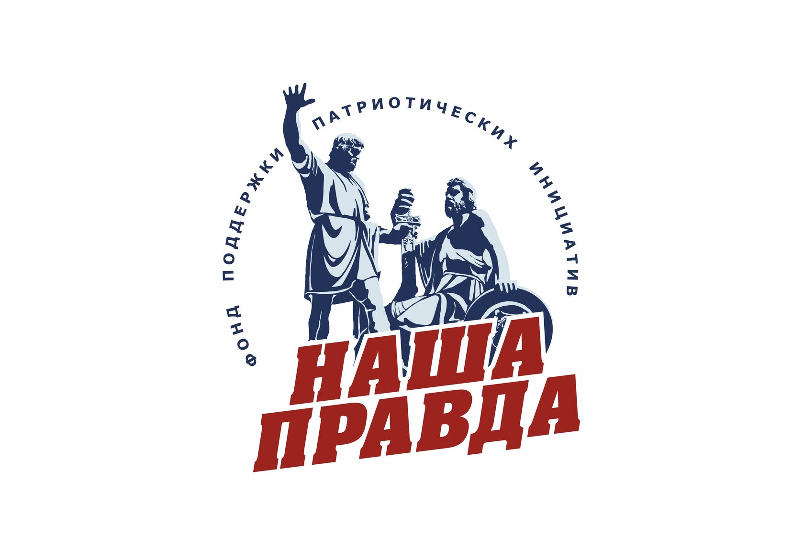

# NON-PROFIT FOUNDATION FOR SUPPORTING OF PATRIOTIC INITIATIVES "OUR TRUTH" — Фонд «Наша Правда»

`sanctioned` `cbst-core` `WB: not_checked` 

ИНН 9705196180 · ОГРН 1237700218612

## At a glance

- **Legal form:** Fond (foundation)
- **Registered:** 21.03.2023
- **Address:** 115172, Москва, вн.тер.г. муниципальный округ Таганский, наб. Котельническая, д. 25, стр. 1, офис 18 комната 5
- **Director:** Бровченко Александр Руфинович
- **ОКВЭД:** 88.99 — Предоставление прочих социальных услуг без обеспечения проживания, не включенных в другие группировки
- **ЦБСТ tie:** Joint equipment deliveries to front-line units alongside ЦБСТ, at least twice.
- **Wildberries overlap:** not_checked

## Ownership & corporate history

### Director

| Value | As of | Note |
|---|---|---|
| Бровченко Александр Руфинович | 2023-03-21 | Генеральный директор, личный ИНН 501105677892, ГРН 1237700218612, 21.03.2023 — unchanged as of 15.08.2026 [s0221] |

### Founders / ownership

| Value | As of | Note |
|---|---|---|
| Фонд региональных некоммерческих проектов «ДАР» и Некоммерческий фонд содействия сохранению историко-культурного наследия «Градислава» | 2026-09-08 | Наша Правда's own official site (о фонде section) self-describes as a joint project of these two funds — a first-party admission, not press attribution. Verbatim: «Фонд "Наша Правда" - это совместный проект Фонда региональных некоммерческих проектов "ДАР" и Некоммерческого фонда содействия сохранению историко-культурного наследия "Градислава", направленный на поддержку военнослужащих и граждан на территории СВО.» Resolves open_questions.json src015 — the EGRUL/устав route to this fact is structurally blocked (a Фонд's founders aren't published in a standard EGRUL extract, and Наша Правда's founding устав is paper-only, not digitized, per territorial ФНС response 2026-09-08), but this self-published statement is independently as strong as any registry document short of the устав itself. [s7370] |

### Address

| Value | As of | Note |
|---|---|---|
| 115172, Москва, вн.тер.г. муниципальный округ Таганский, наб. Котельническая, д. 25, стр. 1, офис 18 комната 5 | 2023-03-21 | ГРН 1237700218612, 21.03.2023 — address at registration, unchanged as of the 15.08.2026 extract [s0221] |

## Financials

| Year | Revenue | Profit | Source |
|---|---|---|---|
| 2024 | — | ₽14,700,000 | [s0389] |
| 2025 | — | ₽22,320,000 | [s0390] |

## Sanctions & screening

**Ukraine (Presidential sanctions decree/list)** [s0575]

- 1 OpenSanctions match(es) (screened 2026-09-06).
- 1 OCCRP Aleph match(es) (screened 2026-09-07).

## Web & social presence

### Website

- <https://xn----7sbabalo0evak8f.xn--p1ai/>

## Images

-  — Foundation logo, from the organization's own official site. [s7538]

## Principals & persons of interest

### Александр Руфинович Бровченко

- **ИНН:** 501105677892
- General Director, Фонд «Наша Правда», since 21.03.2023
- `sanctions lead`

### Виктор Ильич Давыдов

- Член Наблюдательного совета

### Иван Игоревич Карабинский

- Член Наблюдательного совета

### Устратов Дмитрий Владимирович

- **ИНН:** 501101524888
- Член Наблюдательного совета

### Бровченко Александр Руфинович

### Елисеев Илья Владимирович

- **DOB:** 19.12.1965
- **ИНН:** 781124117772
- Член Наблюдательного совета
- `sanctions lead`

### Антонова Татьяна Сергеевна

- Член Наблюдательного совета

### Тихонов Сергей Юрьевич

- Член Попечительского совета

### Манецкий Роман Каллистратович

- Член Попечительского совета

### Дукал Марина Александровна

- Член Попечительского совета

## Open questions

- Who are Фонд «Наша Правда»'s founders? The brief attributes it to Фонд «ДАР» and Фонд «Градислава», but this is NOT confirmed by the fund's own ЕГРЮЛ extract — a Фонд's учредители are simply not published in ЕГРЮЛ (the extract has no учредители section at all, which is a structural property of the legal form, not a redaction). Resolving this needs the fund's Устав or a Минюст filing, not another ЕГРЮЛ pull. [s0221]
- RESOLVED 2026-09-16, correcting an earlier same-day dead-end (see this project's own commit history, 67162e6): docs/index.html's "FY2024 filing names its governing bodies in full" claim IS the БФО filing ([s0389]) after all. Two earlier attempts to OCR this zip only ever ran OCR against its audit-opinion attachment (page-numbered "0280"), never against the actual пояснительная записка PDF (NO_BUHPZ_...) sitting in the same zip -- that file is a 36-page scan that also needed its own OCR pass and had never gotten one. Once OCR'd directly, its own §1.2 табл.3/4 names all 8 people exactly as docs/index.html paraphrases them: Наблюдательный совет = Давыдов (Фонд «ДАР»), Елисеев (no employer listed), Карабинский (Фонд «Градислава»), Устратов (Фонд Поддержки нац. морских проектов), Антонова (no employer listed); Попечительский совет = Тихонов (Фонд «ДАР»), Манецкий (Фонд «Градислава»), Дукал (Фонд «ДАР»). All 8 roles wired on the person side (fond-nasha-pravda, source_id [s0389]). Lesson for future OCR passes on a multi-file zip: OCR every scanned PDF in the archive, not just the one that happens to have the identifiable filename pattern already used elsewhere. [s0389]

## Sources cited in this profile

| ID | Type | Locator | Captured | As of |
|---|---|---|---|---|
| [s0221] | EGRUL extract | EGRUL extract (ul-1237700218612-20260815010023.pdf) | — | 2026-08-15 |
| [s0389] | БФО annual-accounts filing | БФО annual-accounts filing (РЕСУРС_БФО_9705196180_2024_20260815.zip) | 2026-08-15 | 2024-12-31 |
| [s0390] | БФО annual-accounts filing | БФО annual-accounts filing (РЕСУРС_БФО_9705196180_2025_20260815.zip) | 2026-08-15 | 2025-12-31 |
| [s0575] | OpenSanctions screening record | OpenSanctions screening record (OPENSANCTIONS_9705196180_20260824_fond-nasha-pravda.json) | 2026-08-24 | — |
| [s7370] | transcript | transcript (TRANSCRIPT_20260908_nasha-pravda-official-site.html) | 2026-09-08 | — |
| [s7538] | site capture | site capture (SITE_9705196180_20260916_fond-nasha-pravda-logo.jpg) | 2026-09-16 | — |

---
_Generated from this investigation's registry (`data/registry/`) by `scripts/build_company_profile.py`. Not a substitute for reading the underlying primary sources listed above._