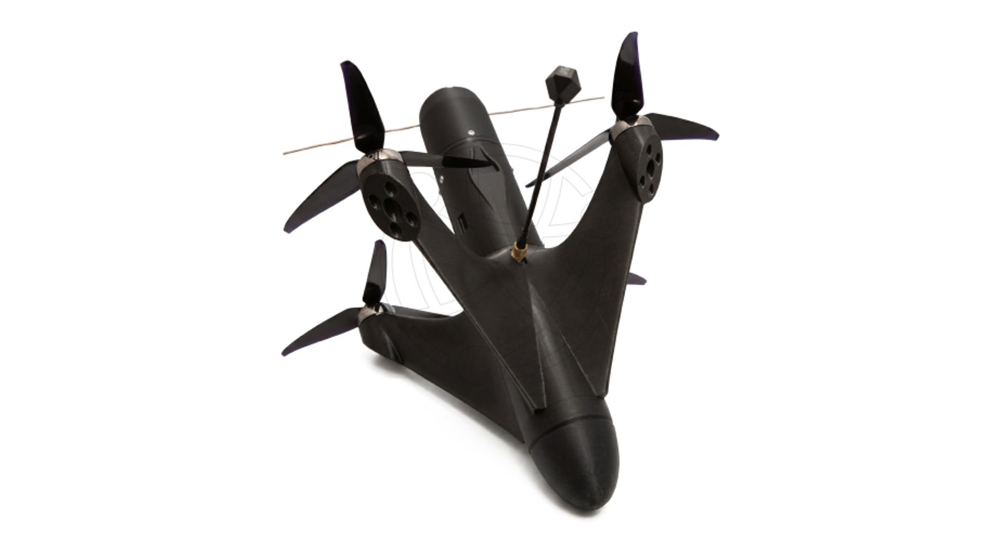

# НПО «КАЙСАНТ»

**Brand:** Germes
`sanctioned` `manufacturer` 

ИНН 7733393203 · ОГРН 1227700641805

## At a glance

- **Legal form:** NPO (research and production association)
- **Registered:** 07.10.2022
- **Address:** 125362, Москва, вн.тер.г. муниципальный округ Южное Тушино
- **Director:** Черепкова Нина Сергеевна
- **Charter capital:** ₽150,000
- **ОКВЭД:** 72.19 — Научные исследования и разработки в области естественных и технических наук прочие
- **ЦБСТ tie:** ЦБСТ residency directly sourced via ЦБСТ's own channel.
- **Wildberries overlap:** none_found

## Ownership & corporate history

### Director

| Value | As of | Note |
|---|---|---|
| Черепкова Нина Сергеевна | 2022-10-07 | личный ИНН 773376903806 — GD since registration [s0454] |

### Founders / ownership

| Value | As of | Note |
|---|---|---|
| 2 участника, оба EGRUL-restricted | — | ГРН 2267706645182 — TWO separate «Доступ к сведениям ограничен» participant records, both dated identically [s0454] |

### Charter capital

| Value | As of | Note |
|---|---|---|
| 150000 | — | from brief:prose, unverified |

### Address

| Value | As of | Note |
|---|---|---|
| Москва, Строительный проезд, 7Ак28 | 2026-08-25 | Physical/operating address per a 2026-08-25 job posting (nesiditsa.ru), NOT the registered EGRUL legal address (125362, Москва, вн.тер.г. муниципальный округ Южное Тушино, already on file as `address`) -- kept separate, not overwriting the legal address. [s2641] |

## Products

- **«ГЕРМЕС связь»** — Multi-band tactical communication system, per germesfpv.ru.
- **«ГЕРМЕС мачты»** — Antenna mast hardware (multiple lines: Сверхлёгкие, Облегчённые, Усиленные, Мачты на кунг, Фермные — category names only, no individual specs).
- **ПО «Гермес»** — Companion software.
- **Приемник** — 868/915 МГц configurable, SMA connector, 5g. 2,900 руб.
- **Передатчик** — JR-connector powered, 1W. 11,350 руб.
- **Ретранслятор** — Range-extending repeater. 16,000 руб.
- **Проводной ретранслятор** — Wired repeater, 30-300m extension, directional antenna. 33,000 руб.
- **Кинетический FPV дрон-перехватчик «ГУСЬ-7»** — Kinetic FPV interceptor drone (multirotor class), от ₽103,700. Sold on Налетай.рф via the ИП Черепкова storefront (see marketplace_listings note) alongside the ГЕРМЕС-7 comms line. Not previously documented in this registry under any name. [s2627]

## Financials

| Year | Revenue | Profit | Source |
|---|---|---|---|
| 2023 | ₽6,689,000 | ₽1,023,000 | [s0339] |
| 2024 | ₽194,116,000 | ₽10,911,000 | [s0340] |
| 2025 | ₽1,812,579,000 | ₽890,678,000 | [s0341] |

## Sanctions & screening

**NZ-RSA2022, Ukraine (Presidential sanctions decree/list), US (OFAC, Russia Harmful Foreign Activities Sanctions)** [s0784]

- Listed on Ukraine's GUR war-sanctions UAV-industry registry (screened 2026-08-24).
- 1 OpenSanctions match(es) (screened 2026-08-24).
- 3 OCCRP Aleph match(es) (screened 2026-08-26).

## Registry flags

- Доступ к сведениям ограничен (оба участника)

## Web & social presence

### Website

- <https://germesfpv.ru/> — Product brand site; legal-entity name "Кайсант" surfaces only in the email domain (info@kaysant.ru) and legal-policy links, not on the product pages themselves.

### Marketplace listings

- <https://xn--80aaorhk2b.xn--p1ai/sellers/ip-cherepkova> — Products bearing the "НПО КАЙСАНТ" manufacturer attribute (ГЕРМЕС-7 radio receiver/transmitter line, and a "Кинетический FPV дрон-перехватчик ГУСЬ-7" -- kinetic FPV interceptor drone) are sold on Налетай.рф NOT under this entity's own name, but through a personal-ИП storefront: "ИП Черепкова Нина Сергеевна" (seller slug ip-cherepkova, ИНН 773376903806) -- this registry's own record for Черепкова Н.С. already identifies her as НПО «Кайсант»'s founder/sole owner/GD (since 07.10.2022), whose EGRUL access was restricted ("доступ ограничен") just three weeks before this listing was captured (2026-08-03). Routing the company's own products through the owner's personal ИП rather than a corporate storefront on a state-backed marketplace, timed close to an EGRUL restriction, reads as a deliberate visibility-reduction pattern rather than routine reselling. 5 products total under that ИП listing.

## Images

-  — «ГУСЬ-7» kinetic FPV interceptor drone -- product photo from its Налетай.рф listing (sold via the ИП Черепкова storefront, see marketplace_listings). [s2627]

## Principals & persons of interest

### Черепкова Нина Сергеевна

- **ИНН:** 773376903806
- Founder / sole owner / Генеральный директор (also operates a personal ИП storefront selling the company's products on Налетай.рф under her own name rather than the company's)

### Cherepkov Aleksandr Aleksandrovich — Черепков Александр Александрович

- co-inventor (ПрЭВМ RU2025669326)
- 93.3% owner (per rusprofile/companium/spark-interfax aggregators, 2026-08-24 -- not yet EGRUL-confirmed)

## Open questions

- germesfpv.ru/fpvdroni (the actual FPV drone model line under the «Гермес» brand) was not retrievable via WebFetch (23.08.2026, likely JS-rendered) — only the comms/mast/receiver line was extracted. A direct browser visit is needed to complete this catalog.
- 2026-08-25 job posting (Менеджер по работе с маркетплейсами) explicitly requires managing "6-8 маркетплейсов, включая специализированные площадки, связанные с тематикой БПЛА" (6-8 marketplaces including specialized UAV-topic platforms) -- corroborates the multi-marketplace sales pattern already documented (Ozon, налетай.рф via the ИП Черепкова storefront -- see web.marketplace_listings[]). Posting also names ВсеИнструменты.ру and Avito as marketplaces the company has experience with, alongside Ozon/Яндекс.Маркет -- not yet checked for this entity's own listings on those platforms. [s2641]

## Sources cited in this profile

| ID | Type | Locator | Captured | As of |
|---|---|---|---|---|
| s0339 | БФО annual-accounts filing | БФО annual-accounts filing (РЕСУРС_БФО_7733393203_2023_20260816.zip) | 2026-08-16 | 2023-12-31 |
| s0340 | БФО annual-accounts filing | БФО annual-accounts filing (РЕСУРС_БФО_7733393203_2024_20260816.zip) | 2026-08-16 | 2024-12-31 |
| s0341 | БФО annual-accounts filing | БФО annual-accounts filing (РЕСУРС_БФО_7733393203_2025_20260816.zip) | 2026-08-16 | 2025-12-31 |
| s0454 | EGRUL extract | EGRUL extract (ul-1227700641805-20260823120336.pdf) | — | 2026-08-23 |
| s0784 | OpenSanctions screening record | OpenSanctions screening record (OPENSANCTIONS_7733393203_20260824_npo-kaysant.json) | 2026-08-24 | — |
| s2627 | Naletay | Naletay (NALETAY_773376903806_20260826_catalog-listing.json) | 2026-08-26 | 2026-08-26 |
| s2641 | Nesiditsa | Nesiditsa (NESIDITSA_7733393203_20260827_vacancy-136610779.html) | 2026-08-27 | 2026-08-25 |

---
_Generated from this investigation's registry (`data/registry/`) by `scripts/build_company_profile.py`. Not a substitute for reading the underlying primary sources listed above._