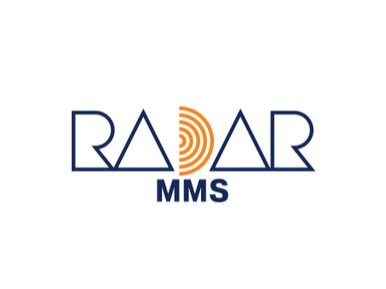
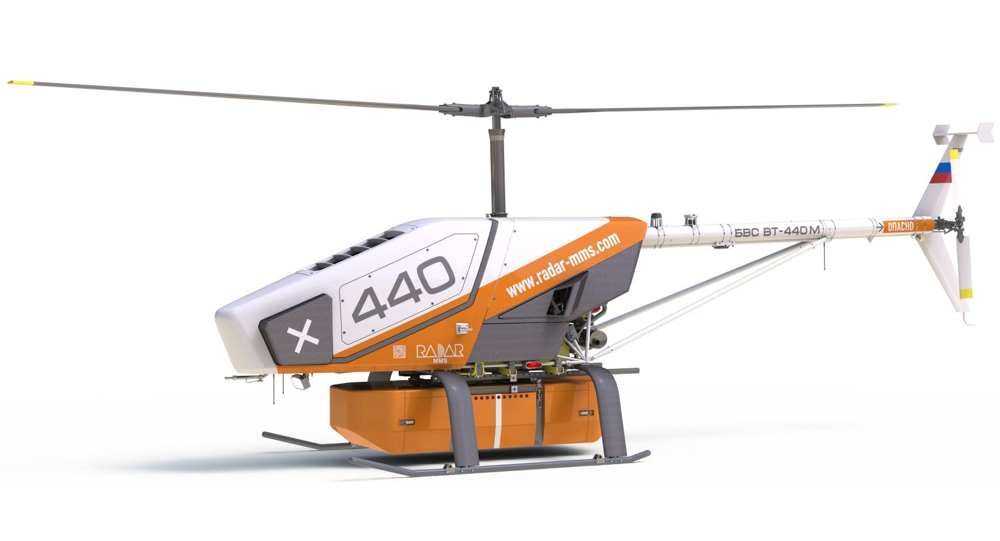

# АО «НПП «Радар ММС»»

`sanctioned` `manufacturer` 

ИНН 7814027653 · ОГРН 1027807560186 · St Petersburg

## At a glance

- **Legal form:** NPP (research and production enterprise)
- **Director:** Анцев Георгий Владимирович
- **Charter capital:** ₽13,996
- **ОКВЭД:** 26.11.9 — Производство частей электронных ламп, трубок и прочих электронных компонентов, не включенных в другие группировки
- **Wildberries overlap:** none_found

## Ownership & corporate history

### Director

| Value | As of | Note |
|---|---|---|
| Гоголинский Кирилл Валерьевич | 2017-10-02 | Signed contract 1780902212017000210 (ФГУП ВНИИ метрологии им. Менделеева) "действующий на основании Устава" — no доверенность number given, the standard indicator of the единоличный исполнительный орган at time of signing. Surfaced via scripts/zakupki_signatory_diff.py, not yet cross-checked against a dated EGRUL extract; predates the current director_history entry (Анцев Георгий Владимирович, as_of 2026-08-25) by ~9 years, no overlap conflict. [s3922] |
| Анцев Георгий Владимирович | 2021-03-10 | Должность: ГЕНЕРАЛЬНЫЙ ДИРЕКТОР-, личный ИНН 780105167705. Full signed ЕГРЮЛ выписка pulled 2026-09-07. [s6845] |
| Анцев Георгий Владимирович | 2026-08-25 | Per АЭРОНЕКСТ member-catalog card («ФИО Руководителя» field, «Должность руководителя»: Генеральный директор-Генеральный конструктор), captured_date basis -- as_of is the capture date, not independently confirmed against EGRUL yet. [s1407] |

### Charter capital

| Value | As of | Note |
|---|---|---|
| 13996 | 2002-07-24 | Full signed ЕГРЮЛ выписка pulled 2026-09-07 (egrul_vypiska_pull.py). [s6845] |

### Address

| Value | As of | Note |
|---|---|---|
| 197375, Санкт-Петербург, вн.тер.г. муниципальный округ Юнтолово, ул. Новосельковская, д. 46, литера А | 2026 | Second corpus at the main Новосельковская production complex, distinct from the д.37 address already on file. One proverki.gov.ru record explicitly names this "Строительство производственно-складского корпуса" (construction of a new production/warehouse building) -- an active expansion, not a static footprint. [s6930] |
| Ленинградская область, Кингисеппский муниципальный район, Котельское сельское поселение, дер. Хаболово (КН 47:20:0442001:212, КН 47:20:0442001:209) | 2026 | TWO separate proverki.gov.ru records cite cadastral numbers at this location, far from the entity's Санкт-Петербург HQ. Nature of the facility/land use not identified -- possible test range, antenna field, or other undisclosed site. Flagged as an open question, not a confirmed facility type. [s6930] |
| Курортный район Санкт-Петербурга (Сестрорецк/Белоостров/Песочный, incl. Сестрорецкое болото nature reserve) | 2026 | One proverki.gov.ru record covers this entire area as an inspected zone; specific activity/facility not identified from the record alone. [s6930] |

## Products

- **БВС ВТ-30Е** — Multi-purpose single-rotor helicopter-type UAS with tail rotor. Manufacturer field on this listing: АО "НПП "Радар ммс" -- confirms this registry's “НПП” name over the separate rk.2035.university showcase blurb's “Концерн” wording (see open_questions). [s1169]
- **БВС ВТ-45** — Universal helicopter-type UAS, up to 10kg payload capacity. [s1169]
- **БВС ВТ-440** — First heavy civil helicopter-type UAS certified for operation in Russia (under an experimental legal regime, ЭПР), up to 100kg payload. [s1169]
- **Радиолокационные головки самонаведения** — Radar homing heads for Kalibr/Kh-35/Kh-59 precision munitions.
- **«Метеосервер»** — Hydrometeorological monitoring system.
- **Автоматизированная док-станция (мобильный дронопорт)** — Mobile automated dronoport/dock station, от ₽26,000,000. Listed alongside БВС ВТ-440м and БВС ВТ-30Е on this entity's налетай.рф storefront; not previously in products[]. [s2630]
- **«Характер-К»** — Корабельная гидрометеорологическая станция (naval shipboard hydrometeorological station), КОД 177166 — supplied to МО РФ under gov. contract № РК/1/04/3/0208/2014 (reg. 0173100004514000947, ₽96,393,305.55, 2014-2015). A военно-морской/naval-fit product line distinct from this entity's better-documented UAV/radar work — found only by reading the fetch-documents attachment in full. [s2712]
- **Датчик метеорологической дальности видимости ДМДВ ИСАТ.416141.003** — Found via GISP goods-catalog full-roster company_ogrn sweep (2026-09-03). ОКПД2: Инструменты и приборы прочие; active ПП719 certificate flag on GISP listing [s5391]
- **Датчик скорости и направления ветра ДСНВ ИСАТ.416136.005** — Found via GISP goods-catalog full-roster company_ogrn sweep (2026-09-03). ОКПД2: Инструменты и приборы прочие; active ПП719 certificate flag on GISP listing [s5391]
- **Датчик метеорологических параметров ДМП ИСАТ.416311.002** — Found via GISP goods-catalog full-roster company_ogrn sweep (2026-09-03). ОКПД2: Инструменты и приборы прочие; active ПП719 certificate flag on GISP listing [s5391]
- **Измеритель гидрологических параметров Вектор-3 /Модификация 6/** — Found via GISP goods-catalog full-roster company_ogrn sweep (2026-09-03). ОКПД2: Инструменты и приборы гидрологические [s5391]
- **Услуга по гидрометеорологическому обеспечению ** — Found via GISP goods-catalog full-roster company_ogrn sweep (2026-09-03). ОКПД2: Услуги по гидрометеорологическому обеспечению деятельности физических и юридических лиц [s5391]
- **Измеритель гидрологических параметров Вектор-3 /Модификация 3/** — Found via GISP goods-catalog full-roster company_ogrn sweep (2026-09-03). ОКПД2: Инструменты и приборы гидрологические [s5391]
- **Измеритель гидрологических параметров Вектор-3 /Модификация 2/** — Found via GISP goods-catalog full-roster company_ogrn sweep (2026-09-03). ОКПД2: Инструменты и приборы гидрологические [s5391]
- **Измеритель гидрологических параметров Вектор-3 /Модификация 5/** — Found via GISP goods-catalog full-roster company_ogrn sweep (2026-09-03). ОКПД2: Инструменты и приборы гидрологические [s5391]
- **Измеритель гидрологических параметров Вектор-3 /Модификация 4/** — Found via GISP goods-catalog full-roster company_ogrn sweep (2026-09-03). ОКПД2: Инструменты и приборы гидрологические [s5391]
- **Измеритель гидрологических параметров Вектор-3 /Модификация 1/** — Found via GISP goods-catalog full-roster company_ogrn sweep (2026-09-03). ОКПД2: Инструменты и приборы гидрологические [s5391]
- **Регулятор теплопотребления АРГОС** — Found via GISP goods-catalog full-roster company_ogrn sweep (2026-09-03). ОКПД2: Приборы автоматические регулирующие и контрольно-измерительные прочие [s5391]
- **Датчик атмосферного давления ДАДС-1** — Found via GISP goods-catalog full-roster company_ogrn sweep (2026-09-03). ОКПД2: Барометры [s5391]
- **Датчик влажности-температуры ДТВВ-01** — Found via GISP goods-catalog full-roster company_ogrn sweep (2026-09-03). ОКПД2: Гигрометры [s5391]
- **Квантовый магнитометр** — Found via GISP goods-catalog full-roster company_ogrn sweep (2026-09-03). ОКПД2: Инструменты и приборы геофизические [s5391]
- **БВС ВТ-30E** — Многоцелевое БВС вертолетного типа одновинтовой схемы с рулевым винтом. [s1169]

## Government contracts

- basis: Открытый конкурс; contract_number: 9411.1006800.11.014; customer: Министерство промышленности и торговли Российской Федерации; date: 04.08.2009; reg_number: 0173100009511000602; value_rub: 45500000; subject_ru: Разработка технологии и конструкции ряда датчиков микроперемещений и температуры с идентификацией на поверхностных акустических волнах для применения в дистанционных автоматизированных системах контроля и мониторинга [s2657]
- basis: Открытый конкурс; contract_number: 9411.1006800.11.024; customer: Министерство промышленности и торговли Российской Федерации; date: 09.10.2009; reg_number: 0173100009511000410; value_rub: 48500000; subject_ru: Разработка базовой конструкции датчика влажности в замкнутых жилых и рабочих помещениях на основе наноструктурированных пленок, взаимодействующих с поверхностными акустическими волнами, возбуждаемыми в линиях задержки или резонаторах [s2656]
- basis: Открытый конкурс; contract_number: 10411.1006800.11.042; customer: Министерство промышленности и торговли Российской Федерации; date: 11.05.2010; reg_number: 0173100009511000713; value_rub: 25000000; subject_ru: Разработка базовой технологии вандалопрочных информационных панелей на основе технологий поверхностных акустических волн для информационных систем массового и индивидуального обслуживания [s2658]
- basis: Открытый конкурс; contract_number: 10411.1003902.11.013; customer: Министерство промышленности и торговли Российской Федерации; date: 18.05.2010; reg_number: 0173100009511000929; value_rub: 103000000; subject_ru: ОКР "Разработка технологий и конструкции блока формирования-сжатия линейночастотномодулированных сигналов с центральной частотой до 1 ГГц для систем наведения и самонаведения БПЛА" шифр "Сжатие" [s2659]
- basis: Открытый конкурс; contract_number: 10411.1003902.11.034; customer: Министерство промышленности и торговли Российской Федерации; date: 28.05.2010; reg_number: 0173100009511000940; value_rub: 93000000; subject_ru: ОКР шифр "Основание" [s2660]
- basis: Запрос котировок; contract_number: 52-11/ОРГЗ; customer: Комитет экономического развития, промышленной политики и торговли; date: 18.04.2011; reg_number: 0172200002011000053; value_rub: 495000; subject_ru: Административные услуги учреждений, направленные на повышение эффективности коммерческой деятельности [s2644]
- basis: Закупка у единственного поставщика (подрядчика, исполнителя); contract_number: З/1/5/0442/ГК-11-ДГОЗ; customer: Министерство обороны Российской Федерации; date: 22.06.2011; reg_number: 0173100004511001960; value_rub: 19740800; subject_ru: гидрометеорологическая станция "Характер-К" [s2648]
- basis: Открытый конкурс (научно-исследовательская, опытно-конструкторская или технологическая работа); contract_number: 11411.1007400.09.054; customer: Министерство промышленности и торговли Российской Федерации; date: 07.07.2011; reg_number: 0173100009511001172; value_rub: 154000000; subject_ru: Интеллектуальная и материальная продукция, услуги по исследованиям и разработкам, нефинансовые нематериальные активы в области естественных и технических наук [s2661]
- basis: Запрос котировок; contract_number: 324; customer: Комитет по природопользованию, охране окружающей среды и обеспечению экологической безопасности; date: 23.08.2011; reg_number: 0172200001611000138; value_rub: 498000; subject_ru: Услуги, связанные с проведением экологических экспертиз [s2643]
- basis: Открытый конкурс (научно-исследовательская, опытно-конструкторская или технологическая работа); contract_number: 11411.1006800.11.130; customer: Министерство промышленности и торговли Российской Федерации; date: 26.08.2011; reg_number: 0173100009511001305; value_rub: 63000000; subject_ru: 7310032: Результаты опытно - конструкторских работ по созданию материальной продукции [s2662]
- basis: Открытый конкурс (научно-исследовательская, опытно-конструкторская или технологическая работа); contract_number: 11411.1000400.11.017; customer: Министерство промышленности и торговли Российской Федерации; date: 18.11.2011; reg_number: 0173100009511002205; value_rub: 90000000; subject_ru: 7310000: Интеллектуальная и материальная продукция, услуги по исследованиям и разработкам, нефинансовые нематериальные активы в области естественных и технических наук [s2668]
- basis: Открытый конкурс (научно-исследовательская, опытно-конструкторская или технологическая работа); contract_number: 11411.1000400.11.089; customer: Министерство промышленности и торговли Российской Федерации; date: 28.11.2011; reg_number: 0173100009511001978; value_rub: 74000000; subject_ru: 7310000: Интеллектуальная и материальная продукция, услуги по исследованиям и разработкам, нефинансовые нематериальные активы в области естественных и технических наук [s2666]
- basis: Открытый конкурс (научно-исследовательская, опытно-конструкторская или технологическая работа); contract_number: 11411.1006800.11.300; customer: Министерство промышленности и торговли Российской Федерации; date: 02.12.2011; reg_number: 0173100009511001827; value_rub: 134000000; subject_ru: 7310032: Результаты опытно - конструкторских работ по созданию материальной продукции [s2663]
- basis: Открытый конкурс (научно-исследовательская, опытно-конструкторская или технологическая работа); contract_number: 11411.1006800.11.313; customer: Министерство промышленности и торговли Российской Федерации; date: 05.12.2011; reg_number: 0173100009511001841; value_rub: 54000000; subject_ru: 7310032: Результаты опытно - конструкторских работ по созданию материальной продукции [s2664]
- basis: Открытый конкурс (научно-исследовательская, опытно-конструкторская или технологическая работа); contract_number: 11411.1000400.11.163; customer: Министерство промышленности и торговли Российской Федерации; date: 06.12.2011; reg_number: 0173100009511002057; value_rub: 84000000; subject_ru: 7310000: Интеллектуальная и материальная продукция, услуги по исследованиям и разработкам, нефинансовые нематериальные активы в области естественных и технических наук [s2667]
- basis: Открытый конкурс (научно-исследовательская, опытно-конструкторская или технологическая работа); contract_number: 11411.1000400.11.147; customer: Министерство промышленности и торговли Российской Федерации; date: 07.12.2011; reg_number: 0173100009511001929; value_rub: 54000000; subject_ru: 7310000: Интеллектуальная и материальная продукция, услуги по исследованиям и разработкам, нефинансовые нематериальные активы в области естественных и технических наук [s2665]
- basis: Открытый аукцион в электронной форме; contract_number: 0173100000812000015-0087535-02; customer: Министерство обороны Российской Федерации; date: 24.02.2012; reg_number: 0173100004512000181; value_rub: 23385420; subject_ru: Корабельная гидрометеорологическая станция "Характер-К" [s2649]
- basis: Открытый конкурс (научно-исследовательская, опытно-конструкторская или технологическая работа); contract_number: 12411.1006899.11.006; customer: Министерство промышленности и торговли Российской Федерации; date: 26.03.2012; reg_number: 0173100009512000115; value_rub: 50000000; subject_ru: Выполнение ОКР"Разработка базовой технологии создания средства испытаний для контроля физико-технических параметров пожарных извещателей раннего оповещения" [s2669]
- basis: Запрос котировок; contract_number: 37-12/ОРГЗ; customer: Комитет экономического развития, промышленной политики и торговли; date: 05.04.2012; reg_number: 0172200002012000045; value_rub: 490000; subject_ru: АДМИНИСТРАТИВНЫЕ УСЛУГИ УЧРЕЖДЕНИЙ, НАПРАВЛЕННЫЕ НА ПОВЫШЕНИЕ ЭФФЕКТИВНОСТИ КОММЕРЧЕСКОЙ ДЕЯТЕЛЬНОСТИ [s2645]
- basis: Открытый аукцион в электронной форме; contract_number: 0173100000812000344-0087535-01; customer: Министерство обороны Российской Федерации; date: 13.04.2012; reg_number: 0173100004512000279; value_rub: 28290000; subject_ru: Сервисное обслуживание, установка и ремонт средств гидрометеорологического обеспечения сил ВМФ [s2650]
- basis: Открытый конкурс (научно-исследовательская, опытно-конструкторская или технологическая работа); contract_number: 12411.1006899.11.078; customer: Министерство промышленности и торговли Российской Федерации; date: 05.05.2012; reg_number: 0173100009512000352; value_rub: 102000000; subject_ru: Выполнение ОКР "Разработка унифицированного электронного модуля считывателя системы беспроводного мониторинга на ПАВ датчиках". [s2672]
- basis: Открытый конкурс (научно-исследовательская, опытно-конструкторская или технологическая работа); contract_number: 12411.1006899.11.073; customer: Министерство промышленности и торговли Российской Федерации; date: 14.05.2012; reg_number: 0173100009512000332; value_rub: 104000000; subject_ru: Выполнение ОКР "Разработка базовой технологии создания системы безопасности с использованием электроиндукционных пожарных извещателей раннего предупреждения о зарождении опасных ситуаций" [s2670]
- basis: Открытый конкурс (научно-исследовательская, опытно-конструкторская или технологическая работа); contract_number: 12411.1006899.11.074; customer: Министерство промышленности и торговли Российской Федерации; date: 14.05.2012; reg_number: 0173100009512000333; value_rub: 117000000; subject_ru: Выполнение ОКР "Разработка базовой технологии и конструкции пассивного беспроводного сенсора локальной температуры биологических объектов". [s2671]
- basis: Открытый аукцион в электронной форме; contract_number: ГК384-06/12; customer: федеральное государственное бюджетное образовательное учреждение высшего профессионального образования "Национальный минерально-сырьевой университет "Горный"; date: 07.06.2012; reg_number: 0372100009412000116; value_rub: 26750000; subject_ru: Средства СЕВ самолетные [s2681]
- basis: Открытый конкурс (научно-исследовательская, опытно-конструкторская или технологическая работа); contract_number: 12411.1400099.11.131; customer: Министерство промышленности и торговли Российской Федерации; date: 16.07.2012; reg_number: 0173100009512000766; value_rub: 90000000; subject_ru: Выполнение ОКР «Разработка линий задержек на ПАВ-структурах для системы радиочастотной идентификации функциональной подсистемы управления материально-техническим обеспечением АСУ ВС РФ», шифр «Микрос-6» [s2673]
- basis: Запрос котировок; contract_number: 19/12; customer: Федеральное государственное бюджетное учреждение "Санкт-Петербургский центр по гидрометеорологии и мониторингу окружающей среды с региональными функциями"; date: 24.09.2012; reg_number: 0372100006212000015; value_rub: 330000; subject_ru: Установки гидрометеорологические измерительные наземные проводные дистанционные [s2680]
- basis: Открытый конкурс (научно-исследовательская, опытно-конструкторская или технологическая работа); contract_number: 13411.1006899.11.017; customer: МИНИСТЕРСТВО ПРОМЫШЛЕННОСТИ И ТОРГОВЛИ РОССИЙСКОЙ ФЕДЕРАЦИИ; date: 28.02.2013; items: ОКР «Разработка базовой технологии создания унифицированных электронных модулей обработки сигналов сенсоров веса и движения для большегрузных автомобилей», шифр «Модуль-Перегруз» (гос. контракт от 28.02.2013 № 13411.10068.99.11.017, доп. соглашение №4 sets 2015 funding at ₽64m budget + ₽38m внебюджетных средств). Weigh-in-motion sensor tech for heavy trucks — under Минпромторг Департамент радиоэлектронной промышленности funding, dual-use/civilian-framed application.; reg_number: 0173100009513000090; value_rub: 110000000.0 [s2718]
- basis: Запрос котировок; contract_number: 4/13/ГК; customer: Комитет по промышленной политике и инновациям Санкт-Петербурга; date: 01.04.2013; reg_number: 0172200006913000007; value_rub: 490000; subject_ru: Оказание услуг по проведению Всероссийской научно-практической конференции «Научно-технические проблемы в промышленности: Будущее сильной России в высоких технологиях» [s2646]
- basis: Открытый аукцион в электронной форме; contract_number: 0173100000813000179-0087535-02; customer: Министерство обороны Российской Федерации; date: 05.04.2013; reg_number: 0173100004513000376; value_rub: 27335329; subject_ru: Корабельная гидрометеорологическая станция "Характер-К" [s2651]
- basis: Открытый конкурс (научно-исследовательская, опытно-конструкторская или технологическая работа); contract_number: 13411.1400099.11.007; customer: МИНИСТЕРСТВО ПРОМЫШЛЕННОСТИ И ТОРГОВЛИ РОССИЙСКОЙ ФЕДЕРАЦИИ; date: 05.04.2013; reg_number: 0173100009513000238; value_rub: 40000000.0; subject_ru: Выполнение ОКР «Разработка гиперзвуковых линий задержки 2-см диапазона длин волн для аппаратуры контроля головок самонаведения», шифр «Одноцветник-30» [s2632]
- basis: Открытый конкурс (научно-исследовательская, опытно-конструкторская или технологическая работа); contract_number: 13411.1400099.11.026; customer: МИНИСТЕРСТВО ПРОМЫШЛЕННОСТИ И ТОРГОВЛИ РОССИЙСКОЙ ФЕДЕРАЦИИ; date: 10.04.2013; reg_number: 0173100009513000264; value_rub: 51000000.0; subject_ru: Выполнение ОКР «Разработка частотозадающих модулей до 2,5 ГГц с резонаторами на поверхностных акустических волнах», шифр «Многоцветник-32» [s2675]
- basis: Открытый конкурс; contract_number: 47/92; customer: Федеральное дорожное агентство; date: 22.07.2013; reg_number: 0173100005713000052; value_rub: 9000000; subject_ru: Разработка предложений по эффективной области применения пассивных беспроводных датчиков на поверхностных акустических волнах для дистанционного мониторинга дорожной инфраструктуры в составе интеллектуальных транспортных систем [s2655]
- basis: Открытый конкурс (научно-исследовательская, опытно-конструкторская или технологическая работа); contract_number: 8-3-41/771/ОК; customer: Министерство обороны Российской Федерации; date: 04.10.2013; reg_number: 0173100004513001187; value_rub: 95149090 [s2652]
- basis: Открытый аукцион в электронной форме; contract_number: ЭА-13/126; customer: федеральное государственное бюджетное учреждение "Арктический и антарктический научно-исследовательский институт"; date: 12.11.2013; reg_number: 0372100002113000487; value_rub: 352000; subject_ru: Измеритель скорости и направления течений «Вектор-2» [s2679]
- basis: Открытый аукцион в электронной форме; contract_number: 1912-НО; customer: Федеральное государственное бюджетное учреждение науки Институт океанологии им. П.П. Ширшова Российской академии наук; date: 27.12.2013; reg_number: 0373100006614000002; value_rub: 1061000; subject_ru: Измеритель течений [s2682]
- basis: Открытый конкурс (научно-исследовательская, опытно-конструкторская или технологическая работа); contract_number: 14411.169999.11.041; customer: МИНИСТЕРСТВО ПРОМЫШЛЕННОСТИ И ТОРГОВЛИ РОССИЙСКОЙ ФЕДЕРАЦИИ; date: 28.02.2014; reg_number: 0173100009514000152; value_rub: 227000000.0; subject_ru: Выполнение ОКР «Разработка промышленной технологии создания интегрированного радиолокационного модуля на базе цифровой активной фазированной решетки для высокоскоростных транспортных средств специального назначения, летящих в пределах действия аэродинамического экрана», шифр «Подкрылок» [s2633]
- basis: Открытый конкурс (научно-исследовательская, опытно-конструкторская или технологическая работа); contract_number: 14411.1929999.11.005; customer: МИНИСТЕРСТВО ПРОМЫШЛЕННОСТИ И ТОРГОВЛИ РОССИЙСКОЙ ФЕДЕРАЦИИ; date: 17.03.2014; reg_number: 0173100009514000262; value_rub: 51015000.0; subject_ru: Выполнение ОКР «Разработка технологии конструирования и производства измерительной аппаратуры прецизионного контроля давления для разработки и испытаний информационно-управляющих систем экранопланов нового поколения», шифр «Движение» [s2676]
- basis: Открытый конкурс (научно-исследовательская, опытно-конструкторская или технологическая работа); contract_number: 14411.1929999.11.034; customer: МИНИСТЕРСТВО ПРОМЫШЛЕННОСТИ И ТОРГОВЛИ РОССИЙСКОЙ ФЕДЕРАЦИИ; date: 01.04.2014; reg_number: 0173100009514000358; value_rub: 85500000.0; subject_ru: Выполнение ОКР «Разработка базовой технологии создания высокочувствительного унифицированного электронного модуля сенсора влажности с использованием влагочувствительных композиций на основе наноматериалов для систем мониторинга окружающей среды», шифр «Атмосфера» [s2677]
- basis: Запрос котировок; contract_number: 11/14/ГК; customer: Комитет по промышленной политике и инновациям Санкт-Петербурга; date: 07.04.2014; reg_number: 0172200006914000012; value_rub: 490000; subject_ru: Оказание услуг по организации и проведению Всероссийской научно-практической конференции «Научно-технические проблемы в промышленности: Будущее сильной России в высоких технологиях» [s2647]
- basis: Электронный аукцион; contract_number: 1416187206072040105002065/0173100000814000463-0087535-02; customer: МИНИСТЕРСТВО ОБОРОНЫ РОССИЙСКОЙ ФЕДЕРАЦИИ; date: 20.05.2014; reg_number: 0173100004514000501; value_rub: 21910000.0; subject_ru: Оказание услуг (Установка гидрометеостанции "Характер-К" на радиотехнических постах береговой системы наблюдения ВМФ) [s2653]
- basis: Открытый конкурс (научно-исследовательская, опытно-конструкторская или технологическая работа); contract_number: 14411.1929999.11.062; customer: МИНИСТЕРСТВО ПРОМЫШЛЕННОСТИ И ТОРГОВЛИ РОССИЙСКОЙ ФЕДЕРАЦИИ; date: 21.07.2014; reg_number: 0173100009514000523; value_rub: 80000000.0; subject_ru: Выполнение ОКР «Разработка базовой технологии жесткого присоединения изделий функциональной электроники на ПАВ к основанию», шифр «Соединение » [s2678]
- basis: Электронный аукцион; contract_number: 1415187205932020105001814/0173100000814001063-0087535-02; customer: МИНИСТЕРСТВО ОБОРОНЫ РОССИЙСКОЙ ФЕДЕРАЦИИ; date: 28.07.2014; items: Поставка корабельной гидрометеорологической станции «Характер-К» (КОД 177166) для нужд Министерства обороны РФ, 2014-2015 гг., в рамках гособоронзаказа. Sole-supplier basis п.25 ч.1 ст.93 44-ФЗ (single bid received on the electronic auction). Technical acceptance by 543 военное представительство МО РФ. Signed for the supplier by Заместитель генерального директора по экономике и финансам Нефедов Сергей Михайлович.; reg_number: 0173100004514000947; value_rub: 96393305.55 [s2712]
- basis: Электронный аукцион; contract_number: 0172200006915000019-0480708-01; customer: КОМИТЕТ ПО ПРОМЫШЛЕННОЙ ПОЛИТИКЕ И ИННОВАЦИЯМ САНКТ-ПЕТЕРБУРГА; date: 30.03.2015; reg_number: 2783848285215000015; value_rub: 347500.0; subject_ru: Оказание услуг по организации и проведению Всероссийской научно-практической конференции «Научно-технические проблемы в промышленности: Будущее сильной России в высоких технологиях» [s2696]
- basis: Открытый конкурс; contract_number: 16411.4432017.11.061; customer: МИНИСТЕРСТВО ПРОМЫШЛЕННОСТИ И ТОРГОВЛИ РОССИЙСКОЙ ФЕДЕРАЦИИ; date: 14.11.2016; items: ОКР «Разработка и освоение серийного производства на отечественном предприятии электронного модуля измерения на основе сорбционно-емкостного датчика влажности и температуры», шифр «Микрос-ИЗ» (гос. контракт № КРИ 06, 2016). Под госпрограмму «Развитие оборонно-промышленного комплекса».; reg_number: 1770559633916000981; value_rub: 128500000.0 [s2773]
- basis: Электронный аукцион; contract_number: 1719187102042412209022759; customer: МИНИСТЕРСТВО ОБОРОНЫ РОССИЙСКОЙ ФЕДЕРАЦИИ; date: 02.08.2017; reg_number: 1770425226117000798; value_rub: 79999999.98; subject_ru: поставка гидрометеостанций корабельных «Характер-К» с монтажными и пусконаладочными работами для нужд Минобороны России [s2683]
- basis: Электронный аукцион; contract_number: 1719187302431442209016193
                                             / 
                                            315-ЭА/2017; customer: ФЕДЕРАЛЬНОЕ ГОСУДАРСТВЕННОЕ УНИТАРНОЕ ПРЕДПРИЯТИЕ "ВСЕРОССИЙСКИЙ НАУЧНО-ИССЛЕДОВАТЕЛЬСКИЙ ИНСТИТУТ МЕТРОЛОГИИ ИМ.Д.И.МЕНДЕЛЕЕВА"; date: 02.10.2017; reg_number: 1780902212017000210; value_rub: 3379145.82; subject_ru: Сервисное обслуживание и ремонт приборов и блоков кораблей (судов) Военно-Морского Флота [s2691]
- basis: Открытый конкурс; contract_number: 17208.4442018.11.002; customer: МИНИСТЕРСТВО ПРОМЫШЛЕННОСТИ И ТОРГОВЛИ РОССИЙСКОЙ ФЕДЕРАЦИИ; date: 06.12.2017; items: ОКР «Разработка базовых ресурсосберегающих и импортозамещающих технологий получения и применения современных композиционных материалов для производства базовых несущих конструкций и функциональных элементов бортовых радиоэлектронных комплексов нового поколения», шифр «Рэбум-м» (гос. контракт № 17208-4442018, 2017). Под подпрограмму 4 госпрограммы «Развитие оборонно-промышленного комплекса» — import-substitution composite-materials R&D for airborne radio-electronics housings.; reg_number: 1770559633917000757; value_rub: 165000000.0 [s2780]
- basis: Электронный аукцион; contract_number: 0172200006917000060-0480708-01; customer: КОМИТЕТ ПО ПРОМЫШЛЕННОЙ ПОЛИТИКЕ И ИННОВАЦИЯМ САНКТ-ПЕТЕРБУРГА; date: 08.02.2018; reg_number: 2783848285218000007; value_rub: 545000.0; subject_ru: Оказание услуг по организации и проведению Всероссийской научно-практической конференции «Научно-технические проблемы в промышленности: Будущее сильной России в высоких технологиях» [s2697]
- basis: Электронный аукцион для заключения энергосервисного контракта; contract_number: 254-06/19мз; customer: НОВОКУЙБЫШЕВСКОЕ МУНИЦИПАЛЬНОЕ БЮДЖЕТНОЕ УЧРЕЖДЕНИЕ ПО ОБЕСПЕЧЕНИЮ ФУНКЦИОНИРОВАНИЯ УЧРЕЖДЕНИЙ ОБРАЗОВАНИЯ "ЦЕНТР-СЕРВИС"; date: 28.06.2019; items: Выполнение комплекса мероприятий, направленных на энергосбережение и повышение энергетической эффективности использования тепловой энергии на объектах Заказчика; reg_number: 3633005008919000078; value_rub: 2240262.88 [s2640]
- basis: Электронный аукцион; contract_number: 1032059; customer: КОМИТЕТ ПО ПРОМЫШЛЕННОЙ ПОЛИТИКЕ, ИННОВАЦИЯМ И ТОРГОВЛЕ САНКТ-ПЕТЕРБУРГА; date: 27.03.2020; items: Оказание услуг по организации и проведению Всероссийской научно-практической конференции «Научно-технические проблемы в промышленности: Будущее сильной России в высоких технологиях»; reg_number: 2783848285220000003; value_rub: 596000.0 [s2698]
- basis: Электронный аукцион; contract_number: 9/21/ГК; customer: КОМИТЕТ ПО ПРОМЫШЛЕННОЙ ПОЛИТИКЕ, ИННОВАЦИЯМ И ТОРГОВЛЕ САНКТ-ПЕТЕРБУРГА; date: 05.04.2021; items: Оказание услуг по организации и проведению Всероссийской научно-практической конференции «Научно-технические проблемы в промышленности: Будущее сильной России в высоких технологиях»; reg_number: 2783848285221000008; value_rub: 490000.0 [s2699]
- basis: Электронный аукцион; contract_number: 20/21-144; customer: ФЕДЕРАЛЬНОЕ ГОСУДАРСТВЕННОЕ БЮДЖЕТНОЕ УЧРЕЖДЕНИЕ "ВСЕРОССИЙСКИЙ НАУЧНО-ИССЛЕДОВАТЕЛЬСКИЙ ГЕОЛОГИЧЕСКИЙ ИНСТИТУТ ИМ. А.П. КАРПИНСКОГО"; date: 15.06.2021; items: Поставка датчика магнитометрического ДМ к Измерительному блоку аэромагнитометра ГТ-МАГ-2 для нужд Норильского филиала ФГБУ ВСЕГЕИ; reg_number: 1780130013621000159; value_rub: 1142880.0 [s2689]
- basis: Электронный аукцион; contract_number: 775/1371-Д; customer: ФЕДЕРАЛЬНОЕ ГОСУДАРСТВЕННОЕ УНИТАРНОЕ ГИДРОГРАФИЧЕСКОЕ ПРЕДПРИЯТИЕ; date: 10.03.2022; items: Поставка оборудования для модернизации средств навигационного оборудования реки Енисей; reg_number: 1781202209622000001; value_rub: 46823502.76 [s2692]
- basis: Электронный аукцион; contract_number: 9/22/ГК; customer: КОМИТЕТ ПО ПРОМЫШЛЕННОЙ ПОЛИТИКЕ, ИННОВАЦИЯМ И ТОРГОВЛЕ САНКТ-ПЕТЕРБУРГА; date: 05.04.2022; items: Оказание услуг по организации и проведению Всероссийской научно-практической конференции «Научно-технические проблемы в промышленности: Будущее сильной России в высоких технологиях»; reg_number: 2783848285222000009; value_rub: 615786.0 [s2700]
- basis: Электронный аукцион; contract_number: 46; customer: САНКТ-ПЕТЕРБУРГСКОЕ ГОСУДАРСТВЕННОЕ КАЗЕННОЕ УЧРЕЖДЕНИЕ "ПОИСКОВО-СПАСАТЕЛЬНАЯ СЛУЖБА САНКТ-ПЕТЕРБУРГА"; date: 18.05.2022; items: Оказание услуг по техническому обслуживанию и ремонту беспилотной авиационной системы БАС ВТ-ПСС для обеспечения деятельности подразделений Санкт-Петербургского государственного казенного учреждения «Поисково-спасательная служба Санкт-Петербурга»; reg_number: 2780548181422000052; value_rub: 1274940.0 [s2695]
- basis: Электронный аукцион; contract_number: 0373400006822000045-01; customer: ФЕДЕРАЛЬНОЕ ГОСУДАРСТВЕННОЕ БЮДЖЕТНОЕ УЧРЕЖДЕНИЕ "ЦЕНТРАЛЬНЫЙ НАУЧНО-ИССЛЕДОВАТЕЛЬСКИЙ ГЕОЛОГОРАЗВЕДОЧНЫЙ ИНСТИТУТ ЦВЕТНЫХ И БЛАГОРОДНЫХ МЕТАЛЛОВ"; date: 19.07.2022; items: Поставка квантовых магнитометрических датчиков; reg_number: 1772642942722000056; value_rub: 3588000.0 [s2686]
- basis: Электронный аукцион; contract_number: 0372200278522000062_256695; customer: САНКТ-ПЕТЕРБУРГСКОЕ ГОСУДАРСТВЕННОЕ КАЗЕННОЕ УЧРЕЖДЕНИЕ "УПРАВЛЕНИЕ ИНФОРМАЦИОННЫХ ТЕХНОЛОГИЙ И СВЯЗИ"; date: 15.09.2022; items: Выполнение первой очереди работ по созданию государственной информационной системы Санкт-Петербурга «Городской реестр социальной защиты» в 2022 году; reg_number: 2784244461022000131; value_rub: 28499130.0 [s2703]
- basis: Электронный аукцион; contract_number: 0372200278522000061_256695; customer: САНКТ-ПЕТЕРБУРГСКОЕ ГОСУДАРСТВЕННОЕ КАЗЕННОЕ УЧРЕЖДЕНИЕ "УПРАВЛЕНИЕ ИНФОРМАЦИОННЫХ ТЕХНОЛОГИЙ И СВЯЗИ"; date: 15.09.2022; items: Выполнение работ по развитию государственной информационной системы Санкт-Петербурга «Цифровые сервисы на потребительском рынке Санкт-Петербурга» в 2022 году; reg_number: 2784244461022000132; value_rub: 35386137.48 [s2704]
- basis: Электронный аукцион; contract_number: 7/23/ГК; customer: КОМИТЕТ ПО ПРОМЫШЛЕННОЙ ПОЛИТИКЕ, ИННОВАЦИЯМ И ТОРГОВЛЕ САНКТ-ПЕТЕРБУРГА; date: 03.04.2023; items: Оказание услуг по организации и проведению Всероссийской научно-практической конференции «Научно-технические проблемы в промышленности: Будущее сильной России в высоких технологиях»; reg_number: 2783848285223000006; value_rub: 679801.99 [s2701]
- basis: Электронный аукцион; contract_number: 105-2-23-44-52; customer: ФЕДЕРАЛЬНОЕ ГОСУДАРСТВЕННОЕ БЮДЖЕТНОЕ УЧРЕЖДЕНИЕ "НАЦИОНАЛЬНЫЙ ИССЛЕДОВАТЕЛЬСКИЙ ЦЕНТР "КУРЧАТОВСКИЙ ИНСТИТУТ"; date: 22.05.2023; items: Поставка измерителя гидрологических параметров; reg_number: 1773411103523000117; value_rub: 1776155.0 [s2688]
- basis: Электронный аукцион; contract_number: 31-23; customer: ФЕДЕРАЛЬНОЕ ГОСУДАРСТВЕННОЕ БЮДЖЕТНОЕ УЧРЕЖДЕНИЕ НАУКИ ИНСТИТУТ ЯДЕРНЫХ ИССЛЕДОВАНИЙ РОССИЙСКОЙ АКАДЕМИИ НАУК; date: 23.05.2023; items: Закупка научного оборудования. Поставка магнитовариационной станции в соответствии с требованиями технического задания и спецификацией.; reg_number: 1772811643723000033; value_rub: 2524693.33 [s2687]
- basis: Электронный аукцион; contract_number: 775/2365-Д; customer: ФЕДЕРАЛЬНОЕ ГОСУДАРСТВЕННОЕ УНИТАРНОЕ ГИДРОГРАФИЧЕСКОЕ ПРЕДПРИЯТИЕ; date: 05.07.2023; items: Выполнение работ по модернизации средств навигационного оборудования акватории Северного морского пути; reg_number: 1781202209623000001; value_rub: 36643416.67 [s2693]
- basis: Электронный аукцион; contract_number: 0372200278523000076_256695; customer: САНКТ-ПЕТЕРБУРГСКОЕ ГОСУДАРСТВЕННОЕ КАЗЕННОЕ УЧРЕЖДЕНИЕ "УПРАВЛЕНИЕ ИНФОРМАЦИОННЫХ ТЕХНОЛОГИЙ И СВЯЗИ"; date: 05.07.2023; items: Выполнение работ по развитию Портала «Мы Петербург» в 2023 году; reg_number: 2784244461023000105; value_rub: 11760207.74 [s2705]
- basis: Открытый конкурс в электронной форме; contract_number: 2.1.3/2023/НПП РАДАР ММС; customer: ФЕДЕРАЛЬНОЕ ГОСУДАРСТВЕННОЕ БЮДЖЕТНОЕ УЧРЕЖДЕНИЕ "ВСЕРОССИЙСКИЙ НАУЧНО-ИССЛЕДОВАТЕЛЬСКИЙ ИНСТИТУТ ГЕОЛОГИИ И МИНЕРАЛЬНЫХ РЕСУРСОВ МИРОВОГО ОКЕАНА ИМЕНИ АКАДЕМИКА И.С. ГРАМБЕРГА"; date: 23.08.2023; items: Выполнение магнитной съёмки с помощью БПЛА в районе оазиса Бангера и холмов Хайджамп, Земля Королевы Мэри, Восточная Антарктида, в составе 69 РАЭ; reg_number: 1783905878023000044; value_rub: 12999610.62 [s2694]
- basis: Электронный аукцион; contract_number: 0372200278523000112_256695; customer: САНКТ-ПЕТЕРБУРГСКОЕ ГОСУДАРСТВЕННОЕ КАЗЕННОЕ УЧРЕЖДЕНИЕ "УПРАВЛЕНИЕ ИНФОРМАЦИОННЫХ ТЕХНОЛОГИЙ И СВЯЗИ"; date: 04.10.2023; items: Выполнение работ по развитию государственной информационной системы Санкт-Петербурга «Цифровые сервисы на потребительском рынке Санкт-Петербурга» в 2023-2024 годах; reg_number: 2784244461023000147; value_rub: 16000016.0 [s2639]
- basis: Электронный аукцион; contract_number: 50.1/23-520; customer: ФЕДЕРАЛЬНОЕ ГОСУДАРСТВЕННОЕ БЮДЖЕТНОЕ УЧРЕЖДЕНИЕ "ВСЕРОССИЙСКИЙ НАУЧНО-ИССЛЕДОВАТЕЛЬСКИЙ ГЕОЛОГИЧЕСКИЙ ИНСТИТУТ ИМ. А.П. КАРПИНСКОГО"; date: 02.02.2024; items: Поставка датчика магниточувствительного квантового авиационного для обеспечения аэрогеофизических работ; reg_number: 1780130013624000051; value_rub: 4899999.0 [s2690]
- basis: Электронный аукцион; contract_number: 5/24/ГК; customer: КОМИТЕТ ПО ПРОМЫШЛЕННОЙ ПОЛИТИКЕ, ИННОВАЦИЯМ И ТОРГОВЛЕ САНКТ-ПЕТЕРБУРГА; date: 11.03.2024; items: Оказание услуг по организации и проведению Всероссийской научно-практической конференции «Научно-технические проблемы в промышленности: Будущее сильной России в высоких технологиях»; reg_number: 2783848285224000004; value_rub: 793127.99 [s2702]
- basis: Запрос котировок в электронной форме; contract_number: 50.1/24-180; customer: ФЕДЕРАЛЬНОЕ ГОСУДАРСТВЕННОЕ БЮДЖЕТНОЕ УЧРЕЖДЕНИЕ "ВСЕРОССИЙСКИЙ НАУЧНО-ИССЛЕДОВАТЕЛЬСКИЙ ГЕОЛОГИЧЕСКИЙ ИНСТИТУТ ИМ. А.П. КАРПИНСКОГО"; date: 24.05.2024; items: Поставка аппаратурно-программного многоканального магнитометрического комплекса; reg_number: 1780130013624000177; value_rub: 3600000.0 [s2635]
- basis: Электронный аукцион; contract_number: ГК-013/03.25; customer: ФЕДЕРАЛЬНОЕ ГОСУДАРСТВЕННОЕ БЮДЖЕТНОЕ УЧРЕЖДЕНИЕ "ВСЕРОССИЙСКИЙ НАУЧНО-ИССЛЕДОВАТЕЛЬСКИЙ ИНСТИТУТ ГЕОЛОГИИ И МИНЕРАЛЬНЫХ РЕСУРСОВ МИРОВОГО ОКЕАНА ИМЕНИ АКАДЕМИКА И.С. ГРАМБЕРГА"; date: 26.03.2025; items: Поставка комплекса бортового аэромагнитного для проведения геофизических съемок для нужд ФГБУ «ВНИИОкеангеология»; reg_number: 1783905878025000014; value_rub: 11243340.0 [s2636]
- basis: Электронный аукцион; contract_number: 7/25/ГК; customer: КОМИТЕТ ПО ПРОМЫШЛЕННОЙ ПОЛИТИКЕ, ИННОВАЦИЯМ И ТОРГОВЛЕ САНКТ-ПЕТЕРБУРГА; date: 28.03.2025; items: Оказание услуг по организации и проведению Всероссийской юношеской научно-практической конференции «Будущее сильной России - в высоких технологиях»; reg_number: 2783848285225000007; value_rub: 1981255.0 [s2637]
- basis: Электронный аукцион; contract_number: 6/26/ГК; customer: КОМИТЕТ ПО ПРОМЫШЛЕННОЙ ПОЛИТИКЕ, ИННОВАЦИЯМ И ТОРГОВЛЕ САНКТ-ПЕТЕРБУРГА; date: 10.03.2026; items: Оказание услуг по организации и проведению Всероссийской юношеской научно-практической конференции «Будущее сильной России - в высоких технологиях»; reg_number: 2783848285226000007; value_rub: 1954867.5 [s2638]
- basis: Электронный аукцион; contract_number: 105-2-26-44-333; customer: ФЕДЕРАЛЬНОЕ ГОСУДАРСТВЕННОЕ БЮДЖЕТНОЕ УЧРЕЖДЕНИЕ "НАЦИОНАЛЬНЫЙ ИССЛЕДОВАТЕЛЬСКИЙ ЦЕНТР "КУРЧАТОВСКИЙ ИНСТИТУТ"; date: 04.05.2026; items: Поставка измерителя гидрологических параметров; reg_number: 1773411103526000181; value_rub: 2283700.0 [s2634]

## State-program participation

- as_of: 2026-09-03; name_en: GISP (State Industrial Information System) Industrial Atlas — federal company-registry map layer; name_ru: Атлас промышленности ГИСП (Государственная информационная система промышленности); role: Company listed in the Ministry of Industry and Trade's official industrial-facility geodatabase, classified under industry '(unclassified)' with primary ОКВЭД 26.11.9 — independently corroborates the entity's ИНН/ОГРН/address/ОКВЭД via a second, unrelated federal data source (matches EGRUL exactly). [s5346]

## Trademarks

| Mark | Reg. no. | Filed | Registered | Classes |
|---|---|---|---|---|
| — | 906069 | 20220602 | 23.11.2022 | 09 (broad catch-all filing, no UAV/defense-specific items) |
| — | 910730 | 20220804 | 12.12.2022 | 09 (broad catch-all filing, no UAV/defense-specific items) |
| — | 929673 | 20220704 | 16.03.2023 | 09 (broad catch-all filing, no UAV/defense-specific items); 42 (broad catch-all filing, no UAV/defense-specific items) |
| — | 956331 | 20220816 | 21.07.2023 | 09 (broad catch-all filing, no UAV/defense-specific items); 38 (broad catch-all filing, no UAV/defense-specific items); 42 (broad catch-all filing, no UAV/defense-specific items) |
| — | 1048759 | 20240110 | 09.09.2024 | 07 (генераторы электроэнергии; машины грузоподъемные; насосные станции; приводы, в том числе гидравлические и электромеханические); 09 (UAV/defense terms present: антенн, беспилот, летательн, навигацион); 10 (приборы для измерения температуры для медицинских целей; устройства диагностические); 12 (аппараты летательные беспилотные [БПЛА], в том числе для доставки грузов; беспилотные авиационные системы; дроны; средства транспортные беспилотные); 16 (broad catch-all filing, no UAV/defense-specific items); 39 (услуги спасательные, в том числе, проведение поисково-спасательных работ; услуги по доставке грузов); 40 (broad catch-all filing, no UAV/defense-specific items); 41 (broad catch-all filing, no UAV/defense-specific items); 42 (UAV/defense terms present: беспилот, летательн); 45 (услуги экстренного оповещения; предоставление услуг по наблюдению и разведке; услуги охраны) |
| — | 1081135 | 20240327 | 24.01.2025 | 09 (видео и аудио записи; видео фильмы; контент мультимедийный; контент цифровой); 12 (средства транспортные водные; суда, в том числе быстроходные, грузовые, круизные, пассажирские, патрульные, спасательные, рыболовные, сухогрузные; суда на подводных крыльях; устройства для управления судами); 16 (broad catch-all filing, no UAV/defense-specific items); 20 (стенды выставочные); 25 (одежда, обувь, головные уборы); 37 (обслуживание техническое транспортных средств; судостроение); 39 (аренда водного транспорта; перевозки водным транспортом; услуги водного прогулочного транспорта); 41 (broad catch-all filing, no UAV/defense-specific items); 42 (broad catch-all filing, no UAV/defense-specific items) |
| — | 1121332 | 20231218 | 05.06.2025 | 07 (генераторы электроэнергии; машины грузоподъемные; насосные станции; приводы, в том числе гидравлические и электромеханические); 09 (UAV/defense terms present: антенн, беспилот, летательн, навигацион); 10 (приборы для измерения температуры для медицинских целей; устройства диагностические); 12 (аппараты летательные беспилотные [БПЛА], в том числе для доставки грузов; беспилотные авиационные системы; дроны; средства транспортные беспилотные); 39 (услуги спасательные, в том числе, проведение поисково-спасательных работ; услуги по доставке грузов); 40 (broad catch-all filing, no UAV/defense-specific items); 41 (broad catch-all filing, no UAV/defense-specific items); 42 (UAV/defense terms present: беспилот, летательн); 45 (услуги экстренного оповещения; предоставление услуг по наблюдению и разведке; услуги охраны) |

## Patents

| Title | Reg. no. | Filed | Inventors |
|---|---|---|---|
| СПОСОБ СТАРТА РАКЕТЫ ИЗ ШИРОКОФЮЗЕЛЯЖНОГО НОСИТЕЛЯ | RU2705387C1 | 2018.12.14 | Янцевич Михаил Владимирович (RU), Потапов Владимир Федорович (RU), Доронин Виктор Валентинович (RU), Анцев Иван Георгиевич (RU), Самонов Виктор Алексеевич (RU), Анцев Георгий Владимирович (RU), Соколовский Виктор Владимирович (RU), Старостенко Антон Валентинович (RU) |
| СПОСОБ ВЕРТИКАЛЬНОГО ВОЗДУШНОГО ЗАПУСКА РАКЕТ | RU2722633C1 | 2018.12.14 | Анцев Георгий Владимирович (RU), Потапов Владимир Федорович (RU), Старостенко Антон Валентинович (RU), Соколовский Виктор Владимирович (RU), Самонов Виктор Алексеевич (RU), Анцев Иван Георгиевич (RU), Доронин Виктор Валентинович (RU), Янцевич Михаил Владимирович (RU) |

## Litigation

- Полный четырёхлетний цикл (2022–2024): первая инстанция → апелляция → кассационная отмена → новое рассмотрение → отказ в иске → апелляция и кассация подтвердили отказ → поворот исполнения. Представитель истца в заседании 02.09.2024: Пашаев Р.М. (доверенность от 12.10.2022). Судья первой инстанции на всех этапах — Ласкина С.О. В отличие от пассивной модели ответчика, видимой в делах АО «НИИ СТТ», АО «НПП Радар ммс» демонстрирует реальную способность вести многоуровневую апелляционно-кассационную защиту и добилось полного освобождения от неустойки, а также подавало (неуспешно, отклонён к совместному рассмотрению) встречный иск к Минобороны о взыскании собственной задолженности. Хронология по всем 15 файлам дела архивирована в data/sources/A40-211563-2022_*.pdf ([s5266]–[s5280]); не все 15 файлов прочитаны построчно, но итоговая траектория подтверждена финальным определением от 02.09.2024 ([s5280]), которое пересказывает все промежуточные акты. [s5266]
- ПАО «Информационные телекоммуникационные технологии» не числится в реестре — не проверено через ЕГРЮЛ. Три доступных акта архивированы: [s5282] (21.02.2026), [s5283] (22.03.2026), [s5284] (02.06.2026). Дело закрыто для дальнейшего доступа судом (закрытое заседание) после этих трёх документов — статья 11 АПК РФ (гостайна/оборонная классификация либо ходатайство стороны о коммерческой/служебной тайне, конкретное основание не установлено из доступных текстов). [s5282]
- Открытый вопрос, а не подтверждённая связь. Документ архивирован ([s5281]), но информационная ценность близка к нулю из-за полной редакции текста. Не привязывать к АО «НПП Радар ммс» без независимого подтверждения имён сторон. [s5281]

## Licences

- Лицензиат в реестре: «Открытое акционерное общество "Научно-производственное предприятие "Радар ммс"» (197375, г. Санкт-Петербург, ул. Новосельковская, д. 37.). Дата внесения сведений в реестр: 17-11-2015. [s6408]
- Лицензиат в реестре: «Открытое акционерное общество "Научно-производственное предприятие "Радар ммс"» (197375, г. Санкт-Петербург, ул. Новосельковская, д. 37.). Дата внесения сведений в реестр: 17-11-2015. [s6408]
- Лицензиат в реестре: «Открытое акционерное общество "Научно-производственное предприятие "Радар ммс"» (197375, г. Санкт-Петербург, ул. Новосельковская, д. 37.). Дата внесения сведений в реестр: 17-11-2015. [s6408]
- Лицензиат в реестре: «Открытое акционерное общество "Научно-производственное предприятие "Радар ммс"» (197375, г. Санкт-Петербург, ул. Новосельковская, д. 37.). Дата внесения сведений в реестр: 17-11-2015. [s6408]
- Лицензиат в реестре: «Открытое акционерное общество "Научно-производственное предприятие "Радар ммс"» (197375, г. Санкт-Петербург, ул. Новосельковская, д. 37.). Дата внесения сведений в реестр: 17-11-2015. [s6408]
- Лицензиат в реестре: «Открытое акционерное общество "Научно-производственное предприятие "Радар ммс"» (197375, г. Санкт-Петербург, ул. Новосельковская, д. 37.). Дата внесения сведений в реестр: 17-11-2015. [s6408]
- Действующая. Эрул-номер Л026-00122-77/00723764, ОГРН 1027807560186 (совпадает с текущим ОГРН записи). Адреса деятельности: 4 объекта в Санкт-Петербурге (ул. Новосельковская д.37; пр-кт Коломяжский д.27, три отдельных помещения). [s6414]
- Срок действия до 11.03.2025. Статус: действует. [s6429]
- Срок действия до 11.03.2025. Статус: действует. [s6429]
- Срок действия до 11.03.2025. Статус: действие прекращено. [s6429]
- 24 отдельных частотных присвоения, выданные ОДНИМ приказом в ОДИН день (581-рчс от 23.07.2025), срок действия до 01.12.2026, все статус «действует» — крупный единовременный пакет присвоений, нехарактерный для рядового заявителя, указывающий на развёрнутую многоканальную радиоэлектронную систему. [s6429]
- Срок действия истёк 11.09.2021. [s6429]
- Срок действия до 11.09.2028. Статус: действует. [s6429]
- Срок действия истёк 11.09.2021. [s6429]
- Срок действия истёк 11.09.2023. [s6429]
- Реестр показывает 32 записи всего; выборка первых 20 (page 0) включает крупную серию из 15 действующих присвоений от 23.07.2025 (приказ 581-рчс) плюс более ранние записи 2015/2017 гг. — согласуется с профилем НПП «Радар ммс» как производителя радиолокационной техники, использующего множество частотных присвоений для испытаний/эксплуатации оборудования; не итемизировано полностью. [s6450]

## Sanctions & screening

**GB-RUS, NZ-RSA2022, US (OFAC, Russia Harmful Foreign Activities Sanctions), Australia (Autonomous Sanctions, Russia), Switzerland (SECO, Ukraine-related measures), Canada (Special Economic Measures Act), Ukraine (Presidential sanctions decree/list), Ukraine (war-sanctions.gur.gov.ua, military-industry listing), US-BIS-EL, EU (Ukraine-related restrictive measures)** [s0798]

- Listed on Ukraine's GUR war-sanctions UAV-industry registry (screened 2026-09-05).
- 1 OpenSanctions match(es) (screened 2026-09-06).
- 5 OCCRP Aleph match(es) (screened 2026-09-19).

## Web & social presence

### Website

- <https://radar-mms.com/> — Confirmed: address matches registry exactly (197375, СПб, ул. Новосельковская, д. 37, лит. А).

### Marketplace listings

- <https://xn--80aaorhk2b.xn--p1ai/sellers/radar-mms> — Official partner/seller profile on Налетай.рф, the ГТЛК-backed state civilian UAV marketplace. Legal-info block confirms exact ИНН match. Direct manufacturer storefront (sells under its own name, not a reseller). 3 products: БВС ВТ-440м (helicopter-type UAV, from ₽80,000,000), БВС ВТ-30Е (from ₽15,000,000), and a mobile automated dronoport (from ₽26,000,000) -- high-value military-grade hardware sold openly.

## Images

-  — Company logo, as self-listed in rk.2035.university's curated БАС-industry showcase [s1168]
-  — БВС ВТ-440М helicopter-type UAV -- product photo from its Налетай.рф listing, branded with the manufacturer's own radar-mms.com site and callsign «ДРАКОН». [s2630]

## Principals & persons of interest

### Antsev Georgiy Vladimirovich — Анцев Георгий Владимирович

- **ИНН:** 780105167705
- co-inventor (patent RU2705387C1)
- co-inventor (patent RU2722633C1)

### Antsev Ivan Georgievich — Анцев Иван Георгиевич

- **ИНН:** 780156016060
- co-inventor (patent RU2705387C1)
- co-inventor (patent RU2722633C1)

### Doronin Viktor Valentinovich — Доронин Виктор Валентинович

- **ИНН:** 695001185808
- co-inventor (patent RU2705387C1)
- co-inventor (patent RU2722633C1)

### Potapov Vladimir Fedorovich — Потапов Владимир Федорович

- **ИНН:** 665100951290
- co-inventor (patent RU2705387C1)
- co-inventor (patent RU2722633C1)

### Samonov Viktor Alekseevich — Самонов Виктор Алексеевич

- co-inventor (patent RU2705387C1)
- co-inventor (patent RU2722633C1)

### Sokolovskiy Viktor Vladimirovich — Соколовский Виктор Владимирович

- co-inventor (patent RU2705387C1)
- co-inventor (patent RU2722633C1)

### Starostenko Anton Valentinovich — Старостенко Антон Валентинович

- co-inventor (patent RU2705387C1)
- co-inventor (patent RU2722633C1)

### Yantsevich Mikhail Vladimirovich — Янцевич Михаил Владимирович

- co-inventor (patent RU2705387C1)
- co-inventor (patent RU2722633C1)

## Open questions

- Featured in rk.2035.university's curated БАС-industry showcase as "АО «Концерн «Радар ММС»»" -- the catalog blurb uses "Концерн" where this registry has "НПП" (both plausibly refer to the same well-known St. Petersburg avionics/radar group; not ИНН-confirmed via this source, which carries no identifier field). [s1168]
- This entity's own rk.2035.university product listings ([s1169], manufacturer field literally АО "НПП "Радар ммс") confirm the registry's own «НПП «Радар ММС»»» name -- resolving the earlier open question about the showcase catalog's separate «Концерн» wording ([s1168]) in favour of «НПП». [s1169]
- Identify what facility/land use is at Ленинградская область, Кингисеппский район, дер. Хаболово (КН 47:20:0442001:212, :209) -- two proverki.gov.ru inspection records cite these cadastral numbers for this defense radar manufacturer, far from its Санкт-Петербург HQ. Test range? Antenna field? Undisclosed production site? Not yet identified. [s6930]
- RESOLVED 2026-09-07 via НСПД ([s6944]): КН 47:20:0442001:212 is a 1,530 m² private residential land plot (индивидуальное жилищное строительство) in дер. Хаболово, Кингисеппский район — not a company facility, test range, or antenna field. Likely a personal landholding of an employee/officer named on the proverki inspection (not identified), unrelated to the company's defense-radar operations. КН :209 has no НСПД record (code 204) — possibly mistyped in the source or re-numbered. No further action planned. [s6944]

## Sources cited in this profile

| ID | Type | Locator | Captured | As of |
|---|---|---|---|---|
| [s0798] | OpenSanctions screening record | OpenSanctions screening record (OPENSANCTIONS_7814027653_20260824_npp-radar-mms.json) | 2026-08-24 | — |
| [s1168] | bulk open-data extract | bulk open-data extract (DATASET_20260824_rk2035-university-bas-objects-catalog.json) | 2026-08-24 | — |
| [s1169] | bulk open-data extract | bulk open-data extract (DATASET_20260824_rk2035-university-bas-product-models.json) | 2026-08-24 | — |
| [s1407] | АЭРОНЕКСТ member record | АЭРОНЕКСТ member record (AERONEXT_7814027653_20260825_npp-radar-mms.json) | 2026-08-25 | — |
| [s2630] | Naletay | Naletay (NALETAY_7814027653_20260826_catalog-listing.json) | 2026-08-26 | 2026-08-26 |
| [s2632] | Zakupki | Zakupki (ZAKUPKI_contract_0173100009513000238_20260826.html) | 2026-08-26 | — |
| [s2633] | Zakupki | Zakupki (ZAKUPKI_contract_0173100009514000152_20260826.html) | 2026-08-26 | — |
| [s2634] | Zakupki | Zakupki (ZAKUPKI_contract_1773411103526000181_20260826.html) | 2026-08-26 | — |
| [s2635] | Zakupki | Zakupki (ZAKUPKI_contract_1780130013624000177_20260826.html) | 2026-08-26 | — |
| [s2636] | Zakupki | Zakupki (ZAKUPKI_contract_1783905878025000014_20260826.html) | 2026-08-26 | — |
| [s2637] | Zakupki | Zakupki (ZAKUPKI_contract_2783848285225000007_20260826.html) | 2026-08-26 | — |
| [s2638] | Zakupki | Zakupki (ZAKUPKI_contract_2783848285226000007_20260826.html) | 2026-08-26 | — |
| [s2639] | Zakupki | Zakupki (ZAKUPKI_contract_2784244461023000147_20260826.html) | 2026-08-26 | — |
| [s2640] | Zakupki | Zakupki (ZAKUPKI_contract_3633005008919000078_20260826.html) | 2026-08-26 | — |
| [s2643] | Zakupki | Zakupki (ZAKUPKI_contract_0172200001611000138_20260826.html) | 2026-08-26 | — |
| [s2644] | Zakupki | Zakupki (ZAKUPKI_contract_0172200002011000053_20260826.html) | 2026-08-26 | — |
| [s2645] | Zakupki | Zakupki (ZAKUPKI_contract_0172200002012000045_20260826.html) | 2026-08-26 | — |
| [s2646] | Zakupki | Zakupki (ZAKUPKI_contract_0172200006913000007_20260826.html) | 2026-08-26 | — |
| [s2647] | Zakupki | Zakupki (ZAKUPKI_contract_0172200006914000012_20260826.html) | 2026-08-26 | — |
| [s2648] | Zakupki | Zakupki (ZAKUPKI_contract_0173100004511001960_20260826.html) | 2026-08-26 | — |
| [s2649] | Zakupki | Zakupki (ZAKUPKI_contract_0173100004512000181_20260826.html) | 2026-08-26 | — |
| [s2650] | Zakupki | Zakupki (ZAKUPKI_contract_0173100004512000279_20260826.html) | 2026-08-26 | — |
| [s2651] | Zakupki | Zakupki (ZAKUPKI_contract_0173100004513000376_20260826.html) | 2026-08-26 | — |
| [s2652] | Zakupki | Zakupki (ZAKUPKI_contract_0173100004513001187_20260826.html) | 2026-08-26 | — |
| [s2653] | Zakupki | Zakupki (ZAKUPKI_contract_0173100004514000501_20260826.html) | 2026-08-26 | — |
| [s2655] | Zakupki | Zakupki (ZAKUPKI_contract_0173100005713000052_20260826.html) | 2026-08-26 | — |
| [s2656] | Zakupki | Zakupki (ZAKUPKI_contract_0173100009511000410_20260826.html) | 2026-08-26 | — |
| [s2657] | Zakupki | Zakupki (ZAKUPKI_contract_0173100009511000602_20260826.html) | 2026-08-26 | — |
| [s2658] | Zakupki | Zakupki (ZAKUPKI_contract_0173100009511000713_20260826.html) | 2026-08-26 | — |
| [s2659] | Zakupki | Zakupki (ZAKUPKI_contract_0173100009511000929_20260826.html) | 2026-08-26 | — |
| [s2660] | Zakupki | Zakupki (ZAKUPKI_contract_0173100009511000940_20260826.html) | 2026-08-26 | — |
| [s2661] | Zakupki | Zakupki (ZAKUPKI_contract_0173100009511001172_20260826.html) | 2026-08-26 | — |
| [s2662] | Zakupki | Zakupki (ZAKUPKI_contract_0173100009511001305_20260826.html) | 2026-08-26 | — |
| [s2663] | Zakupki | Zakupki (ZAKUPKI_contract_0173100009511001827_20260826.html) | 2026-08-26 | — |
| [s2664] | Zakupki | Zakupki (ZAKUPKI_contract_0173100009511001841_20260826.html) | 2026-08-26 | — |
| [s2665] | Zakupki | Zakupki (ZAKUPKI_contract_0173100009511001929_20260826.html) | 2026-08-26 | — |
| [s2666] | Zakupki | Zakupki (ZAKUPKI_contract_0173100009511001978_20260826.html) | 2026-08-26 | — |
| [s2667] | Zakupki | Zakupki (ZAKUPKI_contract_0173100009511002057_20260826.html) | 2026-08-26 | — |
| [s2668] | Zakupki | Zakupki (ZAKUPKI_contract_0173100009511002205_20260826.html) | 2026-08-26 | — |
| [s2669] | Zakupki | Zakupki (ZAKUPKI_contract_0173100009512000115_20260826.html) | 2026-08-26 | — |
| [s2670] | Zakupki | Zakupki (ZAKUPKI_contract_0173100009512000332_20260826.html) | 2026-08-26 | — |
| [s2671] | Zakupki | Zakupki (ZAKUPKI_contract_0173100009512000333_20260826.html) | 2026-08-26 | — |
| [s2672] | Zakupki | Zakupki (ZAKUPKI_contract_0173100009512000352_20260826.html) | 2026-08-26 | — |
| [s2673] | Zakupki | Zakupki (ZAKUPKI_contract_0173100009512000766_20260826.html) | 2026-08-26 | — |
| [s2675] | Zakupki | Zakupki (ZAKUPKI_contract_0173100009513000264_20260826.html) | 2026-08-26 | — |
| [s2676] | Zakupki | Zakupki (ZAKUPKI_contract_0173100009514000262_20260826.html) | 2026-08-26 | — |
| [s2677] | Zakupki | Zakupki (ZAKUPKI_contract_0173100009514000358_20260826.html) | 2026-08-26 | — |
| [s2678] | Zakupki | Zakupki (ZAKUPKI_contract_0173100009514000523_20260826.html) | 2026-08-26 | — |
| [s2679] | Zakupki | Zakupki (ZAKUPKI_contract_0372100002113000487_20260826.html) | 2026-08-26 | — |
| [s2680] | Zakupki | Zakupki (ZAKUPKI_contract_0372100006212000015_20260826.html) | 2026-08-26 | — |
| [s2681] | Zakupki | Zakupki (ZAKUPKI_contract_0372100009412000116_20260826.html) | 2026-08-26 | — |
| [s2682] | Zakupki | Zakupki (ZAKUPKI_contract_0373100006614000002_20260826.html) | 2026-08-26 | — |
| [s2683] | Zakupki | Zakupki (ZAKUPKI_contract_1770425226117000798_20260826.html) | 2026-08-26 | — |
| [s2686] | Zakupki | Zakupki (ZAKUPKI_contract_1772642942722000056_20260826.html) | 2026-08-26 | — |
| [s2687] | Zakupki | Zakupki (ZAKUPKI_contract_1772811643723000033_20260826.html) | 2026-08-26 | — |
| [s2688] | Zakupki | Zakupki (ZAKUPKI_contract_1773411103523000117_20260826.html) | 2026-08-26 | — |
| [s2689] | Zakupki | Zakupki (ZAKUPKI_contract_1780130013621000159_20260826.html) | 2026-08-26 | — |
| [s2690] | Zakupki | Zakupki (ZAKUPKI_contract_1780130013624000051_20260826.html) | 2026-08-26 | — |
| [s2691] | Zakupki | Zakupki (ZAKUPKI_contract_1780902212017000210_20260826.html) | 2026-08-26 | — |
| [s2692] | Zakupki | Zakupki (ZAKUPKI_contract_1781202209622000001_20260826.html) | 2026-08-26 | — |
| [s2693] | Zakupki | Zakupki (ZAKUPKI_contract_1781202209623000001_20260826.html) | 2026-08-26 | — |
| [s2694] | Zakupki | Zakupki (ZAKUPKI_contract_1783905878023000044_20260826.html) | 2026-08-26 | — |
| [s2695] | Zakupki | Zakupki (ZAKUPKI_contract_2780548181422000052_20260826.html) | 2026-08-26 | — |
| [s2696] | Zakupki | Zakupki (ZAKUPKI_contract_2783848285215000015_20260826.html) | 2026-08-26 | — |
| [s2697] | Zakupki | Zakupki (ZAKUPKI_contract_2783848285218000007_20260826.html) | 2026-08-26 | — |
| [s2698] | Zakupki | Zakupki (ZAKUPKI_contract_2783848285220000003_20260826.html) | 2026-08-26 | — |
| [s2699] | Zakupki | Zakupki (ZAKUPKI_contract_2783848285221000008_20260826.html) | 2026-08-26 | — |
| [s2700] | Zakupki | Zakupki (ZAKUPKI_contract_2783848285222000009_20260826.html) | 2026-08-26 | — |
| [s2701] | Zakupki | Zakupki (ZAKUPKI_contract_2783848285223000006_20260826.html) | 2026-08-26 | — |
| [s2702] | Zakupki | Zakupki (ZAKUPKI_contract_2783848285224000004_20260826.html) | 2026-08-26 | — |
| [s2703] | Zakupki | Zakupki (ZAKUPKI_contract_2784244461022000131_20260826.html) | 2026-08-26 | — |
| [s2704] | Zakupki | Zakupki (ZAKUPKI_contract_2784244461022000132_20260826.html) | 2026-08-26 | — |
| [s2705] | Zakupki | Zakupki (ZAKUPKI_contract_2784244461023000105_20260826.html) | 2026-08-26 | — |
| [s2712] | Zakupki | Zakupki (ZAKUPKI_ATTACH_0173100004514000947_0173100004514000947_82-pk-kharakter-01731000045140009470002_00559baa.docx) | — | — |
| [s2718] | Zakupki | Zakupki (ZAKUPKI_ATTACH_0173100009513000090_0173100009513000090_modul-peregruz_0cb13e9d.pdf) | — | — |
| [s2773] | Zakupki | Zakupki (ZAKUPKI_ATTACH_1770559633916000981_1770559633916000981_16411-4432017-1-17705596339160009810002_4169e4e7.pdf) | — | — |
| [s2780] | Zakupki | Zakupki (ZAKUPKI_ATTACH_1770559633917000757_1770559633917000757_17208-4442018-1-17705596339170007570002_60287f57.pdf) | — | — |
| [s3922] | Zakupki | Zakupki (ZAKUPKI_contract_1780902212017000210_20260830.html) | 2026-08-30 | — |
| [s5266] | arbitration court filing | arbitration court filing (A40-211563-2022_20221109_Opredelenie.pdf) | 2022-11-09 | 2022-11-09 |
| [s5281] | arbitration court filing | arbitration court filing (A54-3359-2026_20260417_Opredelenie.pdf) | 2026-04-17 | 2026-04-17 |
| [s5282] | arbitration court filing | arbitration court filing (A56-17609-2026_20260221_Opredelenie.pdf) | 2026-02-21 | 2026-02-21 |
| [s5346] | Gisp | Gisp (GISP_20260903_atlas-promyshlennosti-full-dump-40281-companies.json) | 2026-09-03 | 2026-09-03 |
| [s5391] | Gisp | Gisp (GISP_20260903_goods-catalog-full-roster-sweep-20-hits.json) | 2026-09-03 | 2026-09-03 |
| [s6408] | bulk open-data extract | bulk open-data extract (DATASET_20181120_minpromtorg-aviation-tech-licenses-registry-data-gov-ru.csv) | 2018-11-20 | — |
| [s6414] | bulk open-data extract | bulk open-data extract (DATASET_20260906_roscosmos-licenses-registry-api-full-dump.json) | 2026-09-06 | — |
| [s6429] | bulk open-data extract | bulk open-data extract (DATASET_20260906_rkn-frequency-assignment-registry-search.json) | 2026-09-06 | — |
| [s6450] | Rkn | Rkn (RKN_7814027653_20260907_frequency-registry-npp-radar-mms.html) | 2026-09-07 | — |
| [s6845] | EGRUL extract | EGRUL extract (EGRUL_7814027653_20260907_npp-radar-mms.pdf) | 2026-09-07 | 2026-09-07 |
| [s6930] | Proverki | Proverki (PROVERKI_7814027653_20260907_npp-radar-mms-inspection-history.txt) | 2026-09-07 | — |
| [s6944] | Nspd | Nspd (NSPD_khabolovo_212_20260907.json) | 2026-09-07 | — |

---
_Generated from this investigation's registry (`data/registry/`) by `scripts/build_company_profile.py`. Not a substitute for reading the underlying primary sources listed above._