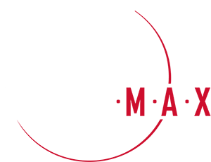

# ООО «Аэромакс»

`sanctioned` `manufacturer` 

ИНН 7725347482 · ОГРН 1177746007900

## At a glance

- **Legal form:** OOO (limited liability company)
- **Registered:** 09.01.2017
- **Address:** 123060, Москва, вн.тер.г. муниципальный округ Щукино, пр-д 1-й Волоколамский, д. 10, стр. 1
- **Director:** Бессонов Сергей Николаевич
- **Charter capital:** ₽3,177,522,000
- **ОКВЭД:** 71.12.44 — Деятельность по созданию топографических карт и планов
- **ЦБСТ tie:** Named directly by ЦБСТ's own channel as a sanctioned resident -- "a tenth name" in the same 24.04.2026 post (t.me/ANO_CBST/2095) discussed at length elsewhere in the same post beyond its six-name contour sentence, corroborated by the EU's own Council Decision (CFSP) 2026/504 (entry 759) naming LLC "AEROMAKS" (ИНН 7725347482) directly.
- **Wildberries overlap:** none_found

## Ownership & corporate history

### Director

| Value | As of | Note |
|---|---|---|
| Чижов Максим Сергеевич | 2020-09-01 | Генеральный директор «действующего на основании Устава» per the signature block of Государственный контракт № 44 with the Ministry of Ecology of Sakhalin Oblast. Earliest documented officer of this entity, predating both Сазанова А.А. (as_of 2024-09-27) and the unreconciled ЕГРЮЛ reading Бессонов С.Н. [s5656] |
| Сазанова Алиса Алексеевна | 2024-09-27 | Signed государственный контракт № ГК 6401/24-4574 with ДИТ Москвы «в лице генерального директора Сазановой Алисы Алексеевны, действующего на основании Устава». Conflicts with the ЕГРЮЛ extract on file ([s0218]), which records Бессонов С.Н. as director — the ЕГРЮЛ extract was pulled 20.08.2026 and its own effective date has not been reconciled against this 2024 signature. Not resolved: whether Сазанова held the post only in 2024, or the two records simply reflect different dates. Flagged rather than merged. [s4572] |
| Бессонов Сергей Николаевич | 2025-09-11 | Должность: ГЕНЕРАЛЬНЫЙ ДИРЕКТОР, личный ИНН 644914040799. Full signed ЕГРЮЛ выписка pulled 2026-09-07. [s6741] |

### Founders / ownership

| Value | As of | Note |
|---|---|---|
| ООО «ГК «Аэромакс»» (ИНН 7710974353, ОГРН 1147748024269) — 100%, nominal ₽3,177,522,000 | 2026-07-14 | ГРН 2267706031459, 14.07.2026 — sole participant; the participant record itself was entered 04.06.2026 (ГРН 2267704772993) [s0218] |

### Charter capital

| Value | As of | Note |
|---|---|---|
| 3177522000 | 2021-02-12 | ГРН 2217701017334, 12.02.2021 — ₽3.18bn [s0218] |

### Address

| Value | As of | Note |
|---|---|---|
| 123060, Москва, вн.тер.г. муниципальный округ Щукино, пр-д 1-й Волоколамский, д. 10, стр. 1 | 2025-11-07 | ГРН 2257723296400, 07.11.2025 [s0218] |
| 101000, г. Москва, пер. Милютинский, д. 13, стр. 1 | 2026 | None of proverki's 3 distinct facility addresses match the entity's own registered legal address (1-й Волоколамский пр-д, д.10, стр.1). [s6927] |
| 115432, г. Москва, пр-т Андропова, д. 18, к. 9 | 2026 | See note on пер. Милютинский entry -- 2nd of 3 non-matching facility addresses. [s6927] |
| 199178, г. Санкт-Петербург, Малый пр. В.О., д. 54, корп. 5, лит. Р | 2026 | See note on пер. Милютинский entry -- 3rd of 3 non-matching facility addresses, and the only one outside Moscow. [s6927] |

## Products

- **B-120** — Беспилотный вертолёт (helicopter-type БАС). [s7997]
- **B-200** — Беспилотный вертолёт В-200, autonomous logistics use. [s7998]
- **В-700** — Heavy-class unmanned cargo helicopter, 3600kg takeoff mass, 700kg payload, Russian ВК-650В turboshaft engine, for Arctic/Siberian cargo delivery. Per the manufacturer's own press release ([s7994]): prototype assembly targeted late 2026, factory/certification testing 2027-2028, type certification targeted April 2029 -- an announced, in-development product, not yet shipping. [s7994]
- **А-5** — Aircraft-type БАС. [s7996]
- **А-5 М/Л** — Aircraft-type БАС — "высокой скоростью, большой продолжительностью и высотой полета". [s7995]
- **A-50** — FLAGGED 2026-09-23: no source supports this as a real Aeromax product. "A-50" collides with the well-known Soviet/Russian A-50 AWACS aircraft (unrelated manufacturer/programme); a WebSearch sweep of Aeromax's own site, press coverage, and third-party listings found zero connection between Aeromax and any "A-50". Likely a stray/garbled entry (possibly confused with А-5). Left in place rather than silently deleted -- needs a human decision on whether to remove.
- **БВС СТ AS-32-10** — Fixed-wing UAS with extended flight time, for aerial survey over large areas. [s1169]
- **БВС СТ AS-32-8** — Compact electric fixed-wing UAS for rapid deployment and high-precision imagery. [s1169]
- **БВС СТ Д-12К** — Electric VTOL UAS. [s1169]

## Financials

| Year | Revenue | Profit | Source |
|---|---|---|---|
| 2021 | ₽231,712,000 | ₽-493,725,000 | [s5553] |
| 2022 | ₽256,862,000 | ₽2,851,156,000 | [s5554] |

## Government contracts

- Surfaced by the user's 2026-09-05 re-scan. THE NOTABLE FACT is not the survey work but a qualification condition in п.5.1.1 of the signed contract: the supplier must «обеспечить наличие действующей лицензии на право осуществления деятельности, связанной с использованием сведений, составляющих государственную тайну», citing ч.1 ст.27 of the Law of the RF «О государственной тайне» № 5485-1 and п.60 of Presidential Decree № 1203 of 30.11.1995. So ООО «Аэромакс» was required to hold — and by winning the award, represented that it held — a Russian state-secrets clearance licence as of April 2020. The contract text was recovered from a cp866-encoded zip (scanned-original bundle); ИКЗ 202781501552378410100100040017420244, signed for the committee by chairman Беляев Д.С. Цена включает НДС 20% — 714 906,00 руб. Статус по карточке: Исполнение завершено. [s5658]
- Surfaced by the user's 2026-09-05 re-scan (13 hits vs the 10 previously collected). Signed for the customer by minister Корнев В.В. and for ООО «Аэромакс» by генеральный директор Чижов Максим Сергеевич — see director_history. Civil forest-inventory survey work, the commercial side of this entity's aerial-survey business. Статус по карточке: Исполнение завершено. [s5656]
- Surfaced by the user's 2026-09-05 re-scan. Sole-supplier award. Agricultural land-boundary mapping for Tomsk oblast — again civil aerial survey/GIS work. Статус по карточке: Исполнение завершено. [s5657]
- Subject stated at contract-card level only — no readable signed contract document in the archived attachment set for this reg number; the specific work description is therefore not recorded here rather than inferred. Status per the contract card as of the 2026-08-31 capture: Исполнение завершено. [s5241]
- Smallest contract on file; municipal cadastral survey work for the city of Smolensk, signed by и.о. Главы города Смоленска Пархоменко А.В. Status per the contract card as of the 2026-08-31 capture: Исполнение прекращено. [s5259]
- Signed by the customer's и.о. директора департамента лесного хозяйства Нижегородской области; contract text confirms parties and price but the archived copy does not carry a separable предмет line. Status per the contract card as of the 2026-08-31 capture: Исполнение завершено. [s5231]
- Municipal aerial-survey/topographic mapping work. Status per the contract card as of the 2026-08-31 capture: Исполнение завершено. [s5258]
- Second award from the same St Petersburg customer. Subject stated at contract-card level only — no readable signed contract document in the archived attachment set. Status per the contract card as of the 2026-08-31 capture: Исполнение завершено. [s5242]
- Moscow city environmental department; first of two consecutive awards on the same subject. Status per the contract card as of the 2026-08-31 capture: Исполнение завершено. [s5235]
- Second-largest contract on file. Aerial remote-sensing survey work for the federal forest-inventory agency ФГБУ «Рослесинфорг» (source [s4568]-series attachment set; subject text quoted from the signed гражданско-правовой договор № ЭА-000777). Status per the contract card as of the 2026-08-31 capture: Исполнение прекращено. [s5219]
- Moscow city environmental department; second and larger of two consecutive awards on the same subject. Status per the contract card as of the 2026-08-31 capture: Исполнение завершено. [s5236]
- Second Рослесинфорг award, this one combining satellite ДЗЗ with ground survey data from the государственная инвентаризация лесов (ГИЛ). Status per the contract card as of the 2026-08-31 capture: Исполнение завершено. [s5220]
- Largest documented contract for this entity. Open electronic competition (реестровый номер закупки 0173200001424001297, протокол ИЭОК1 от 16.09.2024); максимальное значение цены ₽268,916,478.58, сумма единичных расценок ₽23,050.00 (source [s4572], the signed государственный контракт docx). Signed for Аэромакс by генеральный директор Сазанова Алиса Алексеевна — NOT Бессонов С.Н., the director on file from the ЕГРЮЛ extract; see director_history. Terminated by mutual agreement in 2025 without any services rendered or paid (соглашение о расторжении, source [s4571], signed for Аэромакс by первый заместитель генерального директора Никифоров Антон Сергеевич under доверенность от 20.12.2024 № 15-09/92-ДИ; «услуги не оказывались и оплате не подлежат», «стороны претензий друг к другу не имеют»). Same customer and same ГК 6401/24-XXXX contract-number series as ООО «Гаскар интеграция»'s ₽516.8m ГК 6401/24-4522 — two separate ДИТ Москвы awards in the same 2024 batch to two entities on this roster. Status per the contract card as of the 2026-08-31 capture: Исполнение прекращено. [s5240]

## Trademarks

| Mark | Reg. no. | Filed | Registered | Classes |
|---|---|---|---|---|
| — | 739439 | 20190320 | 17.12.2019 | 12 (UAV/defense terms present: летательн, радиоуправляем, дрон, военн, воздушн, беспилот, робот); 39 (UAV/defense terms present: летательн, навигацион); 42 (broad catch-all filing, no UAV/defense-specific items) |
| — | 744949 | 20190320 | 05.02.2020 | 39 (UAV/defense terms present: летательн, навигацион); 42 (broad catch-all filing, no UAV/defense-specific items) |
| — | 781613 | 20200225 | 02.11.2020 | 12 (UAV/defense terms present: беспилот, робот, летательн, радиоуправляем, дрон, военн, воздушн); 39 (UAV/defense terms present: летательн, навигацион); 42 (broad catch-all filing, no UAV/defense-specific items) |
| — | 948119 | 20220711 | 09.06.2023 | 09 (приборы навигационные спутниковые; приборы точные измерительные; устройства для автоматического управления транспортными средствами; устройства зарядные портативные; флэш-накопители USB); 12 (UAV/defense terms present: беспилот, робот, летательн, радиоуправляем, дрон, воздушн); 14 (брелоки для держателей для ключей); 16 (broad catch-all filing, no UAV/defense-specific items); 18 (визитницы); 21 (кружки; стаканы [емкости]; стаканы для напитков); 24 (баннеры текстильные или пластиковые; пледы для пикника; пледы дорожные); 25 (куртки [одежда]; одежда; футболки); 28 (макеты [игрушки]/модели [игрушки]); 39 (UAV/defense terms present: летательн, навигацион); 42 (UAV/defense terms present: дрон) |

## Licences

- Геодезическая и картографическая деятельность — создание государственных топографических карт и планов, государственных геодезических/нивелирных/гравиметрических сетей, сетей дифференциальных геодезических станций, определение параметров фигуры Земли и гравитационного поля; установление, изменение и уточнение прохождения Государственной границы Российской Федерации и границ между субъектами РФ [s0218]
- Свидетельство эксплуатанта (СЭ), выполняющего авиационные работы — реестр Росавиации (favt.gov.ru, выборка из ФГИС «Реестр эксплуатантов и воздушных судов» на 01.09.2026). Статус: норма (действующее). Эксплуатируемые ВС: АС-МК-6 производства ООО «АС-КАМ» (1 ед.), ДИАМ 20 производства ООО «ДИАМ-АЭРО» (1 ед.) — оба являются беспилотными авиационными системами, не пилотируемыми самолётами. [s6416]

## Sanctions & screening

**US (OFAC, Russia Harmful Foreign Activities Sanctions), EU (Ukraine-related restrictive measures), Ukraine (Presidential sanctions decree/list), Switzerland (SECO, Ukraine-related measures)** [s0780]

- 5 OpenSanctions match(es) (screened 2026-09-06).
- 5 OCCRP Aleph match(es) (screened 2026-09-19).

## Web & social presence

### Website

- <https://www.aeromax-group.ru/produkciya/> — ИНН 7725347482 entity — the EU-sanctioned Кронштадт/Аэромакс operating LLC.

### Telegram

- <https://t.me/aeromax_group>

## Images

-  — Company logo ("M.A.X"), from the company's own official site. [s7567]

## Principals & persons of interest

### Бессонов Сергей Николаевич

- **ИНН:** 644914040799
- Генеральный директор
- `sanctions lead`

### Sazanova Alisa Alekseevna — Сазанова Алиса Алексеевна

- Генеральный директор

### Nikiforov Anton Sergeevich — Никифоров Антон Сергеевич

- Первый заместитель генерального директора

## Corporate links

- **ООО «Аэромакс-Авиа (Центр-Логистика)»** `sister-entity` — Same director (Бессонов Сергей Николаевич) — confirms ООО «Аэромакс-Авиа (Центр-Логистика)» (ИНН 9704149557) is a sister/logistics-arm entity of the ГК «Аэромакс» group, not an unrelated namesake. Confirmed 2026-09-29 via a fresh ФНС «Прозрачный бизнес» director/founder cross-reference (screen_upr_uchr.py, [s8065]): both entities listed under Бессонов's own director role. [s8065]
- **ООО «ГК «Аэромакс»»** — Parent entity (100%) [s0218]

## Open questions

- ООО «Аэромакс» was registered 09.01.2017, but its current name record dates only from 16.04.2019 (ГРН 2197747176086) — i.e. the company traded under a DIFFERENT name for its first two years. The extract states the current name only; the predecessor name is not in it. Worth pulling the superseded record or founding charter, since renames are a recurring pattern in this roster (cf. Рационы питания → Боевые технологии). [s0218]

## Sources cited in this profile

| ID | Type | Locator | Captured | As of |
|---|---|---|---|---|
| [s0218] | EGRUL extract | EGRUL extract (ul-1177746007900-20260820195721.pdf) | — | 2026-08-20 |
| [s0780] | OpenSanctions screening record | OpenSanctions screening record (OPENSANCTIONS_7725347482_20260824_ooo-aeromaks.json) | 2026-08-24 | — |
| [s1169] | bulk open-data extract | bulk open-data extract (DATASET_20260824_rk2035-university-bas-product-models.json) | 2026-08-24 | — |
| [s4572] | Zakupki | Zakupki (ZAKUPKI_ATTACH_7725347482_2771087800024000123_kontrakt-gk-6-27710878000240001230002_2266db7b.docx) | — | 2023-12-26 |
| [s5219] | Zakupki | Zakupki (ZAKUPKI_contract_1772231995223000867_20260831.html) | 2026-08-31 | — |
| [s5220] | Zakupki | Zakupki (ZAKUPKI_contract_1772231995224000778_20260831.html) | 2026-08-31 | — |
| [s5231] | Zakupki | Zakupki (ZAKUPKI_contract_2526029455221000021_20260831.html) | 2026-08-31 | — |
| [s5235] | Zakupki | Zakupki (ZAKUPKI_contract_2770422175322000063_20260831.html) | 2026-08-31 | — |
| [s5236] | Zakupki | Zakupki (ZAKUPKI_contract_2770422175323000039_20260831.html) | 2026-08-31 | — |
| [s5240] | Zakupki | Zakupki (ZAKUPKI_contract_2771087800024000123_20260831.html) | 2026-08-31 | — |
| [s5241] | Zakupki | Zakupki (ZAKUPKI_contract_2781501552320000058_20260831.html) | 2026-08-31 | — |
| [s5242] | Zakupki | Zakupki (ZAKUPKI_contract_2781501552322000005_20260831.html) | 2026-08-31 | — |
| [s5258] | Zakupki | Zakupki (ZAKUPKI_contract_3650129088721000013_20260831.html) | 2026-08-31 | — |
| [s5259] | Zakupki | Zakupki (ZAKUPKI_contract_3673001207021000003_20260831.html) | 2026-08-31 | — |
| [s5553] | Bfo | Bfo (BFO_7725347482_2021_ооо-аэромакс.pdf) | — | — |
| [s5554] | Bfo | Bfo (BFO_7725347482_2022_ооо-аэромакс.pdf) | — | — |
| [s5656] | Zakupki | Zakupki (ZAKUPKI_contract_2650123167320000046_20260905.html) | 2026-09-05 | — |
| [s5657] | Zakupki | Zakupki (ZAKUPKI_contract_2702001424420000025_20260905.html) | 2026-09-05 | — |
| [s5658] | Zakupki | Zakupki (ZAKUPKI_contract_2781501552320000032_20260905.html) | 2026-09-05 | — |
| [s6416] | bulk open-data extract | bulk open-data extract (DATASET_20260901_favt-aviation-works-operators-registry.txt) | 2026-09-01 | — |
| [s6741] | EGRUL extract | EGRUL extract (EGRUL_7725347482_20260907_ooo-aeromaks.pdf) | 2026-09-07 | 2026-09-07 |
| [s6927] | Proverki | Proverki (PROVERKI_7725347482_20260907_ooo-aeromaks-inspection-history.txt) | 2026-09-07 | — |
| [s7567] | site capture | site capture (SITE_7725347482_20260916_ooo-aeromaks-logo.png) | 2026-09-16 | — |
| [s7994] | press coverage | press coverage (PRESS_20260622_aeromax-own-press-v-700-announcement.html) | 2026-06-22 | — |
| [s7995] | site capture | site capture (WEBCAPTURE_7725347482_20260923_aeromax-a-5-m-l.html) | 2026-09-23 | — |
| [s7996] | site capture | site capture (WEBCAPTURE_7725347482_20260923_aeromax-a-5.html) | 2026-09-23 | — |
| [s7997] | site capture | site capture (WEBCAPTURE_7725347482_20260923_aeromax-b-120.html) | 2026-09-23 | — |
| [s7998] | site capture | site capture (WEBCAPTURE_7725347482_20260923_aeromax-b-200.html) | 2026-09-23 | — |
| [s8065] | Fns | Fns (FNS_PB_UPR_UCHR_644914040799_20260929_bessonov-sergey-nikolaevich-raw.json) | 2026-09-29 | — |

---
_Generated from this investigation's registry (`data/registry/`) by `scripts/build_company_profile.py`. Not a substitute for reading the underlying primary sources listed above._