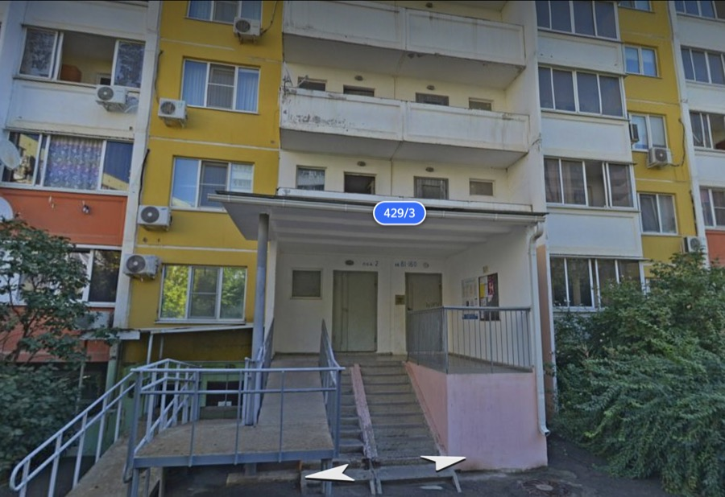
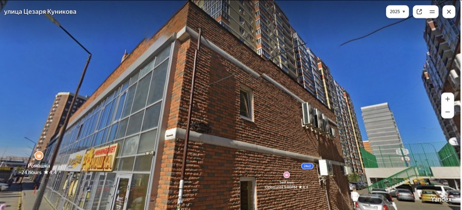
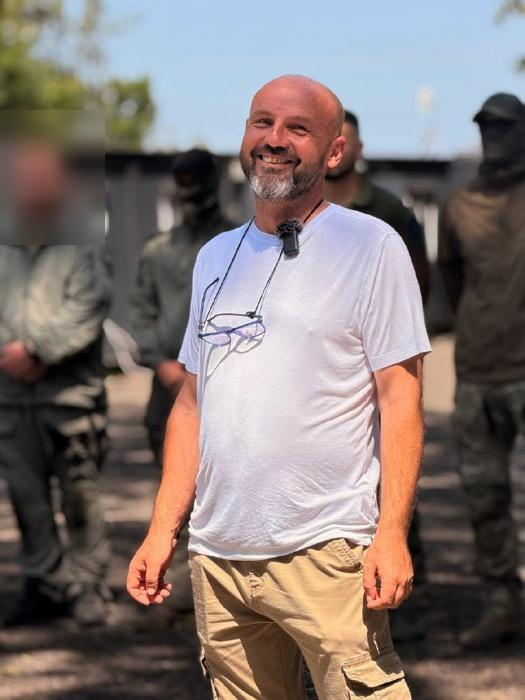

# ООО «Гагаринг»

`manufacturer` 

ИНН 2312321660 · ОГРН 1232300051235 · Краснодар

## At a glance

- **Legal form:** OOO (limited liability company)
- **Registered:** 04.09.2023
- **Address:** 350912, Краснодарский край, г.о. город Краснодар, г. Краснодар, тер. Пашковский Жилой Массив, ул. Им. Фадеева, дом 429/3, помещение 11, комната 4
- **Director:** Барашков Александр Сергеевич
- **Charter capital:** ₽10,000
- **ОКВЭД:** 26.11 — Производство элементов электронной аппаратуры
- **Wildberries overlap:** none_found

## Ownership & corporate history

### Director

| Value | As of | Note |
|---|---|---|
| Барашков Александр Сергеевич | 2023-09-04 | личный ИНН 252201766438 — in post since registration [s0455] |

### Founders / ownership

| Value | As of | Note |
|---|---|---|
| [{'inn_personal': '252201766438', 'name': 'Барашков Александр Сергеевич', 'nominal_value': 5050, 'share_percent': 50.5}, {'inn_personal': '231015713057', 'name': 'Александров Алексей Витальевич', 'nominal_value': 4950, 'share_percent': 49.5}] | 2023-09-04 | EGRUL-sourced split (as_of approximated to registration date; exact EGRUL extract pull date not recorded), previously the only recorded figure. [s0455] |
| [{'name': 'Барашков Александр Сергеевич', 'nominal_value': 5000, 'share_percent': 50.0}, {'name': 'Александров Алексей Витальевич', 'nominal_value': 5000, 'note': 'участник с декабря 2023г.', 'share_percent': 50.0}] | 2025-12-31 | Гагаринг's own FY2025 audit report states an even 50%/50% split (5,000 руб. each), differing slightly from the s0455 EGRUL figure (50.5/49.5). Not reconciled — flagged, not overwritten; a later EGRUL re-pull would resolve which is current. [s5333] |

### Charter capital

| Value | As of | Note |
|---|---|---|
| 10000 | — | from brief:prose, unverified |

### Address

| Value | As of | Note |
|---|---|---|
| 350912, Краснодарский край, г.о. город Краснодар, г. Краснодар, тер. Пашковский Жилой Массив, ул. Им. Фадеева, дом 429/3, помещение 11, комната 4 | 2025-12-31 | Юридический адрес per Гагаринг's own FY2025 audit report (Пояснения текстовые, п.1). Also operates a separate обособленное подразделение без выделения на отдельный баланс: 350020, Краснодар, г. о. Краснодар, ул. Одесская, д.48/3 (КПП 231045001, поставлено на учёт 01.12.2023). [s5333] |
| 350020, Краснодар, ул. Красная, 176/5 (обособленное подразделение/office, per two live hh.ru job postings — not yet cross-checked against EGRUL as a formally registered обособленное подразделение) | 2026-08-25 | A FOURTH distinct Гагаринг location, found via hh.ru job postings (2026-09-04) — Красная 176/5, Краснодар, distinct from the legal HQ (Фадеева 429/3), the training center (Куникова 24к2) and the production subdivision (Одесская 48/3). Two live vacancies (Руководитель отдела продаж В2В, published 25.08.2026; Юрист по договорной и судебной работе, published 07.08.2026) both list this as the work address — reads as a commercial/admin office (sales + legal functions), not production or training. Postal code 350020 confirmed 2026-09-04 via public postal-index directories (house numbers 176–176/8 on ул. Красная all fall under this index). [s5420] |

## Products

- **Система связи «Кузнечик»** — ПО системы связи для БПЛА «Кузнечик» — учтено как нематериальный актив (капитальные вложения), оставшийся срок полезного использования 75–110 месяцев по состоянию на 31.12.2025. Explicitly a UAV (БПЛА) communications-system software product, per FY2025 audit report intangible-assets note. [s5333]
- **Детектор портативный «ЮРКА 1.2»** — 21,960 руб.
- **Детектор портативный «ЮРКА 1.2ВП»** — С видеоперехватом. 24,400 руб.
- **Детектор портативный «ЮРКА 1.2СК»** — С сухим контактом для РЭБ-интеграции. 23,180 руб.
- **Видеоприемник выносной «СОВА»** — NAME COLLISION: same brand name as va-technologies' («Конструкторское бюро СОВА») navigation module — a DIFFERENT product (video receiver, not navigation), different company. 45,964-51,240 руб.
- **РЭБ-глушитель «Звезда 1»** — Подавляет DJI Mavic-класс дронов (диапазоны 2.4/5.8 ГГц, дальность 200м) — «защищает от сброса» (боеприпаса). 30 тыс. руб. [s5437]
- **РЭБ-глушитель «Звезда 2»** — Подавляет управление FPV-дронами (700-1000 МГц, дальность 300м). Само-описано как «средство последнего шанса». 52 тыс. руб. [s5437]
- **Вынос FPV-передатчика «Нить»** — Выносной пульт управления, позволяет управлять дроном из укрытия; входит в комплект системы связи «Кузнечик» (per RT interview, s5435). 4,000 руб. [s5437]
- **Дрон-детектор «ГОРН»** — Из линейки детекторов булат/асель/зов, прошёл испытания; по словам Барашкова отклонён армейскими закупщиками несмотря на лучшие ТТХ («бойцы привыкли к другим детекторам»). 55 тыс. руб., 400+ шт. в наличии на момент поста (июль 2025). [s5439]

## Financials

| Year | Revenue | Profit | Source |
|---|---|---|---|
| 2023 | ₽1,248,000 | ₽-514,000 | [s0241] |
| 2024 | ₽84,503,000 | ₽20,945,000 | [s0242] |
| 2025 | ₽2,159,046,000 | ₽664,188,000 | [s0243] |

## State-program participation

- Лаборатория электроники «Гагаринг» выступила партнёром призового фонда (500 тыс. руб.) хакатона по беспилотной навигации в условиях потери сигнала ГНСС, организованного Фондом развития инноваций Краснодарского края в рамках регионального проекта «Воронка инновационных стартапов» (часть нацпроекта «Эффективная и конкурентная экономика»). Первое подтверждённое участие Гагаринга в региональной инновационной госпрограмме Краснодарского края (отдельно от федеральных АЭРОНЕКСТ/Сколково связей, если такие есть). [s5425]

## Workforce & production scale

| Headcount | As of | Note |
|---|---|---|
| 4 | 2023-12-31 | Численность персонала на 31.12.2023, per FY2025 audit report [s5333] |
| 34 | 2024-12-31 | Численность персонала на 31.12.2024, per FY2025 audit report [s5333] |
| 105 | 2025-12-31 | Среднегодовая численность работающих за 2025 год и численность персонала на 31.12.2025 (совпадают), per FY2025 audit report [s5333] |

## Self-reported marketing claims

> *Ваш опыт и инженерная школа Volkswagen бесценны, и мы готовы предложить вам конкретное применение*
> Your Volkswagen experience and engineering school are invaluable, and we're ready to offer you a concrete application for them.
>
> — Барашков's open recruitment appeal to German Volkswagen engineers facing layoffs, quoted by ТАСС (09.07.2026); the same episode is documented first-hand on Гагаринг's own Telegram channel ("КБ Гагаринг приглашает немецких специалистов на свое производство... У нас заводы не закрывают, у нас заводы строят", @my_el_lab/3864, 30.06.2026), followed by a geopolitical framing post (@my_el_lab/3931, 08.07.2026) casting Western sanctions as having backfired: "Санкции, которые должны были отрезать Россию от высоких технологий, сработали как бумеранг. Вместо изоляции российские производства получили возможность пылесосить европейский инженерный гений..." — an explicit self-description of using the sanctions regime's own labor-market fallout to recruit Western engineering talent into a UAV/РЭБ-electronics producer. (2026-07-09) [s5428]

> *Мой проект Антифорбс рассказывает о том, как я вижу русское предпринимательство. Для меня это в первую очередь профессия, которая приносит пользу стране и обществу.*
> My Antiforbes project tells the story of how I see Russian entrepreneurship. For me it is first and foremost a profession that benefits the country and society.
>
> — Барашков's own framing (@my_el_lab/4297, 10.08.2026) of «Антифорбс», a business prize he founded ranking entrepreneurs by employee salary levels rather than personal wealth ("не то, сколько ты зарабатываешь, а насколько обеспечены твои сотрудники", @my_el_lab/4336, 13.08.2026) — a statist/populist framing of his own business identity, distinct from Гагаринг's product marketing. (2026-08-10) [s5433]

## Battlefield evidence

> *Прототип «Кузнечика» был представлен ещё в 2023 году, но масштабные поставки в войска начались только после вторжения ВСУ в Курскую область. По информации, которую мы получаем от наших военных, FPV-дроны, оснащённые «Кузнечиками», поразили сотни единиц военной техники, включая тяжело бронированные образцы западного производства.*
> The Kuznechik prototype was unveiled back in 2023, but large-scale deliveries to the troops began only after the AFU incursion into Kursk oblast. According to information we get from our military, FPV drones equipped with Kuznechiks have struck hundreds of units of military equipment, including heavily armored Western-made examples.
>
> — On-record quote from founder Александр Барашков to RT (02.11.2024), independently corroborating (from a source distinct from the earlier single-blogger Kursk-lab mention) that Гагаринг deployed field labs inside Курская область during the incursion response, equipping thousands of FPV drones. This directly resolves the previously-flagged open question about an unconfirmed Kursk-oblast site. (2024-11-02) [s5435]

> *Система связи и управление «Кузнечик» для FPV-дронов активно используется российскими военными в зоне специальной военной операции на Украине... Барашков отметил, что не может раскрывать количество поставленных систем и их распределение по подразделениям, так как эта информация является закрытой.*
> The Kuznechik communications/control system for FPV drones is actively used by Russian forces in the SVO zone... Barashkov noted he cannot disclose the quantity of systems delivered or their distribution among units, as this information is classified.
>
> — Independent confirmation via Народный фронт (ONF, a state-linked movement) → ТАСС → vz.ru/ridus.ru republication (08.04.2025), distinct from Гагаринг's own marketing copy. Notable self-admission: Барашков will make broad battlefield-effectiveness claims on record but explicitly declines to give verifiable deployment-scale figures, calling them classified. (2025-04-08) [s5436]

## Patents

| Title | Reg. no. | Filed | Inventors |
|---|---|---|---|
| Способ и система плазменной сварки плавящимся электродом | RU2792246C1 | — | Барашков Александр Сергеевич (RU) |

## Web & social presence

### Website

- <https://gagaring.ru/>

### Telegram

- <https://t.me/my_el_lab> — Гагаринг. Лаборатория электроники. — the company own primary Telegram channel (3,540+ posts, active since 2024-08-19), by far the single most-cited source in this record: product announcements, Барашков first-person posts (Антифорбс, Volkswagen recruitment campaign), training-center/Последний рубеж updates, battlefield-use claims.

## Images

-  — ул. им. Фадеева, д. 429/3, Краснодар — ООО «Гагаринг»'s registered legal address: an ordinary residential building entrance.
-  — ул. Цезаря Куникова, 24к2, Краснодар — the «Гагаринг» training centre's licensed address (АНО ДПО «Образовательный центр Гагаринг», лицензия Л035-01218-23/02689789): a two-storey commercial annex at the base of a residential tower. [s5385]
-  — Барашков Александр Сергеевич, GD/co-founder of ООО «Гагаринг», at what appears to be one of the «Гагаринг» training-centre's field courses (t.me/my_el_lab/4210, one of six images in the post's gallery). [s5387]

## Principals & persons of interest

### Барашков Александр Сергеевич

- **DOB:** 1979-11-03
- **Birthplace:** Хабаровск / Khabarovsk
- **Address:** г. Краснодар, ул. Черкасская, д. 97, кв. 25 (current, per multiple 2023–2024 records — Росреестр, ОСАГО policy, ФССП debtor record; earlier registered address through ~2019 was Приморский край, Октябрьский р-н, с. Покровка, ул. Энгельса, 13, кв. 1, matching the registry's existing note on his ОГРНИП's original 2013 Приморье registration)
- **ИНН:** 252201766438

## Corporate links

- **ООО «Авирон»** — доля участия 36,8% [s5333]
- **ООО «Интел Дрон»** — доля участия 50% [s5333]
- **ООО «НПО Эйлер»** — доля участия 50% [s5333]
- **АНО ДПО «Образовательный центр Гагаринг»** — учредитель [s5333]

## Open questions

- Гагаринг sells a "Видеоприемник выносной «СОВА»" — same brand name «СОВА» as va-technologies (ООО «Конструкторское бюро СОВА»), but a genuinely different product (video receiver vs. GPS-denied navigation module) from a different, unrelated company. Pure brand-name collision — flagged so it is never conflated in future prose.
- FY2024 net-profit discrepancy resolved: the FY2025 audit report is an ИСПРАВЛЕННАЯ (corrected/restated) version of an earlier unaudited report signed 31.03.2026. The corrected 2024 net profit (₽15,361 thousand) differs from the original unaudited figure (₽20,946 thousand) by a documented -₽5,585 thousand correction (also affecting inventories -₽6,932k, receivables -₽632k, total balance -₽7,564k) — per the audit report's own correction table (pp.7-9). Not an unreconciled discrepancy; the audited figure is authoritative. [s5333]
- Related-party turnover disclosed with ООО «СДЭК-НОВА» (₽4.41M turnover, 2025) and ООО «СДЭК-КРАСНОДАР» (₽2.22M turnover, 2025) in the audit report's related-party note — nature of the relationship (common beneficiary vs. ordinary counterparty) not established; needs separate EGRUL/beneficiary check before treating as a network tie. [s5333]
- Two individuals — Павловский Валерий Александрович (ИП) and Павловская Ирина Борисовна (ИП) — appear in the audit report's 'Обеспечения обязательств' (obligation guarantees) section as counterparties to given/received obeespecheniya. Role and connection to Гагаринг not established from this document alone; lead for future verification, not yet added to people.json. [s5333]
- Postal-code discrepancy, RESOLVED (2026-09-04): a Роскомнадзор 152-ФЗ preventive-visit inspection record (proverki.gov.ru, KNM id 26154827, completed 15.11.2024, clean/no violations, Акт №А-23/351) gave the registered address's postal code as 350312, against 350912 in the FY2025 audit report (s5333) and EGRUL. Cross-checked against public Почта России postal-index directories for ул. им. Фадеева, Пашковский жилой массив, Краснодар (index.kodifikant.ru, indexmap.ru, postindex.esosedi.ru — 2026-09-04): the street's valid range is 350910/350911/350912; no directory lists 350312 for this street at all. 350912 (audit report/EGRUL) is confirmed correct; 350312 is a Роскомнадзор filing typo, not a competing valid code. Also resolved while checking: the Красная 176/5 sales/legal office's own postal code is 350020 (confirmed via the same directories, which list house numbers 176 through 176/8 under that index) — added to its address_history entry. [s5335]
- NSPD/Rosreestr cadastral-map check (2026-09-03, live browser lookup, not yet archived as a dated source): the registered HQ address (Фадеева 429/3) is cadastral object 23:43:0411055:29, Назначение 'Многоквартирный дом' (17-storey apartment building, 15,501.7 m², built 2008) — confirms it is a mailbox/office-suite address, not a production site. The Одесская 48/3 subdivision address is a much larger complex: 23 separate cadastral buildings plus 2 structures plus 1 unfinished-construction object share that street address. One checked building there, 23:43:0302010:387, is explicitly named 'Производственный корпус' (Production Building) — brick, 3 floors, 3,873.6 m², built 1972 (Soviet-era industrial), privately owned. This corroborates the Одесская address sitting on a genuine former industrial site with real production buildings, not just office space — but which specific building/unit within the 23-building complex Гагаринг's own subdivision (КПП 231045001) occupies has NOT been identified; the audit report gives no литер/building-letter for it. Needs a follow-up NSPD/EGRN pull specifically keyed to Гагаринг's own premises once that detail is known.
- Possible undocumented Курская область (Kursk oblast) lab/field site: a blogger (@romanov_92) posted 14.12.2024 describing a visit to "one of Гагаринг's labs" with the DB's own address-extraction field reading "Курская область, Россия" — this predates the training center's registration and describes product-development/electronics-lab work (matches ooo-gagaring's own activity, incl. the «Кузнечик» product). No street address, building name or coordinates given, and this is a casual blogger post, not a registry/licence document — could describe the blogger's own location/travel rather than a precise Гагаринг facility address. FLAGGED, not asserted as a confirmed third location (distinct from the Krasnodar HQ and Одесская 48/3 subdivision) pending independent corroboration. RESOLVED 2026-09-04, independently corroborated: RT interviewed Барашков directly (02.11.2024, s5435), who confirmed on record that Гагаринг deployed several field labs inside Курская область during the AFU incursion response, rapidly equipping thousands of FPV drones with Кузнечик systems — a confirmation independent of the earlier casual blogger post. See battlefield_evidence[]. [s5403]
- A second training-center operator, callsign "Пианист" running "УЦ «Шершень»" (@pianist_svo), is confirmed cooperating directly with Барашков/Гагаринг as of 31.01.2026 ("попутно налажено взаимодействие между Пианистом (УЦ «Шершень») и Александром Барашковым"). No legal entity or real name identified for "Пианист" — callsign only. "Шершень" is heavily overloaded elsewhere in this corpus (an FPV drone model, a Ukrainian ЗРК, an unrelated assault-detachment callsign) — this instance is specifically a training-center name, disambiguated by the @pianist_svo handle. Worth a follow-up if "Пианист"'s real identity or УЦ «Шершень»'s legal status surfaces. [s5405]
- Founding устав documents (data/sources/UD_1232300051235_20260819_gagaring.zip, scanned TIFF, OCR'd 2026-09-03, no formal source_id assigned this pass — see MANIFEST.md entry for the raw file) corroborate and refine the founders_history timeline: the ORIGINAL устав (approved 05.08.2023, filed at registration 04.09.2023) was adopted by "Решение №1/2023 Единственного учредителя" (decision of a SOLE founder), confirming Гагаринг began with one founder — consistent with the audit report's own "Александров — участник с декабря 2023г." annotation (he joined after founding, not at it). The 2025 "новая редакция" (new edition, approved 07.01.2025 per a Протокол Общего собрания учредителей — plural founders by then) is signed by Барашков А.С. as Председатель Общего собрания, and its expanded activity list (ст. 3.3) explicitly authorizes: образовательная деятельность (educational activity — matches the later-formed training-center entity), защита сведений составляющих государственную тайну (handling state-secret classified information), защита информации/аттестация объектов информатизации (information-security certification work), and операции с недвижимым имуществом (real-estate transactions) — none of which were previously captured beyond the single primary ОКВЭД code. Neither устав document text names the original sole founder directly on the OCR'd pages checked (the устав body itself carries no per-participant share table — that lives in a separate, not-yet-pulled Решение/Протокол document).
- Attempted to pin the specific building/unit at the Одесская 48/3 subdivision address via public business-directory listings (2026-09-03): zoon.ru's full tenant list for Одесская, 48 (bare address, ~22 organizations — newspaper, dental clinic, furniture store, insurance, construction firms, etc.) shows NO listing for Гагаринг or any electronics/UAV-related business. This is a negative result, not conclusive — the subdivision's actual address carries a "/3" building suffix not necessarily covered by this bare-"48" directory listing, and a defense-adjacent production subdivision would plausibly not publicize itself in a consumer business directory regardless. The specific building/unit within the 23-building complex remains unidentified; would need a targeted EGRN/Rosreestr pull keyed to the exact КПП 231045001 registration, not a business-directory search, to resolve.
- A 11.08.2026 «Русский Инженер» post (cross-posted by Чадаев, @chadayevru msg 5014) credits Барашков/Гагаринг with personally delivering 'more than ten thousand' «Кузнечик» comms kits that allegedly let Russian FPV drones overcome Ukrainian EW jamming during an alleged defense of a Kursk NPP incursion attempt. This is a third-party battlefield-scale claim (not Гагаринг's own marketing copy) — a strong candidate for battlefield_evidence[], but the underlying event (a claimed VSU push toward the Kursk NPP) is not independently corroborated here and the '10,000+' unit figure has no other source. Flagged for verification before promotion to battlefield_evidence[]. NOTE (2026-09-04): a separate RT interview (s5435, 02.11.2024) independently confirms the GENERAL claim that Гагаринг deployed field labs in Курская область and equipped "тысячи" (thousands) of FPV drones during the incursion response — but does NOT mention a Kursk NPP defense specifically, nor corroborate the "10,000+" figure. Do not treat the RT interview as resolving this specific claim; they remain distinct (general Kursk deployment: confirmed; NPP-defense episode + exact unit count: still unconfirmed). [s5418]
- Attempted to pin the Одесская 48/3 production-subdivision building via scripted lookups (2026-09-03): nspd.gov.ru's public geoportal API returned a WAF 403 (same blocking pattern already documented for kad.arbitr.ru — no scripting route from this sandbox), and 2gis.ru's Krasnodar search page is a JS single-page app with no server-rendered results reachable via plain curl. The original audit-report PDF (s5333) does not OCR/extract cleanly for this detail either (pdftotext returns no text for it, likely a scanned page — not re-attempted with tesseract this pass). Resolving this needs either a manual browser NSPD/2GIS/Rosreestr lookup (same class of manual-only source as kad.arbitr.ru) or a proper OCR pass on the audit PDF's relevant page.
- REFINED (2026-09-03, via a real browser session — nspd.gov.ru's public search API returns clean JSON in-browser even though a bare curl request gets WAF-403'd, since the site's JS challenge/session cookies aren't present outside a real browser context): the address "ул. Одесская, д. 48/3" is NOT one building inside a broader 23-building "48" complex as earlier assumed — it is itself a distinct multi-building industrial site. A direct NSPD search for "Краснодар Одесская 48/3" returns at least 19 separately-cadastred buildings all sharing that exact address: производственный корпус (23:43:0302010:387, 1972, 3,873.6 m², the one already flagged), ремонтно-механический участок, мазутохранилище (fuel-oil store), лесосушильная камера (23:43:0302010:399, wood-drying chamber — suggests a former Soviet woodworking/furniture-factory site), неcколько складов, механический цех, служебно-бытовой корпус №9, проходная (checkpoint), плюс a combined-suite listing ("д. 48, пом. 1,2,3..."). None of NSPD's public building records expose an owner/tenant name (Rosreestr redacted this from public output after the 2017 privacy amendments — only 'Частная'/'Собственность' shows), so this still doesn't identify which specific building Гагаринг's КПП 231045001 subdivision actually occupies. Resolving that requires either a paid EGRN extract naming the actual right-holder for one of these cadastral numbers, or independent evidence (a photo/video, a delivery address, a job posting) pinning Гагаринг to one specific building within this complex.
- The 07.08.2026 'Юрист по договорной и судебной работе' vacancy (s5419) explicitly requires 'опыт работы в сфере ГОЗ не менее 2х лет' and 'Практический опыт работы с Федеральным Законом № 275-ФЗ (ГОЗ)' — Гагаринг's own job posting language self-identifies гособоронзаказ (State Defense Order) legal work as part of the role, alongside ordinary 44-ФЗ/223-ФЗ contract work. A targeted zakupki.gov.ru supplier-title scan for Гагаринг's own ИНН (2312321660) returned zero hits (2026-09-04) — consistent with 275-ФЗ ГОЗ contracts often being closed/ДСП and not published on the open 44-ФЗ/223-ФЗ portal, not evidence against a real ГОЗ relationship. This is a real self-admission worth pursuing further (e.g. a targeted search for Гагаринг as a subcontractor to a named prime, since the earlier Чадаев repost describes Барашков personally delivering comms kits rather than a public tender). [s5419]
- Additional registry checks (2026-09-04): (1) Minjust's NKO portal (nco.minjust.gov.ru, s5423) independently corroborates the existing registry entries for the training center, Архангел Легион and АРРС (name/ОГРН/date/address all match) — no new facts, but confirms them via a source distinct from egrul.nalog.ru; the training center's one filed 2025 activity report failed Minjust's check ('Проверка не пройдена', filed 10.04.2026). (2) Гагаринг has NO currently-valid entry in Минпромторг's Единый реестр российской радиоэлектронной продукции (ПП РФ 878, s5421) — despite making UAV comms/EW-adjacent electronics, it hasn't sought or hasn't received the state 'domestically-produced radio-electronics' designation that would confer procurement preference. (3) Гагаринг is NOT on Минцифры's accredited-IT-company registry (s5422), despite carrying OKVED 62.01 (software) alongside its primary electronics code. (4) gagaring.ru and gagaring-school.ru were both registered the same day (18.06.2025, 3 minutes apart) via Beget (s5424) — no registrant PII exposed under standard .ru WHOIS privacy, no pre-privacy-shield historical record found.
- Региональные реестры Краснодарского края (2026-09-04): (1) rmsp.nalog.ru подтверждает статус «Микропредприятие» весь период 10.10.2023–10.07.2026, затем компания ВЫБЫЛА из реестра МСП 10.07.2026 (текущий статус: «Не является субъектом МСП») — причина невыяснена (рост выручки/штата сверх порогов микропредприятия — правдоподобно на фоне заявленного масштаба производства «Кузнечик», либо просрочка подачи налоговой отчётности приводит к автоматическому исключению; не установлено, требует проверки при следующей БФО-подаче). (2) rmsp-pp.nalog.ru (реестр получателей господдержки МСП): «Сведения не найдены» — Гагаринг никогда не получал финансовую/консультационную/образовательную господдержку МСП напрямую (отличается от найденного через investkuban.ru партнёрства с Фондом развития инноваций края, которое шло не через субъект МСП поддержки, а как призовой партнёр стороннего хакатона). (3) prom.krd.ru (реестр промышленных предприятий г. Краснодара) — сайт недоступен из песочницы (connection refused), не проверено, не «отрицательный результат». (4) technopark-krd.ru (Технопарк РЭП Краснодар, радиоэлектронный промышленный технопарк) — нет прямого упоминания на сайте и нет открытого каталога резидентов для проверки; неубедительно, не считать ни подтверждением, ни опровержением связи.
- RESOLVED (2026-09-04, data-quality catch): the 2026-08-24 searchplatform.rospatent.gov.ru full-roster sweep (s1170) had attributed THREE patents to this entity's director via a bare name-string match, including two Soviet-era welding patents (SU1807922A3, published 1993.04.07; SU1834764A3, published 1993.08.15). Барашков Александр Сергеевич (this entity's director) has a confirmed DOB of 1979-11-03 (per people.json, cross-sourced from ~40 leaked-record entries under his own ИНН) — he would have been 13-14 years old at either 1993 publication date. These two are a namesake collision (Александр Сергеевич Барашков is not a rare name), not this director's own patents — removed from `patents[]`, keeping only the plausible 2023 filing (RU2792246C1, same welding-technology field, consistent with an adult career). A general caution for this pattern: any bare-name-string patent/registry match spanning a multi-decade gap should be checked against the person's DOB before being promoted to a display field, not just checked for an exact name string. [s1170]
- A second storefront domain, gagaring.it-shop-tg.ru ("Магазин Гагаринг" / "лаборатория радиоэлектроники"), surfaced 2026-09-04 in web search — sells the same Кузнечик/Сова/Юрка product lines at prices matching gagaring.ru's own catalogue. Reads as a Telegram-shop-bot-generated mirror storefront (the "-tg" and "it-shop-tg.ru" pattern is a generic white-label e-commerce platform naming convention, not a Гагаринг-registered domain) rather than a distinct legal entity or new lead — no ownership/contact/registration details are exposed on the page itself. Not promoted to web[]/domain_history[] pending a WHOIS check confirming it isn't just a third-party reseller mirror. RESOLVED 2026-09-04: a Гагаринг TG post (msg 950, s5437) explicitly names t.me/gagaring_bot/shop as the official sales channel and directs customers to pay only through the shop or by bank transfer to the company's own юрлицо account — confirms gagaring.it-shop-tg.ru / gagaring-m.it-shop-tg.ru (referenced directly in a later post, msg 2218/s5439) ARE Гагаринг's own Telegram-shop-bot-generated storefronts under their own control, not third-party reseller mirrors. Promoted to web[].
- Self-described army-procurement friction, recurring theme (2025-07/08): Барашков states on his own channel that the «ГОРН» drone detector (400+ units in stock, ₽55,000) passed all testing and outperforms the army's incumbent detector line on speed/price/range, but was told troops are "used to other detectors" and no purchase would follow — and separately, in the same-week Соловьёв LIVE interview (s5438), that the «Сова» video receiver is "extremely in-demand at the front" but blocked from official army adoption by what he calls procurement monopolies. Plausibly explains why a targeted zakupki.gov.ru supplier-title scan for Гагаринг's own ИНН came back zero hits (see the separate ГОЗ open_question above) — frontline use may run through informal/volunteer-funded channels rather than official state contracts, not through a closed/ДСП formal contract as first assumed. Also notable: the same TG post (s5437, msg 950) states the «Кузнечик» comms system is sold "только с письмом" (only with a supporting/authorization letter) — a self-imposed sales control applied to their most sensitive comms product but not to the jammers/detectors/accessories. [s5439]
- cbst_tie remains UNRESOLVED — the single most consequential open question for this project specifically, since it determines whether Гагаринг belongs to the ЦБСТ/РОЙ.МАРКЕТ network this investigation is about, or is a parallel/independent UAV-electronics producer. Attempted 2026-09-04: fetched роймаркет.рф directly — the live public page is a supplier APPLICATION form (dual-use-goods sales channel, positioned as a Wildberries/Ozon alternative for professional buyers), not a browsable/searchable vendor catalog; no seller-listing search was possible from it, and no mention of Гагаринг appears on the application page itself. Per Безруков's own 29.12.2025 ТАСС quote (already on file elsewhere in this project), the actual marketplace is a gated pilot used by specific military units, not a public catalog — so this negative result is INCONCLUSIVE, not a real absence-of-tie finding. No dedicated screening script exists for this platform (unlike wb_watch's WB-seller matching, screen_wb.py, already run clean). A real answer needs either a buyer-side login (not available to this investigation) or a future public catalog/press leak naming its actual vendor roster.

## Sources cited in this profile

| ID | Type | Locator | Captured | As of |
|---|---|---|---|---|
| s0241 | БФО annual-accounts filing | БФО annual-accounts filing (РЕСУРС_БФО_2312321660_2023_20260819.zip) | 2026-08-19 | 2023-12-31 |
| s0242 | БФО annual-accounts filing | БФО annual-accounts filing (РЕСУРС_БФО_2312321660_2024_20260819.zip) | 2026-08-19 | 2024-12-31 |
| s0243 | БФО annual-accounts filing | БФО annual-accounts filing (РЕСУРС_БФО_2312321660_2025_20260819.zip) | 2026-08-19 | 2025-12-31 |
| s0455 | EGRUL extract | EGRUL extract (ul-1232300051235-20260823120320.pdf) | — | 2026-08-23 |
| s1170 | bulk open-data extract | bulk open-data extract (DATASET_20260824_rospatent-searchplatform-second-triage-batch.json) | 2026-08-24 | — |
| s5333 | Fedresurs | Fedresurs (FEDRESURS_939B297414FA48A4A4B3497315AF3659_20260903_gagaring-audit-report-2025fy-full.pdf) | 2026-09-03 | — |
| s5335 | Proverki | Proverki (PROVERKI_2312321660_20260903_gagaring-rkn-inspection-26154827.json) | 2026-09-03 | 2024-11-15 |
| s5385 | Islod | Islod (ISLOD_2310240630_20260903_licence-branch-detail.html) | 2026-09-03 | 2025-07-17 |
| s5387 | Tgpost | Tgpost (TGPOST_my_el_lab_4210_20260803.txt) | 2026-08-03 | 2026-08-03 |
| s5403 | Tgpost | Tgpost (TGPOST_20241214_mil_hub-89976-kursk-oblast-lab-visit.txt) | 2024-12-14 | 2024-12-14 |
| s5405 | Tgpost | Tgpost (TGPOST_20260201_projectArchangel-9459-pianist-shershen-med-supplies.txt) | 2026-02-01 | 2026-01-31 |
| s5418 | Tgpost | Tgpost (TGPOST_20260811_chadayevru-5014-russkiy-inzhener-kursk-npp-repost.txt) | 2026-08-11 | 2026-08-11 |
| s5419 | Hhru | Hhru (HHRU_2312321660_20260904_gagaring-vacancy-lawyer-goz-krasnaya176-5.txt) | 2026-09-04 | 2026-08-07 |
| s5420 | Hhru | Hhru (HHRU_2312321660_20260904_gagaring-vacancy-sales-head-krasnaya176-5.txt) | 2026-09-04 | 2026-08-25 |
| s5425 | Investkuban | Investkuban (INVESTKUBAN_2312321660_20260904_gagaring-hackathon-partner.html) | 2026-09-04 | 2026-06-30 |
| s5428 | press coverage | press coverage (PRESS_20260709_tass-gagaring-volkswagen-engineers.txt) | 2026-07-09 | — |
| s5433 | Tgpost | Tgpost (TGPOST_20260810_my_el_lab-4297-antiforbes-entrepreneurship.txt) | 2026-08-10 | — |
| s5435 | press coverage | press coverage (PRESS_20241102_rt-kuznechik-kursk-labs-battlefield-interview.txt) | 2024-11-02 | — |
| s5436 | press coverage | press coverage (PRESS_20250408_vz-ru-tass-kuznechik-onf-battlefield-confirmation.txt) | 2025-04-08 | — |
| s5437 | Tgpost | Tgpost (TGPOST_20241020_my_el_lab-950-product-catalog-zvezda-jammers.txt) | 2024-10-20 | — |
| s5439 | Tgpost | Tgpost (TGPOST_20250728_my_el_lab-2218-gorn-detector-army-rejection.txt) | 2025-07-28 | — |

---
_Generated from this investigation's registry (`data/registry/`) by `scripts/build_company_profile.py`. Not a substitute for reading the underlying primary sources listed above._