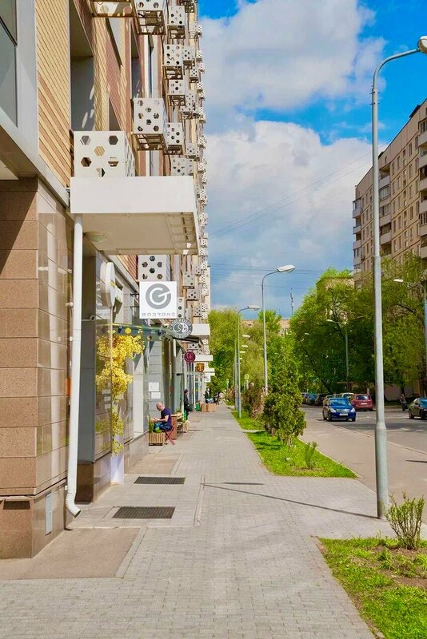
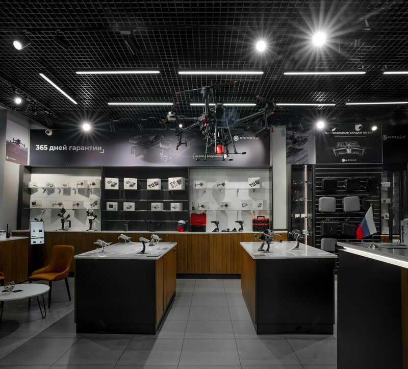
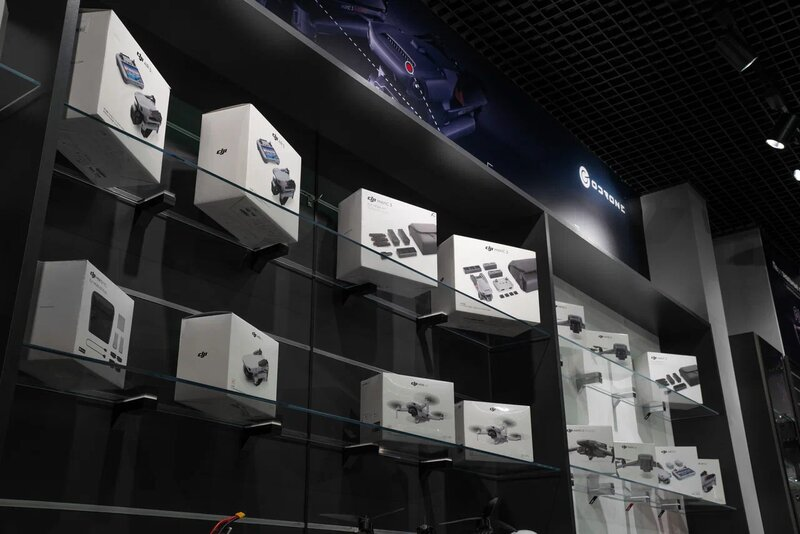

# ООО «ГОУДРОН»

`sanctioned` `manufacturer` 

ИНН 9721203814 · ОГРН 1237700265846

## At a glance

- **Legal form:** OOO (limited liability company)
- **Registered:** 07.04.2023
- **Address:** 111677, Москва, вн.тер.г. муниципальный округ Некрасовка
- **Director:** Козлов Дмитрий Сергеевич
- **Charter capital:** ₽10,000
- **ОКВЭД:** 46.43 — Торговля оптовая бытовыми электротоварами
- **ЦБСТ tie:** Direct first-person confirmation of an ongoing ЦБСТ working relationship, from the company's own Telegram channel.
- **Wildberries overlap:** none_found

## Ownership & corporate history

### Director

| Value | As of | Note |
|---|---|---|
| Козлов Дмитрий Сергеевич | 2023-04-07 | личный ИНН 502727680236 — GD and 100% owner since registration [s0458] |

### Charter capital

| Value | As of | Note |
|---|---|---|
| 10000 | — | from brief:manufacturers-table:line-1022, unverified |

## Products

- **«Набат v3»** — Drone detector, third iteration, tested 04.08.2026 — 200-8800 MHz detection range, also intercepts analog video signal. Per the entity's own dedicated product site (набат.рф, s1393): detection radius up to 2 km, tracks up to 7 drones simultaneously, 1.8" display, 2x removable 6800 mAh batteries, IP66, 5-9h battery life. Pricing tiers: retail 115,000₽; bank transfer (военным/"to military") 100,000₽; card/SBP standard 115,000₽; card/SBP military 106,000₽; legal entities 120,000₽ incl. VAT -- an explicit discounted military-buyer price tier, not just a generic bulk discount. SELF-INCRIMINATING MARKETING COPY, verbatim from the site's own hero-section tagline: "Защита техники и личного состава в условиях СВО" ("Protection of equipment and personnel in the conditions of the SVO [Russia's official euphemism for its war on Ukraine]") -- the product is marketed directly and explicitly for combat use in that war, not framed as generic/dual-use civilian security equipment. INDEPENDENTLY CONFIRMED by real-world customer testimony -- Yandex Maps review by "Антон М." (5★, 20.02.2025, s1396): "Заказывал систему Набат для наших военнослужащих в зоне СВО. Сервис на высшем уровне. Проконсультировали и помогли с выбор. Быстро оплатил и быстро получил. К устройству нареканий нет, свои задачи выполняет." ("Ordered the Nabat system for our servicemen in the SVO zone... No complaints about the device, it performs its tasks.") -- a customer, not the manufacturer, directly confirming combat-zone end use. Two more reviews (s1396) describe the same store fulfilling urgent purchases "для фронта"/"на СВО" of other equipment (a thermal-imaging DJI Mavic 3T; a discount granted specifically because funds were crowdfunded "для СВО"), and the showroom's own wall signage (photographed, see images[]) reads "СВОих не бросаем" -- a wordplay on "СВО" embedded in "своих" ("our own"), displayed physically in-store. [s1393]

## Financials

| Year | Revenue | Profit | Source |
|---|---|---|---|
| 2023 | ₽86,336,000 | ₽18,120,000 | [s0413] |
| 2024 | ₽178,346,000 | ₽9,337,000 | [s0414] |
| 2025 | ₽55,937,000 | ₽512,000 | [s0415] |

## Self-reported marketing claims

> *СВОих не бросаем*
> We don't abandon our own [wordplay embedding "SVO" inside "svoikh"/"our own"]
>
> — Wall signage inside the GoDrone showroom (Большой Симоновский переулок, 2, Москва), from the store's own official "Marketing GoDrone" Yandex Maps photo upload — self-incriminating physical-showroom marketing, not a customer upload. Already on file as an images[] caption; promoted to a structured marketing_claims[] entry per project convention. (2026-08-25) [s1396]

> *Сферы применения: Защита техники и личного состава в условиях СВО.*
> Areas of application: Protection of equipment and personnel under SVO conditions.
>
> — First-listed use case (before civilian applications like crowd/facility protection) on the dedicated набат.рф product site for the «Набат V.3» drone detector. (2026-09-07) [s6457]

> *Перевод (военным): 100 000 ₽. Карта / СБП (Военные): 106 000 ₽.*
> Bank transfer (for military): 100,000 RUB. Card / SBP (military): 106,000 RUB.
>
> — Product site's own pricing table for «Набат V.3», offering a discounted price tier specifically for military buyers (vs. 115,000 RUB retail / 120,000 RUB for legal entities) — a direct self-admission of the military-buyer market segment. (2026-09-07) [s6457]

## Battlefield evidence

> *Дрон-детектор «Набат V.2.C» спас жизни бойцов под Бахмутом. Благодаря сигналу с нашего устройства парни смогли вовремя выпрыгнуть из машины и укрыться в застройке. Другим солдатам повезло меньше — их «Урал» был сожжен вражеским дроном.*
> The "Nabat V.2.C" drone detector saved soldiers' lives near Bakhmut. Thanks to our device's signal, the men were able to jump out of the vehicle in time and take cover in a built-up area. Other soldiers were less fortunate — their "Ural" truck was burned by an enemy drone.
>
> — Self-reported field-use anecdote from the manufacturer's own recurring "#набатвделе" (Nabat in action) testimonial series, Bakhmut direction. (2025-02-20) [s6458]

> *Бойцы с Бахмутского направления записали отзыв на «Набат V.2.C»: сигнал дрона ловит отлично и сразу; легок в управлении; работает безотказно.*
> Soldiers on the Bakhmut direction recorded a review of the "Nabat V.2.C": catches the drone signal well and immediately; easy to operate; works without failure.
>
> — Named-unit soldier testimonial video (Часов Яр direction), part of the same testimonial series. (2025-02-04) [s6458]

> *НАБАТ.V3 доставлен на Запорожскую АЭС. Детектор БПЛА «НАБАТ.V3» развернут на Запорожской атомной электростанции. Комплекс работает в связке с экраном перехвата видеосигнала и используется для постоянного контроля воздушной обстановки вокруг объекта.*
> NABAT.V3 delivered to the Zaporizhzhia Nuclear Power Plant. The NABAT.V3 drone detector has been deployed at the Zaporizhzhia NPP. The system works together with a video-signal interception screen and is used for continuous airspace monitoring around the facility.
>
> — Deployment at a named, internationally significant nuclear facility under Russian occupation — a distinctive, high-profile field deployment. (2025-12-26) [s6458]

> *Получили отзыв после проведения тестирования детектора «Набат-3» в зоне проведения СВО и приграничных территориях. Бойцами действующего подразделения была проверена работа детектора... Военнослужащими была дана высокая оценка работы устройства.*
> Received feedback after testing the "Nabat-3" detector in the SVO zone and border territories. Soldiers of an active unit tested the detector's operation... The servicemen gave the device's performance a high rating.
>
> — Recent (2026) formal field-test feedback from an active-duty unit, part of the same ongoing testimonial series. (2026-07-29) [s6458]

## Trademarks

| Mark | Reg. no. | Filed | Registered | Classes |
|---|---|---|---|---|
| — | 1085944 | 20241003 | 12.02.2025 | 09 (приборы и устройства для обнаружения и отслеживания беспилотных аппаратов (дронов, квадрокоптеров, других движущихся аппаратов), а также для обнаружения операторов беспилотных аппаратов); 37 (ремонт, техничесоке обслуживание приборов и устройств для обнаружения, отслеживания беспилотных аппаратов (дронов, квадрокоптеров, других движущихся аппаратов)); 42 (разработка, проетирование приборов и устройств для обнаружения, отслеживания беспилотных аппаратов (дронов, квадрокоптеров, других движущихся аппаратов), а также для обнаружения операторов беспилотных аппаратов) |
| — | 1088602 | 20240809 | 20.02.2025 | 09 (UAV/defense terms present: антенн, военн, дрон, взрывчат, навигацион, беспилот, квадрокоптер, оружи, робот); 12 (UAV/defense terms present: робот, радиоуправляем, дрон, военн, коптер, боеприпас, воздушн); 28 (UAV/defense terms present: воздушн, дрон, робот); 35 (услуги магазинов, в точисле интернет-магазинов по продаже товаров 09, 12, 25, 28 классов МКТУ); 37 (UAV/defense terms present: беспилот, дрон, квадрокоптер); 42 (UAV/defense terms present: беспилот, дрон, квадрокоптер) |
| — | 1203185 | 20240723 | 24.03.2026 | 09 (приборы и устройства для обнаружения и отслеживания беспилотных аппаратов (дронов, квадрокоптеров, других движущихся аппаратов), а также для обнаружения операторов беспилотных аппаратов); 37 (ремонт, техничесоке обслуживание приборов и устройств для обнаружения, отслеживания беспилотных аппаратов (дронов, квадрокоптеров, других движущихся аппаратов)); 42 (разработка, проетирование приборов и устройств для обнаружения, отслеживания беспилотных аппаратов (дронов, квадрокоптеров, других движущихся аппаратов), а также для обнаружения операторов беспилотных аппаратов) |

## Sanctions & screening

**Ukraine (Presidential sanctions decree/list)** [s0814]

- 1 OpenSanctions match(es) (screened 2026-09-06).
- 2 OCCRP Aleph match(es) (screened 2026-09-05).

## Web & social presence

### Website

- <https://godrone.ru/> — GoDrone -- confirmed via exact director-name match (Козлов Дмитрий Сергеевич) and product match (site describes СТМ детектор дронов «НАБАТ», entity's own products[] lists «Набат v3»).
- <https://xn--80aac0c2a.xn--p1ai/> — набат.рф -- dedicated single-product site for «Набат v3» (punycode Cyrillic domain), user-supplied 2026-08-25, archived s1393. Lists address "Большой Симоновский переулок, 2", Москва -- a physical retail/showroom location, DIFFERENT from the entity's EGRUL registered office (111677, Некрасовка). CONFIRMED REAL 2026-08-25 via a user-supplied Street View screenshot (s1394): a genuine storefront at this address, signage reading "GODRONE"/"Gd Home", with a militarized soldier-silhouette decal on the storefront door. Includes a third-party comparison: the site paraphrases (not a direct quote) a comparison by Кирилл Фёдоров -- self-described "российский блогер и военный эксперт", host on «Соловьёв LIVE» -- of «Набат» against «Булат» (ooo-trimiks-bulat-3mx's own detector), concluding «Набат» is more compact/waterproof/impact-resistant and tracks more drones simultaneously. Marketing copy, not verified against Фёдоров's own original content -- treat as the manufacturer's own claim about a third party's opinion, not a confirmed independent endorsement.

### Telegram

- <https://t.me/GoDrone> — Official brand channel (bio confirms: "Компания GoDrone – противодействие БПЛА, поставки и обслуживание дронов. Сайт: godrone.ru"), 2707 posts scraped in this repo's own archive. Runs a long-standing recurring "#набатвделе" battlefield-testimonial series (soldier/unit field reports), found and wired 2026-09-07 — was previously not listed here despite being this entity's primary Telegram presence.

### Marketplace listings

- <https://www.ozon.ru/seller/gd-2520832/> — Ozon seller "GD" -- plausible GoDrone match (catalog includes a directly GoDrone-branded item and a Nabat-compatible battery), but legal identity NOT ID-confirmed to this entity's ИНН/ОГРН in this capture (2026-08-25, s1390) -- see open_questions. Catalog is a general electronics/power-tool wholesale mix, not the detector unit itself.
- <https://www.ozon.ru/seller/godrone-3980614/> — RESOLVED 2026-08-25 (s1392, user-supplied Ozon legal-info text + egrul.nalog.ru confirmation): this large "GoDrone"-branded Ozon seller (4.8 rating, 3,358 reviews) is LEGALLY OPERATED BY A DIFFERENT ENTITY -- ООО «ИНВИЖН ТРЕЙД», ИНН 7720907532, ОГРН 1237700616614, Moscow (105118, ш. Энтузиастов, д. 34, помещ. 14/1), registered 18.09.2023, GD Курдий Людмила. NOT ООО «ГОУДРОН» itself (different ИНН/ОГРН/legal name entirely). A third-party reseller/wholesale distributor of GoDrone-branded and Nabat-compatible accessories, not this entity's own storefront -- do not attribute this seller's scale/reviews to ooo-goudron directly.

### Other

- <https://partner.gdrone.ru/> — Wholesale/partner portal for the same GoDrone product line.
- <https://yandex.com/maps/org/godrone/218650100504/> — Independent third-party (not manufacturer-controlled) Yandex Maps business listing, user-supplied 2026-08-25, archived s1395, direct curl. Confirms the Большой Симоновский переулок, 2 storefront address exactly (matches the Street View confirmation, s1394). Yandex's own category classification: "Drones and quadrocopters" (Дроны и квадрокоптеры) -- an independent categorization, not the manufacturer's own framing. Rating 5.0, 120 reviews, 48-photo gallery -- a real, actively-reviewed business, not a shell listing. Two additional phone numbers not seen elsewhere: +7 495 191-26-02 (landline) and +7 999 444-50-59 (mobile), distinct from both godrone.ru's and набат.рф's contact numbers -- a third contact channel.

## Images

- ![GoDrone showroom interior, official "Marketing GoDrone" Yandex Maps upload. Wall signage reads "СВОих не бросаем" -- a wordplay embedding "СВО" (Russia's official euphemism for its war on Ukraine) inside "своих" ("our own/ours"), roughly "We don't abandon our own [in the SVO]". Self-incriminating physical-showroom marketing from the store's own official account, not a customer upload.](../images/ooo-goudron_showroom_svoih-ne-brosaem-slogan.jpg) — GoDrone showroom interior, official "Marketing GoDrone" Yandex Maps upload. Wall signage reads "СВОих не бросаем" -- a wordplay embedding "СВО" (Russia's official euphemism for its war on Ukraine) inside "своих" ("our own/ours"), roughly "We don't abandon our own [in the SVO]". Self-incriminating physical-showroom marketing from the store's own official account, not a customer upload. [s1396]
-  — Storefront exterior, Большой Симоновский переулок, 2 -- customer photo, matches the independently-confirmed Street View location. [s1396]
-  — General showroom interior, official "Marketing GoDrone" upload -- professional retail buildout. [s1396]
-  — Product display wall, customer photo -- mostly DJI consumer drone stock, confirming the broader consumer-electronics retail operation alongside the Nabat/counter-drone line. [s1396]

## Principals & persons of interest

### Козлов Дмитрий Сергеевич

- **DOB:** 1986-03-12
- **Address:** г. Москва, ул. Ухтомского Ополчения, д. 2, кв. 131; Московская обл., г. Дзержинский, ул. Томилинская, д. 20, кв. 68
- **ИНН:** 502727680236
- `sanctions lead`

## Open questions

- Two GoDrone-branded Ozon sellers found. The larger one ("GoDrone", seller_id 3980614) is RESOLVED as a different legal entity (ООО «ИНВИЖН ТРЕЙД», ИНН 7720907532 -- see marketplace_listings note) -- a third-party reseller, not this entity itself. The smaller "GD" account (seller_id 2520832) remains genuinely unresolved -- its sellerLegalInformation modal has still never been captured with content, and a direct curl attempt at the endpoint was blocked by Ozon's antibot (307). [s1392]

## Sources cited in this profile

| ID | Type | Locator | Captured | As of |
|---|---|---|---|---|
| s0413 | БФО annual-accounts filing | БФО annual-accounts filing (РЕСУРС_БФО_9721203814_2023_20260821.zip) | 2026-08-21 | 2023-12-31 |
| s0414 | БФО annual-accounts filing | БФО annual-accounts filing (РЕСУРС_БФО_9721203814_2024_20260821.zip) | 2026-08-21 | 2024-12-31 |
| s0415 | БФО annual-accounts filing | БФО annual-accounts filing (РЕСУРС_БФО_9721203814_2025_20260821.zip) | 2026-08-21 | 2025-12-31 |
| s0458 | EGRUL extract | EGRUL extract (ul-1237700265846-20260823120511.pdf) | — | 2026-08-23 |
| s0814 | OpenSanctions screening record | OpenSanctions screening record (OPENSANCTIONS_9721203814_20260824_ooo-goudron.json) | 2026-08-24 | — |
| s1392 | EGRUL open-API record | EGRUL open-API record (EGRULAPI_7720907532_20260825_ooo-invizhn-treyd-godrone-ozon-reseller.json) | 2026-08-25 | 2026-08-25 |
| s1393 | site capture | site capture (SITE_9721203814_20260825_ooo-goudron-nabat-product-site.html) | 2026-08-25 | — |
| s1396 | site capture | site capture (SITE_9721203814_20260825_ooo-goudron-yandex-reviews-photos.json) | 2026-08-25 | — |
| s6457 | Nabat | Nabat (NABAT_9721203814_20260907_produkt-site-marketing-scan.html) | 2026-09-07 | — |
| s6458 | Tgpost | Tgpost (TGPOST_multi_20260907_godrone-battlefield-testimonial-series.txt) | 2026-09-07 | — |

---
_Generated from this investigation's registry (`data/registry/`) by `scripts/build_company_profile.py`. Not a substitute for reading the underlying primary sources listed above._