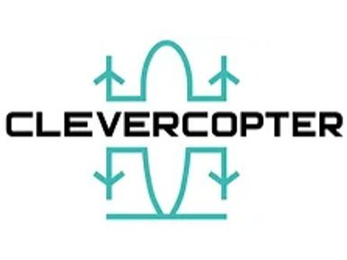

# ООО «Клеверкоптер»

`sanctioned` `manufacturer` 

ИНН 5257183517 · ОГРН 1185275047176 · Nizhny Novgorod

## At a glance

- **Legal form:** OOO (limited liability company)
- **Address:** Нижегородская область, г. Нижний Новгород
- **Director:** Гусев Сергей Владимирович
- **ОКВЭД:** 72.19 — Научные исследования и разработки в области естественных и технических наук прочие
- **Wildberries overlap:** none_found

## Ownership & corporate history

### Director

| Value | As of | Note |
|---|---|---|
| Гусев Сергей Владимирович | 2018-08-30 | personal ИНН 732102513469 [s0464] |

## Products

- **Курьер-30** — Multi-rotor cargo UAV, 30kg MTOW, 6kg payload, 30km range -- delivery/field-scanning/irrigation.
- **Патруль-30** — Hybrid VTOL, 7kg payload, 300km range -- delivery/monitoring.
- **Аэромедик-680** — Heavy hybrid convertible VTOL, 130kg payload, 600km range -- casualty evacuation, inter-terminal cargo.
- **Аэромедик** — Fixed-wing VTOL UAS for cargo transport and (planned) casualty evacuation -- per this entity's own rk.2035.university listing. [s1169]
- **Аэромедик MINI** — Hybrid-powertrain convertiplane for cargo delivery incl. medical payloads. [s1169]

## Financials

| Year | Revenue | Profit | Source |
|---|---|---|---|
| 2021 | ₽490,000 | ₽-3,638,000 | [s5545] |
| 2022 | ₽3,885,000 | ₽-4,991,000 | [s5546] |
| 2023 | ₽8,213,000 | ₽4,682,000 | [s5547] |
| 2024 | ₽9,852,000 | ₽-1,553,000 | [s5548] |
| 2025 | ₽4,293,000 | ₽1,547,000 | [s5549] |

## Trademarks

| Mark | Reg. no. | Filed | Registered | Classes |
|---|---|---|---|---|
| — | 910152 | 20220524 | 08.12.2022 | 09 (UAV/defense terms present: навигацион, квадрокоптер, беспилот, авиацион, летательн); 12 (UAV/defense terms present: летательн, квадрокоптер, беспилот, авиацион, воздушн); 39 (UAV/defense terms present: летательн, авиацион, навигацион); 42 (UAV/defense terms present: беспилот, авиацион) |

## Patents

| Title | Reg. no. | Filed | Inventors |
|---|---|---|---|
| АППАРАТ ЛЕТАТЕЛЬНЫЙ | RU134797S | 2022.06.15 | Гусев Сергей Владимирович (RU), Дубняков Дмитрий Андреевич (RU) |

## Sanctions & screening

**EU (Ukraine-related restrictive measures), Ukraine (Presidential sanctions decree/list), Switzerland (SECO, Ukraine-related measures)** [s0744]

- 1 OpenSanctions match(es) (screened 2026-09-06).
- 5 OCCRP Aleph match(es) (screened 2026-09-05).

## Web & social presence

### Website

- <https://clevercopter.ru/> — Confirmed via matching contact email (mail@clevercopter.ru) and Nizhny Novgorod address consistent with registry.

### Marketplace listings

- <https://xn--80aaorhk2b.xn--p1ai/sellers/kleverkopter> — Official partner/seller profile on Налетай.рф, the ГТЛК-backed state civilian UAV marketplace. Legal-info block confirms exact ИНН match. Direct manufacturer storefront (sells under its own name, not a reseller). 3 products: БАС Курьер-30 and БАС Патруль-30 (multirotor delivery/patrol platforms) plus a LiPo battery.

## Images

-  — Company logo, as self-listed in rk.2035.university's curated БАС-industry showcase [s1168]

## Principals & persons of interest

### Гусев Сергей Владимирович

- co-inventor (patent RU134797S)

### Dubnyakov Dmitriy Andreevich — Дубняков Дмитрий Андреевич

- co-inventor (patent RU134797S)

## Open questions

- Featured in rk.2035.university's curated БАС-industry showcase, describing the «Клевер» open educational drone platform -- corroborates significance; source carries no ИНН to cross-check. [s1168]
- This entity's own rk.2035.university listing (s1169) describes «Курьер-30» with different specs than already on file here (up to 6kg payload / 0.055m³ / 18km range vs. the existing entry's 30kg MTOW / 6kg payload / 30km range) -- not reconciled; could be two product generations, a spec update, or one of the two sources being imprecise. [s1169]

## Sources cited in this profile

| ID | Type | Locator | Captured | As of |
|---|---|---|---|---|
| s0464 | EGRUL extract | EGRUL extract (ul-1185275047176-20260823122917.pdf) | — | 2026-08-23 |
| s0744 | OpenSanctions screening record | OpenSanctions screening record (OPENSANCTIONS_5257183517_20260824_ooo-kleverkopter.json) | 2026-08-24 | — |
| s1168 | bulk open-data extract | bulk open-data extract (DATASET_20260824_rk2035-university-bas-objects-catalog.json) | 2026-08-24 | — |
| s1169 | bulk open-data extract | bulk open-data extract (DATASET_20260824_rk2035-university-bas-product-models.json) | 2026-08-24 | — |
| s5545 | Bfo | Bfo (BFO_5257183517_2021_ооо-клеверкоптер.pdf) | — | — |
| s5546 | Bfo | Bfo (BFO_5257183517_2022_ооо-клеверкоптер.pdf) | — | — |
| s5547 | Bfo | Bfo (BFO_5257183517_2023_ооо-клеверкоптер.pdf) | — | — |
| s5548 | Bfo | Bfo (BFO_5257183517_2024_ооо-клеверкоптер.pdf) | — | — |
| s5549 | Bfo | Bfo (BFO_5257183517_2025_ооо-клеверкоптер.pdf) | — | — |

---
_Generated from this investigation's registry (`data/registry/`) by `scripts/build_company_profile.py`. Not a substitute for reading the underlying primary sources listed above._