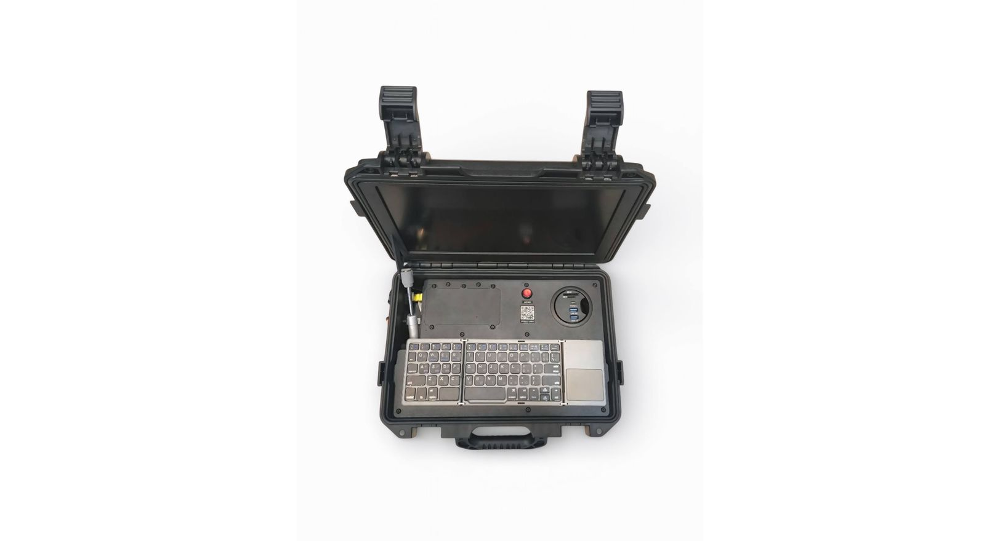

# ООО «КоптерЛаб»

`manufacturer` 

ИНН 7720925267 · ОГРН 1247700198734 · Moscow

## At a glance

- **Legal form:** OOO (limited liability company)
- **Registered:** 29.02.2024
- **Address:** г. Москва
- **Director:** Федукович Кирилл Олегович
- **ОКВЭД:** 62.01 — Разработка компьютерного программного обеспечения
- **Wildberries overlap:** none_found

> **Declared vs. actual activity.** Declared activity is software development, not UAV manufacture — name ("КоптерЛаб") suggests drone-adjacent work (flight-control software, ground-control-station apps) rather than airframe production; consistent with, not contradicting, a software-focused registration.

## Ownership & corporate history

### Director

| Value | As of | Note |
|---|---|---|
| Федукович Кирилл Олегович | 2024-02-29 | personal ИНН 110602844434 [s0473] |

## Products

- **Дрон-конструктор «Колобок»** — Educational/hobby drone-building kit (multirotor), от ₽75,000. [s2626]
- **Дрон-конструктор «Кузнечик»** — Educational/hobby drone-building kit (multirotor), от ₽87,000. [s2626]
- **Программно-аппаратный комплекс «Форпост»** — Found via GISP goods-catalog full-roster company_ogrn sweep (2026-09-03). ОКПД2: Бортовые системы и/или компоненты систем автоматического управления полетом беспилотных воздушных судов [s5391]
- **Беспилотный летательный аппарат «Матка»** — Found via GISP goods-catalog full-roster company_ogrn sweep (2026-09-03). ОКПД2: БАС в составе с беспилотным воздушным судном мультироторного типа [s5391]
- **Беспилотный летательный аппарат «Синица»** — Found via GISP goods-catalog full-roster company_ogrn sweep (2026-09-03). ОКПД2: БАС с беспилотным воздушным судном мультироторного типа с максимальной взлетной массой свыше 0,25 кг, но не более 4 кг [s5391]
- **Беспилотный летательный аппарат Многоцелевая транспортная платформа КЛ-МТП-30** — Found via GISP goods-catalog full-roster company_ogrn sweep (2026-09-03). ОКПД2: БАС в составе с беспилотным воздушным судном мультироторного типа с максимальной взлетной массой свыше 30 кг, но не более 500 кг [s5391]
- **Беспилотный летательный аппарат Многоцелевая транспортная платформа КЛ-МТП-100** — Found via GISP goods-catalog full-roster company_ogrn sweep (2026-09-03). ОКПД2: БАС в составе с беспилотным воздушным судном мультироторного типа с максимальной взлетной массой свыше 30 кг, но не более 500 кг [s5391]
- **Наземная стация управления «Форпост»** — Found via GISP goods-catalog full-roster company_ogrn sweep (2026-09-03). ОКПД2: Бортовые системы и/или компоненты систем автоматического управления полетом беспилотных воздушных судов [s5391]

## Financials

| Year | Revenue | Profit | Source |
|---|---|---|---|
| 2024 | ₽16,287,000 | ₽691,000 | [s0333] |
| 2025 | ₽64,137,000 | ₽34,890,000 | [s0334] |

## State-program participation

- as_of: 2026-09-03; name_en: GISP (State Industrial Information System) product catalog — БАС industry listing; name_ru: Каталог продукции ГИСП — отрасль БАС; role: Manufacturer listed with an active БАС-category (беспилотные авиационные системы) product entry in gisp.gov.ru's official product catalog (industry filter 68/product-group 144), the federal government's industrial-product registry platform. ИНН-matched to this entity exactly. [s5344]
- as_of: 2026-09-06; name_en: rk.2035.university national БАС (UAV-industry) company registry; name_ru: Реестр компаний БАС — rk.2035.university; role: ID-confirmed match (exact ИНН + ОГРН, not a name collision) in the national rk.2035.university БАС-industry company directory. Sectors declared: Компания БАС, Образовательная организация. Activity types: Разработка, Дополнительное [образование]. Personnel count 4, profile created 2025-11-25. [s1165]

## Web & social presence

### Website

- <https://copterlab.ru/> — From rk.2035.university's БАС-industry company directory (ИНН-confirmed match), s1165.

### Marketplace listings

- <https://xn--80aaorhk2b.xn--p1ai/sellers/copterlab> — Official partner/seller profile on Налетай.рф, the ГТЛК-backed state civilian UAV marketplace. Legal-info block confirms exact ИНН match. Direct manufacturer storefront (sells under its own name, not a reseller). 3 products including "Программно-аппаратный комплекс «ФОРПОСТ»" (counter-drone complex, from ₽10,000,000) -- confirms this entity as the manufacturer of that system.

## Images

-  — Программно-аппаратный комплекс «Форпост» -- ruggedized counter-drone control console, product photo from its Налетай.рф listing. [s2626]

## Principals & persons of interest

_No named principals linked to this entity yet._

## Sources cited in this profile

| ID | Type | Locator | Captured | As of |
|---|---|---|---|---|
| s0333 | БФО annual-accounts filing | БФО annual-accounts filing (РЕСУРС_БФО_7720925267_2024_20260816.zip) | 2026-08-16 | 2024-12-31 |
| s0334 | БФО annual-accounts filing | БФО annual-accounts filing (РЕСУРС_БФО_7720925267_2025_20260816.zip) | 2026-08-16 | 2025-12-31 |
| s0473 | EGRUL extract | EGRUL extract (ul-1247700198734-20260823122742.pdf) | — | 2026-08-23 |
| s1165 | bulk open-data extract | bulk open-data extract (DATASET_20260824_rk2035-university-companies.zip) | 2026-08-24 | — |
| s2626 | Naletay | Naletay (NALETAY_7720925267_20260826_catalog-listing.json) | 2026-08-26 | 2026-08-26 |
| s5344 | Gisp | Gisp (GISP_20260903_bas-manufacturer-catalog-155-companies.json) | 2026-09-03 | 2026-09-03 |
| s5391 | Gisp | Gisp (GISP_20260903_goods-catalog-full-roster-sweep-20-hits.json) | 2026-09-03 | 2026-09-03 |

---
_Generated from this investigation's registry (`data/registry/`) by `scripts/build_company_profile.py`. Not a substitute for reading the underlying primary sources listed above._