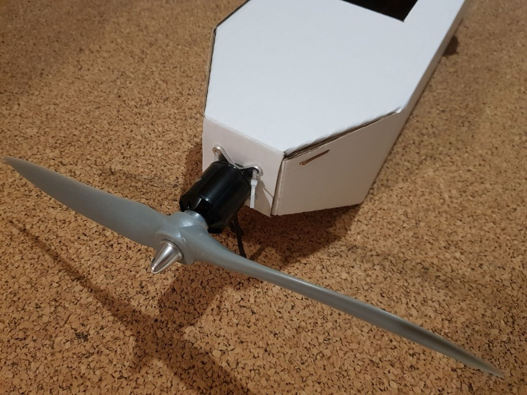
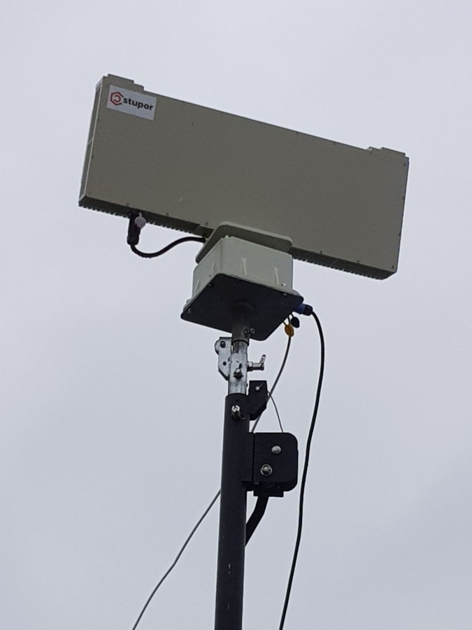

# NPTs BASiRTK — ООО «НПЦ БАСИРТК»

`cbst-core` `WB: not_checked` 

ИНН 3300009049 · ОГРН 1243300000789

## At a glance

- **Registered:** 31.01.2024
- **Address:** 602251, Владимирская обл., г.о. округ Муром, г. Муром, ш. Карачаровское, д. 5
- **Director:** Байгутлина Ирина Анатольевна
- **Charter capital:** ₽500,000
- **ОКВЭД:** 72.19 — Научные исследования и разработки в области естественных и технических наук (R&D, primary code); secondary codes explicitly include 25.40 «Производство оружия и боеприпасов» (weapons/ammunition manufacturing) and 84.22 «Деятельность, связанная с обеспечением военной безопасности» (military-security-related activity) — most network entities register under vaguer software/electronics codes and leave the weapons link implicit; this one states it directly.
- **ЦБСТ tie:** All four projects submitted by НПЦ БАСиРТК were selected into the III stream of ЦБСТ's own Accelerator for special and dual-purpose projects, and completed its first two modules.
- **Wildberries overlap:** not_checked

## Ownership & corporate history

### Director

| Value | As of | Note |
|---|---|---|
| Байгутлина Ирина Анатольевна | 2024-01-31 | GD from incorporation, per the entity's own full signed EGRUL extract. [s0003] |

### Founders / ownership

| Value | As of | Note |
|---|---|---|
| Байгутлина Ирина Анатольевна (100%) | 2024-01-31 |  [s0003] |
| Байгутлина Ирина Анатольевна 100% (₽500 000) | 2026-07-14 | Full signed ЕГРЮЛ выписка pulled 2026-09-07 (egrul_vypiska_pull.py). [s6782] |

### Charter capital

| Value | As of | Note |
|---|---|---|
| 500000 | 2024-01-31 |  [s0003] |

### Address

| Value | As of | Note |
|---|---|---|
| Владимирская обл., г. Муром (exact prior address not yet pulled) | — | Pre-15.07.2026 address — this entity's registered address before the charter amendment; not yet confirmed against a document. |
| 602251, Владимирская обл., г.о. округ Муром, г. Муром, ш. Карачаровское, д. 5 | 2026-07-22 | GRN 2263300336253, 22.07.2026 — matches the 15.07.2026 charter amendment ([s0187]) moving the entity into Технопарк Муроммаш. [s0003] |

### Facility type

| Value | As of | Note |
|---|---|---|
| purpose_built_technopark_sez | 2026-07-15 | charter amendment (data/sources/UD_1243300000789_20260818_npc-basirtk.zip) changes registered address to Муром — Технопарк Муроммаш, matching the brief's already-documented facility. Corroborated by the EGRUL extract's own GRN 2263300336253 dated 22.07.2026. [s0184] |

## Products

- **«Ковровец»** — Low-cost, largely field-assembled cardboard-airframe FPV drone family, supplied directly to the 106th Guards Airborne Division (Tula). Per the entity's own Telegram channel: msg 223 (2024-09-01, [s7959]) "Подготовлена партия трёх типов дронов «Ковровец» для 106-й гвардейской воздушно-десантной Тульской... дивизии"; msg 226 (2024-09-11, [s7960]) troops moved from assembly to full independent field manufacture; msg 229 (2024-09-14, [s7961]) components (motors, ESCs, servos) handed over for troops' own self-manufacture; msg 230 (2024-09-15, quoted here) agreement reached with the 106th on producing "Ковровец"-type drones through the Tula Suvorov Military School, with parts to be produced at Tula defense-industry enterprises. A later channel post (2024-12-03, #269, not separately archived) confirms cardboard (гофрокартон) airframe, comparing to the Australian Corvo PPDS. [s7962]

## Financials

| Year | Revenue | Profit | Source |
|---|---|---|---|
| 2024 | ₽11,000 | ₽-181,000 | [s0247] |
| 2025 | ₽83,700,000 | ₽2,688,000 | [s0248] |

## State-program participation

- as_of: 2026-09-06; name_en: rk.2035.university national БАС (UAV-industry) company registry; name_ru: Реестр компаний БАС — rk.2035.university; role: ID-confirmed match (exact ИНН + ОГРН, not a name collision) in the national rk.2035.university БАС-industry company directory. Surfaced by the screen's full-catalog cross-check pass (missed by the name-substring sweep since the registered short name "НПЦ БАСиРТК" does not literally contain this entity's own name string). Sectors declared: Компания БАС. Activity types: Разработка. Personnel count 13, profile created 2025-12-17. [s1165]

## Workforce & production scale

| Headcount | As of | Note |
|---|---|---|
| 2 | 2025 | RMSP status: микропредприятие (micro-enterprise), 2 employees (average headcount, prior year, per the entity's own БФО filing) -- a company this small should not, on paper, carry the revenue this brief's financials[] shows for the same period. |

## Battlefield evidence

> *Благодарственное письмо адресовано Замятину А.Ю. (технический директор — главный конструктор), подписано генерал-майором Д. Барило, командиром Добровольческого корпуса, войсковая часть — полевая почта 71474.*
> MoD-stamped thank-you letter addressed to Zamyatin A.Yu. (technical director / chief designer), signed by Major-General D. Barilo, commander of the Volunteer Corps, military unit — field post 71474.
>
> — First of two thank-you letters, 16 months apart, from the same unit and commander -- confirms a sustained, not one-off, supply relationship. (2024-12-01) [s0232]

> *Благодарственное письмо адресовано Сухоненковой Н.А. (Административный директор), подписано тем же генерал-майором Д. Барило, тот же войсковая часть — полевая почта 71474.*
> The same letter format and signatory, addressed to Sukhonenkova N.A. (Administrative Director) 16 months later -- confirming the supply relationship with this specific unit was sustained, not a single delivery.
>
> — Second of two thank-you letters from the same unit/commander; recipient here is the entity's Административный директор Сухоненкова Надежда Андреевна, not yet a separate person record. (2026-04-05)

- 1 OpenSanctions match(es) (screened 2026-09-06).

## Web & social presence

### Telegram

- <https://t.me/UAS_development> — Channel title "НПЦ БАСиРТК", description "Канал Научно-производственного центра беспилотных авиационных систем и робототехнических комплексов (Москва - Санкт-Петербург)" -- matches entity's full name exactly. Caveat: description states Moscow-SPb, entity's registered address is Ковров (Владимирская обл.) -- common for a young R&D entity to operate from a different city than its legal registration, but not independently confirmed as the same legal entity beyond the name match. Contact listed as @azflight.

## Images

-  — Satellite imagery (2026) of the entity's confirmed physical facility at 55.5606614732459, 42.05605953940559 -- a large, recently-built industrial building with visible roof ventilation units and active construction debris nearby, inside Промышленный технопарк «Муроммаш».
-  — «Ковровец» FPV drone components supplied to the 106th Guards Airborne Division, per the entity's own channel.
-  — «Ступор» branded counter-drone RF hardware, from a targeting-demonstration post the entity's own channel participated in (16.10.2024).
-  — Генерал-лейтенант Андрей Андреевич Киндяков, заместитель начальника ГУ Генерального штаба ВС РФ по военно-политической работе (GRU deputy chief for military-political work) -- signatory of a separate formal commendation to this entity's technical director, photographed at an unrelated public event (Кубанский казачий хор concert). Included for identification of the signatory, not as evidence about this entity directly.

## Principals & persons of interest

### Байгутлина Ирина Анатольевна

- **ИНН:** 110603326192
- General Director / sole founder (100%) (2024-01-31–present)

### Замятин Александр Юрьевич

- технический директор — главный конструктор

## Open questions

- Сухоненкова Надежда Андреевна (Административный директор) is named as a commendation-letter recipient in this entity's own channel but has no person record yet -- not yet wired per the PII-scope rule (principal/officer-level role, should qualify once a DOB/ИНН lead surfaces).
- «Ступор» counter-drone RF system participation (16.10.2024 post) and the second Благодарственное письмо (to Сухоненкова, 05.04.2026) have no archived primary-source file yet -- only the first letter (Замятину, [s0232]) has been pulled and archived. Worth an archival pass on the entity's own channel (t.me/UAS_development) for these specific posts.

## Sources cited in this profile

| ID | Type | Locator | Captured | As of |
|---|---|---|---|---|
| [s0003] | document | document (3300009049_17082026.pdf) | 2026-08-17 | 2026-08-17 |
| [s0184] | Founding-Устав bundle | Founding-Устав bundle (UD_1243300000789_20260818_npc-basirtk.zip) | 2026-08-18 | 2026-07-15 |
| [s0232] | document | document (Благодарность.pdf) | — | 2024-12-01 |
| [s0247] | БФО annual-accounts filing | БФО annual-accounts filing (РЕСУРС_БФО_3300009049_2024_20260817.zip) | 2026-08-17 | 2024-12-31 |
| [s0248] | БФО annual-accounts filing | БФО annual-accounts filing (РЕСУРС_БФО_3300009049_2025_20260817.zip) | 2026-08-17 | 2025-12-31 |
| [s1165] | bulk open-data extract | bulk open-data extract (DATASET_20260824_rk2035-university-companies.zip) | 2026-08-24 | — |
| [s6782] | EGRUL extract | EGRUL extract (EGRUL_3300009049_20260907_ooo-npts-basirtk.pdf) | 2026-09-07 | 2026-09-07 |
| [s7962] | Tgpost | Tgpost (TGPOST_20240915_UAS_development-230.txt) | 2024-09-15 | — |

---
_Generated from this investigation's registry (`data/registry/`) by `scripts/build_company_profile.py`. Not a substitute for reading the underlying primary sources listed above._