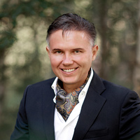

# ООО «Научно-технический центр «Аркодим»»

`WB: not_checked` 

ИНН 1659182805 · ОГРН 1171690065876

## At a glance

- **Registered:** 27.06.2017
- **Director:** Соловьев Константин Юрьевич
- **Wildberries overlap:** not_checked

## Ownership & corporate history

### Director

| Value | As of | Note |
|---|---|---|
| Соловьев Константин Юрьевич | 2026-09-14 | egrul.nalog.ru open-API name/director lookup (no captcha, no auth), pulled 2026-09-14. [s7440] |

### Founders / ownership

| Value | As of | Note |
|---|---|---|
| Соловьев Константин Юрьевич (50%) / Барахтин Артём Владимирович (50%) | 2026-09-14 | Full signed ЕГРЮЛ выписка pulled 2026-09-14 (egrul_vypiska_pull.py). [s7447] |

## Financials

| Year | Revenue | Profit | Source |
|---|---|---|---|
| 2021 | ₽12,000 | ₽10,000 | [s7481] |
| 2022 | ₽1,789,000 | — | [s7482] |
| 2023 | ₽4,370,000 | — | [s7483] |
| 2024 | ₽2,595,000 | ₽15,000 | [s7484] |
| 2025 | ₽1,760,000 | ₽2,000 | [s7485] |

- 1 OCCRP Aleph match(es) (screened 2026-09-19).

## Principals & persons of interest

### Барахтин Артём Владимирович

- **ИНН:** 165910378299
- Учредитель (50%)

## Corporate links

- **ООО «Аркодим»** `sister-entity` — Барахтин Артём Владимирович (ooo-arkodim's director) recorded as a founder here per screen_upr_uchr.py's other_entities scan; current director is a different person (Соловьев Константин Юрьевич). Sister entity in the same «Аркодим» family. Confirmed 2026-09-29 via a fresh ФНС «Прозрачный бизнес» director/founder cross-reference ([s8064]): ООО «НАУЧНО-ТЕХНИЧЕСКИЙ ЦЕНТР «АРКОДИМ»» (ИНН 1659182805) listed under Барахтин's own founder role. [s8064]

## Sources cited in this profile

| ID | Type | Locator | Captured | As of |
|---|---|---|---|---|
| [s7440] | EGRUL extract | EGRUL extract (EGRUL_OPEN_1659182805_20260914_ooo-ntc-arkodim-search.txt) | 2026-09-14 | — |
| [s7447] | EGRUL extract | EGRUL extract (EGRUL_1659182805_20260914_ooo-ntc-arkodim.pdf) | 2026-09-14 | 2026-09-14 |
| [s7481] | Bfo | Bfo (BFO_1659182805_2021_ooo-ntc-arkodim.pdf) | — | — |
| [s7482] | Bfo | Bfo (BFO_1659182805_2022_ooo-ntc-arkodim.pdf) | — | — |
| [s7483] | Bfo | Bfo (BFO_1659182805_2023_ooo-ntc-arkodim.pdf) | — | — |
| [s7484] | Bfo | Bfo (BFO_1659182805_2024_ooo-ntc-arkodim.pdf) | — | — |
| [s7485] | Bfo | Bfo (BFO_1659182805_2025_ooo-ntc-arkodim.pdf) | — | — |
| [s8064] | Fns | Fns (FNS_PB_UPR_UCHR_165910378299_20260929_barakhtin-artem-vladimirovich-raw.json) | 2026-09-29 | — |

---
_Generated from this investigation's registry (`data/registry/`) by `scripts/build_company_profile.py`. Not a substitute for reading the underlying primary sources listed above._