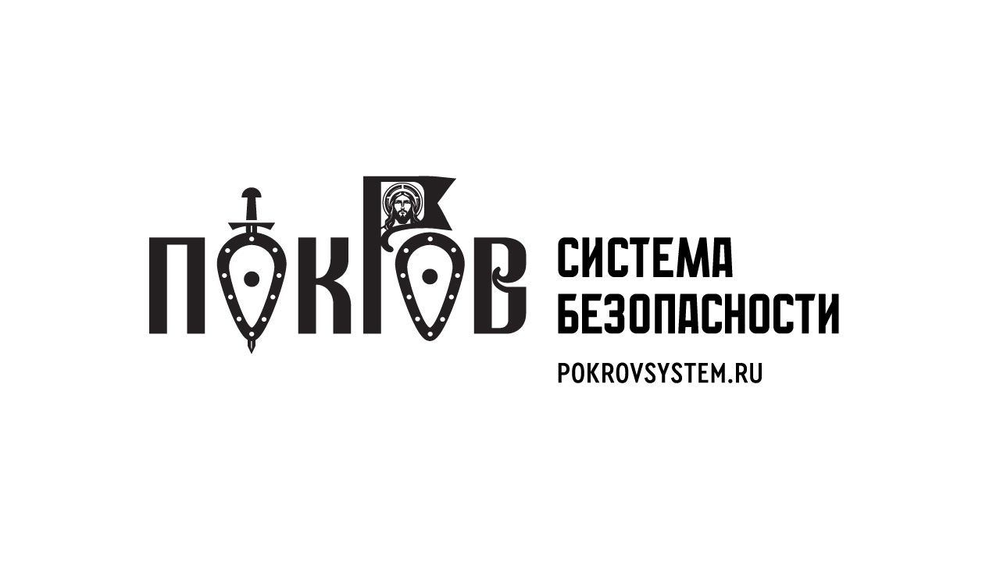
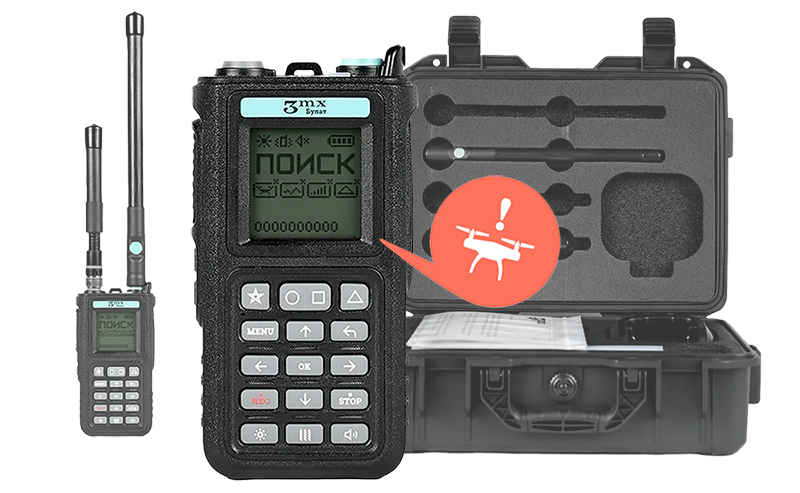
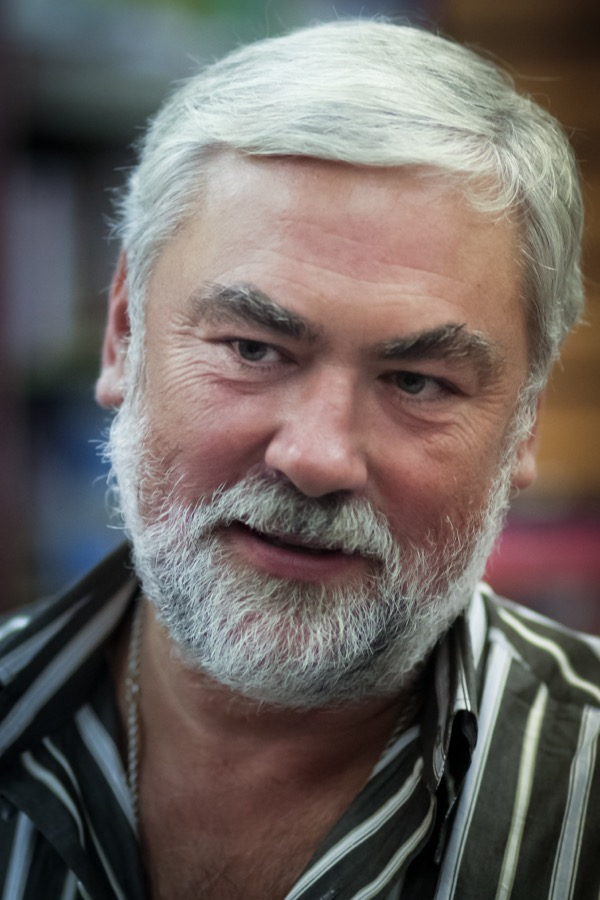

# Pokrov LLC — ООО «ПОКРОВ»

`sanctioned` `manufacturer` 

ИНН 5038189259 · ОГРН 1245000068774 · Khimki, Moscow Oblast

## At a glance

- **Registered:** 2024-06-13
- **Address:** 141204, Московская область, г. Пушкино, ул. Тургенева, д. 1, помещ. 2, ком. 4Д
- **Director:** Цыганов Вадим Борисович
- **Charter capital:** ₽100,000
- **Wildberries overlap:** none_found

## Ownership & corporate history

### Director

| Value | As of | Note |
|---|---|---|
| Цыганов Вадим Борисович | 2024-06-13 | Должность: ГЕНЕРАЛЬНЫЙ ДИРЕКТОР, личный ИНН 504405055721. Full signed ЕГРЮЛ выписка pulled 2026-09-07. [s6799] |
| Цыганов Вадим Борисович | 2026-08-24 | per egrul.nalog.ru open-API lookup, 2026-08-24 [s0946] |

### Founders / ownership

| Value | As of | Note |
|---|---|---|
| Цыганов Вадим Борисович 100% (₽100 000) | 2026-02-24 | Full signed ЕГРЮЛ выписка pulled 2026-09-07 (egrul_vypiska_pull.py). [s6799] |

### Charter capital

| Value | As of | Note |
|---|---|---|
| 100000 | 2024-06-13 | Full signed ЕГРЮЛ выписка pulled 2026-09-07 (egrul_vypiska_pull.py). [s6799] |

### Address

| Value | As of | Note |
|---|---|---|
| 141204, Московская область, г.о. Пушкинский, г. Пушкино, ул. Тургенева, д. 1, помещ. 2, ком. 4Д | 2025-06-09 | factAddress per contract XML (regNumber 1500300810225000157). Cross-checked against rusprofile.ru ([s3929], captured 2026-08-30): this IS the entity's current юридический (registered) address, not a distinct undocumented facility as first assumed -- supersedes the unsourced 'Химки, д. Мышецкое' value previously carried in this entity's scalar 'address' field (no source_id, likely inherited from the founder ИП Цыганов's own address at scaffold time). [s3669] |

## Products

- **Покров ВЦА «Алёша»** — 4-6 km range, 10-channel circular video-frequency suppression, 1050-6200 MHz. [s1386]
- **Покров ВЦ4 «Альфа»** — 10 channels, 360° 40cm antennas, 400-5900 MHz, up to 500m radius. [s1386]
- **Покров ВЦ5 «Альфа»** — 12 channels, 360° 40cm antennas, 400-5900 MHz, backpack design. [s1386]
- **Детектор «Булат» v.4 (3MX)** ([full profile](products/bulat.html)) — Resold 3mx product — detection range 1.5 km, 300-7200 MHz. [s1386]
- **Часы «Таир»** — Wearable notification device paired with the Булат v.4 detector. [s1386]
- **Детектор «Марс»** ([full profile](products/bulat.html)) — Resold 3mx product — detector of digital video links and ELRS remote controls. [s1386]

## Financials

| Year | Revenue | Profit | Source |
|---|---|---|---|
| 2024 | ₽2,731,000 | ₽113,000 | [s6508] |
| 2025 | ₽110,386,000 | ₽3,960,000 | [s6509] |

## Government contracts

- customer: ФГКУ «Центр по проведению спасательных операций особого риска «Лидер»» (МЧС spetsnaz); date: 2025; items: Contract ЕП 2-25 of 26.09.2025 (ООО «ПОКРОВ», signed by Цыганов as general director). The sole-supplier notice's subject line reads «поставка средств подавления беспилотных аппаратов», but the goods itemised in the notice body («закупка средств обнаружения беспилотных летательных аппаратов») and in the printed contract form ([s3672]; contract file title «ГК ЕП 2-25 (Булат, Марс)») are DETECTION devices, ОКПД2 26.51.20.110: 7 × «Мониторинговое устройство БУЛАТ v4» at ₽99,000; 12 × «Булат v4 с выносными антеннами» at ₽105,100; 3 × портативный всенаправленный детектор цифровых видеолинков и пульты ELRS «Марс» at ₽120,000 (total ₽2,314,200). The suppression complex «Покров» ВЦ5 АЛЬФА is a different contract (ЕП 3-25, ИП Цыганов, [s1417]). Sole-supplier basis п.9 ч.1 ст.93 44-ФЗ, justified in the notice by reference to МЧС letters от 20.05.2025 № М-17-1180 ДСП «О доведении ЛБО» и от 10.06.2025 № М-17-1363 ДСП «О направлении обновленного каталога средств противодействия», tied to equipping personnel deployed for «поиск, обезвреживание и уничтожение взрывоопасных предметов на территории Курской области» (OCR of the scanned notice, [s3680], read 2026-09-20. The notice's purchase table repeats the contract's 7 / 12 / 3 units and total ₽2,314,200; its separate list of the customer's overall requirement, including РЭБ kit such as a «Покров» ВЦ5 АЛЬФА complex and «АСК», is larger than what was bought under this contract). Earlier wording of this field described the whole contract as «средства ПОДАВЛЕНИЯ»; that was the notice's subject line, not the goods purchased.; reg_number: 1500300810225000157; value_rub: 2314200; event_type: contract_award; actor_to: {'kind': 'government_customer', 'id': None, 'label': 'ФГКУ «Центр по проведению спасательных операций особого риска «Лидер»» (МЧС spetsnaz)'} [s3680]
- customer: Администрация Белгородского муниципального округа; date: 2026; items: Поставка мониторинговых устройств «Булат» — same «Булат» product line as the earlier ИП Цыганов contracts (see corrections entry for that person).; reg_number: 3310005025826000052; value_rub: 495000; event_type: contract_award; actor_to: {'kind': 'government_customer', 'id': None, 'label': 'Администрация Белгородского муниципального округа'} [s3424]

## Self-reported marketing claims

> *В реестре – рекомендованных средств противодействия бпла. По вопросам приобретения Булат и РЭБ Покров обращайтесь sales@pokrovsystem.ru и чат  @pokrov_sales*
> In the register of recommended counter-UAV means. For purchasing Булат and the Покров jammers, contact sales@pokrovsystem.ru and chat @pokrov_sales.
>
> — Channel description of «Система ПОКРОВ» (@pokrovZOV). The register is not named and not verified. (2026-09-30) [s8534]

> *Сегодня тепловизоры ушли группе «Пресса» — в спецназ «Ахмат». И это лишь звено в длинной цепи поддержки: до тепловизоров были детекторы дронов «Булат», до них — мощные системы РЭБ. В том числе мобильные комплексы РЭБ "Покров" ВЦА "Алёша".*
> Today thermal imagers went to the group «Пресса», to the Akhmat spetsnaz. This is only one link in a long chain of support: before the thermal imagers there were «Булат» drone detectors, and before them powerful jammer systems, including the mobile «Покров» ВЦА «Алёша» jammers.
>
> — Post pokrovZOV/742, 31.07.2026. Company's own claim of deliveries to Akhmat; the recipient and quantities are not documented. (2026-07-31) [s8534]

> *На праздновании дня города Реутов Вадим и Вика Цыгановы передали «Покров» ВЦ4. Маленький вклад в общее большое дело.*
> At the Reutov city-day celebration Vadim and Vika Tsyganov handed over a «Покров» ВЦ4. A small contribution to the big common cause.
>
> — Post pokrovZOV/77, 16.09.2024; the post names a jammer officer of a Kursk/Belgorod regiment as the requester and thanks the Moscow Oblast government for supporting the development of the «Покров» system. The owner of the company and his wife are the donors named. (2024-09-16) [s8532]

> *Булат V4 от 88000 рублей. Доставка по России. Детектор Булат от производителя. Официальный дилер "Покров".*
> Булат V4 from ₽88,000. Delivery across Russia. The Булат detector from the manufacturer. Official dealer "Покров".
>
> — Meta description of pokrovsystem.ru/bulat. ПОКРОВ presents itself as the official dealer, not the manufacturer, consistent with the dealer page on 3mx.ru ([s0558]). (2026-09-30) [s8535]

## Sanctions & screening

**Ukraine (NSDC decision, Presidential Decree 301/2025, State Register of Sanctions)** [s7873]

- 1 OpenSanctions match(es) (screened 2026-09-06).
- 2 OCCRP Aleph match(es) (screened 2026-09-19).

## Web & social presence

### Website

- <https://pokrovsystem.ru/> — Contact: sales@pokrovsystem.ru, +7 495 799-7101 / +7 905 519-7101. Re-confirmed 2026-08-25 ([s1386], direct curl archive) -- ОГРН 1245000068774 matches exactly.

### Telegram

- <https://t.me/pokrov_sales>
- <https://t.me/pokrovZOV> — «Система ПОКРОВ» channel, 1.07K subscribers on 30.09.2026; its post of 16.09.2024 links the couple's channel @vika_tsyganova63 ([s8532]).

## Images

-  — Company logo ("ПОКРОВ — Система безопасности"), from the company's own official site. [s7540]
-  — Product card for the «Булат» v.4 (3MX) handheld detector, with its case and antennas, as shown on the company's own site pokrovsystem.ru (captured 20.09.2026). [s7943]
-  — Concert in Реутов for the city day, 16.09.2024: the «ПОКРОВ» logo is on the stage screen behind the singer. Photo from the company's own channel post (low resolution). [s8519]

## Principals & persons of interest

### Цыганов Вадим Борисович

- **DOB:** 30.05.1963
- **Birthplace:** Стерлитамак, Башкирская АССР, РСФСР, СССР
- **ИНН:** 504405055721
- Генеральный директор / основной участник (80-100%) (2024-06-13–present)
- `sanctions lead`

## Sources cited in this profile

| ID | Type | Locator | Captured | As of |
|---|---|---|---|---|
| [s0946] | EGRUL open-API record | EGRUL open-API record (EGRULAPI_5038189259_20260824_ooo-pokrov.json) | 2026-08-24 | 2026-08-24 |
| [s1386] | site capture | site capture (SITE_5038189259_20260825_ooo-pokrov-pokrovsystem-ru.html) | 2026-08-25 | — |
| [s3424] | Zakupki | Zakupki (ZAKUPKI_contract_3310005025826000052_20260829.html) | 2026-08-29 | — |
| [s3669] | Zakupki | Zakupki (ZAKUPKI_ATTACH_1500300810225000157_1500300810225000157_elektronnyy-kon-15003008102250001570005_72034074.xml) | — | — |
| [s3680] | Zakupki | Zakupki (ZAKUPKI_ATTACH_1500300810225000157_1500300810225000157_uvedomlenie-fas-15003008102250001570006_4d2c94b3.zip) | — | — |
| [s6508] | Bfo | Bfo (BFO_5038189259_2024_ооо-покров.pdf) | — | — |
| [s6509] | Bfo | Bfo (BFO_5038189259_2025_ооо-покров.pdf) | — | — |
| [s6799] | EGRUL extract | EGRUL extract (EGRUL_5038189259_20260907_ooo-pokrov.pdf) | 2026-09-07 | 2026-09-07 |
| [s7540] | site capture | site capture (SITE_5038189259_20260916_ooo-pokrov-logo.jpg) | 2026-09-16 | — |
| [s7873] | Nsdc | Nsdc (NSDC_5038189259_20260920_ooo-pokrov.pdf) | 2026-09-20 | — |
| [s7943] | Web | Web (WEB_5038189259_20260920_pokrovsystem-bulat-v4-preview-card.png) | 2026-09-20 | — |
| [s8519] | Img | Img (IMG_20240916_pokrovZOV-77_photo1.jpg) | 2024-09-16 | — |
| [s8532] | Tg | Tg (TG_20260916_pokrovZOV-77.html) | 2026-09-16 | — |
| [s8534] | Tg | Tg (TG_20260930_pokrovZOV-channel.html) | 2026-09-30 | — |
| [s8535] | Web | Web (WEB_20260930_pokrovsystem-bulat.html) | 2026-09-30 | — |

---
_Generated from this investigation's registry (`data/registry/`) by `scripts/build_company_profile.py`. Not a substitute for reading the underlying primary sources listed above._