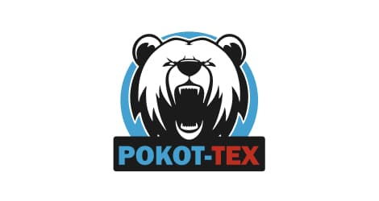

# ООО «Рокот Тех»

`manufacturer` 

ИНН 7606140961 · ОГРН 1247600010954

## At a glance

- **Legal form:** OOO (limited liability company)
- **Address:** Ярославская область, г. Ярославль
- **Director:** Нахтигаль Никита Витальевич
- **Charter capital:** ₽10,000
- **ОКВЭД:** 30.30 — Производство летательных аппаратов, включая космические, и соответствующего оборудования
- **Wildberries overlap:** none_found

## Ownership & corporate history

### Director

| Value | As of | Note |
|---|---|---|
| Нахтигаль Никита Витальевич | 2024-11-27 | personal ИНН 760212118650; also sole founder [s0515] |

### Founders / ownership

| Value | As of | Note |
|---|---|---|
| Нахтигаль Никита Витальевич 100% (₽10 000) | 2024-11-27 | Full signed ЕГРЮЛ выписка pulled 2026-09-07 (egrul_vypiska_pull.py). [s6816] |

### Charter capital

| Value | As of | Note |
|---|---|---|
| 10000 | 2024-11-27 | Full signed ЕГРЮЛ выписка pulled 2026-09-07 (egrul_vypiska_pull.py). [s6816] |

## Products

- **Пластиковые пропеллеры для FPV-дронов** — 9" and 10" currently, 7"/13"/15" in development. Explicitly marketed for combat FPV drones (plastinfo.ru, sdelanounas.ru, ridus.ru coverage of the Yaroslavl production launch, 2025). Sold via Ozon/Avito plus direct/Telegram.
- **Пропеллер для беспилотных авиационных систем RT1050** — Found via GISP goods-catalog full-roster company_ogrn sweep (2026-09-03). ОКПД2: Комплектующие (запасные части) беспилотных авиационных систем, не имеющие самостоятельных группировок; active ПП719 certificate flag on GISP listing [s5391]
- **Пропеллер для беспилотных авиационных систем RT9045** — Found via GISP goods-catalog full-roster company_ogrn sweep (2026-09-03). ОКПД2: Комплектующие (запасные части) беспилотных авиационных систем, не имеющие самостоятельных группировок; active ПП719 certificate flag on GISP listing [s5391]
- **Пропеллеры 9 дюймов для FPV дрона** — Found via GISP goods-catalog full-roster company_ogrn sweep (2026-09-03). ОКПД2: Комплектующие (запасные части) беспилотных авиационных систем, не имеющие самостоятельных группировок [s5391]
- **Пропеллеры 10 дюймов для FPV дрона** — Found via GISP goods-catalog full-roster company_ogrn sweep (2026-09-03). ОКПД2: Комплектующие (запасные части) беспилотных авиационных систем, не имеющие самостоятельных группировок [s5391]

## Financials

| Year | Revenue | Profit | Source |
|---|---|---|---|
| 2024 | — | — | [s6544] |

## State-program participation

- as_of: 2026-09-03; name_en: GISP (State Industrial Information System) product catalog — БАС industry listing; name_ru: Каталог продукции ГИСП — отрасль БАС; role: Manufacturer listed with an active БАС-category (беспилотные авиационные системы) product entry in gisp.gov.ru's official product catalog (industry filter 68/product-group 144), the federal government's industrial-product registry platform. ИНН-matched to this entity exactly. [s5344]

- Listed on Ukraine's GUR war-sanctions UAV-industry registry (screened 2026-09-05).
- 2 OpenSanctions match(es) (screened 2026-09-06).

## Web & social presence

### Website

- <https://rokottech.ru> — Footer confirms ИНН 7606140961/ОГРН 1247600010954 exactly.

### Telegram

- <None>

### Marketplace listings

- <https://xn--80aaorhk2b.xn--p1ai/sellers/rokot-tex> — Official partner/seller profile on Налетай.рф, the ГТЛК-backed state civilian UAV marketplace. Legal-info block confirms exact ИНН match. Direct manufacturer storefront (sells under its own name, not a reseller). 3 products, FPV propellers.

## Images

-  — Company logo ("POKOT-TEX"), from the company's own official site. [s7565]

## Principals & persons of interest

_No named principals linked to this entity yet._

## Open questions

- wb_overlap check (2026-08-24): a WB seller (ИП Вихарев С.В., ИНН 745202549414, Chelyabinsk region, registered as sole trader 2020) sells 2 military-flagged items under brand «Рокот Тех» — a close match to this entity's own name but a different individual/region, not this entity's own ИНН. Possibly an authorized reseller, possibly coincidental — not confirmed either way.

## Sources cited in this profile

| ID | Type | Locator | Captured | As of |
|---|---|---|---|---|
| s0515 | EGRUL extract | EGRUL extract (ul-1247600010954-20260823135127.pdf) | — | 2026-08-23 |
| s5344 | Gisp | Gisp (GISP_20260903_bas-manufacturer-catalog-155-companies.json) | 2026-09-03 | 2026-09-03 |
| s5391 | Gisp | Gisp (GISP_20260903_goods-catalog-full-roster-sweep-20-hits.json) | 2026-09-03 | 2026-09-03 |
| s6544 | Bfo | Bfo (BFO_7606140961_2024_ооо-рокот-тех.pdf) | — | — |
| s6816 | EGRUL extract | EGRUL extract (EGRUL_7606140961_20260907_ooo-rokot-tekh.pdf) | 2026-09-07 | 2026-09-07 |
| s7565 | site capture | site capture (SITE_7606140961_20260916_ooo-rokot-tekh-logo.jpg) | 2026-09-16 | — |

---
_Generated from this investigation's registry (`data/registry/`) by `scripts/build_company_profile.py`. Not a substitute for reading the underlying primary sources listed above._