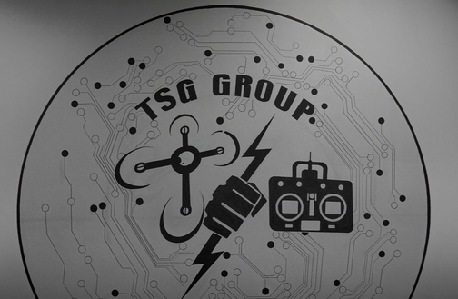

# TSG Group — ООО «ТИ ЭС ДЖИ ГРУПП»

**Brand:** TSG Group
`manufacturer` 

ИНН 3257085996 · ОГРН 1233200001066

## At a glance

- **Registered:** 22.03.2023
- **Address:** 241020, Брянская область, г.о. город Брянск, г. Брянск
- **Director:** Абрамова Татьяна Александровна
- **Charter capital:** ₽10,000
- **ОКВЭД:** 72.19 — Научные исследования и разработки в области естественных и технических наук прочие
- **Wildberries overlap:** none_found

> **Declared vs. actual activity.** Declared R&D, but secondary OKVED codes are concrete hardware manufacture: 25.11/25.61/25.99 (metalworking), 26.30.5/26.30.17 (radio/TV transmitting equipment and parts), 26.51 (measurement/testing/navigation instruments) — consistent with an actual production profile, not a pure research shop.

## Ownership & corporate history

### Director

| Value | As of | Note |
|---|---|---|
| Абрамова Татьяна Александровна | 2023-03-22 | личный ИНН 321400558603 — GD since registration [s0456] |

### Founders / ownership

| Value | As of | Note |
|---|---|---|
| Бойко А.Ю. (49%) + Абрамов Ю.А. (35%) — 84% at founding | 2023-10-10 | GRN 2233200753289 [s0456] |
| Бойко А.Ю. (49%) + Абрамов Ю.А. (35%) + Абрамова Т.А. (16%) — 100% | 2024-10-29 | GD Абрамова Т.А. herself added as a 16% founder a year after founding, completing the ownership picture — GRN 2243200118753. Surname match strongly suggests Абрамов Ю.А. and Абрамова Т.А. are family (spouses or siblings), not independently confirmed. [s0456] |

### Charter capital

| Value | As of | Note |
|---|---|---|
| 10000 | — | from corrections:add_entities, unverified |
| 10000 | 2023-03-22 | Full signed ЕГРЮЛ выписка pulled 2026-09-07 (egrul_vypiska_pull.py). [s6781] |

### Address

| Value | As of | Note |
|---|---|---|
| 241020, Брянская область, г.о. город Брянск, г. Брянск, пр-кт Московский, д. 67А | 2025-05-16 | factAddress per contract XML (regNumber 2320000296325000067) matches the registered address on file exactly — corroborates, no new facility. [s3758] |

## Products

- **Шелкопряд** — Станок для намотки оптоволокна (fiber-optic winding machine) for fiber-optic-controlled drone spools. Per KurskCiTY.ru coverage of a «ТСГ» field-test exhibition for отряд «Яким»/бригада «БАРС-Курск», 20.05.2026. [s7502]
- **Подсолнух** — Дрон-мишень (target drone) simulating enemy long-range strike drones for mobile fire-team training: climbs to 2km altitude, up to 130km/h. Per KurskCiTY.ru coverage of a «ТСГ» field-test exhibition for отряд «Яким»/бригада «БАРС-Курск», 20.05.2026. [s7502]
- **Незабудка** — Дрон-перехватчик самолётного типа (fixed-wing-type interceptor drone) carrying a 600-800g warhead, up to 200km/h. Per KurskCiTY.ru coverage of a «ТСГ» field-test exhibition for отряд «Яким»/бригада «БАРС-Курск», 20.05.2026. [s7502]
- **Брянск-1** — Дрон-перехватчик самолётного типа (fixed-wing-type interceptor drone) carrying a 600-800g warhead, up to 300km/h. Per KurskCiTY.ru coverage of a «ТСГ» field-test exhibition for отряд «Яким»/бригада «БАРС-Курск», 20.05.2026. [s7502]
- **Подснежник-800** — Compact composite reconnaissance UAV that fits in a backpack, up to two hours flight endurance. Per KurskCiTY.ru coverage of a «ТСГ» field-test exhibition for отряд «Яким»/бригада «БАРС-Курск», 20.05.2026. [s7502]
- **Дирижёр** — Multifunctional master control console combining fiber-optic drone-control-station functions with radio communications and a BPLA firmware-flashing device. Per KurskCiTY.ru coverage of a «ТСГ» field-test exhibition for отряд «Яким»/бригада «БАРС-Курск», 20.05.2026. [s7502]

## Financials

| Year | Revenue | Profit | Source |
|---|---|---|---|
| 2023 | ₽13,283,000 | ₽1,120,000 | [s0244] |
| 2024 | ₽130,816,000 | ₽25,203,000 | [s0245] |
| 2025 | ₽190,251,000 | ₽9,493,000 | [s0246] |

## Government contracts

- customer: СГУП «Центр специального назначения «Защита» Брянской области»; date: 2025; items: Поставка средств радиоэлектронной борьбы — largest of this ИНН's 3 zakupki hits; customer is a regional counter-drone/EW response unit in a border region (Bryansk).; reg_number: 2320000296325000067; value_rub: 20235000 [s3396]

## Trademarks

| Mark | Reg. no. | Filed | Registered | Classes |
|---|---|---|---|---|
| — | 1190273 | 20250516 | 27.02.2026 | 01 (broad catch-all filing, no UAV/defense-specific items); 06 (broad catch-all filing, no UAV/defense-specific items); 07 (UAV/defense terms present: дрон, летательн, воздушн, робот); 09 (UAV/defense terms present: антенн, навигацион, военн, оружи, робот, взрывчат); 12 (UAV/defense terms present: беспилот, робот, летательн, радиоуправляем, коптер, дрон, военн, воздушн); 17 (broad catch-all filing, no UAV/defense-specific items); 20 (broad catch-all filing, no UAV/defense-specific items); 28 (UAV/defense terms present: воздушн, дрон, оружи, робот); 35 (broad catch-all filing, no UAV/defense-specific items); 37 (broad catch-all filing, no UAV/defense-specific items); 38 (broad catch-all filing, no UAV/defense-specific items); 39 (UAV/defense terms present: летательн, дрон, навигацион); 40 (UAV/defense terms present: робот); 41 (UAV/defense terms present: робот, дрон); 42 (UAV/defense terms present: робот, дрон); 45 (UAV/defense terms present: дрон) |
| — | 1190349 | 20250516 | 27.02.2026 | 09 (UAV/defense terms present: антенн, навигацион, военн, оружи, робот, взрывчат); 12 (UAV/defense terms present: беспилот, робот, летательн, радиоуправляем, коптер, дрон, военн, воздушн) |

- 1 OpenSanctions match(es) (screened 2026-09-06).

## Web & social presence

### Website

- <https://xn----etbb2caedho.xn--p1ai/> — тсг-групп.рф

### Telegram

- <None>

## Images

-  — Company logo ("TSG Group"), from the company's own official site. [s7561]

## Principals & persons of interest

### Абрамова Татьяна Александровна

- **ИНН:** 752704816054

## Open questions

- RESOLVED: the missing 16% of founder shares belongs to Абрамова Татьяна Александровна — the company's own GD, added as a founder 29.10.2024, a year after the other two founders. Ownership now accounts for 100%. [s0456]

## Sources cited in this profile

| ID | Type | Locator | Captured | As of |
|---|---|---|---|---|
| s0244 | БФО annual-accounts filing | БФО annual-accounts filing (РЕСУРС_БФО_3257085996_2023_20260817.zip) | 2026-08-17 | 2023-12-31 |
| s0245 | БФО annual-accounts filing | БФО annual-accounts filing (РЕСУРС_БФО_3257085996_2024_20260817.zip) | 2026-08-17 | 2024-12-31 |
| s0246 | БФО annual-accounts filing | БФО annual-accounts filing (РЕСУРС_БФО_3257085996_2025_20260817.zip) | 2026-08-17 | 2025-12-31 |
| s0456 | EGRUL extract | EGRUL extract (ul-1233200001066-20260823120457.pdf) | — | 2026-08-23 |
| s3396 | Zakupki | Zakupki (ZAKUPKI_contract_2320000296325000067_20260829.html) | 2026-08-29 | — |
| s3758 | Zakupki | Zakupki (ZAKUPKI_ATTACH_2320000296325000067_2320000296325000067_elektronnyy-kon-23200002963250000670004_a7747f0a.xml) | — | — |
| s6781 | EGRUL extract | EGRUL extract (EGRUL_3257085996_20260907_ooo-ti-es-dzhi-grupp.pdf) | 2026-09-07 | 2026-09-07 |
| s7502 | press coverage | press coverage (PRESS_20260520_kurskcity-tsg-yakim-bars-kursk-field-test.html) | 2026-05-20 | — |
| s7561 | site capture | site capture (SITE_3257085996_20260916_ooo-ti-es-dzhi-grupp-logo.png) | 2026-09-16 | — |

---
_Generated from this investigation's registry (`data/registry/`) by `scripts/build_company_profile.py`. Not a substitute for reading the underlying primary sources listed above._