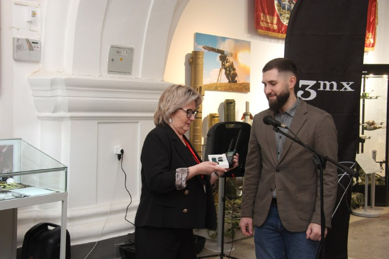

# LIMITED LIABILITY COMPANY "TRIMIX" — ООО «Тримикс»

**Brand:** «Булат» / 3mx
`sanctioned` `manufacturer` `WB: confirmed_reseller` 

ИНН 7802942873 · ОГРН 1237800084235 · St Petersburg

## At a glance

- **Legal form:** OOO (limited liability company)
- **Registered:** 21.07.2023
- **Address:** 194352, Санкт-Петербург, вн.тер.г. муниципальный округ Сергиевское, аллея Придорожная, д. 8, литера А, помещ. №707
- **Director:** — (EGRUL-restricted)
- **Charter capital:** ₽200,000
- **ОКВЭД:** 46.52 — Торговля оптовая электронным и телекоммуникационным оборудованием и его запасными частями
- **ЦБСТ tie:** Product («Булат»/3mx) shown at ЦБСТ's Дронница 2025 showcase.
- **Wildberries overlap:** confirmed_reseller

## Ownership & corporate history

### Director

| Value | As of | Note |
|---|---|---|
| Белоглазова (Мешкова) Людмила Александровна | 2024-08-22 | Pre-restriction directorship per dossier, 21.07.2023 – 22.08.2024 (company's own incorporation date through the handover to Шагиахметов). [s1408] |
| Шагиахметов Айрат Фатхутдинович | 2024-10-31 | Pre-restriction directorship per dossier, 23.08.2024 – 31.10.2024 (took over from Белоглазова, held role through the EGRUL restriction date). [s1408] |
| — (EGRUL-restricted) | 2024-11-01 | Доступ к сведениям ограничен, ГРН 2247802369637, 01.11.2024 — Federal Law 129-FZ restriction, not a data gap [s0225] |

### Founders / ownership

| Value | As of | Note |
|---|---|---|
| 15% Шахматов Иван Анатольевич | 2024-10-31 | Pre-restriction ownership per dossier, 28.02.2024 – 31.10.2024. [s1408] |
| 15% Шагиахметов Айрат Фатхутдинович | 2024-10-31 | Pre-restriction ownership per dossier, 23.08.2024 – 31.10.2024. [s1408] |
| 70-100% Белоглазова (Мешкова) Людмила Александровна | 2024-10-31 | Pre-restriction ownership per dossier, 21.07.2023 – 31.10.2024 (the day before EGRUL access was restricted). [s1408] |
| 3 participants, all EGRUL-restricted | 2024-11-01 | Доступ к сведениям ограничен, ГРН 2247802369637, 01.11.2024 — Federal Law 129-FZ restriction, not a data gap [s0225] |

### Charter capital

| Value | As of | Note |
|---|---|---|
| 200000 | 2024-02-27 | ГРН 2247800413045, 27.02.2024 [s0225] |

### Address

| Value | As of | Note |
|---|---|---|
| 194352, Санкт-Петербург, вн.тер.г. муниципальный округ Сергиевское, аллея Придорожная, д. 8, литера А, помещ. №707 | 2024-03-12 | ГРН 2247800521637, 12.03.2024 — current address per full ЕГРЮЛ extract [s0225] |

### Legal name

| Value | As of | Note |
|---|---|---|
| ООО «3мх» | 2023-08-02 | Original registered name 21.07.2023 – 02.08.2023, per dossier, before renaming to «Тримикс». [s1408] |

## Products

- **«Булат» в.4** — Портативный всенаправленный детектор БПЛА, обнаружение до 1.5 км; firmware v1.71.
- **«Булат» в.3** — Портативный всенаправленный детектор БПЛА; firmware v4.13.
- **«Булат-Онлайн»** — Automatic airspace monitoring complex.
- **«Пётр»** — Tactical active headphones; firmware v0.91.12.
- **«Азар»** — Analog video signal receiver; firmware v0.3.
- **«Марс»** — Digital video link and control detector; firmware v0.11. [s1383]

## Financials

| Year | Revenue | Profit | Source |
|---|---|---|---|
| 2023 | ₽45,621,000 | ₽13,151,000 | [s0367] |

## Trademarks

| Mark | Reg. no. | Filed | Registered | Classes |
|---|---|---|---|---|
| 3mx | 1125967 | 20231219 | 20250625 | 09 — детекторы, а именно дрон-детекторы; антенны; радиопередатчики; приборы наблюдения; радиоприемники; устройства сигнальные тревожные, 42 — IT/software services, 45 — физическая охрана, услуги по наблюдению с помощью дрона, охрана объектов через системы удаленного наблюдения |
| — | 1229675 | 20251209 | 05.06.2026 | 09 (UAV/defense terms present: беспилот, летательн); 39 (отслеживание, обнаружение, мониторинг транспортных средств, морских и воздушных судов; отслеживание, обнаружение, мониторинг беспилотных летательных аппаратов; отслеживание, обнаружение, мониторинг беспилотных катеров); 45 (услуги по обнаружению видеокамер; консультации по вопросам безопасности; охрана безопасности для объектов) |

## Patents

| Title | Reg. no. | Filed | Inventors |
|---|---|---|---|
| УСТРОЙСТВО ДЛЯ ОБНАРУЖЕНИЯ БЕСПИЛОТНОГО ЛЕТАТЕЛЬНОГО АППАРАТА (ВАРИАНТЫ) И РАДИОЭЛЕКТРОННЫЙ МОДУЛЬ ДЛЯ ПОЛУЧЕНИЯ УНИКАЛЬНОГО ОТПЕЧАТКА РАДИОСИГНАЛА | RU2826668C1 | 2024.03.11 | Шагиахметов Айрат Фатхутдинович (RU) |

## Sanctions & screening

**Switzerland (SECO, Ukraine-related measures), EU (Ukraine-related restrictive measures), US (OFAC, Russia Harmful Foreign Activities Sanctions), Ukraine (Presidential sanctions decree/list)** [s0795]

- 1 OpenSanctions match(es) (screened 2026-08-24).
- 5 OCCRP Aleph match(es) (screened 2026-08-24).

## Registry flags

- Доступ к сведениям ограничен (GD + all 3 founders, 01.11.2024)

## Web & social presence

### Website

- <https://3mx.ru/> — Full catalog nav: /products/detektory-dronov/, /products/podaviteli-dronov/, /products/kompleksy-reb/, /products/komponenty-dlya-sredstv-reb/, /products/aksessuary/

### Marketplace listings

- <https://www.wildberries.ru/catalog/241450767/detail.aspx> — «Булат» v.3 portable drone detector, confirmed live listing 2026-08-25.
- <https://www.wildberries.ru/catalog/418185835/detail.aspx> — «Булат» v.4 portable drone detector, confirmed live listing 2026-08-25.
- <https://www.wildberries.ru/brands/311445014-3mx/detektory-dronov> — Brand storefront page listing the full 3mx/Булат detector line on Wildberries.
- <https://www.wildberries.ru/seller/250074680> — Third-party dealer storefront (ИП, individual entrepreneur; not the manufacturer's own account) -- confirmed via user-supplied browser HAR capture 2026-08-25 (s1381): ИНН 350102453754, self-declared WB trademark field "madro - официальный дилер 3mx". UPGRADED to manufacturer-confirmed 2026-08-25: 3mx's own site lists "Мэдро (Madro)" as an official dealer at https://3mx.ru/dilery/ (archived 23.08.2026, s0558 -- resolves the identity this source's original note flagged as unmatched) -- SPb + 2x Moscow offices incl. Митинский радиорынок, own site madro.ru, Telegram @madro_sales -- so this is not just a self-declared WB claim but an independently-listed official dealer relationship. 34 SKUs, 6127 items, 521 reviews on WB. Reseller's personal identity not otherwise profiled (incidental retail dealer, not a network principal).
- <https://www.ozon.ru/product/mars-detektor-dronov-3mx-videolinkov-i-pultov-elrs-do-1-5-km-5525752932/> — «Марс» digital video-link/ELRS-control detector listed under the 3MX brand on Ozon -- a different marketplace than WB. Confirmed via user-supplied browser HAR capture 2026-08-25 (s1383). No seller/company-info API call was captured in that session, so the listing's own seller account is not ID-confirmed to this entity's ИНН -- same reseller-vs-manufacturer caveat as the WB listings until a seller-info pull is done.
- <https://www.ozon.ru/seller/maks-911-4233382/> — «Макс 911» dealer's own Ozon storefront -- confirmed via user-supplied browser HAR capture 2026-08-25 (s1384). Self-declared page title "МАКС 911- офиц. дилер 3mx", lists 3mx/«Булат»-branded detectors, matching the manufacturer's own dealer-page claim (3mx.ru/dilery/, s0558). Legal entity is now resolved via dji911.com/contacts itself (ИП Коровкин Александр Анатольевич, ИНН 780223272953, s1388) -- not independently re-confirmed against this specific Ozon storefront's own sellerTransparency widget (not captured), but the same dealer per the matching branding.

### Other

- <https://3mx.ru/dilery/> — Manufacturer's own dealer-network page, 2026-08-25 (originally archived 23.08.2026 as s0558, not re-archived here -- identical content confirmed by check_registry.py's duplicate-file warning): lists 3 official dealers -- Мэдро/madro.ru (confirmed WB presence, see marketplace_listings), Макс 911/dji911.com (Moscow), Покров/pokrovsystem.ru (Moscow). The latter two not yet checked for a WB presence of their own -- open lead.

## Principals & persons of interest

### Шагиахметов Айрат Фатхутдинович

- **DOB:** 1988-03-17
- **Address:** Самарская область, с. Большая Черниговка, ул. Железнодорожников, д. 14, кв. 3
- **ИНН:** 636501708070
- co-inventor (patent RU2826668C1)
- `sanctions lead`

### Shandabyla Siarhei — Шандобыло Сергей Сергеевич

- **DOB:** 1991-06-24
- **Address:** г. Санкт-Петербург, пр-кт. Товарищеский, д. 16, корп. 1, кв. 253; также Ленинградская обл., Всеволожский р-н, п. Мурино, ул. Шувалова, д. 17, кв. 181
- **ИНН:** 781154619843
- Директор по развитию
- <https://vk.ru/sergei_shandobilo>

### Кузнецов Руслан Николаевич

- **DOB:** 1996-04-01
- **Address:** г. Санкт-Петербург, ул. Тамбасова, д. 3, корп. 1, кв. 17; также Самарская область, с. Большая Черниговка, ул. Железнодорожников, д. 14, кв. 3
- **ИНН:** 637592279701
- Сотрудник
- <https://vk.ru/id47482624>
- <https://vk.ru/id357392286>
- <https://www.instagram.com/r.k16320/>

### Федоров Павел Романович

- **DOB:** 1998-08-31
- Сотрудник

### Сафиева Виктория Зуфаровна

- **DOB:** 1985-01-28
- **Address:** г. Санкт-Петербург, ул. Щербакова, д. 23, лит. А, кв. 34; также г. Москва, ул. Мосфильмовская, д. 17/25, кв. 15
- Сотрудник
- <https://www.instagram.com/victoriasafieva/>
- <https://www.facebook.com/profile.php?id=100001781383146>

### Кирток Александр Сергеевич

- **DOB:** 1995-10-21
- **Address:** г. Санкт-Петербург, ш. Революции, д. 21, корп. 2, кв. 12; также г. Санкт-Петербург, пр-кт Энтузиастов, д. 30, корп. 2, кв. 173 (адрес доставки)
- **ИНН:** 511500997610
- Сотрудник

### Шветов Артемий Андреевич

- **DOB:** 1999-06-04
- **Address:** Новгородская область, Великий Новгород, ул. Морозовская, д. 6, кв. 29
- **ИНН:** 531500409942
- Сотрудник
- <https://www.instagram.com/artemyshvetov/>
- <https://vk.ru/artemyshvetov>

### Петров Алексей Александрович

- **DOB:** 1994-04-20
- **Address:** Ленинградская область, Мурино, Воронцовский бульвар, д. 20, корп. 2, кв. 306
- **ИНН:** 290140368319
- Сотрудник (не окончательно подтверждено)
- <https://vk.ru/id557110968>
- <https://x.com/ptrvlx>
- <https://www.instagram.com/ptrvlx/>

### Михайлов Константин Денисович

- **DOB:** 1997-02-17
- **Address:** г. Москва, Сумской проезд, д. 12, корп. 3, кв. 971
- **ИНН:** 772032838410
- Дилер (Москва, Мариуполь)

## Corporate links

- **Unresolved entity** — Named dealer, per 3mx.ru/dilery/ AND independently confirmed via madro.ru itself (23.08.2026): «Мэдро» (Madro) explicitly states "официальный поставщик производителя «3mx»" (official supplier of manufacturer 3mx) and sells its own branded EW line «УФ-МЭДРО» alongside 3mx products. Storefronts in Saint Petersburg (ул. Академика Павлова, 5В), Moscow (2 offices + a shop at Митинский радиорынок), and Mariupol (occupied Ukraine). Telegram @madro_sales. LEGAL ENTITY STILL UNRESOLVED: a web search surfaced ООО «МАДРО» (ИНН 7720923661, ОГРН 1247700133669, Moscow, registered 08.02.2024, declared activity "specialized design work") as a same-named candidate, but this was NOT independently confirmed as the same legal entity behind madro.ru — flagged as a lead, not a match, pending direct confirmation (e.g. the site's own offer/contract documents, which were not checked in this pass). [s0558]
- **Unresolved entity** — Named dealer, per 3mx.ru/dilery/: «Макс 911» (Max 911) — dji911.com. Telegram @dji911_operator. CONFIRMED via dji911.com itself (23.08.2026): explicitly states "официальный дилер" for 3mx and sells «Булат V.4» ("Булат-4"), «Марс», «Инкубатор» (remote antenna) and its own «Neobooster» DJI signal-amplifier accessory. LEGAL ENTITY RESOLVED 2026-08-25 (dji911.com/contacts, s1388, direct curl archive): "Продажу оборудования 3MX на маркетплейсах осуществляет ИП Коровкин А.А. ИНН 780223272953" -- full name confirmed via egrul.nalog.ru open API (s1387): ИП Коровкин Александр Анатольевич, ОГРНИП 323784700072451 (active, registered 07.03.2023; a prior ОГРНИП 319784700120061 under the same ИНН was terminated 29.12.2022). Checksum-valid ИНН. Incidental retail dealer, not a network principal -- not otherwise PII-profiled per project policy (same treatment as Мэдро's ИП). Also has an Ozon storefront (2026-08-25, user-supplied browser HAR capture, s1384): https://www.ozon.ru/seller/maks-911-4233382/, self-declared page title "МАКС 911- офиц. дилер 3mx" -- not independently ИНН-confirmed to Коровкин on that marketplace (sellerTransparency widget not captured there), but consistent given the matching branding. [s1388]
- **Pokrov LLC** — Named dealer, per 3mx.ru/dilery/: «Покров» (Pokrov) — pokrovsystem.ru, Khimki (Moscow Oblast). Telegram @pokrov_sales. Legal entity RESOLVED 2026-08-24 (cross-link fixed 2026-08-25 -- was already a standalone registry entity, `ooo-pokrov`, ИНН 5038189259/ОГРН 1245000068774, just not linked from here): NOT a pure reseller like Мэдро -- sells its own branded EW jammer line (Покров ВЦА «Алёша», ВЦ4/ВЦ5 «Альфа») alongside resold 3mx detector products (Булат v.4, Марс). [s1386]

## Open questions

- 3mx's dealer page (s0558, 23.08.2026) originally flagged all 3 named dealers as unmatched to a legal entity. ALL THREE now resolved: Мэдро (2026-08-25, via WB seller HAR capture) -- ИП Артемьева Виктория Михайловна, ИНН 350102453754, ОГРНИП 325784700034333. Покров (2026-08-25, cross-link fix -- was already resolved 2026-08-24, just not linked from this record) -- ООО «ПОКРОВ», ИНН 5038189259/ОГРН 1245000068774. Макс 911 (2026-08-25, dji911.com/contacts + egrul.nalog.ru) -- ИП Коровкин Александр Анатольевич, ИНН 780223272953, ОГРНИП 323784700072451. No further open leads on this dealer roster. [s0558]

## Sources cited in this profile

| ID | Type | Locator | Captured | As of |
|---|---|---|---|---|
| s0225 | EGRUL extract | EGRUL extract (ul-1237800084235-20260818195131.pdf) | — | 2026-08-18 |
| s0367 | БФО annual-accounts filing | БФО annual-accounts filing (РЕСУРС_БФО_7802942873_2023_20260816.zip) | 2026-08-16 | 2023-12-31 |
| s0558 | transcript | transcript (TRANSCRIPT_20260823_3mx-dealers-page.html) | 2026-08-23 | — |
| s0795 | OpenSanctions screening record | OpenSanctions screening record (OPENSANCTIONS_7802942873_20260824_ooo-trimiks-bulat-3mx.json) | 2026-08-24 | — |
| s1383 | Ozon marketplace capture | Ozon marketplace capture (OZON_20260825_asel-labs-3mx-product-search.json) | 2026-08-25 | — |
| s1386 | site capture | site capture (SITE_5038189259_20260825_ooo-pokrov-pokrovsystem-ru.html) | 2026-08-25 | — |
| s1388 | site capture | site capture (SITE_780223272953_20260825_max911-dji911-com-contacts.html) | 2026-08-25 | — |
| s1408 | third-party OSINT dossier | third-party OSINT dossier (DOSSIER_20260825_trimix-3mx-companies-and-people.xlsx) | 2026-08-25 | — |

---
_Generated from this investigation's registry (`data/registry/`) by `scripts/build_company_profile.py`. Not a substitute for reading the underlying primary sources listed above._