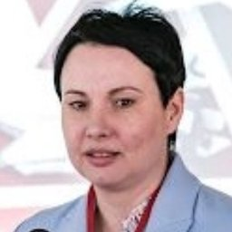

# ООО «Центр управления городской аэромобильностью»

`sanctioned` `manufacturer` 

ИНН 9731094770 · ОГРН 1227700378553

## At a glance

- **Address:** г. Москва
- **Director:** Соколова Ольга Михайловна
- **Charter capital:** ₽10,000
- **ОКВЭД:** 30.30.39 — Производство прочих летательных аппаратов
- **ЦБСТ tie:** General director sits on ЦБСТ's supervisory board.
- **Wildberries overlap:** none_found

## Ownership & corporate history

### Director

| Value | As of | Note |
|---|---|---|
| Соколова Ольга Михайловна | 2023-08-29 | Должность: ГЕНЕРАЛЬНЫЙ ДИРЕКТОР, личный ИНН 500905260513. Full signed ЕГРЮЛ выписка pulled 2026-09-07. [s6870] |
| Соколова Ольга Михайловна | 2026-08-22 | Генеральный директор, per egrul.nalog.ru open-API pull. Supersedes an earlier uncited entry ("Соколова Ольга", no patronymic); the full name is confirmed by the EGRUL extract archived 2026-08-22. [s0432] |

### Founders / ownership

| Value | As of | Note |
|---|---|---|
| ФОНД "МОСКОВСКИЙ ИННОВАЦИОННЫЙ КЛАСТЕР" 100% (₽10 000) | 2023-10-10 | Full signed ЕГРЮЛ выписка pulled 2026-09-07 (egrul_vypiska_pull.py). [s6870] |

### Charter capital

| Value | As of | Note |
|---|---|---|
| 10000 | 2022-06-28 | Full signed ЕГРЮЛ выписка pulled 2026-09-07 (egrul_vypiska_pull.py). [s6870] |

## Financials

| Year | Revenue | Profit | Source |
|---|---|---|---|
| 2022 | — | ₽-7,845,000 | [s6691] |
| 2023 | — | ₽-159,752,000 | [s6692] |
| 2024 | ₽13,929,333,000 | ₽232,145,000 | [s6693] |
| 2025 | ₽59,574,775,000 | ₽3,412,399,000 | [s6694] |

## Trademarks

| Mark | Reg. no. | Filed | Registered | Classes |
|---|---|---|---|---|
| Бумеранг | 1041160 | 20231110 | — |  |

## Sanctions & screening

**Ukraine (war-sanctions.gur.gov.ua, UAV-industry listing), Switzerland (SECO, Ukraine-related measures), Canada (Special Economic Measures Act), Ukraine (Presidential sanctions decree/list), EU (Ukraine-related restrictive measures)** [s0820]

- Listed on Ukraine's GUR war-sanctions UAV-industry registry (screened 2026-09-05).
- 1 OpenSanctions match(es) (screened 2026-09-06).
- 3 OCCRP Aleph match(es) (screened 2026-09-05).

## Principals & persons of interest

### Ольга Соколова

- **DOB:** 03.01.1976
- **Birthplace:** Бишкек, Кыргызстан (Bishkek, Kyrgyzstan)
- **ИНН:** 500905260513
- Генеральный директор
- `sanctions lead`

## Open questions

- GUR states this entity "produces FPV drones used in the war against Ukraine" but names no specific model — worth a follow-up check against the entity's own site/filings for product names. [s0968]

## Sources cited in this profile

| ID | Type | Locator | Captured | As of |
|---|---|---|---|---|
| [s0432] | EGRUL open-API record | EGRUL open-API record (EGRULAPI_9731094770_20260822_ooo-tsugam.json) | 2026-08-22 | 2026-08-22 |
| [s0820] | OpenSanctions screening record | OpenSanctions screening record (OPENSANCTIONS_9731094770_20260824_ooo-tsugam.json) | 2026-08-24 | — |
| [s0968] | GUR war-sanctions record | GUR war-sanctions record (GUR_9731094770_20260824_ooo-tsugam.html) | 2026-08-24 | — |
| [s6691] | Bfo | Bfo (BFO_9731094770_2022_ооо-цугам.pdf) | — | — |
| [s6692] | Bfo | Bfo (BFO_9731094770_2023_ооо-цугам.pdf) | — | — |
| [s6693] | Bfo | Bfo (BFO_9731094770_2024_ооо-цугам.pdf) | — | — |
| [s6694] | Bfo | Bfo (BFO_9731094770_2025_ооо-цугам.pdf) | — | — |
| [s6870] | EGRUL extract | EGRUL extract (EGRUL_9731094770_20260907_ooo-tsugam.pdf) | 2026-09-07 | 2026-09-07 |

---
_Generated from this investigation's registry (`data/registry/`) by `scripts/build_company_profile.py`. Not a substitute for reading the underlying primary sources listed above._