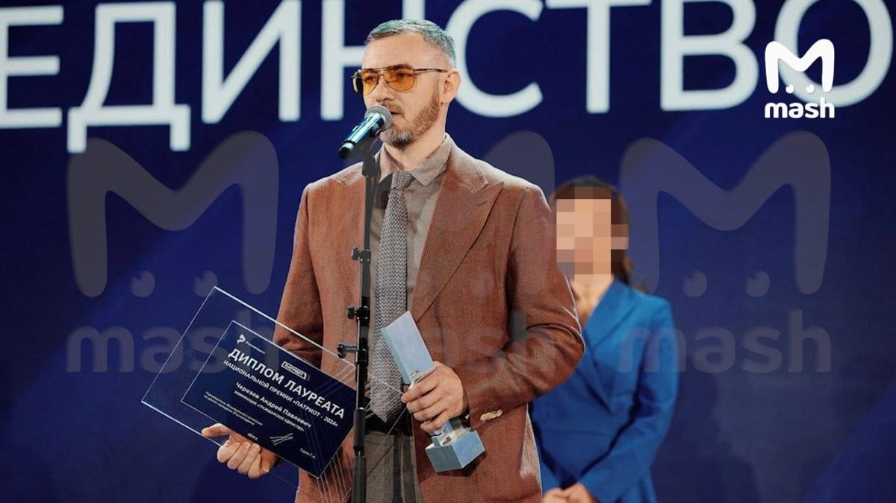

# ООО «Воздушный трактат»

`sanctioned` `manufacturer` 

ИНН 7100046925 · ОГРН 1237100015767 · Tula

## At a glance

- **Legal form:** OOO (limited liability company)
- **Address:** Тульская область, г.о. город Тула, с. Осиновая Гора
- **Director:** Черезов Андрей Павлович
- **Charter capital:** ₽10,000
- **ОКВЭД:** 72.19 — Научные исследования и разработки в области естественных и технических наук прочие
- **Wildberries overlap:** none_found

## Ownership & corporate history

### Director

| Value | As of | Note |
|---|---|---|
| Черезов Андрей Павлович | 2023-11-28 | personal ИНН 712802968839; also sole founder [s0506] |

### Founders / ownership

| Value | As of | Note |
|---|---|---|
| Черезов Андрей Павлович 100% (₽10 000) | 2023-11-28 | Full signed ЕГРЮЛ выписка pulled 2026-09-07 (egrul_vypiska_pull.py). [s6728] |

### Charter capital

| Value | As of | Note |
|---|---|---|
| 10000 | 2023-11-28 | Full signed ЕГРЮЛ выписка pulled 2026-09-07 (egrul_vypiska_pull.py). [s6728] |

## Products

- **«Овод»** ([full profile](products/ovod.html)) — FPV strike-drone family, developed by Андрей Иванов (technical founder/spokesperson) under owner/director Черезов А.П. First batch of 4,000 units delivered to SVO forces Oct 2024. Per TheIns (29.07.2026, [s8058]), reporting on the assassination attempt against Черезов, verbatim: "Черезов владеет и управляет двумя компаниями... — ООО «Русская лаборатория воздушного транспорта» (РЛВТ) и ООО «Воздушный трактат» — обе они участвовали в разработке БПЛА «Овод»" (both companies participated in developing the «Овод» drone). [s8058]
- **«Провод» / «Провод-15»** ([full profile](products/ovod.html)) — Fiber-optic-guided heavy FPV strike drone, reported >40km range record in the SVO zone; press-reported destruction of a Ukrainian ammunition depot in Sumy region (Aug 2026 coverage). Brand appears more directly tied to sister entity РЛВТ (see ovod's own products[], sourced to [s8051]) -- TheIns's own article on this entity ([s8058]) covers «Овод» but does not separately name «Провод»/«Провод-15», so this entity's own participation in that specific variant remains unconfirmed beyond the general «Овод» family tie above. Left flagged, not force-sourced.

## Financials

| Year | Revenue | Profit | Source |
|---|---|---|---|
| 2024 | ₽4,626,000 | ₽484,000 | [s0290] |
| 2025 | — | ₽-1,822,000 | [s0291] |

## Sanctions & screening

**US (OFAC, Russia Harmful Foreign Activities Sanctions), Ukraine (war-sanctions.gur.gov.ua, UAV-industry listing)** [s0760]

- Listed on Ukraine's GUR war-sanctions UAV-industry registry (screened 2026-09-05).
- 1 OpenSanctions match(es) (screened 2026-09-06).
- 3 OCCRP Aleph match(es) (screened 2026-09-19).

## Principals & persons of interest

### Черезов Андрей Павлович

- **ИНН:** 712802968839
- Директор и учредитель (100%) (2023-11-28–present)

## Open questions

- RESOLVED via web search (23.08.2026): Андрей Иванов is a real, independently-documented person — multiple press profiles (МК Тула 03.07.2025, ТВ Звезда 16.10.2024, tsn24.ru 01.04.2025, zanmsk.ru) describe him as an engineer/developer who returned from Thailand at the start of the SVO to build FPV drones, founding «Овод» production ~2023 and later developing a fiber-optic heavy strike variant called «Провод»/«Овод-Про». He is NOT a pseudonym for Черезов Андрей Павлович (the confirmed legal owner/director of РЛВТ, ИНН 7100027464) — different name entirely, and press coverage treats him as the technical founder/public face while Черезов holds legal ownership. Two real, distinct people behind the same brand: Черезов as owner/director of record, Иванов as founder/engineer/spokesperson. No person record created yet for Андрей Иванов — surname-only identification insufficient to anchor one (no patronymic, DOB, or personal ИНН found in this pass); worth a person record once more identifying detail surfaces.
- NEW cross-network link (found 2026-09-05, cross-channel Филиппов/Архангел trawl): «Овод» took 2nd place in Archangel_Forum's own self-run 'Народное тестирование' (People's Testing) drone comparison series, msg 104088 (2024-07-05) — «Овод» производства ООО «Воздушный тракт» [sic, forum's own abbreviation of this entity's actual name] scored behind 1st-place «ПВХ-1» (АО «Обуховский завод») on the SAME informal testing ground Филиппов's Проект «Архангел» network runs for its own supplier ecosystem. This is the first documented point of contact between this sanctioned, ЦБСТ-flagship entity and the Архангел-family network — a shared informal supplier-vetting circuit, not (yet) a corporate or contractual tie. Separately, Archangel_Forum msg 179660 (2026-07-30) reports an assassination attempt against this company's director Черезов Андрей Павлович ('НАС НЕ ЗАПУГАЛИ — НАС РАЗОЗЛИЛИ'), self-reported by the company's own channel and not independently verified — parallels Filippov's own self-reported assassination-attempt claims (proekt_arhangel#382/#739, [s5475]) as a second instance of this claim-pattern within the same investigation, worth tracking but not treating as confirmed fact.
- A rich Telegram marketing/battlefield-evidence scan of @tulaovod (2026-09-07, source [s6456]) found extensive self-incriminating marketing copy, a third-party military combat-use report, and product photos for the umbrella «Овод» brand — but the channel speaks for the brand as a whole and does not distinguish this entity from its sister company РЛВТ (slug ovod, ИНН 7100027464). All wired claims were attributed to `ovod` since its existing product record ([s0526]) already ties it concretely to the «Овод» brand; this entity's own marketing_claims/battlefield_evidence/images gaps remain genuinely open pending a way to confirm which specific products/claims belong to ООО «Воздушный трактат» itself rather than РЛВТ.
- ЦБСТ TIE WITHDRAWN (2026-10-02): the earlier t-doc tie rested on ЦБСТ post 623 calling the «Овод» drone its «флагманский резидент». The post names the brand, not this company. Reading post 623 and post 2366 ([s7958]) with the EU act ([s7977]), the registry places the residency on ООО «Русская лаборатория воздушного транспорта» (slug ovod, ИНН 7100027464): it existed in 2022, is named by the EU as developer and manufacturer of «Ovod», is the contract supplier and carries the revenue (₽1.31bn FY2025). This entity shares the 100% owner Черезов А.П. (ownership edges stay), reported ₽4.6m for 2024 and nothing for 2025, and was named by КЦПН on 13.06.2024 as the producer it bought «Овод» from, as «ООО Воздушный тракт (г. Тула)» ([s8963], [s8964]; the origin post t.me/kcpn2014/2275 was not read). That 2024 statement is the one document pointing here; it may mean this company acted as seller of record in 2024. Trademark check: Rospatent owner-name search 2026-10-02 for «Русская лаборатория воздушного транспорта» returned 0 marks ([s8962]), and for «Воздушный трактат» 0 (inline, no file); owner «Черезов» returned 5 marks held by other persons. A search by mark text is not available through that API, so who holds the «Овод» mark is unknown. Kommersant ([s8961], 29.07.2026) states only that Черезов owns both companies. [s7957]

## Sources cited in this profile

| ID | Type | Locator | Captured | As of |
|---|---|---|---|---|
| [s0290] | БФО annual-accounts filing | БФО annual-accounts filing (РЕСУРС_БФО_7100046925_2024_20260816.zip) | 2026-08-16 | 2024-12-31 |
| [s0291] | БФО annual-accounts filing | БФО annual-accounts filing (РЕСУРС_БФО_7100046925_2025_20260816.zip) | 2026-08-16 | 2025-12-31 |
| [s0506] | EGRUL extract | EGRUL extract (ul-1237100015767-20260823133443.pdf) | — | 2026-08-23 |
| [s0760] | OpenSanctions screening record | OpenSanctions screening record (OPENSANCTIONS_7100046925_20260824_ooo-vozdushnyy-traktat.json) | 2026-08-24 | — |
| [s6728] | EGRUL extract | EGRUL extract (EGRUL_7100046925_20260907_ooo-vozdushnyy-traktat.pdf) | 2026-09-07 | 2026-09-07 |
| [s7957] | Tgpost | Tgpost (TGPOST_20250415_ano_cbst-623-orbita-ovod-flagship-resident.txt) | 2025-04-15 | — |
| [s8058] | press coverage | press coverage (PRESS_20260729_cherezov-assassination-vozdushnyy-traktat-rlvt-ovod-theins.html) | 2026-07-29 | — |

---
_Generated from this investigation's registry (`data/registry/`) by `scripts/build_company_profile.py`. Not a substitute for reading the underlying primary sources listed above._