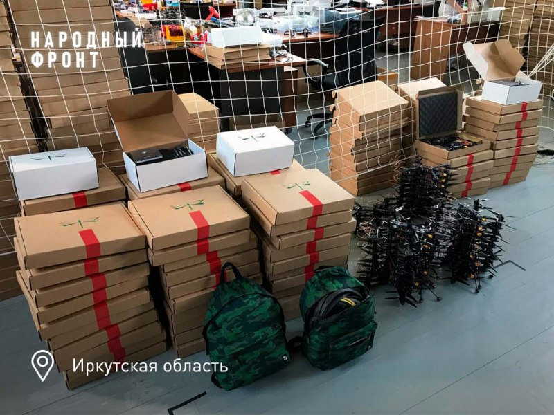
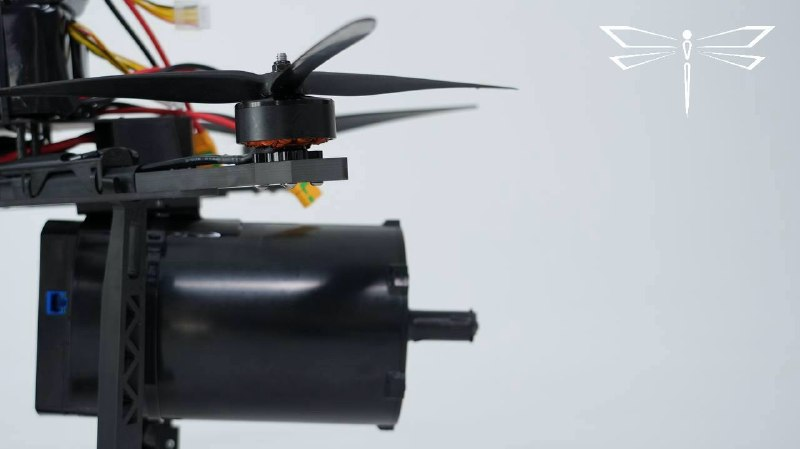

# Russian Air Transport Laboratory LLC — ООО «Русская лаборатория воздушного транспорта»

**Brand:** Ovod
`sanctioned` `manufacturer` 

ИНН 7100027464 · ОГРН 1227100012369 · Tula

## At a glance

- **Address:** Тульская область, г.о. город Тула, с. Осиновая Гора
- **Director:** Черезов Андрей Павлович
- **Charter capital:** ₽20,000
- **ОКВЭД:** 72.19 — Научные исследования и разработки в области естественных и технических наук прочие
- **Wildberries overlap:** none_found

## Ownership & corporate history

### Director

| Value | As of | Note |
|---|---|---|
| Черезов Андрей Павлович | 2022-09-28 | Должность: ДИРЕКТОР, личный ИНН 712802968839. Full signed ЕГРЮЛ выписка pulled 2026-09-07. [s6727] |
| Черезов Андрей Павлович | 2024-05-08 | personal ИНН 712802968839; also sole founder — SAME person who wholly owns ООО «Воздушный трактат» (already verified this session), at the same Осиновая Гора address [s0526] |

### Founders / ownership

| Value | As of | Note |
|---|---|---|
| Черезов Андрей Павлович 100% (₽20 000) | 2024-05-08 | Full signed ЕГРЮЛ выписка pulled 2026-09-07 (egrul_vypiska_pull.py). [s6727] |

### Charter capital

| Value | As of | Note |
|---|---|---|
| 20000 | 2024-04-25 | Full signed ЕГРЮЛ выписка pulled 2026-09-07 (egrul_vypiska_pull.py). [s6727] |

### Address

| Value | As of | Note |
|---|---|---|
| Тульская область, г. Тула, ул. Рязанская, здание 5Ж | 2026-04-01 | First street-level address on file (prior: village-level 'с. Осиновая Гора'), from a ГУ МЧС России по Тульской области 'профилактический визит' record (Apr 2026). [s6960] |

## Products

- **«Овод»** ([full profile](products/ovod.html)) — FPV kamikaze drone with neural-network-based autonomous targeting ("система самонаведения на основе нейросети"), deployed in Ukraine since 2023. Company e-mail domain (company@ovod71.ru) is literally the product brand. [s0526]
- **«Провод-15»** ([full profile](products/ovod.html)) — Fiber-optic-guided heavy FPV strike drone variant. Press-reported (2026-08-23 web search) >40km range record in the SVO zone and destruction of a Ukrainian ammunition depot in Sumy region (Aug 2026 coverage) -- not yet cross-checked against a primary source.
- **Роботизированный комплекс «ДОВОД»** — Наземный необитаемый робототехнический комплекс для безлюдной доставки и запуска FPV-дронов «ОВОД 10» в район выполнения боевой задачи. Совместная разработка ОВОДа и НРТК «Курьер». Действует на удалении до 20 км от операторов, запускает FPV-дроны с дальностью до 35 км — оператор может находиться на расстоянии до 55 км от цели. Успешно испытан в зоне СВО (30.07.2026). Планируется ИИ-управление. [s5446]

## Financials

| Year | Revenue | Profit | Source |
|---|---|---|---|
| 2022 | — | ₽-35,000 | [s6531] |
| 2023 | ₽110,147,000 | ₽6,733,000 | [s6532] |
| 2024 | ₽561,552,000 | ₽81,457,000 | [s6533] |
| 2025 | ₽1,310,635,000 | ₽27,965,000 | [s6534] |

## Government contracts

- customer: ФГБОУ ВО «Воронежский государственный технический университет»; date: 2025; items: Поставка беспилотных авиационных систем мультироторного типа для проведения научно-исследовательских работ — largest of 3 similar VSTU contracts (also 1366202088624000018 ₽19.18m, 1366202088624000019 ₽10.59m) plus a 4th to Belgorod State Technological University (1312301779325000005, ₽12.99m, UAV-vehicle experimental components) — ₽72.6m total across 4 contracts.; reg_number: 1366202088625000035; value_rub: 29883878 [s3376]
- customer: ФГБОУ ВО «Белгородский государственный технологический университет им. В.Г. Шухова»; date: 2025-01-14; items: Routine university-supply contract, no UAV/defense-specific language.; reg_number: 1312301779325000005; value_rub: 12991860.65 [s3372]
- customer: ФГБОУ ВО «Воронежский государственный технический университет»; date: 2024-11-25; items: Routine university-supply contract, no UAV/defense-specific language.; reg_number: 1366202088624000018; value_rub: 19178947.02 [s3374]
- customer: ФГБОУ ВО «Воронежский государственный технический университет»; date: 2024-11-26; items: Routine university-supply contract, no UAV/defense-specific language.; reg_number: 1366202088624000019; value_rub: 10591051.86 [s3375]

## State-program participation

- as_of: 2026-09-03; name_en: GISP (State Industrial Information System) product catalog — БАС industry listing; name_ru: Каталог продукции ГИСП — отрасль БАС; role: Manufacturer listed with an active БАС-category (беспилотные авиационные системы) product entry in gisp.gov.ru's official product catalog (industry filter 68/product-group 144), the federal government's industrial-product registry platform. ИНН-matched to this entity exactly. [s5344]

## Self-reported marketing claims

> *"Овод" – это новейший боеприпас квадрокоптерного типа: ведёт, как разведку, так и поражает цель.*
> "Ovod" is a state-of-the-art quadcopter-type munition: it conducts reconnaissance and also strikes the target.
>
> — Quoted from a regional Народный фронт official (Елена Зубун) describing the first-ever shipment of 50 «Овод» kamikaze drones to the SVO zone, reposted on the channel's own account of the shipment. (2023-08-17) [s6456]

> *Сейчас наши дроны на оптоволокне преодолевают расстояние до 40 км. Без красивых презентаций и сказок для телевизора. Просто инженерия, математика и русские мужики, которые умеют работать руками и головой.*
> Right now our fiber-optic drones cover distances of up to 40 km. No pretty presentations or TV fairy tales. Just engineering, math, and Russian men who know how to work with their hands and their heads.
>
> — Manufacturer's own technical/marketing claim about fiber-optic-guided strike-drone range, posted alongside a product close-up photo. (2026-05-26) [s6456]

> *Произвели. Испытали. Применили. Разработкой и испытанием дронов ОВОД занимаются люди с реальным боевым опытом... Основатель ОВОДА с 2022 по 2026 год лично работал на многих направлениях от Крынок и Бахмута до Белгорода и Курска.*
> Manufactured. Tested. Deployed. The people developing and testing OVOD drones have real combat experience... The founder of OVOD personally worked on many fronts from 2022 to 2026, from Krynky and Bakhmut to Belgorod and Kursk.
>
> — Extended marketing narrative describing front-line field-testing as the company's core development method, including a joint trial with ФСБ ЦСН special forces. (2026-07-08) [s6456]

> *Тяжелый ударный FPV-дрон «Провод» на оптоволокне отработал на рекордную для боевых условий дальность - 40 километров 400 метров и уничтожил там, на Сумском направлении, укропский склад с БК и ошивавшийся рядом личный состав противника.*
> The heavy fiber-optic strike FPV drone "Provod" achieved a record combat-condition range of 40.4 km, destroying a Ukrainian ammunition depot and nearby enemy personnel on the Sumy front.
>
> — Self-reported strike claim for the «Провод»/«ПрОвод» fiber-optic variant of the «Овод» family, framed as a range record. (2026-08-18) [s6456]

> *Дроны на "леске" различаются длиной катушки. Сейчас катушки позволяют летать на 40 км, можно и дальше... Подсчет стоимости уничтоженной техники не ведется, но в целом можно считать 2-4 дрона на гаубицу или боевую машину. Фактически получается уничтожить ценное имущество стоимостью от 100 млн рублей дронами суммарной стоимостью меньше 1 млн рублей... Мы постоянно растем, совершенствуем свои дроны и увеличиваем объемы производства. В перспективе ждем появления изделий, способных работать автоматически с использованием ИИ.*
> "Leash"-type drones differ by spool length. Spools now allow flight up to 40 km, and further is possible... The value of destroyed equipment isn't tracked, but roughly 2-4 drones are used per howitzer or combat vehicle. In effect, assets worth over 100 million rubles are destroyed using drones totaling under 1 million rubles... We keep growing, improving our drones and increasing production volumes. Going forward we expect products capable of working autonomously using AI.
>
> — TASS-quoted ("ТАСС пишет про наши дроны") company statement on cost-effectiveness economics and a forward AI-autonomy roadmap. (2026-08-20) [s6456]

> *Сегодня год с момента основания боевой группы "ОВОД" в составе отдела контроля и целевого применения производителя дронов "ОВОД". Боевая группа создана из опытных воинов - ветеранов СВО. Военные специалисты ОВОДА содействуют подразделениям МО РФ и других силовых служб в зоне СВО. Боевая группа "ОВОД" регулярно работает на сложных участках фронта, где занимается апробацией изделий и выполняет боевые задачи в роли беспилотного спецназа.*
> Today marks one year since the founding of the OVOD combat group within the manufacturer's own control-and-target-application department. The combat group is made up of experienced SVO veterans. OVOD's military specialists assist units of the Russian MoD and other security services in the SVO zone. The OVOD combat group regularly operates in difficult front-line sectors, field-testing products and carrying out combat tasks in the role of unmanned special forces.
>
> — 1st-anniversary announcement (founded ~28.08.2025) of the manufacturer's own in-house combat/field-testing detachment, staffed by SVO veterans and operating directly at the front — distinct from the earlier-documented general 'field-support sector' (msg 845), this is explicitly a combat unit performing military tasks, not just training/support. (2026-08-28) [s6456]

## Battlefield evidence

> *Операторы БАРС-8 нашли и уничтожили самоходную гаубицу ВСУ западного образца стоимостью порядка 3 млн долларов четырьмя дронами ОВОД. Гаубица стоимостью до 3 млн долларов уничтожена дронами стоимостью порядка 6 тысяч долларов.*
> БАРС-8 operators found and destroyed a Western-pattern self-propelled howitzer worth roughly $3M using four Ovod drones. A howitzer worth up to $3M destroyed by drones costing roughly $6,000 total.
>
> — Third-party-attributed (named БАРС-8 reservist unit, not Овод's own marketing framing) cost-effectiveness battlefield claim, posted 05.08.2026. (2026-08-05) [s5446]

> *Подразделения лётного батальона 88-й бригады Эспаньола стабильно продолжают боевую работу на Константиновском направлении СВО в окрестностях Часов Яра... На видео выше — нарезка поражений ПВД неприятеля несколькими точными ударами FPV-дронов самолетного типа системы «Привет-82» расчетами лётного отряда «Совы», расчетами «Овода» со своими средствами...*
> Units of the 88th Brigade "Espanyola" flight battalion continue combat operations on the Konstantinovka front near Chasiv Yar... the video shows a compilation of strikes on enemy forward positions by "Privet-82" fixed-wing FPV drone crews, "Ovod" crews with their own equipment...
>
> — Named military unit's (88th Brigade, callsign "Испанец"/Espanyola) own combat-application account with video footage, reposted on Овод's own channel — third-party framed, not the manufacturer's own marketing copy. (2025-06-10) [s6456]

## Sanctions & screening

**US (OFAC)** [s0526]

**EU** [s0526]

**Ukraine (war-sanctions.gur.gov.ua, UAV-industry listing), US (OFAC, Russia Harmful Foreign Activities Sanctions), Ukraine (Presidential sanctions decree/list), EU (Ukraine-related restrictive measures)** [s0759]

- Listed on Ukraine's GUR war-sanctions UAV-industry registry (screened 2026-09-05).
- 1 OpenSanctions match(es) (screened 2026-09-06).
- 5 OCCRP Aleph match(es) (screened 2026-09-05).

## Web & social presence

### Telegram

- <https://t.me/tulaovod> — Official brand channel for the umbrella "группа компаний «ОВОД»" (bio/posts speak in the company's own first-person voice), 831 posts scraped in this repo's own archive. Already used as the source for this entity's marketing_claims/battlefield_evidence/images (source s6456), but was missing from web.telegram itself until now.

## Images

-  — Первая партия из 50 дронов-камикадзе «Овод», упакованных для отправки в зону СВО при поддержке проекта "Народный фронт" (Иркутская область), август 2023. [s6451]
-  — Product close-up: motor/propeller assembly of a fiber-optic-guided strike drone, with the «ОВОД» dragonfly logo — official product photo from the manufacturer's own channel. [s6455]
-  — Stylized CGI promotional render (not a real combat photograph) of an armed quadcopter in a cinematic urban scene, with the «ОВОД» logo — official promotional art, not footage. [s6454]

## Principals & persons of interest

_No named principals linked to this entity yet._

## Open questions

- On 29.07.2026 founder Андрей Черезов was shot three times in Tula by an unidentified attacker who fled; a criminal case was opened. Овод's own channel frames this as one of a pattern of attacks targeting leading Russian drone developers, alongside a car-bomb attack the same week (05.08.2026) that seriously injured Владимир Ткачук, described as developer of «Упырь» ("Ghoul") combat drones — «Упырь»/Ткачук is NOT currently in this registry, a genuinely new adjacent-network lead not yet investigated. [s5446]
- PEP-adjacency lead, NOT independently confirmed: a 30.07.2026 forward on Овод's own channel, originally from war correspondent Анастасия Кашеварова's (@akashevarova) personal channel, claims Алексей Дюмин — while governor of Tula oblast — personally helped Черезов with his early drone development, before the enemy had comparable technology. This is a named, identifiable journalist's secondhand account, forwarded (not authored) by Овод itself — not corroborated by any Дюмин-side or Овод-official primary source in this pass. If confirmed, this would tie Овод's founding story directly to a now-senior federal security/defense-adjacent official; treat as an open lead requiring independent verification before use, not as an established fact. [s5446]

## Sources cited in this profile

| ID | Type | Locator | Captured | As of |
|---|---|---|---|---|
| s0526 | EGRUL extract | EGRUL extract (ul-1227100012369-20260823143522.pdf) | — | 2026-08-23 |
| s0759 | OpenSanctions screening record | OpenSanctions screening record (OPENSANCTIONS_7100027464_20260824_ovod.json) | 2026-08-24 | — |
| s3372 | Zakupki | Zakupki (ZAKUPKI_contract_1312301779325000005_20260829.html) | 2026-08-29 | — |
| s3374 | Zakupki | Zakupki (ZAKUPKI_contract_1366202088624000018_20260829.html) | 2026-08-29 | — |
| s3375 | Zakupki | Zakupki (ZAKUPKI_contract_1366202088624000019_20260829.html) | 2026-08-29 | — |
| s3376 | Zakupki | Zakupki (ZAKUPKI_contract_1366202088625000035_20260829.html) | 2026-08-29 | — |
| s5344 | Gisp | Gisp (GISP_20260903_bas-manufacturer-catalog-155-companies.json) | 2026-09-03 | 2026-09-03 |
| s5446 | Tgpost | Tgpost (TGPOST_multi_20260729-20260805_tulaovod-week-assassination-dovod-barsclaim.txt) | — | — |
| s6451 | Telegram media | Telegram media (TGMEDIA_7100027464_20230817_tulaovod-post72-1.jpg) | 2023-08-17 | — |
| s6454 | Telegram media | Telegram media (TGMEDIA_7100027464_20260306_tulaovod-post845-1.jpg) | 2026-03-06 | — |
| s6455 | Telegram media | Telegram media (TGMEDIA_7100027464_20260526_tulaovod-post896-1.jpg) | 2026-05-26 | — |
| s6456 | Tgpost | Tgpost (TGPOST_multi_20260907_tulaovod-marketing-battlefield-scan.txt) | 2026-09-07 | — |
| s6531 | Bfo | Bfo (BFO_7100027464_2022_ооо-рлвт.pdf) | — | — |
| s6532 | Bfo | Bfo (BFO_7100027464_2023_ооо-рлвт.pdf) | — | — |
| s6533 | Bfo | Bfo (BFO_7100027464_2024_ооо-рлвт.pdf) | — | — |
| s6534 | Bfo | Bfo (BFO_7100027464_2025_ооо-рлвт.pdf) | — | — |
| s6727 | EGRUL extract | EGRUL extract (EGRUL_7100027464_20260907_ovod.pdf) | 2026-09-07 | 2026-09-07 |
| s6960 | Proverki | Proverki (PROVERKI_7100027464_20260907_ovod-inspection-history.txt) | 2026-09-07 | — |

---
_Generated from this investigation's registry (`data/registry/`) by `scripts/build_company_profile.py`. Not a substitute for reading the underlying primary sources listed above._