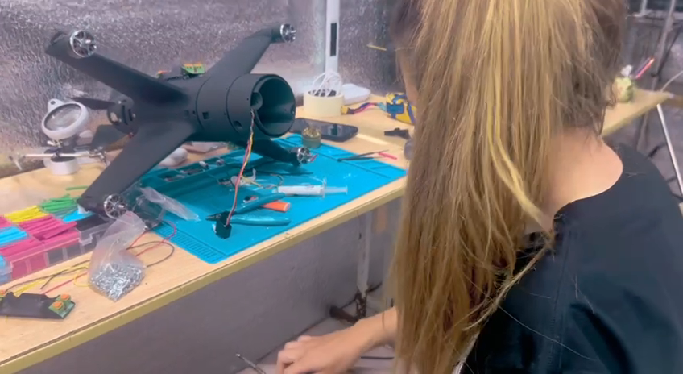
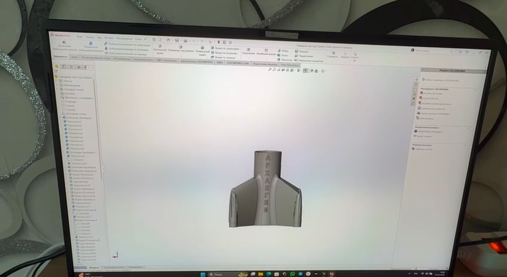
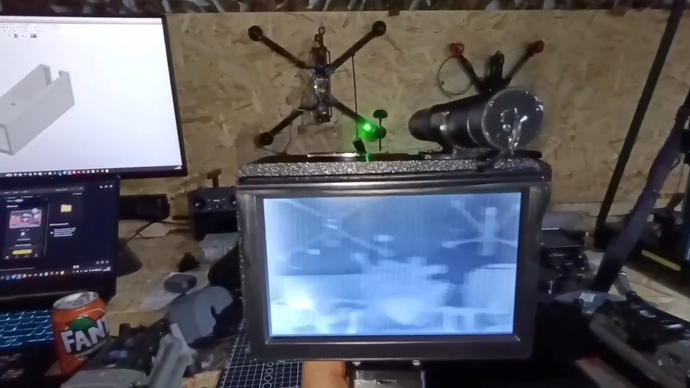
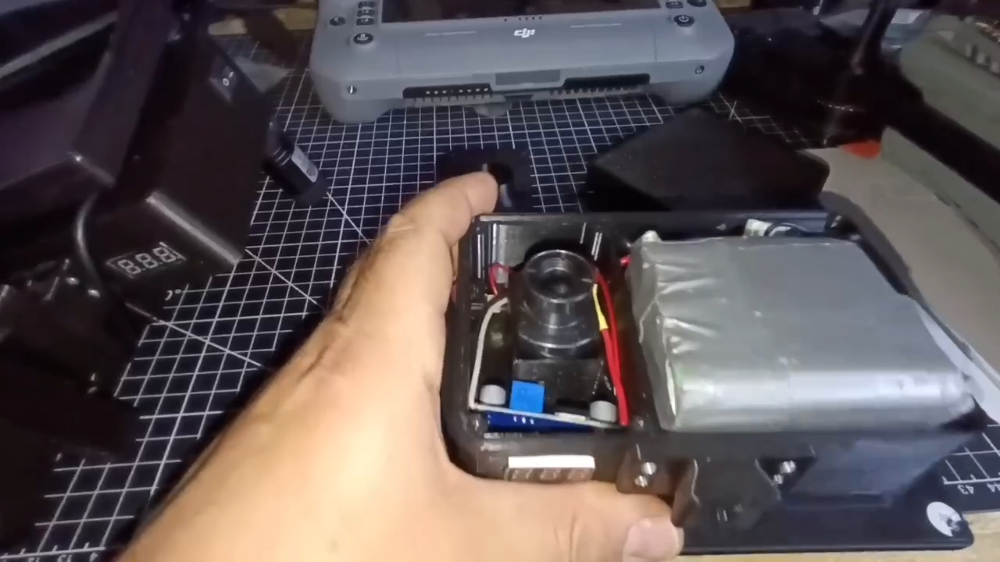

# Project "KB Arkhangel" — Проект КБ «Архангел»

**Brand:** Архангел
`manufacturer` 

## At a glance

- **ЦБСТ tie:** None found.
- **Wildberries overlap:** none_found

## Products

- **Дрон-ракета-перехватчик «Архангел»** — Self-described as "по сути, управляемая ракета с вертикальным взлётом или возможностью размещения на самолёте-матке" (in essence a guided rocket with vertical takeoff, or carriage on a mothership aircraft). Range up to 50km, max speed 340km/h, cruise 100-120km/h (33% power); 200+km/h needs 50% power at reduced 25-30km range. Intended use case: paired with air-defense radar (РЛС ПВО), operator guides the drone (fitted with a corner reflector) onto target by instruments. Full open-source build files (3D-printable PLA-CF airframe, Betaflight config, BOM) published publicly by the project's own channel for free self-assembly. B2B integration channel offered for aircraft/radar/ground-vehicle (БЭК) integration via @arhangel_channel_bot. [s5454]
- **«Гермес коллектив»** — Multi-drone control architecture allowing an operator to deploy and switch between several drones from cover ("высаживать и переключаться между ними... не выходя из укрытия"). Developed for ambush-drone (засадные) tasking, self-described as also suited to ПВО/interceptor drones. Publicly endorsed on-record by an unnamed combat participant quoted in the announcement post. [s5457]
- **«Слоненок»** — Unified airspace surveillance-and-strike complex combining radar/video detection with interceptor-drone engagement. 15km monitoring radius, AI-based automatic target engagement, capacity for 17 interceptor drones per unit; operator role reduced to a single switch-toggle at the engagement moment. Press-quoted (paraphrase, not verbatim — see [s5459]) description from Филиппов: the system can replace the work of several mobile fire groups (МОГ). Described as a collaboration between Проект «Архангел» specialists and unnamed colleagues in St. Petersburg. [s5459]
- **«Ночник ПВН» — прибор наблюдения (ПВН = пост воздушного наблюдения) с экраном 7" и 5"** — Hand-held/turret-mounted observation device the channel published as open design files (post 10796, 19.09.2026: «Это ночник ПВН. Кому надо было. Берите пользуйтесь.»; RAR with STEP/STL files and a parts note in msg 10797). From the demonstrator's narration (machine transcript, approximate) it is a low-cost 'thermal-style' imager for air-observation posts in two versions, 7-inch and 5-inch screen, an ordinary FPV camera, a green laser pointer on a button on the grip that marks a found target (not visible in the imager), a removable 6S1P pack on XT60, a voltmeter/charge indicator, one (7-inch) or two (5-inch) buck modules, and a dovetail quick-release so it can sit on a turret or take a hand grip. The parts note lists a 5" monitor, voltmeter, step-down converter and laser, each as an Ozon link with no make named. Sensor make/model and thermal-versus-low-light are not stated. [s7618]

## Self-reported marketing claims

> *В боевой версии «Архангела» используется цилиндр с боевой частью (поражающие элементы — шарики или контргайки). Вес этого цилиндра должен быть 500 гр для правильной балансировки и курсовой устойчивости дрона.*
> The combat version of "Arkhangel" uses a cylinder with a warhead (fragmentation elements — ball bearings or lock nuts). This cylinder must weigh 500g for correct balance and directional stability.
>
> — Self-published, direct admission of a combat/fragmentation variant distinct from the civilian "ram" (таран) variant described in the same post — both offered as build options from the same open-source instructions. (2026-06-26) [s5454]

> *Гражданское применение: можно оснастить утяжелённой головкой и использовать как таран.*
> Civilian application: can be fitted with a weighted nose and used as a ram.
>
> — The project's own framing of a "civilian" (non-warhead) use case for the same airframe, immediately followed later in the same post by the combat-warhead admission above. (2026-06-26) [s5454]

> *Тест патронов IGLA LEX 100 с дробью ВНЖ (вольфрам). Патрон не сертифицирован для гражданского оружия. Его делают для минобороны.*
> Test of IGLA LEX 100 cartridges with tungsten-alloy shot. The cartridge is not certified for civilian firearms — it is made for the Ministry of Defense.
>
> — Community member in the private "Академия Противодействия БПЛА" chat testing military-only ammunition as a warhead payload option for the «Архангел» interceptor, as part of a broader tungsten-vs-lead-vs-steel fragmentation-payload cost/effectiveness discussion (same thread, msgs 110701-110710). Not an official project product claim, but direct evidence of community-level weapons optimization around this drone with explicit awareness that the ammunition in question is restricted to military use. (2025-11-03) [s5457]

> *Всем привет. Вчера нас изрядно потрепали, погиб расчёт ПВО, на минуточку глубоко в тылу. Очередной раз ходил к власть имущим с Архангелом , ответ один , а он сам цель найдёт, если не , тогда не нужно у нас некому на них летать. По этому буду пилить самозахват , и если даже дальность упадёт до 15-20, но он будет в автономе это будет дело.*
> Everyone hi. Yesterday we took a beating, an air-defense crew died, deep in the rear no less. Went to the powers-that-be with "Arkhangel" [the drone/project] again, same answer — it'll find the target itself, and if not, then there's no one for it to fly against anyway. So I'm going to build in self-lock [autonomous target acquisition], and even if range drops to 15-20 [km], if it's autonomous, that's the point.
>
> — Archangel_Forum#179201, 2026-07-09, presumed authored by Филиппов given the first-person "ходил к власть имущим" framing and the direct product-development decision that follows. Direct evidence of (a) a real combat death of a PVO crew the author attributes to inadequate targeting capability, (b) his own lobbying of Russian officials for autonomous-targeting authority/support, rebuffed, and (c) a resulting decision to develop autonomous self-lock target acquisition even at reduced range as a direct consequence. (2026-07-09) [s5463]

> *Мы решили выложить в свободный доступ чертежи и схемы сборки дрона «Архангел»... Новый дрон... это, по сути, управляемая ракета с вертикальным взлётом, или возможностью размещения на самолете-матке. Запас хода птички — 50 километров... дрон разгоняется до 340 км/ч без потери управления и аэродинамики... Вес боевой части в представленной модели 500-700 граммов... тесная связка с РЛС ПВО... Печатайте «Архангелов», разите бесовские самолёты.*
> We decided to freely publish the blueprints and assembly diagrams for the "Arkhangel" drone... the new drone... is in essence a guided, vertically-launched missile, or one that can be carried by a mothership aircraft. Range — up to 50km... the drone reaches 340 km/h without losing control or aerodynamics... the warhead weight in this model is 500-700 grams... [designed for] tight integration with air-defense radar... Print "Arkhangels", strike the demonic planes.
>
> — proekt_arhangel#219, 2025-05-31 — full open-source build instructions publicly released, incl. a specific parts list (Bambulab X1Carbon printer, Brotherhobby motor, GEPRC VTX/antenna, SpeedyBee flight controller, GNB LiHv battery, and "Связь: Гермес или аналоги"). Re-posted verbatim at least twice more (proekt_arhangel#669, 2025-11-02; proekt_arhangel#1013, 2026-06-26), each time noting iterative hardware revisions ("делаем уже четвертую версию"). (2025-05-31) [s5475]

> *К.Б. «Архангел» — производство БПЛА, обучение ПВО и камикадзе... Условия: Официальное оформление, Командировки, Договорная работа, Зарплаты выше военных.*
> Design Bureau "Arkhangel" — UAV production, air-defense and kamikaze [pilot] training... Terms: official employment, business travel, contract work, salaries above military pay.
>
> — proekt_arhangel#260, 2025-06-16 — formal recruitment posting for pilots, EW/comms/radar specialists and manufacturers. (2025-06-16) [s5475]

> *Архангел запускает свою собственную ЧВК. У нас не будет контракта ни с Минобороны, ни с доброкором... Формат - охранное предприятие. Работа выездная! Заработная плата от двухсот до четырехсот тысяч рублей.*
> Arkhangel is launching its own PMC. We will have no contract with the Ministry of Defense or with a volunteer corps... Format — a security enterprise. Fieldwork! Salary from 200,000 to 400,000 rubles.
>
> — proekt_arhangel#1068, 2026-07-25 — direct recruitment posting for a self-described private military company under the "Архангел" brand, distinct from the project's MoD-contract recruitment funnel; re-advertised as "ЧВК «Архангел»" in proekt_arhangel#1035/#1079 (2026-07-10/08-17). (2026-07-25) [s5475]

> *Группа компаний «Архангел» обеспечивает: разработку и производство дронов-перехватчиков... создание мобильных расчётов защиты объектов; подготовку операторов... Дополнительная информация... предоставляется: ООО «Архангел Групп».*
> The "Arkhangel" group of companies provides: development and production of interceptor drones... creation of mobile facility-defense teams; operator training... Further information... is provided by: OOO "Arkhangel Grupp".
>
> — proekt_arhangel#1094, 2026-09-02 — a formal B2B outreach letter to critical-infrastructure enterprise managers, the first primary-source document explicitly naming ООО «Архангел Групп» (ИНН 9702081286, see ooo-arkhangel-grupp) as the designated commercial contracting entity for the whole informal "группа компаний «Архангел»" ecosystem. (2026-09-02) [s5475]

> *Дрон нужно загружать 550-700гр, вес максимально смещаем ближе к голове, для лучшей развесовки, без веса он не летает!*
> The drone must be loaded with 550-700 g, the weight moved as far forward toward the head as possible for better balance; without weight it does not fly!
>
> — Channel's own build/flight instruction (msg 183433). This post does not say what the load is, but the channel's own earlier posts give the same range as the warhead: «Вес боевой части в представленной модели 500-700 граммов» (31.05.2025, [s5475]) and a 500 g cylinder with a fragmentation warhead in the combat version ([s5454]). The ballast-versus-warhead reading is therefore the channel's own, stated elsewhere; this post does not call it a warhead. (2026-09-06) [s7653]

> *скорость экономичного полета в районе 140кмч, пиковая скорость 315кмч, дальность на 7000мам аккумуляторе заряженным в 4.45в LiHv время полета 20-23мин если не тратить заряд на долгий взлет а сразу оторвавшись от земли на 1м за 2-3 секунды перейти в горизонт и начать планировать снизив газ, дальность полета до 50км в зависимости от условий и ветра*
> economical flight speed around 140 km/h, peak speed 315 km/h, [...] flight range up to 50 km depending on conditions and wind
>
> — Same post (msg 183433). Figures differ from the earlier product description (max 340 km/h, cruise 100-120 km/h, [s5454]): self-reported and inconsistent between posts. (2026-09-06) [s7653]

> *Программа и настройки под полетник: BestFPV с ESC 65A так как стек SpeedyBee 60А больше не производят. на рынки подделки!*
> Software and settings for the flight controller: BestFPV [sic] with a 65A ESC, since the SpeedyBee 60A stack is no longer produced. Fakes on the market!
>
> — Explains the switch from the SpeedyBee ([s5452]) to the BeastFPV stack (foreign_components[]); «BestFPV» is the post's own spelling. (2026-09-06) [s7653]

> *Оператор FPV-дронов 1-й Славянской бригады 51-й армии с позывным "Радистка" на постоянной основе получает военно-техническую поддержку от организации Архангел «Легион» для дальнейшего распределения по её усмотрению. Мы отправляем по её запросу ДЕСЯТЬ систем сброса груза на FPV.*
> A FPV-drone operator of the 1st Slavic Brigade of the 51st Army with the callsign "Радистка" permanently receives military-technical support from the «Архангел» organisation «Легион» [...] We are sending, at her request, TEN cargo-drop systems for FPV.
>
> — Channel's own report of material support to a named army unit's operator (also posted on her channel @rastratchikRadistka msg 1754). The make of the drop systems is not stated. (2025-06-19) [s7648]

> *Главной целью нашего центра является подготовка специалистов для Министерства обороны.
Это факт.*
> The main goal of our centre is training specialists for the Ministry of Defence. That is a fact.
>
> — Post «Кого мы учим бесплатно?» (msg 10573). Same post lists «Рубикон, полк БПС 51-й армии, 205-я бригада — везде год, везде наши люди». (2026-07-28) [s7651]

> *205-ая бригада, видеоотчеты с пораженными  целями которой частенько публикуются у нас на канале ждет и операторов и техников.*
> the 205th Brigade, whose video reports with hit targets are often published on our channel, is waiting for both operators and technicians.
>
> — Recruitment post (msg 10511), also naming the 11th battalion of the 51st Army and «Рубикон»; roles listed include «Ударные дроны — гаси все что движется» and a single payment «от ТРЕХ миллионов рублей». (2026-07-19) [s7650]

> *Одни из самых крепких, братских отношений у нас сложились с 78-м полкой 51-ой армии.

Здесь служит наверное две трети наших выпускников.*
> One of our strongest, fraternal relationships has formed with the 78th regiment of the 51st Army. Probably two thirds of our graduates serve here.
>
> — Post msg 10782 with a 57-second recruitment video ([s7634]; still [s7645]). «78-м полкой» is the post's own grammar (sic). Unit named by the channel only; not independently confirmed. (2026-09-13) [s7654]

> *В скором времени он отправится служить в Отдельный Батальон беспилотных систем 51-ой армии. ... получишь выплату в 3.4 миллиона рублей, служить будешь у наших друзей.*
> Soon he will go to serve in a Separate Unmanned Systems Battalion of the 51st Army. [...] you will get a payment of 3.4 million rubles, you will serve with our friends.
>
> — Post msg 9640 about a trainee; payout figure differs from the «от трёх миллионов» in later posts. (2026-03-02) [s7649]

> *Задача последних дней сборка наших дронов-перехватчиков второго поколения.*
> The task of recent days is assembling our second-generation interceptor drones.
>
> — Caption of the 84-second lab video (msg 10619; stills [s7641], [s7642]) that shows the airframe on a bench and the flight-controller board. (2026-08-04) [s7652]

> *Это ночник ПВН. Кому надо было. Берите пользуйтесь.*
> This is the ПВН night-light. For whoever needed it. Take it, use it.
>
> — Channel releasing the «Ночник ПВН» design files (video [s7618], RAR [s7619]); see products[]. (2026-09-19) [s7655]

> *Мы Проект Архангел полностью поддерживаем стратегию и идеологию такого начинания и дела! После встречи и консультации и достигнутого соглашения. Полностью подключаемся к взаимодействию с Барс Сармат и объединяем ресурсы, возможности и наработки.*
> We, Project Arkhangel, fully support the strategy and ideology of this undertaking. After the meeting, consultation and the agreement reached, we are fully connecting to cooperation with Bars Sarmat and pooling resources, capabilities and developments.
>
> — @projectArchangel msg 5502 (17.10.2024), the same day as msg 5500 announcing a meeting with Рогозин Д.О. as 'командир БАРС Сармат'. Also published in Archangel_Forum (msg 139838/139839). (2024-10-17) [s7694]

> *Встретились по рабочим моментам с Сенатором Совета Федерации РФ комитета обороны по Запорожью а так же командиром БАРС Сармат - Рогозиным Дмитрием Олеговичем. Начинаем работать*
> We met on working matters with the Federation Council senator from the defence committee for Zaporozhye and also the commander of BARS Sarmat, Rogozin Dmitry Olegovich. We are starting work.
>
> — @projectArchangel msg 5500 (17.10.2024). The Архангел-side counterpart to the unit's own msg 1683 and 1744. (2024-10-17) [s7693]

## Foreign components

- name: Bambu Lab X1 Carbon 3D printer + PLA-CF filament; manufacturer: Bambu Lab (China); context: Bill-of-materials spreadsheet for "Малая ДР" (a small combat drone), shared as a Telegram file in the @projectArchangel channel (msg 10381, 26.06.2026): the printer/filament pair is listed as the first component, i.e. used to fabricate the airframe itself, not just workshop equipment. [s5452]
- name: Brotherhobby Avenger 2816 1050KV motors (×4), HQProp 7×12×2 propellers (×4); manufacturer: Brotherhobby / HQProp (China); context: Same BOM, [s5452]. [s5452]
- name: Caddx Ratel PRO FPV camera (1500TVL); manufacturer: Caddx (China); context: Same BOM, [s5452]. [s5452]
- name: GEPRC MATEN 1.2G 5W VTX + matching 1.2/1.3GHz antenna; manufacturer: GEPRC (China); context: Same BOM, [s5452]. [s5452]
- name: SpeedyBee F4 F405 V4 60A BLS 30x30 Stack flight controller; manufacturer: SpeedyBee (China); context: Same BOM, [s5452] -- also confirmed as the actual board flashed in a companion Betaflight config dump from the same message thread ([s5453], board_name SPEEDYBEEF405V4, 8 motor resources defined, firmware 4.4.3). [s5452]
- name: GNB (Gaoneng) 6000mAh LiHV battery; manufacturer: Shenzhen Gaoneng New Energy (China); context: Same BOM, [s5452] -- the same GAONENG battery brand documented elsewhere in this registry (see ooo-npo-rustekhdron's litigation[] and ooo-boevye-tekhnologii) supplying the ЦБСТ-network Рустехдрон/ДСГ court case; here found completely independently in an unrelated adjacent-not-ЦБСТ network's own build documentation, consistent with the brand's D2C export model reaching many unrelated Russian buyers rather than one exclusive supply chain. [s5452]
- name: F722 BLS 65A FC&ESC BEASTFPV flight-controller/ESC stack (replacing the SpeedyBee stack); manufacturer: BeastFPV (brand; country of origin not established in this registry); context: Bill of materials in the channel's 06.09.2026 build/print/flight instruction post (Archangel_Forum msg 183433, topic «К. Б. "Архангел"»): «Полетный контроллер для FPV F722 BLS 65A FC&ESC BEASTFPV (Стек)». The same post says the earlier SpeedyBee stack was dropped: «Программа и настройки под полетник: BestFPV с ESC 65A так как стек SpeedyBee 60А больше не производят. на рынки подделки!» («BestFPV» sic; the post's own spelling). Earlier BOM (26.06.2026) named the SpeedyBee F405 V4 60A stack instead ([s5452]). The flight controller visible in the channel's videos ([s7617], [s7615]; stills [s7642], [s7643]) is a ~30×30 mm STM32-type LQFP-64 board with «Rev 2.2» and an «A» logo; chip markings are not legible, so it is NOT matched to either product. [s7653]
- name: SolidWorks (CAD, incl. CAM/MBD modules) used to model the airframe body; manufacturer: Dassault Systèmes (France); context: Seen, not stated: the on-screen toolbar tabs read SOLIDWORKS / SOLIDWORKS CAM / MBD in the CAD walkthrough of the tube-and-arm body lettered «АРХАНГЕЛ» in the 32-minute instruction video (Archangel_Forum msg 183433, frame at ~25 min, still [s7644]). [s7644]
- name: Betaflight Configurator (flight-controller setup software), shown on a laptop with the FC on USB; manufacturer: Betaflight open-source project (international); context: Seen, not stated: first ~2 minutes of the instruction video (msg 183433) show the configurator's orange-themed UI with a 3D drone model while the board is connected on a red USB cable (still [s7643]). Consistent with the Betaflight 4.4.3 config dump archived as [s5453]. [s7643]
- name: 5" monitor, voltmeter, step-down converter and laser pointer for the «Ночник ПВН» device; manufacturer: not named (parts note lists Ozon marketplace short links only); context: Parts note «Запчасти.txt» inside the RAR published in post 10797 (19.09.2026); the links were not opened, so makes and origin are unknown. [s7619]

- 5 OCCRP Aleph match(es) (screened 2026-09-05).

## Web & social presence

### Website

- <https://bpla.archangel.school> — Базовый онлайн-курс — self-hosted training site, [s5460]
- <https://архангел-фпв.рф> — self-cited in the project's own contact roster (msg Archangel_Forum#143591/#145758), not yet independently visited/archived — [s5463]

### Telegram

- <https://t.me/Archangel_Forum> — форум/волонтёрский канал, 73,085 posts scraped
- <https://t.me/projectArchangel> — основной канал разработчиков/инженеров/пилотов, 10,042 posts scraped
- <https://t.me/proekt_arhangel> — «Академия противодействия БПЛА», 1,073 posts scraped
- <https://t.me/arhangel76> — Филиппов М.Г.'s own handle, self-identified "руководитель проекта"
- <https://t.me/arhangel_channel_bot> — feedback bot
- <https://t.me/Coordinator_Archangel_Project> — document intake for enlistment (passport/military ID/СНИЛС/ИНН/bank details)
- <https://t.me/VERA_consultant_Archangel> — training-program consultant contact
- <https://t.me/Natalia_Archangel_Project> — "Набор добровольцев, оформление" — volunteer recruitment processing
- <https://t.me/arhangel_study_bot> — training bot
- <https://t.me/Vasya_consultant_Arhangel> — "консультант" contact, confirmed genuine in an anti-fraud post ([s5463])

### VK

- <https://vk.com/id729012386> — project's own stated "Канал ВК", appears 300+x in its own signature block
- <https://vk.ru/pro_fpvdrons> — instructor "Тина"'s own VK training resource, cross-linked from the project's channels

### Other

- <https://max.ru/join/DhptZoo2BqNt2jl2k1EG8tAKDGfc8vgVEz7YDwMNqhE> — MAX messenger project chat
- <https://max.ru/arkhangelfront> — "Геннадий Архангельский"'s own MAX channel — see open_questions

## Images

-  — Flight-controller board shown in the «Архангел» lab video (@projectArchangel msg 10619, 04.08.2026): ~30×30 mm, STM32-type LQFP-64 MCU, USB-C, silkscreen «Rev 2.2» and an «A» logo, hand-soldered leads. 4× enlarged crop of one frame of an 848×464 video; chip markings not legible, make not confirmed (see open questions). [s7642]
-  — Assembly bench in the «Архангел» lab (msg 10619, 04.08.2026): a black tube-and-arm airframe on a silicone soldering mat, with staff in «АРХАНГЕЛ»-branded shirts. The channel captions the clip as assembly of «дронов-перехватчиков второго поколения». [s7641]
-  — Flight controller on a USB cable in front of Betaflight Configurator, first minutes of the 32-minute instruction video (Archangel_Forum msg 183433, 06.09.2026); this frame shows the connector side (white JST sockets), yellow silicone standoffs as in the 10619 board. [s7643]
-  — CAD model of the tube body lettered «АРХАНГЕЛ» in SolidWorks (toolbar reads SOLIDWORKS / SOLIDWORKS CAM / MBD), from the same instruction video (msg 183433). [s7644]
-  — «Ночник ПВН» observation device (screen, camera and green laser pointer on top) demonstrated in @projectArchangel msg 10796 (19.09.2026), released with its design files. [s7646]
-  — Inside the «Ночник ПВН»: FPV camera, foil-wrapped battery pack with XT60 lead and buck-converter boards (msg 10796). [s7647]
-  — Frame from the 57-second recruitment video (msg 10782, 13.09.2026): a uniformed speaker in front of a workshop with several 3D printers who, per a machine transcript (approximate), introduces herself by the callsign «Радистка», says she has been an operator of strike UAVs since 2023 and points viewers to the «Архангел» school. Identity beyond the callsign is not established here. [s7645]

## Principals & persons of interest

### Mikhail Gennadevich Filippov — Филиппов Михаил Геннадьевич

- **DOB:** 17.11.1976
- **Address:** Московская область, г. Лыткарино, ул. Парковая, д. 4, кв. 52
- **ИНН:** 502603133030
- Head / lead figure
- <https://t.me/arhangel76>
- <https://vk.com/id729012386>
- <https://ok.ru/profile/568814443751>

### Gennadiy Arkhangelskiy — Архангельский Геннадий (patronymic unconfirmed)

- Contributor — weapons/mount engineering (self-described)
- <https://t.me/arkhangelfront>
- <https://max.ru/arkhangelfront>

### Bella (surname not established) — Бэлла (фамилия не установлена)

- Admin, «Академия Противодействия БПЛА» chat (3,256 members)
- <https://t.me/BG_Belissimo>

### Nastya (surname not established) — Настя (фамилия не установлена)

- Admin, «Академия Противодействия БПЛА» chat (3,256 members)
- <https://t.me/ANLUNEGOVA>

### "Gagarin" (handle, real name not established) — Гагарин (имя/фамилия не установлены, позывной/юзернейм)

- Course participant (posted in the private chat, also member of Archangel_Forum)
- <https://t.me/GagaPiH>
- tel:++79787635190

### Alexandr (surname not established) — Александр (фамилия не установлена)

- Course participant (posted in the private chat, also member of Archangel_Forum)
- <https://t.me/alex_bbggt>
- tel:++79009253078

### Andrew (surname not established) — Andrew (фамилия не установлена)

- Course participant (posted in the private chat, also member of Archangel_Forum)
- <https://t.me/First_Pathfinder>
- tel:++79107023959

### Roman (surname not established) — Роман (фамилия не установлена)

- Course participant (posted in the private chat, also member of Archangel_Forum)
- tel:++79168352900

### "Petrovich" (handle, real name not established) — Петрович (фамилия не установлена, позывной/юзернейм)

- Course participant (posted in the private chat, also member of Archangel_Forum)
- <https://t.me/Sapfpv>
- tel:++79049814991

### Dmitriy Zhukov — Жуков Дмитрий

- Course participant (posted in the private chat, also member of Archangel_Forum)
- <https://t.me/Dmitry_Zhykovv>
- tel:++79144258457

### "SKIF" (handle/callsign, real name not established) — СКИФ (фамилия не установлена, позывной/юзернейм)

- Course participant (posted in the private chat, also member of Archangel_Forum)
- <https://t.me/wozmezdiye>
- tel:++79309361316

### Evgeniy Sergeevich (surname not established) — Евгений Сергеевич (фамилия не установлена)

- Course participant (posted in the private chat, also member of Archangel_Forum)
- <https://t.me/IEto_Yal>
- tel:++79835092797

### "Geha" (handle, real name not established) — Геха (фамилия не установлена, позывной/юзернейм)

- Course participant (posted in the private chat, also member of Archangel_Forum)
- <https://t.me/GEHA125ru>
- tel:++79140716246

### Aleksandr Dubrovskiy — Дубровский Александр

- Course participant (posted in the private chat, also member of Archangel_Forum); self-stated external role below
- <https://t.me/AlexanderDubrovsky>

## Corporate links

- **НПО «КАЙСАНТ»** `component-supplier` — Both sides publicly name the tie: the ГЕРМЕС long-range comms line, whose own channel @germesfpv is НПО «КАЙСАНТ»'s (Telegram title and Академия chat msg 110720, [s5457]), is presented as fitted to Архангел's interceptors. (1) ГЕРМЕС's own post, forwarded into mil_hub as msg 130001 (14.05.2026, forward from @germesfpv): «Мы рады, что Михаил «Архангел» выбрал спецсвязь ГЕРМЕС для своих дронов-перехватчиков.» and «Дроны-перехватчики проекта «Архангел» оснащены дальнобойной связью ГЕРМЕС.» Only that post's opening line («Правильно обученный личный состав и правильные изделия») is attributed to Филиппов; the ГЕРМЕС sentences are the vendor's own claim, not his. (2) Архангел's own channel, @projectArchangel msg 3881 (03.04.2024): «Производство связи ГЕРМЕС.https://t.me/germesfpv», and 59 ГЕРМЕС video posts through July 2026 ([s7653]). (3) Архангел's bill of materials lists «Связь: Гермес или аналоги» ([s5452]). No supply contract or invoice is on file, so this is a self-reported product-use tie between the two, not a documented sale. НПО «КАЙСАНТ» is a ЦБСТ resident (t-doc), so this makes the Архангел cluster reachable from ЦБСТ through it. [s5539]
- **CSN "Bars-Sarmat" (Rogozin)** `training-partnership` — Both sides publicly name the tie (see the ЦСН record): Архангел's own msg 5500 and 5502 (17.10.2024, [s7693]/s7694) announce a meeting with Рогозин as 'командир БАРС Сармат' and 'Полностью подключаемся к взаимодействию с Барс Сармат и объединяем ресурсы, возможности и наработки'; the unit's own channel answers with msg 1683 and 1744 and two joint approbations (Горыныч 2.0, ЩИТ-И, [s7699]/s7700). The unit's logo appears next to the word АРХАНГЕЛ in a Архангел video. A cooperation, recruitment and testing tie, not a corporate one: no contract or shared registration is on file. [s7694]

## Open questions

- This post links two further, distinct, NOT-yet-scraped channels: t.me/proekt_arhangel (cited twice as a related/parent channel, distinct handle from @projectArchangel) and t.me/malyha_ww (video build instructions — "малыха" matches the BOM's "Малая ДР" naming for this small variant). Also confirms t.me/c/1859964206/110711 (the already-known private "Академия Противодействия БПЛА" chat) carries this project's own tuning content. [s5454]
- BOM line item "Связь: Гермес или аналоги" ("Hermes comms, or equivalent") is a generic reference, not a specific vendor citation — plausibly, but NOT confirmed to be, the same «Гермес» tactical-comms brand sold commercially by `npo-kaysant` (ИНН 7733393203, see that entity's merged `kb-germes` alias). Left as an open lead, not merged. RESOLVED 2026-09-04 (via a web search, then confirmed against the private Академия chat's own msg 110720, [s5457]): the channel named in that chat, "ГЕРМЕС - ППРЧ связь, мачты, защита от дронов," is confirmed via its own Telegram title ("...НПО КАЙСАНТ") to be `npo-kaysant`'s (ИНН 7733393203) own commercial channel (@germesfpv). This IS the same «Гермес» brand referenced generically in the BOM. [s5454]
- Self-description (23.10.2025, [s5456]): "Проект «Архангел» имеет: сеть своих учебных центров; профессиональные боевые расчеты; ... опыт подготовки дроноводов в зоне СВО, исчисляемый несколькими тысячами пилотов; производственные мощности; мощную партнерскую сеть предприятий" (a network of its own training centers, professional combat crews, experience training drone pilots in the SVO zone numbering several thousand, production capacity, and a strong partner network of enterprises) — the project's own claim of scale, not independently verified. [s5456]
- The private "Академия Противодействия БПЛА" chat (channel_id 1859964206, already scraped, 5795 posts) carries 387 "Архангел" mentions and 147 warhead/fragmentation-term mentions — only one specific thread (msgs 110701-110720) has been close-read so far. A full close-read of this chat is a real next step, likely to surface further weapons-development detail beyond the polished public-channel framing. [s5457]
- A build variant using "судоплатовских комплектующих (ВТ 40)" (components from "Судоплатов"/"НСУ 2.0") is offered alongside the standard kit — the same rival network Проект Архангел publicly denied supplying in 2024 (see the parked roymarket_archangel_adjacent_network memory's "Гермес comms" note). Suggests a more complex relationship than pure rivalry — at minimum component-level compatibility. Not investigated further. [s5457]
- A Telegram channel named "ГЕРМЕС - ППРЧ связь, мачты, защита от дронов" is referenced by name (no handle) as the home channel for the «Гермес коллектив» system — not yet identified/scraped. May or may not be the same «Гермес» brand sold commercially by `npo-kaysant` (ИНН 7733393203). [s5457]
- Full-corpus scoped mining pass (2026-09-04) over all four Филиппов/Архангел-linked channels (Archangel_Forum 73,085 posts, projectArchangel 10,042, proekt_arhangel 1,073, the private Академия chat 5,795 — 65,454 non-empty posts scanned) confirms the project's own multi-platform contact roster from its own recurring signature block (msg projectArchangel#132, #9910): own training site bpla.archangel.school, VK (vk.com/id729012386 — appears 337-401x as the project's official VK link), MAX messenger (multiple join links, incl. a project-wide chat), plus named contact-handles for three distinct training-intake functions: @Coordinator_Archangel_Project (document intake — passport/military ID/СНИЛС/ИНН/bank details for enlistment), @VERA_consultant_Archangel (training program consultant), @Natalia_Archangel_Project (пункт: "Набор добровольцев, оформление" — volunteer recruitment processing). No full legal names attached to any of the three handles in the scanned text — not promoted to people.json pending a name. No Twitter/X, Instagram, Facebook, or Odnoklassniki presence found belonging to the project itself — the handful of Instagram/Facebook links in this 65k-post corpus are unrelated third-party equipment-sourcing references embedded in a single post (projectArchangel#3534), not the project's own accounts. [s5460]
- «Малыха» (t.me/malyha_ww, referenced twice already as an unscraped build-video channel) is now fully resolved as a multi-platform training-video operation, per its own self-published contact block (projectArchangel#10301, 2026-06-14): Telegram t.me/malyha_ww + feedback bot @malyha_ww_bot, RuTube rutube.ru/channel/59281618, VK vk.com/malyha_ww. Still not scraped as a channel — a real next step if deeper build-instruction detail is wanted, since its Telegram content has never been pulled into this DB. [s5460]
- t.me/sudoplatov_official identified (14 cross-posts in projectArchangel/Archangel_Forum, 2023-2024) as the rival "Судоплатов" network's own public channel — this is the network whose "судоплатовских комплектующих (ВТ 40)" component variant was offered alongside the standard «Архангел» build kit (see the still-open component-compatibility question logged 2026-09-04 from [s5457]). Not scraped yet — a future step for resolving that lead, not chased further this pass. [s5460]
- «Ворон-оптоволокно» (t.me/voronoptovolokno) — per a direct self-published account (projectArchangel#9215, undated but positioned late Dec 2025/Jan 2026 in the feed), the founder of Проект «Архангел» personally visited the «Ворон» team, described as a field-repairable fiber-optic-cable manufacturer for FPV drones; the post states «Ворон» is relocating its fiber-optic production to Krasnodar Krai (the same region as Проект «Архангел»'s own Туапсе base) and the two projects plan joint operator training. No legal entity/ИНН resolved for «Ворон»/«Ворон-оптоволокно» yet — worth an EGRUL name search given the confirmed direct founder-to-founder relationship, distinct from a mere equipment mention. [s5460]
- POSSIBLE cross-network overlap, NOT confirmed: projectArchangel#9534 (undated, positioned ~Feb 2026 in the feed) is signed "Геннадий Архангельский" and describes personally sourcing/mounting ten four-barrel ЯкБ-12.7mm aviation machine guns for a customer's mobile counter-UAV fire groups (МОГ), with his own MAX channel max.ru/arkhangelfront (also cross-posted as t.me/arkhangelfront, 11x). This surname is otherwise ONLY attached in this registry to Архангельский Геннадий Евгеньевич (`arkhangelskiy-gennadiy-evgenevich`), director/co-founder of the separate, Гагаринг-adjacent АНО «Архангел» / «Архангел Легион» (ИНН 2315233718) — also a Krasnodar Krai operation. The projectArchangel post gives no patronymic, so this CANNOT be treated as the same person without further verification (a namesake, or a shared surname/brand coincidence, is equally plausible). If confirmed, this would be the first direct personal link found between Филиппов's Проект «Архангел» and the Гагаринг-adjacent «Архангел Легион» network — flagged here specifically so it is not silently missed, but NOT merged or asserted as fact. [s5460]
- КБ «Перит» (t.me/kbperit, 33 cross-posts) advertises an ОПУ (опорно-поворотное устройство, pan-tilt antenna mount) product "Голова" in the network's channels, with its own "@kbperit_admin" contact for "Сотрудничество и реклама" (cooperation and ADVERTISING) — reads as a paid cross-promotion, not a confirmed corporate partnership with Проект «Архангел». Noted, not investigated further; same treatment applies to ~50 other one-off legal-entity mentions (component/equipment vendors named in passing across the 65k-post scan) that were not individually triaged this pass — see the scoped mining report for the full list if a specific one becomes relevant later. [s5460]
- First close-read pass (2026-09-04) over Archangel_Forum's substantive native posts (33 of 1,633 "Архангел"-mentioning posts exceed 400 characters — the rest, plus the remaining 71,452 non-"Архангел" posts in this 73,085-post forum, remain unread; top-viewed posts are confirmed generic war-news reposts, not project content). Confirms two additional training locations beyond Туапсе/Запорожье: a Ставропольская школа (announced June 2024, physically "на территории Луганской народной республики", recruiting instructors incl. combat-engineer/sapper and tactical-medicine roles, contact @bpla_2023) and a Moscow training cohort ("третий поток в Москве", referenced Nov 2024). A 2025-11-22 post narrows the MoD-cadet training location specifically to Запорожье/Крым, with a formal Yandex-Forms enrollment process and "диплом государственного образца" (state-standard diploma, verifiable via Госуслуги) on completion — a materially more institutionalized credentialing detail than previously documented. [s5463]
- RESOLVED/UPGRADED ([s5539], 2026-09-05) — see the new open_questions entry below. POSSIBLE institutional tie to `ooo-gagaring`/`ano-dpo-obrazovatelny-tsentr-gagaring` (Гагаринг), NOT confirmed: Archangel_Forum#98621 (2024-06-20) announces Проект Архангел's own "Ассоциация Народный ВПК" (membership application process, coordinated via @VERA_consultant_Archangel) and in the same post cites, consecutively: a TASS article (06.03.2024, archived via Wayback since tass.ru itself blocks scripted access) about a DIFFERENT, formally-registered "Ассоциация разработчиков перспективных систем РЭР, РЭБ и связи" — that article's own text never says "Народный ВПК", so it is NOT confirmed to be the same organization; and "Компания Гагаринг" (t.me/my_el_lab) directly by name. The post's own prose does not explicitly state Гагаринг is a joining member of whatever "Народный ВПК" is — it reads as citing Гагаринг as a comparable/reference example, not a confirmed formal tie. This is nonetheless the FIRST documented direct textual co-mention of Проект «Архангел» and Гагаринг anywhere in this investigation's corpus (the prior Гагаринг wide-net pass found no tie between the two networks) — worth a dedicated follow-up (check for a Гагаринг-side confirmation of "Народный ВПК" membership, or a reply/cross-post acknowledging the association) before treating it as more than a citation. [s5463]
- Проект «Архангел» is also affiliated with a third named umbrella body: "Конгресс руководителей Волонтёрских групп СВО" (Congress of Heads of Volunteer Groups of the SVO), admission contact @MiroslavaVS — appears in the project's own recurring contact-roster block (Archangel_Forum#143591/#145758) alongside "Ассоциация Народный ВПК". Neither @MiroslavaVS nor the Congress itself has been independently researched yet. [s5463]
- Full close-read (not keyword-scoped) of proekt_arhangel's entire native-post corpus (256 of 1,073 posts >50 chars, 23.01.2025-04.09.2026, 2026-09-04) surfaced a self-disclosed corporate structure NOT captured by the earlier scoped mining pass (see this record's other [s5460]-sourced open questions): proekt_arhangel#623 (2025-10-11) states the project created THREE new legal entities in mid-to-late 2025 — «Архангел-Щит» (civilian PVO/volunteer/security-staff training, Подмосковье/Запорожье/Крым/Краснодарский край — this appears to CONFIRM `ooo-arkhangel-shchit`, ИНН 5027339008, previously identified only via press photo-credit, [s5456]), «АНО ЦППО БПЛА "Архангел"» (Krasnodar krai, "при поддержке губернатора и мэра Туапсе" — free training for volunteers/PVO crews — NO ИНН yet resolved, not the same entity as `ano-arkhangel`/Архангел Легион which is a distinct Krasnodar-krai operation with no confirmed tie), and «Хаб СВО» (production entity, website habsvo.ru — NO ИНН yet resolved). The same post also states "Две наших ООО Архангел (Херсон и Запорожье) функционируют в полном объеме в интересах и по задачам ГУБП ВС РФ и при поддержке Фонда НТИ и Института 2035" — CONFIRMS a second, Kherson-oblast ООО «Архангел» distinct from `ooo-arkhangel-zaporizhzhie`, plausibly the same entity behind the still-unresolved withdrawn Геническ trademark application (see `ooo-arkhangel-zaporizhzhie`'s own open_questions, [s5468]) — NOT yet confirmed by ИНН, and "ГУБП ВС РФ" is an abbreviation not yet decoded (plausibly a UAV-systems directorate of the Russian MoD) — both worth a targeted EGRUL name search before promoting either to a full entity record. [s5475]
- proekt_arhangel#631/#653 (2025-10-18/23) documents a signed "взаимное партнерское соглашение" between «Архангел» and Тульское ЦКБА (a major, well-established state defense contractor) to integrate the «Архангел» interceptor into ЦКБА's КББ-МД radar systems (which the post says complement «Панцирь»-class short-range air defense) — a concrete, named industrial-defense partnership, distinct from and more formal than the network's usual informal component-donor relationships. Not yet independently corroborated outside the project's own channel. [s5475]
- proekt_arhangel#569 (2025-09-16) claims the «Архангел» interceptor was exhibited directly to President Putin at the «Мулино» polygon during the «Запад-2025» strategic exercises, as a ЦБСТ resident's product, alongside АНО «ЦБСТ» chairman Андрей Безруков and ЦИК «Единой России» head Александр Сидякин (both already-documented ЦБСТ principals in this registry) — cites a third-party Telegram repost (t.me/Yunashev_Live/106434) as its own source, not yet independently verified against a press account. If confirmed, this is the strongest institutional-legitimacy tie found to date between Проект «Архангел» and the ЦБСТ/state apparatus at the presidential level. [s5475]
- proekt_arhangel#871 (2026-04-11) documents a new named subdivision, «Апшеронский центр беспилотных систем 'Рубеж'», created jointly with the youth-patriotic "Казачий кордон" center and the Apsheronsk-district veterans' organisation «Оплот», whose opening event doubled as a formal ЮНАРМИЯ (state youth military-patriotic movement) induction ceremony in Krasnodar krai, with minors reported handling drone-control simulators ("Дети — пробуют, учатся, впервые берут в руки аппаратуру управления на симуляторе") and Hero of Russia Артём Владимирович Чумаров as guest speaker. This is a distinct finding from the existing PII-policy "affiliated participants" category (course students/instructors) — it documents outreach to minors specifically, not yet assessed against any PII/child-protection-specific framing this project may want to apply. [s5475]
- proekt_arhangel#697 (2025-11-19), the Tuapse training-center opening announcement, states graduates receive "гарантированное трудоустройство... в элитное подразделение «Рубикон»" — Рубикон being a publicly known, Genshtab-linked Russian UAV unit — a specific named-unit placement guarantee not previously on file for this network. [s5475]
- proekt_arhangel#1084 (2026-08-24) is a direct public endorsement of Барашков (Гагаринг's founder, `barashkov-*` in people.json) as the ideal candidate for a proposed federally-empowered regional UAV-defense coordinator role in Krasnodar krai — the first documented instance of MUTUAL political endorsement between the Архангел and Гагаринг networks (the earlier-known tie, Archangel_Forum#98621, was a one-way citation only). [s5475]
- Соловьев Life's coverage, self-cited by the project (proekt_arhangel#1035, 2026-07-10) as "Побывал на позициях батальона Судоплатова, чтобы ознакомиться с результатами работы новых дронов" — an independent press visit to a named "батальон Судоплатова" — appears to CORROBORATE the existing GUR-sourced claim on `ooo-arkhangel-zaporizhzhie` that this network trains the BARS-32/"Sudoplatov's battalion" unit. Distinct from, and not yet cross-checked against, `t.me/sudoplatov_official` (the still-unscraped rival "Судоплатов" component-brand channel already flagged elsewhere in this record) or the "судоплатовских комплектующих" build-kit variant. [s5475]
- New, not-yet-researched names surfaced in this close-read: «ZOV-AA» (proekt_arhangel#1035 — a joint Kazan event held "под эгидой проекта Архангел и проекта ZOV-AA", no further detail); «Рокот Воронеж» (proekt_arhangel#621 — a self-described peer "гаражный" collective, distinct from «Рокот тех» rokot_tech, a Voronezh propeller manufacturer thanked separately for СТ-1-certified components in proekt_arhangel#819). Neither yet cross-checked against any registry or EGRUL search. [s5475]
- КБ «Перит» (t.me/kbperit) — previously logged ([s5460]) as "reads as a paid cross-promotion, not a confirmed corporate partnership." This close-read finds stronger evidence: proekt_arhangel#858/#864 (2026-03-28, 2026-04-03) documents actual hardware ("Голова" pan-tilt antenna mounts) being delivered to and installed at the Tuapse training center, with a named contact (Харон, t.me/haron_fpv) — an actual supply relationship, not merely an ad. Upgrading this assessment; still not a documented ownership/equity tie. [s5475]
- Private 'Академия Противодействия БПЛА' chat msg 109102 (2025-07-04): "То, что ворон неровно дышит к Архангелам, в курсе все вменяемые люди... этот случай вверг меня в ступор" — a chat participant references inter-network friction ("межклановые разборки") between «Ворон»/«Ворон-оптоволокно» and «Архангел», in apparent tension with the earlier-logged ([s5460]) friendly account of a founder-to-founder visit and planned joint operator training. Both readings left on file — not resolved which is the more current/accurate picture of the relationship. [s5475]
- Private chat msg 109207 (2025-07-09) lists open vacancies including "К нам в роту БПЛА (добробат ЦСН САРМАТ)" — a named unit "ЦСН Сармат", plausibly tied to the already-known Telegram channel @russian_shock_volunteer_brigade ("Сармат", already thanked by name in the projectArchangel corpus) but not yet confirmed as the same organisation. [s5475]
- CONFIRMED 2026-09-04 via independent mainstream press ([s5476] aviation21.ru, [s5477] CNews, [s5478]/s5483 vpk.name [TASS wire syndication], [s5481]/s5482 EADaily/www1.ru — TASS's own two originals, tass.ru/armiya-i-opk/24883027 and /25776813, are cited by name in multiple of these but TASS itself remains script-blocked, consistent with this project's known TASS access issue): the Kalashnikov MOU (proekt_arhangel#545, previously only project-self-reported) is real. Concern «Калашников» and «Архангел» signed a memorandum 27.08.2025 under which Архангел "selects, verifies and combat-tests developments from independent engineers, small teams and enthusiasts" and Kalashnikov provides industrial-scale production. Михаил Филиппов is named directly by press (not just self-identified on Telegram) as "основатель и руководитель проекта «Архангел»". Press-reported technical specs (aviation21.ru, [s5476]): speed "nearly 280 km/h", range 50km, payload 700g-7kg, hybrid VTOL-to-fixed-wing — NOTE this 280 km/h figure is materially LOWER than the 340-350 km/h repeatedly claimed on the project's own Telegram channels; not resolved which figure is accurate, or whether they describe different product variants. ESCALATION ([s5481] EADaily, [s5482] www1.ru, both 2025-12-01): Kalashnikov CEO Алан Лушников stated in Бердянск (Zaporizhzhia region) that Kalashnikov is now developing "целую линейку" (an entire product line) of combat UAVs based on Архангел's designs — quote: "На базе их изделий разрабатывается целая линейка. Мы взяли то, что было, за основу, сейчас развиваем" — confirming the partnership moved from MOU to actual serial industrial production within ~3 months, a major and independently-verified escalation of this network's tie to a top-tier Russian state defense manufacturer. [s5477]
- PARTIALLY CONFIRMED 2026-09-04: independent press ([s5479] Interfax, [s5480] RIA Novosti) confirms Putin visited the «Мулино» training ground on 16.09.2025 during «Запад-2025», was shown "средства обнаружения и поражения беспилотников, радиолокационные станции, все виды ПВО FPV" among 400+ weapon exhibits (125 already combat-deployed), and was accompanied by Defense Minister Белоусов, Nizhny Novgorod governor Никитин, Госсекретарь Союзного государства Глазьев, and ЦИК «Единой России» head Сидякин (matching the projectArchangel claim). HOWEVER neither press account names Безруков, ЦБСТ, or «Архангел» specifically among the exhibits described — the event and Сидякин's presence are confirmed, but the specific claim that the «Архангел» interceptor itself was among the displayed items, or that Безруков personally attended, rests only on the project's own Telegram post and its cited third-party repost (t.me/Yunashev_Live/106434), not yet independently verified by name in mainstream press. [s5480]
- 2023 NATIONWIDE SCALE (2026-09-04, sampled from projectArchangel's early archive, msg 470-887, April-May 2023 — NOT yet separately archived to data/sources/, quotes taken from the local scratchpad dump only; re-pull as a proper TGPOST source before citing in any published brief): by May 2023 the project claims a considerably larger nationwide training-school network than currently documented in this registry (which centers on Krasnodar/Tuapse/Zaporizhzhia/Crimea/Moscow, 2025-26 vintage) — msg 773 (2023-05-14) lists partner schools in Moscow (x3), Sergiev-Posad, Tarusa, Yaroslavl, Orekhovo-Zuevo, Tver, Tula, Lyubertsy, St. Petersburg (x3), Syktyvkar (x2), Veliky Novgorod, Rostov-on-Don, Simferopol, Sevastopol, Stavropol, Kazan, Samara, Izhevsk, Yekaterinburg, Novosibirsk, Tomsk, Vladivostok, Chita, Yuzhno-Sakhalinsk, plus Zaporizhzhia/LDNR. @arhangel76 (Филиппов) is first directly named as the contact point in this archive at msg 752 (2023-05-12) — "Написать Архангелу @arhangel76". msg 851-853 (2023-05-26) announce a formal 'all-Russia launch' — a 60-person Podmoskovie flagship center, a dozen city training centers, an online education platform, and an explicit scheme to register volunteers in whichever region pays the highest one-time governor's bonus ('sotni tysyach rubley'). msg 868 (2023-05-27) describes an already-operational all-female battalion training at a Evpatoria (Crimea) hotel donated by a fighter with callsign "БАРИН", commanded locally by "БОМЖ" (@BOMONDOS); a separate Rostov school run by "Percy_Jackson". This 2023 scale (dozens of cities) is far larger than what any currently-documented source captures — worth a dedicated follow-up to assess how much of this network persisted vs. consolidated into the smaller current footprint. [s5475]
- GOVERNOR-LEVEL PATRONAGE, 2023 (sampled from projectArchangel's early archive, msg 1252-1505, July-August 2023 — NOT yet separately archived to data/sources/, re-pull as a proper TGPOST source before citing in any published brief): confirms direct, named involvement of Евгений Витальевич Балицкий, the Russian-installed occupation governor of Zaporizhzhia oblast (an already-sanctioned figure in most Western sanctions regimes), personally presenting course-completion certificates to BARS-32/"Sudoplatovtsy" graduates of the project's UAV-operator course (msg 1358, 2023-07-19), and jointly organizing (with the MoD and 'Sudoplatovtsy') an engineering testing rally on the Zaporizhzhia polygon 8-9.08.2023 (msg 1483) where MoD personnel evaluated submitted drone/counter-drone hardware for a formal written assessment routed to a 'профильное ведомство Министерства обороны РФ'. Also names Валерия Петрусевич (@petrusV82), a Crimean volunteer coordinator tied to a separate named anti-drone complex 'Гроза' (msg 1505) — not yet cross-checked. This is roughly two years earlier than any other governor/state-official-level tie already documented for this network. [s5475]
- GENERAL STAFF (Генштаб) PILOT-BATTALION CLAIM, 2023-08-25 (sampled from projectArchangel's early archive, msg 1780 — NOT yet separately archived to data/sources/, re-pull as a proper TGPOST source before citing in any published brief): "Идёт укомплектование и обучение специального штатного батальона... Проект пилотный от Генштаба с соответствующим полноценным обеспечением" — the project claims direct sponsorship of a 'pilot project from the General Staff' to staff a dedicated battalion, with military-specialty codes (ВУС) already secured for all cadets and full official logistics support ('без обеспечения не имело бы смысла'). This is the single strongest claimed institutional tie found in this archive to date — ENTIRELY SELF-REPORTED, not yet corroborated by any independent source; worth a dedicated press/OSINT search given its significance if true. Same period (msg 1747, 2023-08-22) records a Moscow school 'День открытых дверей' attended by ТК «Звезда» 'Военная приёмка', representatives of «Военный осведомитель» (a well-known Russian milblogger channel), and an armored vehicle donated by a named individual entrepreneur, ИП Хараборкина Раиса Ивановна (Ставрополь) — a new, not-yet-cross-checked donor name. [s5475]
- Earliest independent press investigation of the project found to date: iStories (Роман Романовский), 'Народный ВПК. Кто стоит за «Упырем», «Владленом Татарским» и «Архангелом»', 2023-08-25 — published almost exactly two years before the project's own later institutional-tie claims (Kalashnikov MOU, Putin/Мулино). Filippov (callsign 'Архангел') is quoted describing himself as a ремонтник (repairman) who previously did commercial DJI filming, then organized a chat of hobbyist pilots into city-by-city teams (Иркутск, Калуга, Санкт-Петербург, Новосибирск named) starting Nov 2022 — matching this project's own early-history claims found independently in the projectArchangel channel's 2022-2023 archive. CRITICALLY, Filippov told the journalist the project was funded by a single unnamed patron ('меценат') and was producing 'крайне мало' (extremely few) drones as of Aug 2023 — a direct press-sourced contradiction of the scale later claimed by the project's own channel (dozens of cities, formal MoD ties, Kalashnikov industrial partnership). Filippov did not respond to iStories' calls; see also the 'Открытое небо' open_questions entry (same source) for the certificate-issuing company lead. Article also profiles two adjacent but textually-distinct volunteer-drone projects ('Упырь', 'Русский беспилотник'/'Владлен Татарский') — no confirmed tie found between those and «Архангел» in this article; a coincidental Туапсе mention in the unrelated 'Владлен Татарский' section (администратор Артём Лымарь's father-in-law's MVD career location) is NOT the same as this project's own Туапсе training center and should not be conflated with it. [s5484]
- «Открытое небо» — a Lytkarino (Moscow region) company whose site was listed in the project's VK groups as the certificate-issuer for pilot-school graduates ('сайт подмосковной компании из Лыткарино «Открытое небо», сертификаты этой компании обещали выдавать выпускникам школы пилотов'), publicly describing itself as a professional photo/video-production company — i.e. a civilian-facing front company providing paperwork cover for the drone school, not itself a drone manufacturer. Per iStories, co-owners are Андрей Клименко and Наталья Голикова. Клименко was previously director of construction firm «Лан-Ком» when it was owned by Александр Удодов, husband of a sister of Prime Minister Михаил Мишустин — an indirect employment tie (Клименко worked FOR a Удодов-owned company), not an ownership or family link between «Открытое небо»/«Архангел» and Мишустин himself; do not overstate this as a direct PM connection. Голикова previously worked as a товаровед (merchandise inspector) in Lytkarino grocery retail — NOT yet confirmed as the same 'Наталья' who ran @Natalia_Archangel_Project's recruitment/paperwork channel in the Telegram archive; namesake only, unconfirmed, do not conflate. «Открытое небо»'s own ИНН/ОГРН not yet identified — needs an EGRUL name search ('Открытое небо' + Лыткарино) before it can be promoted to a full entities.json record; Клименко refused to comment, Филиппов did not respond to calls. [s5484]
- Earliest-dated institutional press claim found for this project: TASS-sourced coverage (via aviaru.net/aviaru_uav repost, 2023-06-06 — predates the Aug 2023 iStories piece and the Генштаб pilot-battalion claim), citing an unnamed 'representative of the organization' of the 'всероссийский добровольческий проект «Архангел»': project developing a fixed-wing loitering munition ('барражирующий боеприпас самолетного типа'), ~25km range, explicitly described as a low-cost, easy-to-produce analog of the «Ланцет» kamikaze drone (ZALA Aero/Kalashnikov-family loitering munition), ~2m wingspan, paired with a mobile ground-control station for rapid deployment. Verbatim quote: 'Изделие имеет размах крыла около 2 м. Также мы придумали для него мобильную машину управления, такой пульт. Это позволяет ускорить процесс развертывания дрона для боевой работы, потому что долгое развертывание - большой риск.' Notable as an early (self-claimed, not independently verified at the time) attempt at a Lancet-class product TWO YEARS before the confirmed 2025 Kalashnikov industrial partnership ([s5476]-s5483) — suggests a possible throughline from an independent 2023 in-house loitering-munition attempt to the later formal Kalashnikov tie-up, though no document directly connects the two projects/products. TASS itself not independently re-pulled (site access blocked, per standing project note); this is the wire-service repost, attributed to TASS by the reposting channel. [s5485]
- Major independent press corroboration of the project's 2023 scale, well before any other press coverage on file: Readovka (major Russian pro-war Telegram-native outlet, millions of followers) sent its own team to visit the project's Zaporizhzhia training range in person ('Команда Readovka побывала на полигоне в Запорожье, где обучаются действующие солдаты ВС РФ'), published 2023-09-03. States the school then had 12 branches nationwide training roughly 2,000 people total ('12 отделений в разных регионах, где суммарно готовят порядка двух тыс человек') — the first independently-reported (not self-reported) figure for the network's scale, and it corroborates the multi-city claims already found in the project's own channel archive. A named organizer with callsign «Патриот» (NOT yet cross-referenced against any other known handle — distinct from «Философ»/@frendefren and «Мажор»/@Wasp60 already on file) is quoted: 'Простой боец с дроном стоимостью 37 тыс рублей может уничтожить подарочный натовский "Тигр", который стоит не один млн долларов.' Specifically at the Zaporizhzhia site: 90 students, one of whom reportedly destroyed ~30 pieces of enemy equipment/bunkers/strongpoints within a single month of training — a battlefield-effectiveness claim, self-reported to the journalist by the school, not independently verified by Readovka. Also describes on-range weapon iteration based on field feedback (payload capacity, flight range) and use of a captured Mariupol Red Cross sign fragment (gifted by the Readovka team itself) as maneuver-training material — color detail, not registry-relevant. Direct link: https://t.me/readovkanews/65379 [s5486]
- Companion Readovka piece (2023-09-12, republishing/citing the Telegram channel 'Главное в Мелитополе'), title '«Наша задача — обеспечить и научить»: как школа «Архангел» делает из военнослужащих операторов смертоносных дронов'. Directly quotes an instructor with callsign «Философ» — this matches the already-identified @frendefren/'Филосов' (school/admin contact) from the project's own recruitment posts, corroborating his on-the-ground instructor role via an independent outlet rather than only the project's own Telegram: 'Это — такая рабочая лошадка, на которой мы можем в любой момент спроектировать, смоделировать и использовать [элементы] в работе' (re: the school's 3D printer for making drone parts on-site). Confirms computer-simulator and terrain-orientation training methods, and states the school's core mission as teaching operators to work from cover/safe distance. Direct link: https://t.me/readovkanews/65883 [s5487]
- RESOLVED — namesake collision, not a tie: msg 2087 (2023-09-26) links to a Rossiyskaya Gazeta (state-owned official government newspaper) piece, 'Новый беспилотный конвертоплан «Архангел» сможет нести на борту несколько дронов', captioned sarcastically by the channel as 'Совпадение и не более того' (coincidence and nothing more). Confirmed via web search (rg.ru direct fetch blocked, 401 — same bot-challenge pattern as TASS; not independently re-pulled) that this is an UNRELATED product: an 'Архангел' convertiplane developed by a different design bureau ('Артямонов Технологии'), an 'air-mother' drone-swarm carrier aircraft, hybrid ICE engine, 6000m ceiling — a completely different class of hardware from Filippov's assembled FPV/loitering-munition products. Per the same search, this convertiplane has reportedly been used since 2025 by fighters of the «Барс-Сармат» unit — which IS a separately-confirmed entity in this registry (Алексей Рогозин's drone-testing detachment at Дронница) but has no established tie to Filippov's «Архангел»/«Проект Архангел» network. No source_id: this is a negative/disambiguation finding, not a claim requiring citation. Not pursued further here — a third-party product+design-bureau sharing only the brand name is out of scope for this entity's own record; parked as a lead in the roymarket_adjacent_networks memory for anyone tracing Барс-Сармат's own equipment supply.
- Early ideological throughline (msg 2266, 2023-10-08, from the unarchived early-history scratchpad — see the citation-precision caveat on this entity's other early-history notes): the channel reposts the full 14-point ЧВК «Вагнер» code of conduct approvingly ('Поддержим славные традиции настоящих воинов... руководство оркестра, и его бойцы придерживались именно этого свода правил'), explicitly framing the project's own recruits as heirs to that code — this predates the later formal «ЧВК Архангел» PMC-recruitment branding found in the 2025-26 proekt_arhangel archive (msg 1068/1035/1079, [s5475] batch2) by roughly two years, suggesting the Wagner affinity is a long-standing identity marker, not a late rebrand. Separately (msg 2269/2273, 2023-10-08): confirms personnel continuity — coordinator handles @goydaq (Tuapse school), @SvetulyaAstra (Zaporizhzhia active-military training), and @Lisa_Bigler (remote learning) were already staffing those exact same roles in Oct 2023, years before the same three handles turn up staffing the same roles in the 2025-26 archive — i.e. a stable coordinator team, not high turnover. A person referred to only as 'Миша Туапсинский' (Misha 'the Tuapse guy') is named informally as a recurring in-house storyteller/instructor figure — no surname or identifier given, not promoted to people.json. [s5475]
- Further Oct 2023 detail from the unarchived early-history scratchpad (same citation-precision caveat as this entity's other early-history notes, cited to [s5475] loosely): (1) a NEW city branch, «Архангел Екатеринбург» (msg 2299, 2023-10-12), graduated its first cohort — curriculum: tactical medicine, engineering prep, artillery/aviation fire correction, soldering/maneuver practice, firmware/software config, radio comms/EW basics, range flight practice — contact @ArchangelEKB; (2) a physical street address for the Stavropol school (msg 2311): г. Ставрополь, ул. Юности, д. 3, contact 'Дмитрий'; (3) instructor vacancies specifically at Патриот Park (Kubinka, Moscow — the official Russian MoD military theme/training park) and a Mariupol training center (msg 2332); (4) a named partner org, «Ассоциация ФПВ» (@asfpv), supplying Ветерок 7/10 kamikaze drones via Денис 'ASFPV' (@PilotPiter, msg 2339); a second named partner, 'Алексей КБ 70' (@kb70ru), supplying plywood airframes described as fielded 'по всему фронту' (msg ~2340s); (5) a direct cooperation/joint-testing relationship with a second named BARS-system unit, 'Корпус Инструкторов БПЛА, БАРС-11 «Царские Волки»' (msg 2375-2380), distinct from BARS-32/Sudoplatov; (6) a multi-part self-authored history post about the Sudoplatov battalion (msg 2395) states its core came from fighters with Syria/Libya/'Novorossiya' experience 'входящие в состав весьма известной охранной структуры с большими возможностями' — a commonly-understood coded reference to Wagner PMC — and discloses casualties as of Oct 2023: 10 KIA, 67 WIA since the war's start. Sudoplatov battalion is an adjacent, closely-partnered unit, not this entity itself; flagged here as context for the partnership's depth, not as a claim about proekt-kb-arkhangel directly. [s5475]
- UNATTRIBUTED — private Академия chat (2026-08-19/20/27, this dump has no per-message sender/username field, so no identifier can be attached; a lead, not a citable claim against any specific person/entity). An anonymous participant, self-described as an independent R&D developer (not a manufacturer — sells design documentation/production licenses, not finished drones) working on AI-guidance modules for interceptor drones, describes testing at Crimean ranges (Феодосия) and states directly that Михаил ('архангел') personally determined training must happen only in Crimea, embedded with 'могов' (mobile fire groups) or interceptor-drone teams, not on an open range. Separately states doing contract work 'для минпромторга, для заводов (рф и китай), для международных компаний. Часто для заводов китая делаем работы, под видом арабов или казахов' — i.e. describes routinely disguising the customer relationship as Arab or Kazakh rather than Russian when placing work with Chinese factories, plausibly to evade Chinese suppliers' own export-control/compliance screening against Russian military-end-use orders. No named entity or person attached to this admission in the available data — flagged here as a general network-adjacent procurement-practice lead, not attributable to proekt-kb-arkhangel itself or any other specific record without further identification (would need a sender-aware re-scrape of this chat, a live network job).
- From the first close-read pass of Archangel_Forum (channel_id 1814184028, 73,085 posts, distinct from the main @projectArchangel channel — a member-facing FPV-build/marketplace/support space, not institutional announcements; overwhelmingly parts sales and firmware troubleshooting). msg 30750 (2024-01-08) distributes a roster of ~35 named local contacts (Telegram handles) across dozens of Russian cities plus occupied Crimea/southern Ukraine, offering free DJI Mavic firmware modification ('1001,' — a real, independently well-documented Russian-developed DJI jailbreak, per Forbes/dronexl.co/Fletcher Russia-Eurasia Program coverage, claimed to have modified 100,000+ drones by mid-2024) — this specific variant strips DRONE ID/geofencing and REPLACES the drone's self-identification string ('about,' command output changes from 'Slava Ukraini' to 'Russian Hackers'). New here: confirmation that Archangel_Forum itself served as ONE distribution channel into this broader firmware-modification ecosystem, not just a passive audience, with a specific city/handle roster as of Jan 2024. No source_id — the broader '1001' phenomenon is already externally documented, only the distribution-channel role is new to this investigation. Separately (msg 30851, 2024-01-09): a forum poster self-identifies with callsign «Ворон» — 'Инженер-конструктор 3 категории Научно-исследовательский институт МАИ РФ кафедра №602 Конструкторское бюро «Искатель»', serving since Sept 2023 in 'ДРБ «Родня»' on FPV work. Possible but UNCONFIRMED tie to the already-documented «Ворон»/«Ворон-оптоволокно» fiber-optic-cable manufacturing project this entity's own record already flags (Filippov personally visited that team; production relocating to Krasnodar Krai) — same callsign, plausible engineer-behind-the-team fit, but no document directly links this forum poster's MAI/КБ Искатель affiliation to that specific team; flagged as a lead, not merged.
- Archangel_Forum msg 104088 (2024-07-05), part 8 of a self-run '#FPVtest «Народное тестирование»' (People's Testing) series comparing FPV/reconnaissance drones from 8 different producers on standardized range/payload/EW-resistance/kit-completeness criteria. Results: 1st place (86/100) — «ПВХ-1» by АО «Обуховский завод» (СПб) — a major state defense-industrial enterprise (Алмаз-Антей concern's own St. Petersburg plant), competing on the SAME informal testing ground as small volunteer producers, a notable institutional-scale signal; 6.8km max range, 10.8km/7.2km/8.1km at 1/1.5/2kg payload respectively, passed EW-resistance test. 2nd place — «Овод» by ООО «Воздушный тракт» (Tula) — new named entity, not yet in this registry. 3rd place — «Гортензия» by ИП Кудряшов, St. Petersburg — RESOLVES a recurring partner nickname ('Гортензия Питер') cited by name in dozens of the network's own early-2023 gratitude posts (already read in the projectArchangel early-history archive) without any legal identity previously attached — now identified as an individual entrepreneur, Кудряшов, based in St. Petersburg. None of the three (Обуховский завод, Воздушный тракт, ИП Кудряшов) yet promoted to full entities.json records — flagged as leads for a future EGRUL/ИНН pass, not yet independently verified beyond this forum post. Also worth noting: msg 104010 (same date) is a lengthy essay on drone-operator training philosophy signed '(с) Чадаев' — Алексей Чадаев, the political strategist already flagged elsewhere in this investigation's orbit for a personal-friendship framing with Гагаринг's Барашков (per the pending Гагаринг wide-net plan, msg 5013/chadayevru) — appearing here in the Архангел forum's own feed. Likely just general commentary reposted/read widely rather than an organizational tie between the two networks; noted as a possible cross-network contact point, not asserted as a link.
- Follow-up on the ООО «Воздушный тракт» (Tula, brand «Овод», 2nd place in the Archangel_Forum's own 'Народное тестирование' series, see the Обуховский завод/Гортензия note above): Archangel_Forum msg 179660 (2026-07-30) reports an assassination attempt against the company's named founder/director, Андрей Павлович Черезов, framed as a rallying moment ('НАС НЕ ЗАПУГАЛИ — НАС РАЗОЗЛИЛИ') — he reportedly survived, no further detail given, and the company calls on allied units already fielding «Овод» drones to add a tribute marking in his honor. Self-reported by the company's own channel, not independently verified — same evidentiary caution already applied to Filippov's own self-reported assassination-attempt claims (proekt_arhangel#382/#739, [s5475]) — but taken together, a second named figure in this same producer network reporting a targeted-attack claim within the same investigation is a pattern worth tracking. ООО «Воздушный тракт» not yet promoted to a full entities.json record (no ИНН/ОГРН pulled yet) — a candidate for a future EGRUL search given it now has a named director and a documented incident, not just a product name.
- PROCUREMENT-PLATFORM SWEEP, NEGATIVE RESULT (2026-09-04): checked zakupki.gov.ru's central EIS registry -- which aggregates every 44-ФЗ/223-ФЗ notice from all six accredited ЭТП (Сбербанк-АСТ, RTS-Tender, Roseltorg, Фабрикант, GZ Lot-Online, ТЭК-Торг) -- for every known Архангел-family legal entity, both as customer (заказчик) and as supplier (via scripts/zakupki_batch_pull.py's supplierTitle search): ooo-arkhangel (ИНН 9714079108), ano-arkhangel (ИНН 2315233718, Архангел Легион), ooo-arkhangel-zaporizhzhie (ИНН 9500026652), and ooo-arkhangel-tsentr (ИНН 5032379630). All four returned zero records across every procurement stage (Подача заявок/Работа комиссии/Закупка завершена). This is a genuine negative finding, not a coverage gap -- it confirms none of the Архангел-branded entities participate in formal state procurement in either direction, consistent with iStories' ([s5484]) reporting that Проект «Архангел» runs on direct patron financing/donation rather than government contracts -- a real structural contrast with гагаринг/Ушкуйник, both deeply embedded in госзакупки. Separately: this same sweep confirmed that individual 223-ФЗ procurement protocols (tested exhaustively on Ушкуйник's Центр коллективного пользования equipment-procurement notices) NEVER disclose winning-supplier identity in the public EIS record -- true even for single-bidder (несостоявшийся) lots, on both Sberbank-AST's own site and zakupki.gov.ru's protocol pages -- a structural disclosure gap in Russia's 223-ФЗ regime, not a login-wall to defeat. The one known supplier identity (Степанов Д.А., see people.json) was only recoverable because a human-readable free-text scanned protocol PDF happened to be archived separately.
- CONFIRMED, not merely possible ([s5539], cross-channel mining 2026-09-05): Гагаринг's own commercial channel t.me/my_el_lab ("Компания Гагаринг", linked from its own bio to gagaring.ru and @gagaring_bot — this is Гагаринг's storefront channel, not a third party) directly cross-posts Проект «Архангел» content on at least five occasions (msgs 634, 894, 896, 2531, 4544; 07.08.2024-30.08.2026): two are urgent recruiting calls for UAV pilots/producers signed with contact @arhangel76 (Филиппов's own handle); one (msg4544, 30.08.2026) is a full B2B sales pitch for «Архангел»-brand interceptor drones and facility-defense contracts, linking directly to t.me/projectArchangel and instructing interested businesses to contact 'руководителю проекта «Архангел» @arhangel76'. The IDENTICAL urgent-recruiting text (msg634/msg894) is also posted verbatim on t.me/rastratchikRadistka (msgs 965, 1995) — a separate, well-known FPV-operator personal channel already cross-referenced elsewhere in this registry — indicating one coordinated push distributed across multiple network-affiliated channels, not an isolated citation. Separately, rastratchikRadistka msg858 (27.06.2024) signs off with a stacked institutional list: 'проект Архангел / Форум Архангел / Гагаринг / Народны ВПК / Ассоциация / Основатель проекта - Архангел @arhangel76 / Координатор @VERA_consult' — Гагаринг named as one line in what reads as a single shared organizational signature block, not a citation of a separate entity. This upgrades the relationship from the earlier one-way-citation/mutual-endorsement findings (Archangel_Forum#98621, proekt_arhangel#1084) to active operational cross-promotion: Гагаринг's own storefront channel is directly selling/recruiting for Проект «Архангел»'s product line. Still NOT found: any corporate/ownership document (EGRUL founder overlap, a joint contract, a formal MOU) tying `ooo-gagaring` as a legal entity to any Архангел-family ИНН — this is a channel-level/marketing-level tie, strong and repeated, but not yet a documented corporate one. [s5539]
- New independent press quotations of Филиппов found in a cross-channel mining pass ([s5539], 2026-09-05), all previously undocumented in this registry: (1) mil_hub#98395 (11.03.2025) quotes him on a mobile combat laser weapon test in Crimea ('Провели испытания боевой лазерной установки на расстоянии до цели - 35 м...') — a laser-weapon claim not previously on record for this project; (2) mil_hub#98498 (12.03.2025, TASS Simferopol dateline) quotes him as 'основатель и глава проекта' on a kamikaze-drone speed upgrade to ~280 km/h via a hybrid vertical-takeoff design; (3) mil_hub#117097 (07.11.2025, outlet 'Секунда') quotes him on new-generation interceptor-drone testing in the Kursk border region, again citing the Kalashnikov production tie; (4) mil_hub#130001 (14.05.2026) quotes him confirming the project's interceptor drones use 'спецсвязь ГЕРМЕС' comms — corroborates, from his own mouth, the Гермес-brand comms tie already flagged elsewhere in this registry as unconfirmed vendor identity. None of these four have been re-pulled in raw/verbatim form from their original outlets (mil_hub is a repost aggregator) — treat as paraphrase pending a raw re-pull, same caution already applied to the aviation21.ru/CNews citations. [s5539]
- GoDrone (t.me/GoDrone, "НАБАТ | GoDrone", counter-UAV/drone-supply company, godrone.ru, 12,199 subscribers) hosts its own training-recruitment post for "ракета «Архангел»" (msg1347, 23.07.2025) — phrased as GoDrone's own announcement ('Через месяц начинается обучение первого потока операторов НАШЕЙ новой ракеты «Архангел»'), suggesting GoDrone may be a training-delivery partner for this specific product line, distinct from the interceptor-drone product already documented — not yet resolved whether 'ракета' here is loose marketing language for the same interceptor or an actual separate missile-type product. Separately (msg1582, 18.09.2025) GoDrone names "Архангел Спецназа" as one of its own customers ('Наши легионеры берут дроны в GoDrone') — this is the distinct, still-unresolved-to-a-legal-entity «Архангел Спецназа» brand (@arx_spn, 1.02M subscribers, per the parked roymarket_archangel_adjacent_network memory), NOT confirmed as the same operation as Филиппов's Проект «Архангел» — recorded here only as GoDrone being a shared commercial touchpoint for multiple same-named-but-distinct «Архангел» brands, not as a merge of the two. [s5539]
- Which flight controller is in the channel's drones? The 26.06.2026 BOM and config dump name the SpeedyBee F405 V4 60A stack ([s5452], [s5453]); the 06.09.2026 post says that stack is no longer made and specifies a BeastFPV F722 BLS 65A stack. The board visible in videos [s7617]/s7615 (stills [s7642], [s7643]) is an STM32-type LQFP-64 board with «Rev 2.2» and an «A» logo, unmatched to either. A sharper view of the chip side or the silkscreen, or the beastfpv.ru product page (linked in Archangel_Forum msg 122423, not opened), would settle it. [s7653]
- Self-reported performance figures conflict: max 340 km/h / cruise 100-120 km/h ([s5454]) versus peak 315 km/h / economy 140 km/h and 50 km range (msg 183433, 06.09.2026). No independent test data on file. [s7653]
- Units the channel says it supplies or places graduates with: 1-я Славянская бригада 51-й армии (10 drop systems, 19.06.2025), 11-й отдельный батальон беспилотных систем 51-й армии, 205-я бригада, «Рубикон», 78-й полк 51-й армии ("две трети выпускников", msg 10782). All are the channel's own statements. They are deliberately NOT in military_units.json, which stays scoped to the delivery-tracking channel network (see scripts/graph_contract.py); the 11th battalion and the 78th regiment are named inconsistently as the main destination and are not reconciled. [s7648]
- Speaker of video msg 10782 introduces herself by the callsign «Радистка» (machine transcript, approximate). Whether she is the operator of the 1st Slavic Brigade who received drop systems (msg 7815), the channel @rastratchikRadistka, and the person already noted in notes/gagaring_network_map.md is inferred from the callsign only. No people.json record: no full name is sourced. [s7654]
- «Ночник ПВН»: no sensor make/model, no statement whether it is thermal or low-light, and no evidence of who fields it. The channel's recruitment posts offer a 'малое ПВО' role, so a link to its air-defence crews is plausible but unshown. [s7618]
- Гермес: the «Архангел» channels repeatedly promote the «ГЕРМЕС» long-range/anti-jam comms line (59 video posts in the local scrape of @projectArchangel, Dec 2023 - Jul 2026, counted from data/roymarket.db rather than an archived file; e.g. msg 3881 «Производство связи ГЕРМЕС. t.me/germesfpv»), and both build bills of materials list «Связь: Гермес или аналоги» ([s5452], [s7653]). This registry holds «ГЕРМЕС связь» and «ГЕРМЕС мачты» as products of НПО «КАЙСАНТ» (npo-kaysant, ИНН 7733393203); the matching product names make it likely that entity is behind the channel, but no primary source yet says so or that it supplies Архангел. Deliberately NOT recorded as a related_entities edge: an edge would pull the whole Архангел cluster (Филиппов, ООО «Архангел Групп», ML Констракшнс) into the ЦБСТ-connected graph on an unconfirmed link. [s7653]

## Sources cited in this profile

| ID | Type | Locator | Captured | As of |
|---|---|---|---|---|
| [s5452] | Tgfile | Tgfile (TGFILE_20260626_projectArchangel-10381-arhangel-rocket-bom.xlsx) | 2026-06-26 | — |
| [s5454] | Tgpost | Tgpost (TGPOST_20260626_projectArchangel-10381-arhangel-rocket-build-instructions.txt) | 2026-06-26 | — |
| [s5456] | Tgpost | Tgpost (TGPOST_multi_20251009-20251023_proekt_arhangel-arkhangel-shchit-business-model.txt) | — | — |
| [s5457] | Tgpost | Tgpost (TGPOST_multi_20251102-20251103_academy-bpla-chat-arkhangel-warhead-optimization.txt) | — | — |
| [s5459] | press coverage | press coverage (PRESS_20260415_vz-ru-arkhangel-slonenok-system.txt) | 2026-04-15 | — |
| [s5460] | Tgpost | Tgpost (TGPOST_multi_20230130-20260614_projectArchangel-fullmine-contacts-network.txt) | — | — |
| [s5463] | Tgpost | Tgpost (TGPOST_multi_20231221-20260709_archangel-forum-close-read-batch1.txt) | — | — |
| [s5475] | Tgpost | Tgpost (TGPOST_multi_20250131-20260902_proekt-arhangel-academy-close-read-batch2.txt) | — | — |
| [s5477] | press coverage | press coverage (PRESS_20250827_cnews-kalashnikov-arkhangel-production-start.html) | 2025-08-27 | 2025-08-27 |
| [s5480] | press coverage | press coverage (PRESS_20250916_ria-putin-mulino-zapad2025.html) | 2025-09-16 | 2025-09-16 |
| [s5484] | press coverage | press coverage (PRESS_20230825_istories-narodny-vpk-arkhangel-filippov.html) | 2023-08-25 | 2023-08-25 |
| [s5485] | press coverage | press coverage (PRESS_20230606_aviaru-tass-arkhangel-lancet-analog.html) | 2023-06-06 | 2023-06-06 |
| [s5486] | press coverage | press coverage (PRESS_20230903_readovkanews-arkhangel-zaporizhzhia-range-instructors.html) | 2023-09-03 | 2023-09-03 |
| [s5487] | press coverage | press coverage (PRESS_20230912_readovkanews-arkhangel-school-drone-operators.html) | 2023-09-12 | 2023-09-12 |
| [s5539] | Tgpost | Tgpost (TGPOST_multi_20240807-20260830_arhangel-crosschannel-mining.txt) | — | — |
| [s7618] | Telegram media | Telegram media (TGMEDIA_20260919_projectarchangel-post10796.mp4) | 2026-09-19 | — |
| [s7619] | Telegram media | Telegram media (TGMEDIA_20260919_projectarchangel-post10797.rar) | 2026-09-19 | — |
| [s7641] | Telegram media | Telegram media (TGMEDIA_20260804_projectarchangel-post10619-airframe-assembly-bench.png) | 2026-08-04 | — |
| [s7642] | Telegram media | Telegram media (TGMEDIA_20260804_projectarchangel-post10619-fc-board-crop.png) | 2026-08-04 | — |
| [s7643] | Telegram media | Telegram media (TGMEDIA_20260906_archangelforum-post183433-fc-betaflight-usb.png) | 2026-09-06 | — |
| [s7644] | Telegram media | Telegram media (TGMEDIA_20260906_archangelforum-post183433-solidworks-body-cad.png) | 2026-09-06 | — |
| [s7645] | Telegram media | Telegram media (TGMEDIA_20260913_projectarchangel-post10782-radistka-recruitment.png) | 2026-09-13 | — |
| [s7646] | Telegram media | Telegram media (TGMEDIA_20260919_projectarchangel-post10796-pvn-front-laser.png) | 2026-09-19 | — |
| [s7647] | Telegram media | Telegram media (TGMEDIA_20260919_projectarchangel-post10796-pvn-internals.png) | 2026-09-19 | — |
| [s7648] | Tgpost | Tgpost (TGPOST_20250619_projectArchangel-7815-support-to-radistka-1st-slavic-brigade.txt) | 2025-06-19 | — |
| [s7649] | Tgpost | Tgpost (TGPOST_20260302_projectArchangel-9640-trainee-atlas-51st-army-battalion.txt) | 2026-03-02 | — |
| [s7650] | Tgpost | Tgpost (TGPOST_20260719_projectArchangel-10511-contract-11th-battalion-205th-rubicon.txt) | 2026-07-19 | — |
| [s7651] | Tgpost | Tgpost (TGPOST_20260728_projectArchangel-10573-free-training-mod-purpose-chvk.txt) | 2026-07-28 | — |
| [s7652] | Tgpost | Tgpost (TGPOST_20260804_projectArchangel-10619-lab-second-generation-interceptors.txt) | 2026-08-04 | — |
| [s7653] | Tgpost | Tgpost (TGPOST_20260906_Archangel_Forum-183433-build-print-flight-instructions.txt) | 2026-09-06 | — |
| [s7654] | Tgpost | Tgpost (TGPOST_20260913_projectArchangel-10782-contract-78th-regiment-radistka-video.txt) | 2026-09-13 | — |
| [s7655] | Tgpost | Tgpost (TGPOST_20260919_projectArchangel-10796-nochnik-pvn.txt) | 2026-09-19 | — |
| [s7693] | Tgpost | Tgpost (TGPOST_20241017_projectArchangel-5500-meeting-rogozin-sarmat.txt) | 2024-10-17 | — |
| [s7694] | Tgpost | Tgpost (TGPOST_20241017_projectArchangel-5502-arkhangel-joins-sarmat.txt) | 2024-10-17 | — |

---
_Generated from this investigation's registry (`data/registry/`) by `scripts/build_company_profile.py`. Not a substitute for reading the underlying primary sources listed above._